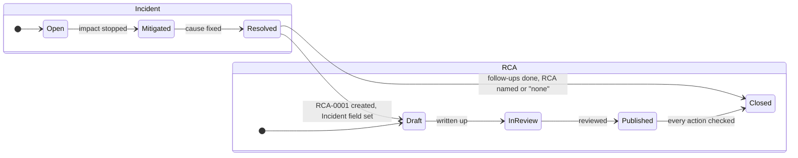
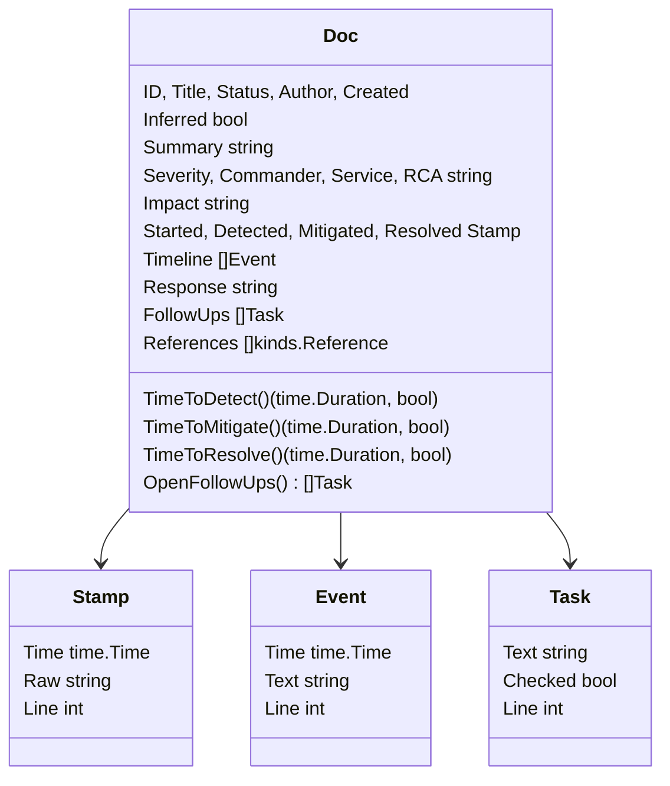
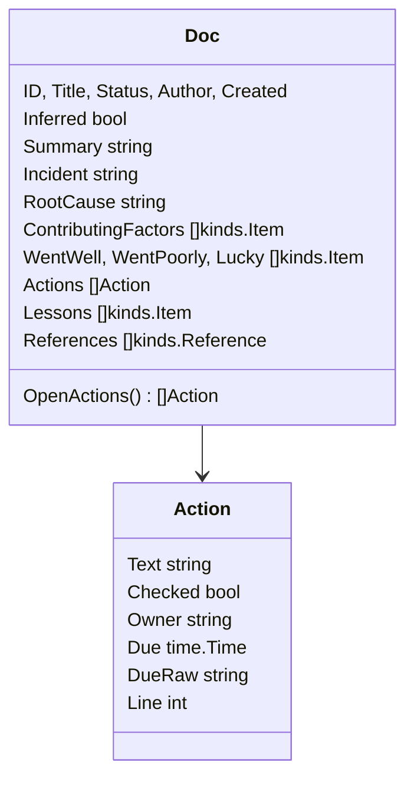

<!-- markdownlint-disable-file MD025 MD041 -->

# DESIGN-0022: Incident and root cause analysis: INC and RCA as built-in document types

<!--toc:start-->
<!-- markdownlint-capture -->
<!-- markdownlint-disable MD013 -->
- [Overview](#overview)
- [Goals and Non-Goals](#goals-and-non-goals)
  - [Goals](#goals)
  - [Non-Goals](#non-goals)
- [Background](#background)
- [Detailed Design](#detailed-design)
  - [1. The registry entries](#1-the-registry-entries)
  - [2. Disabled by default](#2-disabled-by-default)
  - [3. The incident template](#3-the-incident-template)
  - [4. The RCA template](#4-the-rca-template)
  - [5. The kind catalogue](#5-the-kind-catalogue)
  - [6. pkg/incident](#6-pkgincident)
  - [7. pkg/rca](#7-pkgrca)
  - [8. Wiring in cmd/ and the core](#8-wiring-in-cmd-and-the-core)
  - [9. docz-api, docz-site, and the exports](#9-docz-api-docz-site-and-the-exports)
  - [10. Parity](#10-parity)
  - [11. The first real documents](#11-the-first-real-documents)
- [API / Interface Changes](#api--interface-changes)
- [Data Model](#data-model)
- [Testing Strategy](#testing-strategy)
- [Migration / Rollout Plan](#migration--rollout-plan)
- [Open Questions](#open-questions)
  - [1. What are the type names, ID prefixes, and directories?](#1-what-are-the-type-names-id-prefixes-and-directories)
  - [2. Which aliases?](#2-which-aliases)
  - [3. Which incident statuses?](#3-which-incident-statuses)
  - [4. Which RCA statuses?](#4-which-rca-statuses)
  - [5. Does docz know a severity scale?](#5-does-docz-know-a-severity-scale)
  - [6. What is the timestamp form?](#6-what-is-the-timestamp-form)
  - [7. Where do the four stamps live?](#7-where-do-the-four-stamps-live)
  - [8. Does every incident need an RCA?](#8-does-every-incident-need-an-rca)
  - [9. How is an action item's owner and due date written?](#9-how-is-an-action-items-owner-and-due-date-written)
  - [10. What does the rendered incident template report?](#10-what-does-the-rendered-incident-template-report)
  - [11. What is the first real pair?](#11-what-is-the-first-real-pair)
  - [12. One PR or two?](#12-one-pr-or-two)
  - [13. Structured fields and views now, or as follow-ups?](#13-structured-fields-and-views-now-or-as-follow-ups)
- [References](#references)
<!-- markdownlint-restore -->
<!--toc:end-->

<!--docz:overview:start-->
## Overview

Two new built-in document types, following the runbook precedent
(DESIGN-0019, IMPL-0022): **incident** (`INC-0001`), the record of an
outage or degradation written while it happens and closed when the service
is back, and **rca** (`RCA-0001`), the root cause analysis written
afterwards, reviewed, and closed when its action items are done. Both
ship **disabled by default**, each gets a type package (`pkg/incident`,
`pkg/rca`) with the same four files and the same contract as the six that
exist, and the RCA points at its incident rather than repeating it.

The one new grammar is the incident **timeline**: a list whose items open
with a timestamp. Everything else is regions, bold fields, items, and
checkboxes docz already parses.

<!--docz:overview:end-->

## Goals and Non-Goals

<!--docz:goals:start-->
### Goals

- An incident record someone can keep **during** the incident, with a
  timeline that is easy to append to and a status that says where the
  service is.
- A root cause analysis that reads as a review document: the cause, the
  factors, what went well and badly, and action items with owners and due
  dates, each of which the validator can check.
- Both types rigid in the way every built-in is (ADR-0002): a structured
  `Doc` per type, so docz-api and docz-site can show a timeline, a
  time-to-detect, or an open action count without parsing markdown.
- Disabled by default, with the same surfaces and the same enabling story
  as runbook, so a repository that never has incidents sees nothing new.
- A typed edge from an RCA to its incident, and from an incident to its
  RCA, ready for the document graph INV-0028 concluded for.

<!--docz:goals:end-->

<!--docz:non-goals:start-->
### Non-Goals

- **Incident management.** docz records an incident; it does not page,
  open a channel, or track a status page. The record links to those.
- **A severity scale.** Severity is a field the document fills; docz does
  not know what `SEV1` means and does not rank it (Open Question 5).
- **Alerts or dashboards from incidents.** Time-to-detect and the like
  are methods on `incident.Doc`; aggregating them across a repository is
  docz-api's and docz-site's, as follow-ups.
- **Changing what an RFC, ADR, design, IMPL, investigation, or runbook
  is.** The six existing types are untouched. INC and RCA are added
  beside them, after runbook in the registry.
- **A docz-site view per type.** Both render through the generic document
  page on day one, as runbook did, with step-aware views as follow-ups
  (the #144 and #145 pattern).

<!--docz:non-goals:end-->

<!--docz:background:start-->
## Background

docz has six built-in types. Five describe work before and as it happens
(RFC, ADR, design, IMPL, investigation) and one describes work that
repeats (runbook, DESIGN-0019). None describes something that **went
wrong**. An outage today lands in an investigation if anyone writes it
down, and an investigation's shape (question, hypothesis, findings,
conclusion) is the wrong one: an incident has a timeline, not a
hypothesis, and an RCA has action items with owners, not a
recommendation.

The shape of both documents is well established outside docz:

- Google's SRE book gives the postmortem its sections: summary, impact,
  root causes, trigger, resolution, detection, action items, lessons
  learned (what went well, what went wrong, where we got lucky), and a
  timeline.
- PagerDuty's and Atlassian's incident handbooks split the **incident
  record** (live, status-driven, timeline-first) from the **postmortem**
  (after, reviewed, action-driven), which is why this design has two
  types and not one.

What docz already has that these two types reuse:

- **Regions and the kind catalogue** (DESIGN-0015): a type is a template
  with markers, a schema skeleton, and per-kind rules. Adding a type is
  one registry entry, two templates, a schema, catalogue entries, and a
  package (CLAUDE.md, "adding a new doc type").
- **Bold fields** (`**Owner:**`) with folded continuation lines, which
  runbook added for `Service` and `Owner`.
- **Items, tasks, tables, and references** readers in `kinds` and
  `docparse`, including `TaskItems` with byte-accurate lines, so an action
  item can be checked off through `docwrite.SetTaskState`.
- **Disabled by default** (DESIGN-0019 §2), proven on runbook: the block
  in every generated `.docz.yaml`, absent from `EnabledTypes()`, the
  `docz create` error naming the flag, the parity normaliser.
- **The `Triggered by` precedent** for a typed edge: `investigation.Doc`
  reads a bold field whose value names another document, and INV-0028
  concluded that such fields are the graph's typed edges.

The list-with-timestamp timeline was chosen over a table on 2026-10-16
because an incident record is appended to while the incident is live, and
a list item is what a person can type in that state. The RCA points at
the incident, rather than carrying its own timeline and impact, so a fact
is written once.

<!--docz:background:end-->

<!--docz:detailed-design:start-->
## Detailed Design

### 1. The registry entries

Two entries appended to `allDocTypes` in `pkg/doczcore/config/doctype.go`,
after runbook, so `DocTypeNames()` grows at the end and no existing error
string changes.

```go
{
    Name:    "incident",
    Aliases: []string{"inc"},
    DefaultConfig: func() TypeConfig {
        return TypeConfig{
            Enabled:     false,
            Dir:         "incident",
            IDPrefix:    "INC",
            IDWidth:     4,
            Statuses:    []string{"Open", "Mitigated", "Resolved", "Closed"},
            StatusField: "status",
            PluralLabel: "Incidents",
        }
    },
    NavTitle:        "Incidents",
    PluralLabel:     "Incidents",
    TemplateName:    "incident",
    HelpDescription: "Incidents — the record of an outage, kept while it happens",
},
{
    Name:    "rca",
    Aliases: []string{"postmortem"},
    DefaultConfig: func() TypeConfig {
        return TypeConfig{
            Enabled:     false,
            Dir:         "rca",
            IDPrefix:    "RCA",
            IDWidth:     4,
            Statuses:    []string{"Draft", "In Review", "Published", "Closed"},
            StatusField: "status",
            PluralLabel: "RCAs",
        }
    },
    NavTitle:        "RCAs",
    PluralLabel:     "RCAs",
    TemplateName:    "rca",
    HelpDescription: "Root cause analyses — reviewed after an incident, closed when its actions are done",
},
```

Open Questions 1 to 4 settle the names, aliases, and statuses. The
`rca` type's name and prefix both fold to `rca`, which
`validateResolution` allows: one type claiming a token twice is fine, and
only two types claiming it is a collision.

The two lifecycles, and the one edge between them:



### 2. Disabled by default

Everything DESIGN-0019 §2 says of runbook holds for both types, through
the same code paths, with no new mechanism:

| Surface | Disabled (default) | Enabled |
| ------- | ------------------ | ------- |
| `docz init` generated `.docz.yaml` | `incident:` and `rca:` blocks, `enabled: false` | the user flips a flag |
| `docz init` / `docz update` | no directory, no README | `docs/incident/` or `docs/rca/` with its index README |
| `docz create incident` / `inc` / `INC` | error naming `types.incident.enabled: true` | `docs/incident/0001-<slug>.md` |
| `docz create rca` / `postmortem` / `RCA` | error naming `types.rca.enabled: true` | `docs/rca/0001-<slug>.md` |
| `docz list`, `docz validate`, wiki nav, docz-api ingest | absent | present |
| `docz --help` | listed, suffixed `(disabled by default)` | listed |

`TypesHelp()` already appends the suffix from `DefaultConfig().Enabled`,
and `cmd/create.go` already names the flag, so neither changes. The
`docz_yaml.tmpl` preamble says eight types rather than six and gains a
line per type beside runbook's:

```yaml
#   `runbook`, `incident`, and `rca` ship disabled. Set
#   `types.<name>.enabled: true` to scaffold the directory and use
#   `docz create <name>` (aliases: rb, inc, postmortem). A short
#   `incident: {enabled: true}` gets every other field from the defaults,
#   but a `types:` block that lists ONLY the types you add switches the
#   others off: add to this block rather than replacing it.
```

A repository is expected to enable the pair together, but nothing
requires it: an incident with no RCA type enabled simply never names one,
and an RCA whose `**Incident:**` names a type the repository has not
enabled gets `rca.summary.incident-unresolved` (§5) rather than an error.

### 3. The incident template

`pkg/doczcore/doctemplate/templates/incident.md`, prose trimmed. Every
section is a marked region, so a document is marked from birth.

````markdown
# {{ .Prefix }}-{{ .Number }}: {{ .Title }}

<!--toc:start-->
<!--toc:end-->

<!--docz:summary:start-->
## Summary

<!-- What happened, in two or three sentences, for someone who was not
     there. -->

**Severity:** <!-- your scale: SEV2, P1, major … -->

**Commander:** <!-- who ran the response -->

**Service:** <!-- what was affected -->

**RCA:** <!-- RCA-NNNN once written, or "none" if this incident needs
     no analysis -->

<!--docz:summary:end-->

<!--docz:impact:start-->
## Impact

<!-- Who and what was affected, and how badly. -->

**Started:** <!-- YYYY-MM-DD HH:MM UTC, when the impact began -->

**Detected:** <!-- YYYY-MM-DD HH:MM UTC, when someone or something
     noticed -->

**Mitigated:** <!-- YYYY-MM-DD HH:MM UTC, when the impact stopped -->

**Resolved:** <!-- YYYY-MM-DD HH:MM UTC, when the cause was fixed -->

<!--docz:impact:end-->

<!--docz:timeline:start-->
## Timeline

<!-- One item per event, oldest first, each opening with its time.
     Append as it happens; tidy later. -->

- YYYY-MM-DD HH:MM UTC: <!-- the alert fired / the page went out -->
- YYYY-MM-DD HH:MM UTC: <!-- what was tried, and what it showed -->

<!--docz:timeline:end-->

<!--docz:response:start-->
## Response

<!-- What was done to stop the impact and fix the cause, and what was
     communicated to whom. -->

<!--docz:response:end-->

<!--docz:follow-ups:start-->
## Follow-ups

<!-- Immediate items: write the RCA, revert the workaround, tell the
     customer. Long-term action items belong in the RCA. -->

- [ ] <!-- Write RCA-NNNN -->

<!--docz:follow-ups:end-->

<!--docz:references:start-->
## References

<!-- The alert, the dashboard, the chat channel, the PRs, the runbook -->

<!--docz:references:end-->
````

Three rules the template encodes:

- **The four timestamps live in Impact** (Open Question 7), as bold
  fields, in the one shape `YYYY-MM-DD HH:MM UTC` (Open Question 6). The
  reader parses them to `time.Time`, and `Doc` derives the durations
  people ask for from them.
- **The timeline is a list whose items open with a timestamp** (§6). An
  item that does not is still kept, with a zero `Time` and a finding.
- **`**RCA:**` is the forward edge.** It is empty while the incident is
  open, names the RCA once one is written, or says `none` to record that
  the decision not to write one was made (Open Question 8).

### 4. The RCA template

`pkg/doczcore/doctemplate/templates/rca.md`, prose trimmed:

````markdown
# {{ .Prefix }}-{{ .Number }}: {{ .Title }}

<!--toc:start-->
<!--toc:end-->

<!--docz:summary:start-->
## Summary

<!-- The incident in two or three sentences, and the cause in one. -->

**Incident:** <!-- INC-NNNN; the timeline and impact live there -->

<!--docz:summary:end-->

<!--docz:root-cause:start-->
## Root Cause

<!-- The condition that, had it not held, would have prevented the
     incident. One cause; the rest are contributing factors. -->

<!--docz:root-cause:end-->

<!--docz:contributing-factors:start-->
## Contributing Factors

- <!-- what made it worse, slower to find, or slower to fix -->

<!--docz:contributing-factors:end-->

<!--docz:went-well:start-->
## What Went Well

- <!-- what to keep doing -->

<!--docz:went-well:end-->

<!--docz:went-poorly:start-->
## What Went Poorly

- <!-- what to stop doing -->

<!--docz:went-poorly:end-->

<!--docz:lucky:start-->
## Where We Got Lucky

- <!-- what would have made it worse, and did not, by chance -->

<!--docz:lucky:end-->

<!--docz:actions:start-->
## Action Items

<!-- One per line, with an owner and a due date. Check them off here;
     the RCA closes when every one is checked. -->

- [ ] <!-- the change --> (owner: <!-- who -->, due: <!-- YYYY-MM-DD -->)

<!--docz:actions:end-->

<!--docz:lessons:start-->
## Lessons Learned

- <!-- what the organisation now knows that it did not -->

<!--docz:lessons:end-->

<!--docz:references:start-->
## References

<!-- The incident, the PRs that fixed it, the designs the actions
     changed -->

<!--docz:references:end-->
````

Two rules the template encodes:

- **`**Incident:**` is the back edge** and the only place the RCA names
  its incident. The RCA carries no timeline and no impact of its own;
  docz-site can show the incident's beside it (§9).
- **An action item is a checkbox with a trailing `(owner: …, due: …)`**
  (Open Question 9). `docparse.TaskItems` finds the checkbox and its
  line; `rca`'s reader takes the parenthetical off the end. Checking one
  off is `docwrite.SetTaskState` on that line, the same call IMPL tasks
  use, so the IMPL loop's tooling works on RCA actions unchanged.

Both templates carry `<!-- markdownlint-disable-file MD025 MD041 -->`
after their frontmatter, and nothing else: neither repeats a heading, so
neither needs `MD024`. Every line fits MD013's 80 outside fences, pinned
by `TestEmbeddedTemplatesFitMD013`.

The marker skeletons `templates/schema/incident.md` and
`templates/schema/rca.md` are the templates' marker lines and nothing
else, and the derivation test pins each pair equal.

### 5. The kind catalogue

Eleven entries are added to `pkg/doczcore/validate/kindrule.go`. The
count in the file's comment is corrected to match the map.

| Kind | Type | Singleton | Check |
| ---- | ---- | --------- | ----- |
| `impact` | incident | yes | none: prose and bold fields; the timestamp rules are `incident.Validate`'s |
| `timeline` | incident | yes | new `checkTimeline`: `timeline.no-events` (warning) when the region carries no list item |
| `response` | incident | yes | none: prose |
| `follow-ups` | incident | yes | `checkTasks`, the IMPL tasks check, so an unchecked-box shape is enforced the same way |
| `root-cause` | rca | yes | `content.empty` (error) when the region holds only comments and whitespace |
| `contributing-factors` | rca | yes | `checkItems` |
| `went-well` | rca | yes | `checkItems` |
| `went-poorly` | rca | yes | `checkItems` |
| `lucky` | rca | yes | `checkItems` |
| `actions` | rca | yes | `checkTasks` |
| `lessons` | rca | yes | `checkItems` |

`summary` and `references` already exist. Every kind here is generic
enough for a custom type to carry: a `timeline` region in a custom
`postmortem-lite` type gets the same `no-events` check, which is the
point of the catalogue being keyed by kind.

### 6. `pkg/incident`

Four files, `doc.go`, `headings.go`, `parse.go`, `validate.go`, plus a
`timeline.go` for the one grammar, following `pkg/runbook`'s `walk.go`.



**The timeline grammar.** A `timeline` region's list items, through
`docparse.ListItems`, each become an `Event`:

- the item's text up to the first colon followed by a space is the
  timestamp, parsed with the one layout `2006-01-02 15:04 UTC`; what
  follows the colon is `Text`;
- continuation lines fold into `Text`, and nested bullets fold in too,
  because an event is one thing that happened, not a list;
- an item that does not open with a parseable timestamp is kept with a
  zero `Time` and its whole text as `Text`, for `incident.Validate` to
  report;
- `Line` is the item's line, so a consumer can point at it.

**The four stamps** are the `**Started:**`, `**Detected:**`,
`**Mitigated:**`, and `**Resolved:**` fields of the `impact` region,
read through `kinds.Field` with runbook's continuation folding, parsed
with the same layout. A `Stamp` keeps `Raw` so a malformed value is
still visible, and a zero `Time` with an empty `Raw` means the field
was not filled, which is the normal state of an open incident.

**Durations** are methods, not fields: `TimeToDetect` is `Detected`
minus `Started`, `TimeToMitigate` is `Mitigated` minus `Started`,
`TimeToResolve` is `Resolved` minus `Started`, each returning `false`
when either stamp is zero. They are the three numbers every incident
review asks for, and keeping them as methods means a consumer cannot
read a stale one.

`Parse` fails for exactly two things, no frontmatter and CR line
endings, like every type package but `impl`. Everything else leaves a
field zero for `Validate` to report.

**`incident.Validate`**, nine codes beside the generic tier's:

| Code | Severity | When |
| ---- | -------- | ---- |
| `incident.parse` | error | `Parse` rejected the document |
| `incident.summary.no-severity` | warning | `**Severity:**` is empty |
| `incident.summary.no-commander` | warning | `**Commander:**` is empty |
| `incident.impact.bad-stamp` | error | a filled stamp does not parse |
| `incident.impact.out-of-order` | warning | filled stamps are not `Started ≤ Detected ≤ Mitigated ≤ Resolved` |
| `incident.timeline.no-stamp` | error | a timeline item does not open with a timestamp |
| `incident.timeline.out-of-order` | warning | an event is earlier than the one before it |
| `incident.status.no-stamp` | warning | status is Mitigated, Resolved, or Closed and the matching stamp is empty |
| `incident.status.closed-no-rca` | warning | status is Closed and `**RCA:**` is neither an id nor `none` |

**No rule reads the clock**, as runbook's do not: a stamp's shape and
order are checked, never its age. `timeline.no-stamp` reads the item as
written, so the template's `YYYY-MM-DD HH:MM UTC: <!-- … -->` placeholder
is a malformed stamp and the rendered template has that one error, the
way the rendered IMPL template has findings a document must clear. Open
Question 10 asks whether the placeholder should instead be a comment the
reader skips.

### 7. `pkg/rca`

Four files, no walker: every region is prose, items, or checkboxes.



**The action grammar.** Each `docparse.TaskItem` in the `actions` region
becomes an `Action`. If its text ends with a parenthetical, the reader
splits it on commas into `key: value` pairs and takes `owner` and `due`
(folded keys, trimmed values); the parenthetical is removed from `Text`.
`due` parses with `2006-01-02`; a value that does not parse keeps
`DueRaw` for the validator. A task with no parenthetical is an `Action`
with empty `Owner` and zero `Due`, reported, not rejected.

`Incident` is the `**Incident:**` field's value, trimmed. The reader does
not resolve it: whether `INC-0007` exists is the repository tier's
question (`repo.Validate` holds the listing), reported there as
`rca.summary.incident-unresolved`.

**`rca.Validate`**, seven codes:

| Code | Severity | When |
| ---- | -------- | ---- |
| `rca.parse` | error | `Parse` rejected the document |
| `rca.summary.no-incident` | warning | `**Incident:**` is empty |
| `rca.summary.incident-unresolved` | warning | the named id is not a document in the repository (repository tier) |
| `rca.root-cause.empty` | error | the region holds no prose |
| `rca.action.no-owner` | warning | an action has no `owner` |
| `rca.action.bad-due` | error | an action's `due` does not parse |
| `rca.status.closed-open-actions` | warning | status is Closed and an action is unchecked |

### 8. Wiring in `cmd/` and the core

- `cmd/validate.go`'s `typeValidator` gains `case "incident"` and
  `case "rca"`, arms seven and eight of the only type-name switch in the
  repository. `rca.summary.incident-unresolved` is composed there too,
  because it needs the listing `repo.Validate` returns and `pkg/rca` may
  not import `repo` (R2).
- `pkg/doczcore/layer_test.go` adds `/pkg/incident` and `/pkg/rca` to the
  packages the core may not import.
- `test/consumer` gains one inline fixture per package, which makes
  twenty `pkg/` packages, and the consumer `go.sum` must not grow.
- `index_incident.md` and `index_rca.md` join the embedded index headers,
  so a repository's README for each type says what the type is for
  before its table, as runbook's does.
- `lint-generated` enables both types in its scaffold beside runbook, so
  the rendered templates and their READMEs are linted on every run.

### 9. docz-api, docz-site, and the exports

No per-type code in either, the runbook path:

- **docz-api** ingests `docs/incident/` and `docs/rca/` the moment a
  repository enables them, stores the registry aliases on the `doc_types`
  row (`typeAliases` in the mapper), and resolves `/inc/` and
  `/postmortem/` from the row. Nothing in the API knows a timeline from
  a paragraph until the follow-up that serves `incident.Doc`'s fields
  (Open Question 13).
- **docz-site** renders both through the generic document page.
  `xrefs.ts` already links `INC-0001` and `RCA-0001` tokens once the
  types exist, so the two edges are clickable on day one.
- **Confluence export** writes both types by default. INV-0022's rule
  leaves out `impl` alone, and an incident record is exactly the document
  people outside the repository want to read.
- **The document graph** (INV-0028) reads `**Incident:**` and `**RCA:**`
  as typed edges, `rca → incident` and `incident → rca`, the way it reads
  `**Triggered by:**`.

### 10. Parity

Adding two disabled types changes the same two v1.2.2 outputs runbook
did: the generated `.docz.yaml` gains two type blocks and two nav titles,
and `docz config` gains the nav titles. The `runbook` normaliser in
`test/parity` is generalised to **`disabled-types`**: it drops the block
and nav title of every built-in whose default is disabled, read from the
registry, so a ninth disabled type needs no new normaliser. It runs on
both sides, as `runbook` did. The goldens stay v1.2.2 captures.

### 11. The first real documents

No fleet of incidents exists to snapshot, so each package's corpus is
hand-written fixtures plus one real pair from this repository's own
history (Open Question 11). The candidate is the chart publish failure
during the v2 betas: `ghcr.yml` pushed `charts/docz` and failed
`403 write_package` because the GHCR package had no Actions access grant
for the repository. It has a timeline (the tag, the failed job, the
grant, the re-run), a clear root cause, a contributing factor (each
package needs its own grant and nothing says so until the first 403),
and an action item that was in fact done (the CLAUDE.md note). Writing
it as `INC-0001` and `RCA-0001` dogfoods both templates and both readers
on a document whose facts can be checked against the Actions log.

<!--docz:detailed-design:end-->

<!--docz:api-changes:start-->
## API / Interface Changes

**New public packages**, stable from the release that ships them
(ADR-0002 Decision 7 no longer applies: nothing is experimental after
v2.0.0):

- `pkg/incident`: `Doc`, `Stamp`, `Event`, `Task`, `Parse`, `Validate`,
  `Headings`, and the `Code*` constants.
- `pkg/rca`: `Doc`, `Action`, `Parse`, `Validate`, `Headings`, and the
  `Code*` constants.

**Additive changes to existing packages:**

- `pkg/doczcore/config`: two registry entries; `DocTypeNames()` returns
  eight names; `DefaultConfig().Types` has eight keys; `DefaultNavTitles()`
  gains `incident: Incidents` and `rca: RCAs`.
- `pkg/doczcore/doctemplate`: two body templates, two index headers, and
  two schemas, all resolvable through the existing functions.
- `pkg/doczcore/validate`: eleven catalogue kinds and one new generic
  code, `timeline.no-events`.
- `pkg/doczcore/kinds`: no change. `Field`, `Items`, `References`, and
  `docparse.TaskItems`/`ListItems` cover every shape.

**CLI:** `docz create incident|inc`, `docz create rca|postmortem`, and
every command that takes a type accepts the new names. No new flags.

**Config:** two `types:` blocks in the generated `.docz.yaml`, disabled.
No new keys.

**docz-api:** no spec change. The two types arrive as `doc_types` rows.
Structured fields are a later, additive spec bump (Open Question 13).

<!--docz:api-changes:end-->

<!--docz:data-model:start-->
## Data Model

No storage changes anywhere. docz holds no state beyond the documents.
docz-api's `doc_types` and `documents` tables already model a type as a
row and a document as its raw markdown plus frontmatter, and the Confluence
tables key on property keys that already carry any type's id prefix.

The one data shape worth pinning is the timestamp. Every stamp and every
timeline event is written as `YYYY-MM-DD HH:MM UTC`, parsed with Go's
`2006-01-02 15:04 UTC` layout, and held as a `time.Time` in UTC. Minutes
are the resolution: an incident record is kept by a person, not a
logger, and seconds would be invented precision.

<!--docz:data-model:end-->

<!--docz:testing:start-->
## Testing Strategy

The same suite every type package carries, plus the timeline grammar's
own cases:

- **Goldens** under `pkg/incident/testdata/` and `pkg/rca/testdata/`:
  each fixture as `.orig.md` (unmarked) and a generated marked `.md`,
  with `.golden.txt` fact files regenerated with `-update`. The corpus is
  the first real pair (§11), the rendered templates, and hand-written
  edge cases: an open incident with every stamp empty, a timeline with
  one unstamped item and one out of order, an RCA with an action missing
  its owner and one with a bad due date, a Closed RCA with an open action.
- **The inference invariant**: parsing each `.orig.md` through the
  heading table yields the same facts as its marked sibling in every
  field but `Inferred` and the line numbers markers shift.
- **`FuzzParse`** per package: never panics, and `Parse` fails only for
  the two documented reasons.
- **Derivation tests**: each template and its schema yield the same
  `validate.Schema`; each `headings` table equals
  `kinds.SpecFromTemplate` over its template.
- **Rendered-template validation**: `docz validate` over a freshly
  created incident and RCA reports warnings only, or the one placeholder
  error Open Question 10 decides.
- **Write-through**: `docwrite.SetTaskState` on an `Action.Line` flips
  that action and nothing else, pinned by a golden, the IMPL proof
  repeated for the new grammar.
- **Parity**: `just parity` passes with the generalised `disabled-types`
  normaliser; the three existing revert drills still bite.
- **Consumer**: `just test-consumer` parses an inline incident and an
  inline RCA from outside the module.
- **Lint**: `just lint-generated` with both types enabled in the
  scaffold; `TestEmbeddedTemplatesFitMD013`.
- **Layer rules**: `TestLayerRules_*` with the two packages added.
- **docz-api**: the existing e2e onboard test gains a fixture repository
  with both types enabled, proving they ingest, list, and resolve by
  alias with no server change.

<!--docz:testing:end-->

<!--docz:rollout:start-->
## Migration / Rollout Plan

1. This design is reviewed and its open questions resolved.
2. One IMPL is drafted, its phases built on `feat/incident-rca-types` as
   one PR (Open Question 12), labelled `minor`:
   - registry, templates, schemas, index headers, catalogue;
   - `pkg/incident`, with the timeline grammar;
   - `pkg/rca`, with the action grammar;
   - cmd, parity, consumer, lint-generated, layer rules;
   - docs: CLAUDE.md, READMEs, the config preamble;
   - the first real pair, `INC-0001` and `RCA-0001`, in this repository.
3. The merge cuts v2.1.0 by label; `release.yml` publishes the images
   and the chart.

Existing repositories need nothing. Their `.docz.yaml` is never
rewritten, so they see no new block until they add one. Enabling follows
DESIGN-0019's rule exactly: a repository with a `types:` block adds
`incident: {enabled: true}` and `rca: {enabled: true}` to it, and one
without must list every type it wants or copy the generated block. Then
`docz update` creates the directories and READMEs. docz-api must be on
v2.1.0 before a repository enables either type with a short block.

**Follow-ups**, filed as issues when the IMPL is drafted:

- Incident fields served by docz-api beside the body (severity,
  commander, the four stamps, the three durations, open follow-ups) and
  RCA fields (incident, open actions), the #145 pattern.
- A timeline view in docz-site, with the incident's impact shown on its
  RCA's page through the `**Incident:**` edge, the #144 pattern.
- An ADR per type (#146) for incident and rca, with this design as the
  source.

Rollback: revert the PR. No stored data depends on either type, because
docz-api ingests them only for repositories that enabled them.

<!--docz:rollout:end-->

<!--docz:open-questions:start-->
## Open Questions

### 1. What are the type names, ID prefixes, and directories?

- **a. `incident` with prefix `INC` and directory `incident`; `rca` with
  prefix `RCA` and directory `rca`.** The name is the word people say and
  the prefix is the id they type. *(recommendation)*
- b. `inc` as the type name too, matching the prefix, as `rfc` and `adr`
  do.
- c. `postmortem` as the type name, with prefix `PM`.
- d. Other.

### 2. Which aliases?

- **a. `inc` for incident, `postmortem` for rca.** Both are what people
  already call them; `postmortem` reads better than `pm` and collides
  with nothing. *(recommendation)*
- b. `inc` only; rca is short enough.
- c. `inc` and `pm`.
- d. Other.

### 3. Which incident statuses?

- **a. Open, Mitigated, Resolved, Closed.** Mitigated is the impact
  stopping, Resolved the cause being fixed, Closed the follow-ups done
  and the RCA named or declined. Each maps to a stamp the validator can
  ask for. *(recommendation)*
- b. Open, Resolved, Closed: fewer states, and no distinction between a
  workaround and a fix.
- c. Investigating, Identified, Monitoring, Resolved: the status-page
  vocabulary. It describes the response, not the record, and has no
  "closed".
- d. Other.

### 4. Which RCA statuses?

- **a. Draft, In Review, Published, Closed.** Published is the reviewed
  document; Closed is every action item checked, which the validator can
  see. *(recommendation)*
- b. Draft, Published: actions are tracked elsewhere.
- c. Draft, In Review, Accepted, Actions Complete: ADR-like wording.
- d. Other.

### 5. Does docz know a severity scale?

- **a. No. `**Severity:**` is any non-empty token; the validator checks
  presence only.** Every organisation has its own scale and docz should
  not pick one. *(recommendation)*
- b. `SEV1` to `SEV4` baked in and validated.
- c. A configurable list under `types.incident.severities` in
  `.docz.yaml`, validated like statuses.
- d. Other.

### 6. What is the timestamp form?

- **a. `YYYY-MM-DD HH:MM UTC`, nothing else.** One layout, one zone, so
  two incidents compare and a reader never guesses an offset. It is what
  postmortems already do. *(recommendation)*
- b. UTC or a `±HH:MM` offset, normalised to UTC by the reader.
- c. RFC 3339 (`2026-10-16T03:12:00Z`): exact, but not what a person
  types during an incident.
- d. Other.

### 7. Where do the four stamps live?

- **a. Bold fields in the Impact region.** They read as part of the
  impact statement, and `kinds.Field` already parses the shape.
  *(recommendation)*
- b. A table in its own `stamps` region.
- c. Frontmatter keys: typed, but a new frontmatter shape for one type,
  and frontmatter is the one surface every consumer parses with one
  struct.
- d. Other.

### 8. Does every incident need an RCA?

- **a. No. A Closed incident whose `**RCA:**` is empty gets a warning;
  `none` is an answer, and names the decision.** *(recommendation)*
- b. Yes: Closed with no RCA id is an error.
- c. Never checked; the field is informational.
- d. Other.

### 9. How is an action item's owner and due date written?

- **a. A checkbox with a trailing `(owner: name, due: YYYY-MM-DD)`.** The
  checkbox is what `SetTaskState` flips and what the IMPL loop already
  handles; the parenthetical is the one addition. *(recommendation)*
- b. A table with Action, Owner, Due, and Done columns: easier to scan,
  but not a checkbox, so nothing existing checks it off.
- c. Plain checkboxes, with owner and due in prose and nothing parsed.
- d. Other.

### 10. What does the rendered incident template report?

- **a. One `incident.timeline.no-stamp` error, from the
  `YYYY-MM-DD HH:MM UTC:` placeholder item, which the first real event
  replaces.** It is honest: an incident with no event is not a record.
  *(recommendation)*
- b. Warnings only, by making the placeholder a comment the reader skips
  and adding `timeline.no-events` as the warning instead.
- c. Other.

### 11. What is the first real pair?

- **a. `INC-0001` and `RCA-0001` for the GHCR `403 write_package` chart
  publish failure during the v2 betas, reconstructed from the Actions
  log.** A real timeline, a real cause, and an action item that was done.
  *(recommendation)*
- b. Hand-written fixtures only; the first real incident is whatever
  happens next.
- c. docz-api's invisible ingest failures (INV-0007), which had a
  timeline and an RCA in all but name.
- d. Other.

### 12. One PR or two?

- **a. One IMPL and one PR for both types, labelled `minor`, cutting
  v2.1.0.** The two share the registry, parity, and lint changes, and the
  RCA's edge needs the incident type to exist. *(recommendation)*
- b. Two PRs, incident first, so each type is reviewable alone.
- c. Other.

### 13. Structured fields and views now, or as follow-ups?

- **a. Follow-ups, filed as issues when the IMPL is drafted, the
  runbook precedent (#144, #145).** Both types are useful through the
  generic page on day one. *(recommendation)*
- b. In this design: the spec bump for `incident` and `rca` fields and
  the docz-site timeline view ship with the types.
- c. Other.

<!--docz:open-questions:end-->

<!--docz:references:start-->
## References

- [DESIGN-0019](0019-runbook-a-sixth-built-in-document-type-disabled-by-default.md):
  runbook, the precedent for a disabled-by-default built-in and for a
  type package with one new grammar
- [DESIGN-0015](0015-structured-regions-and-docz-validate.md): regions,
  schemas, and the kind catalogue
- [ADR-0002](../adr/0002-docz-is-an-api-package-whose-first-consumer-is-the-cli.md):
  every built-in is a structured type
- [INV-0022](../investigation/0022-leaving-impl-documents-out-of-the-confluence-export-by-default.md):
  which types the Confluence export writes
- [INV-0028](../investigation/0028-a-document-graph-from-the-references-docz-already-parses.md):
  bold fields naming a document as typed graph edges
- Issues [#144](https://github.com/donaldgifford/docz/issues/144),
  [#145](https://github.com/donaldgifford/docz/issues/145), and
  [#146](https://github.com/donaldgifford/docz/issues/146): the runbook
  follow-up pattern this design repeats
- [`pkg/runbook`](../../pkg/runbook/): the four files and the walker
- [Google SRE, "Postmortem Culture"](https://sre.google/sre-book/postmortem-culture/)
  and its [example postmortem](https://sre.google/sre-book/example-postmortem/)
- [PagerDuty incident response: postmortems](https://response.pagerduty.com/after/post_mortem_process/)
- [Atlassian incident handbook](https://www.atlassian.com/incident-management/handbook)

<!--docz:references:end-->
