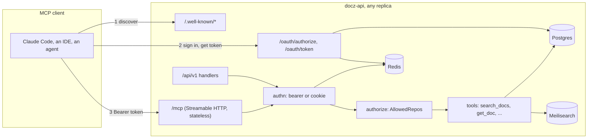
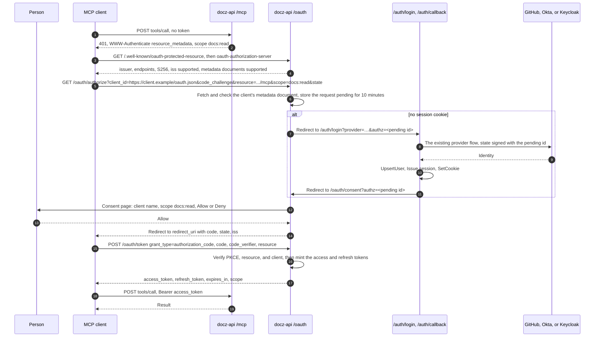
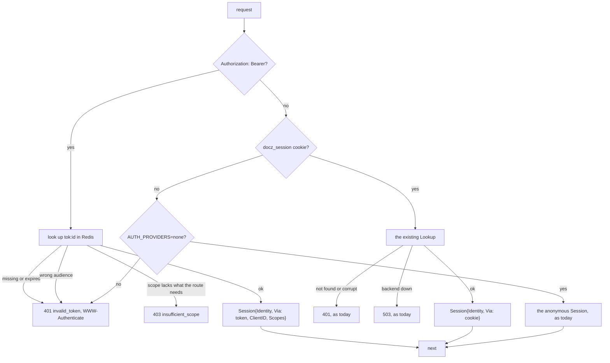
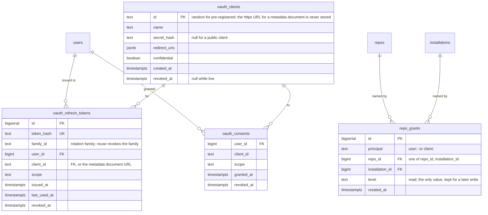

<!-- markdownlint-disable-file MD025 MD041 -->

# DESIGN-0023: A read-only MCP server in docz-api: OAuth 2.1 tokens, tools, and resources

<!--toc:start-->
<!-- markdownlint-capture -->
<!-- markdownlint-disable MD013 -->
- [Overview](#overview)
- [Goals and Non-Goals](#goals-and-non-goals)
  - [Goals](#goals)
  - [Non-Goals](#non-goals)
- [Background](#background)
- [Detailed Design](#detailed-design)
  - [1. Shape](#1-shape)
  - [2. The endpoint](#2-the-endpoint)
  - [3. Tools](#3-tools)
  - [4. Typed fields](#4-typed-fields)
  - [5. The authorization server](#5-the-authorization-server)
    - [The authorization code flow](#the-authorization-code-flow)
    - [Client credentials](#client-credentials)
    - [What a client sees per grant](#what-a-client-sees-per-grant)
  - [6. One authentication middleware](#6-one-authentication-middleware)
  - [7. Authorization](#7-authorization)
  - [8. Observability, limits, and audit](#8-observability-limits-and-audit)
  - [9. Security](#9-security)
- [API / Interface Changes](#api--interface-changes)
- [Data Model](#data-model)
- [Testing Strategy](#testing-strategy)
- [Migration / Rollout Plan](#migration--rollout-plan)
- [Open Questions](#open-questions)
  - [1. Which protocol revisions does /mcp speak?](#1-which-protocol-revisions-does-mcp-speak)
  - [2. What is an access token?](#2-what-is-an-access-token)
  - [3. Who serves the consent page and the provider chooser?](#3-who-serves-the-consent-page-and-the-provider-chooser)
  - [4. What does /mcp do under AUTH_PROVIDERS=none?](#4-what-does-mcp-do-under-auth_providersnone)
  - [5. How are repository grants written, and what is the default?](#5-how-are-repository-grants-written-and-what-is-the-default)
  - [6. Are there personal access tokens?](#6-are-there-personal-access-tokens)
  - [7. What does resources/list return?](#7-what-does-resourceslist-return)
  - [8. Is get_impl_progress a separate tool?](#8-is-get_impl_progress-a-separate-tool)
  - [9. What goes in api/openapi.yaml?](#9-what-goes-in-apiopenapiyaml)
  - [10. Is MCP on or off by default?](#10-is-mcp-on-or-off-by-default)
  - [11. Where does the rate limiter keep its buckets?](#11-where-does-the-rate-limiter-keep-its-buckets)
  - [12. What happens to INV-0024?](#12-what-happens-to-inv-0024)
  - [13. Where does the code live?](#13-where-does-the-code-live)
  - [14. What are the token lifetimes?](#14-what-are-the-token-lifetimes)
- [References](#references)
<!-- markdownlint-restore -->
<!--toc:end-->

<!--docz:overview:start-->
## Overview

docz-api gains a Model Context Protocol (MCP) server at `/mcp`, in the same
binary and process as the REST API, speaking the stateless 2026-07-28
revision over Streamable HTTP through the official Go SDK. It is
**read-only as its whole scope**, not as a first phase: the tools answer
the questions an agent asks about a fleet's documentation (search, list,
read one document with its typed fields, read a plan's progress), and
nothing a caller can send changes a repository, a page, or the server.

Three things have to exist for that endpoint to be usable by an MCP client,
and this design covers all three:

1. **An authorization server.** A GitHub-login deployment has no OAuth
   server an MCP client could use, so docz-api becomes one: it delegates
   the login to the providers it already has (GitHub, Okta, Keycloak),
   issues short-lived access tokens bound to `/mcp`, rotating refresh
   tokens, and client credentials for unattended callers, and publishes the
   metadata documents the MCP authorization section requires.
2. **One authentication middleware.** `/api/v1` and `/mcp` accept a bearer
   token or the session cookie through the same middleware, so docz-site is
   unchanged, scripts get tokens, and there is one place that decides who
   a request is from.
3. **Authorization that is no longer allow-all.** Every principal, a
   person or a client, maps to a set of repositories through a grants
   table with a server-wide default. The REST handlers already read that
   set from the context; the MCP tools read the same one.

The tools return document text as data an agent should treat as untrusted,
every call is rate limited per principal and logged with its principal, and
the whole surface is behind one flag, off by default, so an existing
deployment is unchanged until an operator turns it on.

<!--docz:overview:end-->

## Goals and Non-Goals

<!--docz:goals:start-->
### Goals

- An MCP client (Claude Code, Claude Desktop, an IDE, an agent framework)
  can connect to `<docz-api>/mcp` with no configuration beyond the URL,
  discover the server, sign in through the deployment's existing login,
  and read documentation.
- The 2026-07-28 revision only: no sessions, no `initialize`, any replica
  answers any call, and the `Mcp-Method` and `Mcp-Name` headers feed the
  request logger, the rate limiter, and the metrics without reading bodies.
- A small tool set shaped for agents, not a mirror of the REST routes, with
  typed fields from `pkg/{rfc,adr,design,impl,investigation,runbook}` so an
  agent gets `phases[2].tasks[0].checked` and not a bag of markdown.
- docz-api as an OAuth 2.1 authorization server for its own resource:
  authorization code with PKCE, rotating refresh tokens, client
  credentials, Client ID Metadata Documents and pre-registered clients,
  `iss` in authorization responses, RFC 9728 and RFC 8414 metadata.
- One `authn` middleware for cookie and bearer, one `authorize` seam for
  REST and MCP, and a grants table that replaces `AllReposAuthorizer`.
- Audit, rate limits, metrics, and traces on every tool call, with the
  `traceparent` in `_meta` joining MCP calls to the traces docz-api emits.
- Everything behind `MCP_ENABLED`, off by default, with the chart and
  RUNBOOK covering how to turn it on and how to register a client.

<!--docz:goals:end-->

<!--docz:non-goals:start-->
### Non-Goals

- **Write tools of any kind**: no `set_status`, `check_task`,
  `create_doc`, no PR opening, no Confluence writes. docz-api stays
  read-only (INV-0023, INV-0025, and INV-0026 are won't-do), so the
  `docs:write` and `impl:run` scopes INV-0024 sketched do not exist, and
  there is no MRTR confirmation flow because nothing needs confirming.
- **The Tasks extension and Temporal.** There is no long-running operation
  to hand back a task handle for.
- **`subscriptions/listen`.** Change notifications are deferred; a client
  re-reads. The lists carry `ttlMs` so a client caches them sensibly.
- **Dynamic Client Registration** (RFC 7591). Deprecated in 2026-07-28, and
  docz-api is a new authorization server with no older clients to carry.
- **An identity provider.** docz-api never holds a password. It
  authenticates people only by delegating to GitHub, Okta, or Keycloak, as
  the site login does today.
- **A separate MCP service** calling `/api/v1`, and a stdio server each
  person runs with a long-lived token (INV-0024 question 1).
- **Prompts** (`prompts/list`) in the first release. Nothing asks for them,
  and the tool descriptions carry what an agent needs.
- **Per-document authorization.** Grants are per repository, as the REST
  API's existence hiding is today.

<!--docz:non-goals:end-->

<!--docz:background:start-->
## Background

[INV-0024] asked what an MCP server for docz-api should look like under the
2026-07-28 revision and how it should authenticate. It concluded
"inconclusive, direction clear": in-process at `/mcp`, docz-api as its own
authorization server, read-only tools first, and the authorization model
as the real work. Its eight questions were each recommended one way; this
design takes those recommendations as its starting point and resolves what
the investigation left open. Two of its threads are dropped here, by a
decision taken after it was written: the write tools and the IMPL run
handle depended on INV-0023's Temporal control plane and write access,
and docz-api stays read-only, so this design's scope is the read tools
with nothing deferred behind them.

**What the protocol asks for** (INV-0024 Observation 1). The 2026-07-28
revision removed sessions and the `initialize` handshake. Every request
carries its protocol version and the client's capabilities in `_meta`; a
server answers `server/discover` with its versions, capabilities, and
identity; `tools/list` and `resources/list` are the same for every caller
and carry `ttlMs` and `cacheScope`; Streamable HTTP requests carry
`Mcp-Method` and `Mcp-Name` headers. For HTTP transports the server is an
OAuth 2.1 resource server: it publishes Protected Resource Metadata (RFC
9728), answers an unauthenticated call with `401` and a `WWW-Authenticate`
header naming that document, and accepts only tokens issued for it as the
audience. Clients use PKCE and RFC 8707 `resource`, and register through
Client ID Metadata Documents or pre-registration. Client credentials for
unattended callers are the `ext-auth` extension's.

**What the SDK supports**, checked 2026-10-17. The official Go SDK,
`github.com/modelcontextprotocol/go-sdk`, ships 2026-07-28 support from
v1.7.0 and is at v1.8.0. Its Streamable HTTP handler serves the new
revision when `StreamableHTTPOptions.Stateless` is set, in which mode `GET`
and `DELETE` return `405`, no session id is consulted, and a server-to-
client request is refused. `ServerOptions.SupportedProtocolVersions`
narrows what the server advertises, and `ServerOptions.SetCacheable` sets
the per-request cache control the lists carry. It validates the
`Mcp-Method` and `Mcp-Name` headers against the body for 2026-07-28
requests, and bounds every decoding path. INV-0024 question 6's worry, that
the SDK might lag the revision, has not come to pass.

**What docz-api has** today, which this design extends rather than
replaces:

| Package | What it does | What changes |
| ------- | ------------ | ------------ |
| `internal/auth` | `Provider{Name, AuthCodeURL, Exchange}` returning an `Identity{Provider, Subject, Email, Login, Groups}`; GitHub OAuth, OIDC for Okta and Keycloak; a signed `state` with a 5-minute TTL | The `state` payload gains a pending-authorization id, so a login started by `/oauth/authorize` returns to it |
| `internal/authhttp` | `/auth/login`, `/auth/callback`, `/api/v1/auth/session`, `/api/v1/auth/logout` | The callback finishes a pending authorization when the state names one |
| `internal/session` | Opaque Redis sessions, the `docz_session` cookie, `Middleware`, `AnonymousMiddleware`, `FromContext` | `Middleware` becomes the cookie half of `authn`; `Session` gains `Via` and the token's client |
| `internal/authorize` | `AllowedRepos` in the context; `AllReposAuthorizer` returns every repository | A grants-backed `Authorizer`; the interface and `FromContext` are unchanged |
| `internal/httpapi` | The REST handlers over a `storeReader` and a `Searcher`; existence hiding through `AllowedRepos` | Unchanged; the MCP tools call the same `storeReader` and `Searcher` |
| `internal/config` | Env-only, one `ErrInvalidConfig` listing every problem | `MCPConfig` and `OAuthConfig` |
| `cmd/docz-api` | `runServer` composes the gate `authn ∘ authorize.Middleware` | Mounts the well-known documents, the token endpoints, and `/mcp` when enabled |

The server has no rate limiter today. `golang.org/x/time` is already an
indirect dependency and `rate.Limiter` is enough for a per-principal bucket.

**Document text is untrusted** (INV-0021, INV-0024 Observation 6). A
document is written by anyone with push access, and a page under the
`api:` block by anyone who can edit a markdown file in the repository. An
agent reading them through MCP can be prompt-injected by their content.
With no write tools the damage is bounded to what the agent does elsewhere
with what it read, but the server still returns text as data and never as
instructions, and never follows a link a document carries.

<!--docz:background:end-->

<!--docz:detailed-design:start-->
## Detailed Design

### 1. Shape

The work is in six places. Nothing in `pkg/` changes: the type packages
already return the typed fields, and the library never learns that MCP
exists.

| Where | What changes |
| ----- | ------------ |
| `internal/mcp` (new) | The server: tool and resource registration over the Go SDK, the result shapes, the `docz://` resource template, the typed-field switch (§3, §4) |
| `internal/oauth` (new) | The authorization server: metadata documents, `/oauth/authorize`, `/oauth/token`, `/oauth/revoke`, the consent page, client resolution, token issue and lookup (§5) |
| `internal/auth`, `internal/authhttp` | The signed `state` carries a pending authorization id; the callback finishes it (§5) |
| `internal/session` | `Session` gains `Via` and `ClientID`; `authn` resolves a bearer token or the cookie into one (§6) |
| `internal/authorize` | `GrantAuthorizer` over `repo_grants` and a default policy; `AllReposAuthorizer` becomes the `all` policy (§7) |
| `internal/store` | `oauth_clients`, `oauth_refresh_tokens`, `repo_grants`; Redis keys for access tokens, pending authorizations, and codes (Data Model) |
| `internal/telemetry` | MCP metrics, the tool name on the span, the audit line (§8) |
| `internal/config`, `cmd/docz-api` | `MCP_*` and `OAUTH_*`; wiring behind `MCP_ENABLED` (§5, §9, Rollout) |
| `api/openapi.yaml` | The `bearerToken` security scheme on `/api/v1`; the OAuth endpoints (API changes) |
| `charts/docz` | `api.mcp.*` values, the signing material, an alert (Rollout) |

How a call reaches the data:



Layering is unchanged. `internal/mcp` imports the type packages under
`pkg/`, `internal/store`, `internal/search`, and `internal/authorize`,
exactly as `internal/httpapi` does; `internal/oauth` imports `auth`,
`session`, and `store`. Nothing under `pkg/` imports either.

### 2. The endpoint

`/mcp` is one route on the root router, mounted by `runServer` only when
`MCP_ENABLED` is true. It is the Go SDK's `StreamableHTTPHandler` with
`Stateless: true`, wrapped in the same `authn` and `authorize` middleware
as `/api/v1` (§6, §7) and in a per-principal rate limiter (§8). The SDK's
server is built once per process with:

- `SupportedProtocolVersions` narrowed to `2026-07-28` (question 1). A
  client on 2025-11-25 gets the SDK's `UnsupportedProtocolVersionError`
  naming the version the server speaks, which is what the revision asks
  for; there is no stateful fallback to keep working.
- `Implementation{Name: "docz-api", Version: <build version>}`, which is
  what `server/discover` reports as the server's identity.
- `SetCacheable` on the list results with a `ttlMs` of one hour: the tool
  set and the resource templates are fixed at build time, so a client may
  cache them for the process's lifetime, and an hour is long enough to
  matter and short enough that a deploy is picked up.

In stateless mode `GET /mcp` and `DELETE /mcp` are `405`, which is the
SDK's behaviour and the right one: there is no stream to open and no
session to end. The handler validates the `Mcp-Method` and `Mcp-Name`
headers against the body, so by the time a request reaches a tool the
request logger has already recorded the tool's name from the header.

An unauthenticated `POST /mcp` is answered before the SDK sees it:

```http
HTTP/1.1 401 Unauthorized
WWW-Authenticate: Bearer resource_metadata="https://docz.example/.well-known/oauth-protected-resource", scope="docs:read"
```

A token that is valid but lacks `docs:read` gets `403` with
`error="insufficient_scope"` and the same `scope`. Both are the resource
server's side of the MCP authorization section, and both are produced by
the `authn` middleware (§6), not by MCP code, so `/api/v1` answers a bad
bearer the same way.

### 3. Tools

Six tools, each `readOnlyHint: true`, `idempotentHint: true`, and
`openWorldHint: false`. Every argument that names a repository takes
`owner/name`; every one that names a type takes the token the REST API
takes, resolved by the same `resolveType` over the repository's
`doc_types` row (name, prefix, or alias, folded). Every result has a
`structuredContent` object whose schema is the tool's `outputSchema`, and
one `text` block the client can show, so a client that reads only text
still gets the answer.

| Tool | Arguments | Returns | REST it stands on |
| ---- | --------- | ------- | ----------------- |
| `list_repos` | none | `repos[]{repo, default_branch, docs_dir, last_synced_sha, types[]{name, id_prefix, plural_label, statuses}}` | `GET /repos`, `GET /repos/{o}/{n}/types` folded into one call |
| `list_docs` | `repo`, optional `type`, `status` | `docs[]{repo, doc_id, type, title, status, author, created, path, updated_at}` | `GET …/types/{type}/docs` across every type when `type` is omitted |
| `get_doc` | `repo`, `id` (the frontmatter id, `IMPL-0018`; the type is derived from the prefix as `repo.Find` does) | the document summary, `markdown`, `confluence_url`, and `fields` (§4) | `GET …/docs/{doc_id}` plus the typed parse |
| `search_docs` | `query`, optional `repo`, `type`, `status`, `author`, `source`, `limit` | `hits[]{source, repo, doc_id, type, title, path, status, snippet}` and `facets` | `GET /search` with the caller's `AllowedRepos` |
| `get_impl_progress` | `repo`, `id` | `objective`, `phases[]{index, token, title, done, total, tasks[]{id, text, checked, deferred, verify}}`, `open_questions[]{number, text, resolved}` | `get_doc` for an IMPL, with the counts an agent would otherwise compute |
| `get_page` | `repo`, `path` (`index`, `changelog`, or a published page path) | `title`, `markdown`, `git_sha` | `GET …/index`, `…/changelog`, `…/pages/{path}` |

`get_impl_progress` is `get_doc` with the counts folded in and the markdown
left out (question 8). It exists because "how far along is IMPL-0018" is
the question an agent asks most, and answering it from `get_doc` costs the
whole document's text in the context window for a number.

What a tool does not do:

- It never returns a repository the caller's `AllowedRepos` does not
  contain. A `repo` argument outside the set is `NotFound`, the REST API's
  existence hiding, so a tool call cannot be used to enumerate.
- It never follows a link. A document's references are returned as the
  paths and ids the document wrote, not fetched.
- It never returns `raw_md` for more than one document per call. `list_docs`
  and `search_docs` return summaries and snippets; the full text is one
  `get_doc` or `get_page` at a time, which is both the context-window
  budget and the rate limiter's unit.
- It never writes. There is no tool with a side effect, so `destructiveHint`
  is never set and MRTR is never used.

Errors are the SDK's tool errors with `isError: true` and a message in the
REST API's wording: `repo not found`, `document not found`, `type not
found`, `search unavailable`. A tool never returns a store error's text.

### 4. Typed fields

`get_doc.fields` is the type package's `Doc` for the document's type,
serialised as JSON, under a `kind` that names which shape it is:

| Type | `fields.kind` | From | What an agent gets |
| ---- | ------------- | ---- | ------------------ |
| rfc | `rfc` | `rfc.Parse` | summary, motivation, proposal, alternatives, risks with mitigations, open questions |
| adr | `adr` | `adr.Parse` | context, decision, consequences (positive, negative, neutral), alternatives, superseded-by |
| design | `design` | `design.Parse` | goals, non-goals, decisions, open questions, references |
| impl | `impl` | `impl.Parse` | objective, phases with tasks (`id`, `text`, `checked`, `verify`, `deferred`), open questions, decisions |
| investigation | `investigation` | `investigation.Parse` | question, hypothesis, findings, conclusion with verdict, recommendation |
| runbook | `runbook` | `runbook.Parse` | overview (service, owner, alert), procedures with steps and commands, scenarios, last verified |
| custom, or a parse failure | `generic` | `docparse.Headings` and `kinds.ResolveRegions` | headings with lines, and the regions the document carries |

The switch on the type's canonical name is the same five-arm switch (six
with runbook) `cmd/validate.go` carries, and for the same reason: `repo`
and the core may not import a type package (DESIGN-0014 R2), so the server
is where the name picks the parser. A custom type whose documents carry a
built-in's regions parses with the built-in's package only when the type
is the built-in; a custom type is `generic`, which is still every heading
and every marked region.

`Parse` fails for exactly two things, no frontmatter and CR line endings,
and `pkg/impl` for a plan with no phases. A document that fails to parse
is still returned: `markdown` is complete, `fields.kind` is `generic`, and
`fields.parse_error` carries the message, because an agent asked for the
document and a half-written one is the normal state of a document.

Resources are the same documents by URI: `docz://<owner>/<name>/<type>/<id>`,
served by `resources/read` with the markdown as `text/markdown` and the
typed fields as a second `application/json` content, so a client can attach
a document as context without a tool call. `resources/list` returns **one
resource template** per enabled built-in type and one generic template,
not the documents (question 7): the revision requires lists to be the same
for every caller, and the set of documents a caller may see is not. A
client that wants the list calls `list_docs`, which is per-principal by
construction. `resources/templates/list` carries the same `ttlMs` as the
tools.

### 5. The authorization server

docz-api publishes two metadata documents and serves three endpoints. All
of them are mounted on the root router, outside both gates, when
`MCP_ENABLED` is true and `AUTH_PROVIDERS` is not `none` (question 4).

| Route | What it is |
| ----- | ---------- |
| `GET /.well-known/oauth-protected-resource` | RFC 9728: `resource` = `<OAUTH_ISSUER>/mcp`, `authorization_servers` = `[<OAUTH_ISSUER>]`, `scopes_supported` = `["docs:read"]`, `bearer_methods_supported` = `["header"]` |
| `GET /.well-known/oauth-authorization-server` | RFC 8414: `issuer`, the three endpoints, `grant_types_supported` = `authorization_code`, `refresh_token`, `client_credentials`; `code_challenge_methods_supported` = `["S256"]`; `authorization_response_iss_parameter_supported` = true; `client_id_metadata_document_supported` = true; `token_endpoint_auth_methods_supported` = `none`, `client_secret_basic`, `client_secret_post` |
| `GET /oauth/authorize` | The authorization request: validate, store it pending, send the person through the login, then the consent page, then redirect with a code |
| `POST /oauth/token` | The three grants; returns an access token, its lifetime, the scope, and a refresh token for the code and refresh grants |
| `POST /oauth/revoke` | RFC 7009: revokes a refresh token and its family, or an access token |

`OAUTH_ISSUER` is the server's public base URL, `https://docz.example`,
and is required when MCP is enabled. It is the `iss` in every
authorization response, the audience every access token is bound to, and
the prefix of the PRM's `resource`. `AUTH_REDIRECT_BASE` already carries
the same value for the site login; `OAUTH_ISSUER` defaults to it and is
separate only so a deployment that serves the two on different hosts can
say so.

#### The authorization code flow



Each step's rules:

- **Validation before anything is stored.** `response_type=code`,
  `code_challenge` with `S256` only, `resource` equal to the PRM's
  `resource` (a request for any other audience is refused with
  `invalid_target`), `scope` a subset of `docs:read` (empty means all of
  it), `redirect_uri` exactly one of the client's registered URIs, and
  `state` present. A failure that happens before the `redirect_uri` is
  trusted is shown on an error page; after, it is returned to the client as
  an OAuth error redirect with `iss`.
- **The client.** `client_id` is either an `https` URL, resolved as a
  Client ID Metadata Document, or an id from `oauth_clients`
  (pre-registered). A metadata document is fetched with a 5-second timeout,
  a 64 KiB cap, no redirects, `https` only, and a resolver that refuses
  loopback, link-local, and private address ranges (the SSRF guard an
  authorization server fetching URLs needs); its `client_id` must equal the
  URL it was fetched from, and its `redirect_uris` are the only ones
  accepted. It is cached in Redis for its `Cache-Control` max-age, at most
  one hour, so a client's second authorization costs no fetch. A document
  that fails any check is `invalid_client`.
- **The login.** The existing `/auth/login` is reused as it is, with one
  addition: the signed `state` payload carries the pending authorization
  id, and `/auth/callback` reads it after `Issue` and `SetCookie` and
  redirects to the consent page instead of `/`. A person already holding a
  session cookie skips the login. With several providers enabled the
  consent page is preceded by a provider chooser, a list of links to
  `/auth/login?provider=…`, the same page docz-site shows (question 3).
- **The consent page** is one HTML page docz-api serves itself (question
  3), naming the client (`client_name` from its metadata document, or the
  registered name), the scope in words ("read the documentation of the
  repositories you can see"), and two buttons. Consent is remembered per
  `(user, client)` in `oauth_consents` so a refresh that has expired can be
  renewed without the page, and revoked from `/api/v1/auth/session`'s
  future "connected clients" list (deferred). The page sets no cookie of
  its own: the pending id is in the query and the person is identified by
  their session cookie, and the form posts with a CSRF token tied to the
  pending id.
- **The code** is a 32-byte random value in Redis for 60 seconds, single
  use, holding the pending request and the user id. Redeeming it twice
  revokes every token it issued, as OAuth 2.1 requires.
- **The tokens.** An access token is an opaque 32-byte random id, stored in
  Redis as `tok:<id>` with the principal, the client, the scope, the
  audience, and an expiry of `OAUTH_ACCESS_TTL` (default 1 hour), the same
  shape as a session (question 2). A refresh token is opaque too, stored
  **hashed** in Postgres `oauth_refresh_tokens` with a family id, rotated on
  every use, and expiring after `OAUTH_REFRESH_TTL` (default 30 days) of
  disuse; presenting a rotated-out token revokes its whole family, the
  reuse detection OAuth 2.1 asks for. Nothing is a JWT, so there is no
  signing key to manage and no token that outlives its revocation.
- **`iss`** is on every authorization response, success or error (RFC
  9207), and the metadata says so.

#### Client credentials

An unattended caller, an agent that runs on a schedule or a CI job that
reads documentation, is a pre-registered client with a secret and the
`client_credentials` grant:

```http
POST /oauth/token
Authorization: Basic base64(client_id:client_secret)
Content-Type: application/x-www-form-urlencoded

grant_type=client_credentials&scope=docs:read&resource=https://docz.example/mcp
```

The principal is the client itself (`client:<id>`), the token is an access
token with no refresh token (the client asks again), and the client's
repositories come from `repo_grants` like a person's (§7). The secret is
generated by the server, shown once, and stored hashed. Pre-registration is
an admin operation with no HTTP surface in this design: `docz-api
-oauth-client-add <name> --redirect-uri … [--confidential]` beside
`-onboard` and `-export`, printing the id and, for a confidential client,
the secret once. The same flag with `--revoke` disables a client and its
tokens.

#### What a client sees per grant

| Grant | Who | Authenticates with | Gets | Repositories |
| ----- | --- | ------------------ | ---- | ------------ |
| `authorization_code` + PKCE | a person through an MCP client | login via the existing provider, consent | access 1 h, refresh 30 d rotating | the person's grants |
| `refresh_token` | the same client later | the refresh token | a new pair; the old refresh token is dead | the person's grants at redeem time |
| `client_credentials` | an unattended client | `client_secret_basic` or `_post` | access 1 h, no refresh | the client's grants |

### 6. One authentication middleware

`authn` today is a chooser between `session.Middleware` and
`AnonymousMiddleware`. It becomes one middleware that resolves a request
to a `Session` from whichever credential it carries:



The rules that matter:

- **Bearer wins when present.** A request carrying both is judged by the
  token, so a script that sends a token from a browser profile that also
  has a cookie behaves as the token says. A bearer header that is malformed
  or names a token the store does not have is `401`, never a fall-through
  to the cookie.
- **The `WWW-Authenticate` challenge** is on every `401` from `authn`,
  cookie or bearer, naming the PRM and the route's scope, because the MCP
  client that gets it is the one that needs it and a browser ignores it.
  docz-site's login UI keys off the status alone, so it is unchanged.
- **`Session.Via`** is `cookie`, `token`, or `anonymous`, and
  `Session.ClientID` names the OAuth client a token was issued to. Both are
  on the audit line (§8); neither changes what a handler may do, because
  the scope is checked here and the repositories in `authorize`.
- **`session.FromContext`** is unchanged in signature and every REST
  handler keeps working: a token caller reads `/api/v1/auth/session` and
  sees the identity the token acts for, with `via: "token"` added to the
  response (an additive spec change).
- **Scopes.** `docs:read` is the only scope and every route under `/api/v1`
  and `/mcp` needs it, so today the check is "the token has the scope". It
  is still checked, so a second scope can be added without touching the
  routes that do not need it.
- **`AUTH_PROVIDERS=none`** keeps its meaning: with no login there is no
  one to issue a token to, the authorization server is not mounted, and
  `/mcp`, like `/api/v1`, answers the anonymous principal (question 4). The
  chart and both READMEs already state that exposure.

`/api/v1` accepting bearer tokens is INV-0024 question 4's answer and
costs nothing beyond this middleware: the same token a client uses for
`/mcp` works in `curl`, and a person who wants a token for a script gets
one by connecting any MCP client once and copying it, or by registering a
client with credentials.

### 7. Authorization

`authorize.Middleware` and `AllowedRepos` stay. What changes is the
`Authorizer` behind them: `GrantAuthorizer` replaces `AllReposAuthorizer`
and reads the principal from the `Session` the `authn` middleware put in
the context.

A principal is a string key: `user:<provider>:<subject>` for a person, and
`client:<id>` for a client-credentials client. The `repo_grants` table maps
a principal to a repository or to an installation (every repository under
it, now and later), and `AUTHZ_DEFAULT` says what a principal with no
grants may see:

| `AUTHZ_DEFAULT` | A principal with no grant row sees | For |
| --------------- | ---------------------------------- | --- |
| `all` (default) | every repository, which is today's behaviour | a single-tenant deployment: a homelab, one team, one GitHub account's installations |
| `none` | nothing | a deployment serving more than one audience, where every principal is granted in |

A principal with grant rows sees exactly those repositories under either
policy. `AUTHZ_ADMINS` is a comma-separated list of principal keys that see
everything regardless, so the operator can never lock themselves out of a
`none` deployment.

Grants are written by the operator: `docz-api -grant <principal>
<owner/name | installation:<id>>` and `-revoke-grant`, beside the client
flag, with no HTTP surface in this design (question 5). The GitHub rule
INV-0024 question 8 sketched, deriving grants from installation
repositories, is kept as one automatic row: a person whose GitHub `login`
equals an installation's `account_login` (a user-owned installation) is
granted that installation. Organisation membership is not looked up; a
deployment that wants it writes installation grants per person, or sets
`all`. That is the smallest rule that is correct, and the one place a
later design can add membership without changing the table.

The `Allowed` call is one query per request, cached in the process for
`AUTHZ_CACHE_TTL` (default 30 seconds) per principal, so a grant change is
live within that window and a burst of tool calls does not hit Postgres per
call. The REST handlers and the tools consume the result the same way, so
authorization is decided in one place, as INV-0024 Observation 5 asked.

### 8. Observability, limits, and audit

Every tool call is one request, so the existing HTTP middleware already
logs and meters it; what is added is the tool's name and the principal.

- **Metrics**: `docz_api_mcp_calls_total{tool,status}` and
  `docz_api_mcp_call_duration_seconds{tool}` beside the HTTP RED metrics,
  and `docz_api_oauth_tokens_total{grant,status}` for the token endpoint.
  The `tool` label is the `Mcp-Name` header's value when `Mcp-Method` is
  `tools/call`, else the method, so cardinality is the tool set.
- **Traces**: the request span is named by the route, `POST /mcp`, and a
  child span `mcp.<method>` carries the tool name. The `traceparent` in the
  request's `_meta` is extracted as the parent when the HTTP headers carry
  none, so an agent's trace continues into the server.
- **Audit**: one slog line at Info per tool call, `mcp call`, with
  `principal`, `via`, `client_id`, `tool`, `repo`, `doc_id`, `status`, and
  `duration`, and never the arguments' free text (a search query is a
  person's words) or any document text. The token endpoint logs `oauth
  token` with `grant`, `client_id`, `principal`, and `status`. The token
  itself appears in no log, no error, and no span attribute; the
  `config.Secret` discipline applies to it.
- **Rate limits**: a token bucket per principal, `MCP_RATE_LIMIT` calls
  per minute (default 120) with a burst of the same, applied to `/mcp` and
  to `/api/v1` for token callers alike; the cookie path is not limited,
  because docz-site is one page load of many calls and today has none. A
  limited call is `429` with `Retry-After`. The limiter is in-process per
  replica, so the effective limit is the configured one times the replica
  count; that is stated in the chart's values, and a shared limiter in
  Redis is a follow-up if it is ever needed (question 11).
- **Readiness**: nothing is added to `/readyz`. The token store is Redis,
  already probed; a Postgres outage already fails it.

### 9. Security

- **The resource server rules**: only tokens whose audience is
  `<OAUTH_ISSUER>/mcp` are accepted, a token is never forwarded anywhere,
  the challenge names the PRM, and `insufficient_scope` names every scope
  in one challenge.
- **The authorization server rules**: PKCE `S256` on every code request,
  exact `redirect_uri` matching, `resource` required and checked, `iss` on
  every response, single-use codes with reuse revoking what they issued,
  rotating refresh tokens with family revocation, client secrets and
  refresh tokens stored hashed, access tokens opaque and in Redis with a
  TTL, no DCR, no implicit grant, no password grant.
- **Fetching client metadata documents** is the one outbound request an
  attacker can direct: the resolver refuses non-public addresses, redirects
  are not followed, the body is capped, the scheme is `https`, and the
  document is validated before it is cached.
- **Origin**: `/mcp` sends no CORS headers, the same as `/api/v1`, and
  `POST` with a `Bearer` header is not a simple request, so a page on
  another origin cannot make one. The consent form checks its CSRF token,
  and the `SameSite=Lax` session cookie already covers the login redirect.
- **Untrusted text**: tool results carry document text as data in
  `structuredContent` and in a text block, and each tool's description says
  the text is authored by the repository's committers and is not an
  instruction. The server never acts on anything a document says because
  it has nothing to act with.
- **Enumeration**: a repository outside `AllowedRepos` is `not found`,
  not `forbidden`, on every tool and resource, as on REST.
- **The flag**: with `MCP_ENABLED` unset, none of the new routes exist,
  `authn` has no token store to consult and so no bearer path, and the
  only change an existing deployment sees is the migration adding empty
  tables.

<!--docz:detailed-design:end-->

<!--docz:api-changes:start-->
## API / Interface Changes

**New HTTP routes**, all on the root router, present only when
`MCP_ENABLED` is true:

| Route | Gate | Contract |
| ----- | ---- | -------- |
| `POST /mcp` | `authn` (bearer or cookie), `authorize`, the rate limiter | MCP 2026-07-28; `GET` and `DELETE` are `405` |
| `GET /.well-known/oauth-protected-resource` | none | RFC 9728 |
| `GET /.well-known/oauth-authorization-server` | none | RFC 8414 |
| `GET /oauth/authorize` | none (the login is inside it) | OAuth 2.1 authorization endpoint |
| `GET`, `POST /oauth/consent` | the session cookie | the consent page and its form |
| `POST /oauth/token` | client authentication per grant | OAuth 2.1 token endpoint |
| `POST /oauth/revoke` | client authentication | RFC 7009 |

The well-known and `/oauth/*` routes are absent when `AUTH_PROVIDERS` is
`none`; `/mcp` is still mounted and serves the anonymous principal.

**Changed routes**:

- Every `/api/v1` route accepts `Authorization: Bearer <token>` as well as
  the cookie. A `401` from any of them now carries `WWW-Authenticate`.
- `GET /api/v1/auth/session` gains `via` (`cookie`, `token`, `anonymous`)
  and, for a token, `client_id`. Both additive.

**`api/openapi.yaml`** goes to `1.7.0` (minor, additive): a `bearerToken`
security scheme (`type: http`, `scheme: bearer`) is added beside
`sessionCookie` and every `/api/v1` operation lists both; the two fields
above are added to `SessionResponse`; the `/oauth/token` and
`/oauth/revoke` endpoints and the two well-known documents are specced,
because a script author reads the spec to learn how to get a token
(question 9). `/mcp` is **not** in the OpenAPI document: its contract is
the MCP specification's, and `server/discover` plus `tools/list` describe
the tools to the one kind of client that calls it. The `api/README.md`
gains a "Tokens" section. docz-site regenerates its client and needs no
change beyond that.

**Tool contract.** The tool names, argument schemas, output schemas, and
annotations in §3 are a public contract from the first release, versioned
with the binary and listed in the CHANGELOG under `mcp`. A tool is renamed
by adding the new name and keeping the old one for a release.

**Configuration** (`internal/config`, env-only, every problem in one
`ErrInvalidConfig`):

| Variable | Default | Meaning |
| -------- | ------- | ------- |
| `MCP_ENABLED` | `false` | mounts `/mcp` and the authorization server |
| `MCP_RATE_LIMIT` | `120` | tool calls per minute per principal, per replica |
| `OAUTH_ISSUER` | `AUTH_REDIRECT_BASE` | the public base URL: the `iss`, the audience's prefix, the PRM's `resource` |
| `OAUTH_ACCESS_TTL` | `1h` | access token lifetime |
| `OAUTH_REFRESH_TTL` | `720h` | refresh token lifetime from last use |
| `AUTHZ_DEFAULT` | `all` | what a principal with no grant sees: `all` or `none` |
| `AUTHZ_ADMINS` | empty | principal keys that see every repository |
| `AUTHZ_CACHE_TTL` | `30s` | how long a principal's allowed set is held in process |

`OAUTH_ISSUER` must be `https` with a host and no path or query, as the
site validates `sync.confluence.site`. When `MCP_ENABLED` is true and
`AUTH_PROVIDERS` is not `none`, `OAUTH_ISSUER` is required and
`SESSION_SECRET`, already required, signs the consent form's CSRF token.

**Admin flags** on the binary, beside `-migrate`, `-onboard`, and
`-export`: `-oauth-client-add`, `-oauth-client-revoke`, `-grant`,
`-revoke-grant`, each printing what it did and exiting. They connect to
Postgres and need nothing else running.

<!--docz:api-changes:end-->

<!--docz:data-model:start-->
## Data Model

One migration, `add_oauth`, adds four tables. Nothing existing changes;
`users` is the principal table for people and is referenced by id.



Notes on the shape:

- `oauth_clients.id` for a Client ID Metadata Document client is the URL
  itself, and such clients are **not** rows: the document is the
  registration, fetched and cached (Redis `cimd:<sha256(url)>`). Only
  pre-registered clients, which have secrets and operator-chosen names,
  are stored. `client_id` columns elsewhere hold either.
- `oauth_consents` has a unique key on `(user_id, client_id)`; consent is
  for the full `docs:read` scope, and a wider scope later would be a new
  consent.
- `repo_grants` has a check constraint that exactly one of `repo_id` and
  `installation_id` is set, and a unique key over
  `(principal, repo_id, installation_id)`. `level` is `read` and is the
  one column that anticipates a decision this design does not make: it
  costs nothing now and spares a migration if a write level ever exists.
- Deleting an installation (`DeleteInstallation`, CASCADE) deletes its
  grants; deleting a repository deletes its grants; deleting a user is not
  something docz-api does.

**Redis keys**, beside `sess:<id>`:

| Key | Value | TTL |
| --- | ----- | --- |
| `tok:<id>` | `{principal, user_id, client_id, scope, aud, issued_at}` | `OAUTH_ACCESS_TTL` |
| `authz:<id>` | the validated authorization request plus the user id once known | 10 minutes |
| `code:<id>` | the pending id, the user id, the PKCE challenge; deleted on first redeem | 60 seconds |
| `cimd:<sha256(url)>` | the validated metadata document | its `max-age`, at most 1 hour |

sqlc generates the queries as for every other table: `UpsertOAuthClient`,
`GetOAuthClient`, `RevokeOAuthClient`, `InsertRefreshToken`,
`RotateRefreshToken` (one statement: mark the old row used and insert the
new), `RevokeRefreshFamily`, `UpsertConsent`, `GetConsent`, `InsertGrant`,
`DeleteGrant`, `ListAllowedRepoIDs(principal)` (the union of direct and
installation grants, one query).

<!--docz:data-model:end-->

<!--docz:testing:start-->
## Testing Strategy

The standard-library `testing` package only, as the rest of `internal/`.

**Unit, `internal/oauth`.** Table tests over the authorization request
validator (every refusal in §5 by name), the PKCE check, the metadata
document fetcher against an `httptest` server (the size cap, the redirect
refusal, the private-address refusal through an injected resolver, the
`client_id` mismatch), token issue and lookup against `miniredis` or the
same Redis testcontainer the session tests use, refresh rotation and
family revocation, and code single-use. The two metadata documents are
golden JSON.

**Unit, `internal/mcp`.** The Go SDK's in-memory transport connects a
client to the server with no HTTP: `server/discover` reports the version
and identity, `tools/list` is the six tools with the annotations in §3,
and each tool is called against the fake `storeReader` and `Searcher`
`internal/httpapi` already has. `get_doc.fields` is pinned against the
type packages' own golden corpora: for each `.md` under
`pkg/<type>/testdata`, the tool's `fields` equals `Parse`'s result
marshalled, so the tool can never disagree with the library. The `generic`
fallback is tested with a custom type and with a document that fails to
parse.

**Unit, `authn` and `authorize`.** The flowchart in §6 as a table, one row
per edge, over a fake token lookup and a fake session lookup; the three
policies of §7 against a fake grant reader; the cache's TTL.

**Contract.** `openapi_contract_test.go` gains the `bearerToken` round
trips (every read route with a token, a bad token's `401` and its
challenge, `insufficient_scope`), the token endpoint's three grants, and
the well-known documents. `/mcp` is covered by its own conformance test:
the SDK's Streamable HTTP client against the full `runServer` stack with
in-package fakes, so the headers, the `401` challenge, the `405`s, and a
tool call through real middleware are all exercised. The `Mcp-Name`
metric label and the audit line are asserted from a captured slog handler.

**Integration** (`//go:build integration`, real Postgres and Redis through
testcontainers). The full code flow with a fake provider: `/oauth/authorize`
→ `/auth/login` → the fake's callback → consent → code → token → a tool
call that returns a document from a reconciled repository; a `none`
deployment where the same call needs no token; a `AUTHZ_DEFAULT=none`
deployment where the call is `not found` until a grant is written; refresh
reuse revoking the family; `DeleteInstallation` cascading a grant.

**Live.** The first release is checked by hand with two real clients,
recorded in the RUNBOOK: Claude Code (`claude mcp add --transport http
docz https://…/mcp`), which exercises the code flow with a metadata
document, and `curl` with a client-credentials token against `/api/v1` and
`/mcp`.

**What is not tested here**: the provider logins themselves, which the
existing suites cover and this design does not change.

<!--docz:testing:end-->

<!--docz:rollout:start-->
## Migration / Rollout Plan

1. **Library and SDK.** Add `github.com/modelcontextprotocol/go-sdk` as a
   direct dependency (promoted through the require block, never a bare
   `go mod tidy`); confirm `v1.8.0` or later builds under `go 1.26.9`.
   `layer_test.go`'s allow-list is untouched because nothing under `pkg/`
   imports it.
2. **Migration and config.** `add_oauth`; `MCPConfig`, `OAuthConfig`,
   `AuthzConfig` in `internal/config` with their validation; the admin
   flags. A deployment that upgrades gets the tables and nothing else.
3. **`authn` and `authorize`.** The one middleware and the grant
   authorizer, with `AUTHZ_DEFAULT=all` so every existing deployment
   behaves as before. This step ships on its own and is observable: the
   `via` field on the session response.
4. **The authorization server.** `internal/oauth`, the well-known
   documents, the three endpoints, the consent page, behind `MCP_ENABLED`.
5. **The MCP server.** `internal/mcp`, `/mcp`, the tools, the resources,
   the metrics and audit line.
6. **Chart `charts/docz`.** `api.mcp.enabled` (default `false`),
   `api.mcp.issuer` (defaulting to the API's external URL when an ingress
   or route is set), `api.mcp.rateLimit`, `api.authz.default`,
   `api.authz.admins`; each rendered only while `enabled`. One alert,
   `DoczAPIOAuthTokenFailures` (a sustained rate of `status="error"` on
   `docz_api_oauth_tokens_total`), in the PrometheusRule and in
   `contrib/prometheus/alerts.yaml`. The chart's unit tests cover the
   values rendering nothing while disabled.
7. **RUNBOOK-0004, "Enable MCP on docz-api"**: set the issuer, turn the
   flag on, add a client, grant a principal, connect Claude Code, read the
   metrics, and the two failure modes an operator will meet (a metadata
   document the server refuses, a principal who sees nothing under
   `none`). RUNBOOK-0003's shape.
8. **The homelab deployment** turns it on first, with `AUTHZ_DEFAULT=all`
   and GitHub login, and the live check in Testing is run there before the
   release note says the feature exists.
9. **Release.** A `minor`: the spec goes to `1.7.0`, the CHANGELOG carries
   the tool contract, and INV-0024 is marked Concluded pointing here
   (question 12).

Nothing here is a breaking change for an existing deployment: `/api/v1`
keeps the cookie, the session response gains fields, and every new route
is behind a flag that defaults off. Rolling back is turning the flag off;
the tables stay and are empty or inert.

<!--docz:rollout:end-->

<!--docz:open-questions:start-->
## Open Questions

### 1. Which protocol revisions does `/mcp` speak?

- a. **`2026-07-28` only, stateless.** *(recommendation)* The SDK's
  `SupportedProtocolVersions` narrows to it; a 2025-11-25 client gets the
  typed `UnsupportedProtocolVersionError` naming the version and can tell
  its user. There is no session store to run, no sticky routing, and no
  second code path to test. Every Tier 1 SDK and the major clients speak
  the revision as of this design's date.
- b. Both revisions: a stateless handler for 2026-07-28 and the SDK's
  stateful one, with sessions, for 2025-11-25 clients. Wider
  compatibility for a few months, at the cost of session state in Redis,
  replica affinity or a shared session store, and two conformance tests.
- c. Other.

### 2. What is an access token?

- a. **An opaque random id in Redis, the shape of a session.**
  *(recommendation)* One lookup per request, which Redis already serves
  for every cookie request; revocation is a delete; no signing key, no JWT
  library on the request path, and nothing to rotate. The audience is a
  field in the record.
- b. A signed JWT (`ES256`, a key the operator supplies or the server
  generates and stores), verified locally with no store hit, as INV-0024
  question 2 sketched. Faster per call and self-describing, but
  revocation needs a denylist in Redis anyway, the key needs managing and
  rotating, and an audience-bound JWT buys nothing over an opaque token
  when the issuer and the resource are one process.
- c. Other.

### 3. Who serves the consent page and the provider chooser?

- a. **docz-api, as one minimal HTML page each, embedded.**
  *(recommendation)* An authorization server has to be usable without the
  site: an MCP client is pointed at the API's URL, and a deployment may
  run docz-api alone. The pages are a client name, a sentence, two
  buttons, and a list of providers, with no script. docz-site's look is
  not matched, and that is acceptable for a page seen once per client.
- b. docz-site serves them at `/oauth/consent`, calling a JSON endpoint on
  the API, so the page matches the site. The API then needs the site's
  URL to redirect to, a deployment without the site has no MCP, and the
  consent decision crosses an origin.
- c. No consent page: a pre-registered client is trusted and a metadata
  document client is shown consent. Fewer clicks for docz's own tooling;
  but "a pre-registered client" is an operator's decision and consent is
  the person's, and OAuth 2.1 expects the person to be asked.
- d. Other.

### 4. What does `/mcp` do under `AUTH_PROVIDERS=none`?

- a. **It serves the anonymous principal with no token, as `/api/v1` does,
  and the authorization server is not mounted.** *(recommendation)* `none`
  already means "anyone who can reach the Service reads everything", the
  chart and both READMEs say so, and an MCP client on the same network
  gets the same. There is nobody to issue a token to.
- b. `/mcp` requires a token even under `none`, issued only by client
  credentials. Unattended callers get a credential without a login; but a
  person's MCP client cannot connect at all, which is the main use.
- c. `/mcp` is not mounted under `none`; `MCP_ENABLED` with `none` is a
  config error. The simplest rule, and it makes the first-setup mode
  unable to try the feature.
- d. Other.

### 5. How are repository grants written, and what is the default?

- a. **A `repo_grants` table written by admin flags on the binary,
  `AUTHZ_DEFAULT=all` by default, `AUTHZ_ADMINS` as the lock-out guard,
  and one automatic rule: a GitHub login that owns a user installation is
  granted it.** *(recommendation)* Every existing deployment keeps its
  behaviour; a multi-audience one flips to `none` and grants people in.
  No HTTP surface, so nothing new is exposed and nothing new needs
  authorization of its own.
- b. As (a), plus organisation membership looked up at login through the
  GitHub OAuth token (`read:org`), stored as `Identity.Groups`, and an
  installation whose account is an organisation granted to its members.
  Closer to "what you can see on GitHub", at the cost of a wider OAuth
  scope on the login, a lookup per login, and a rule for Okta and Keycloak
  users who have no GitHub identity.
- c. `AUTHZ_DEFAULT=none` by default. Safer for a new multi-tenant
  deployment, and a breaking change for every existing one on upgrade.
- d. An HTTP admin API for grants and clients, behind an admin scope, so
  docz-site can grow a settings page. More surface to design and secure
  before the first release; the flags can be wrapped by an API later.
- e. Other.

### 6. Are there personal access tokens?

- a. **No.** *(recommendation)* A person who wants a token for a script
  connects an MCP client once (the refresh token keeps it alive) or asks
  the operator for a client-credentials client. A PAT is a long-lived
  secret in a dotfile, which is what the OAuth flow exists to avoid, and
  it would be a third token kind with its own table and lifecycle.
- b. Yes: `/api/v1/auth/tokens` lets a signed-in person mint a named,
  expiring token bound to their grants, and list and revoke them. The
  familiar GitHub shape, useful for `curl`, and a second place tokens are
  made.
- c. Other.

### 7. What does `resources/list` return?

- a. **Resource templates only: one `docz://{owner}/{name}/{type}/{id}`
  template per built-in type and one generic, with `list_docs` as the way
  to enumerate.** *(recommendation)* The revision requires list results to
  be the same for every caller and cacheable; the set of documents a
  caller may read is per-principal and changes on every ingest. Templates
  are the one honest answer, and `resources/read` still serves any
  document by URI.
- b. Every document the caller may read, with `cacheScope` marking the
  list private. Clients can browse without a tool call; the list is
  thousands of entries across a fleet, is built per call, and is exactly
  the per-caller list the revision moved away from.
- c. No resources at all; tools only. Simplest, and a client cannot attach
  a document as context by URI.
- d. Other.

### 8. Is `get_impl_progress` a separate tool?

- a. **Yes, beside `get_doc`.** *(recommendation)* Progress is the one
  question asked often enough to deserve an answer without the document's
  text in the context window, and the counts (done, total, deferred per
  phase) are derived once in the server rather than by every agent.
- b. No: `get_doc` with `include_markdown: false` returns the typed fields
  alone, and the agent counts. One tool fewer, and every agent computes
  the same sums.
- c. Other.

### 9. What goes in `api/openapi.yaml`?

- a. **The `bearerToken` scheme on every `/api/v1` operation, the two
  session fields, the token and revoke endpoints, and the two well-known
  documents; `/mcp` stays out.** *(recommendation)* A script author
  learns how to get and use a token from the spec; the MCP contract is
  described by the protocol itself.
- b. Only the `bearerToken` scheme and the session fields; the OAuth
  endpoints are documented in `api/README.md` prose. A smaller spec change,
  and the token endpoint is the thing a script author needs most.
- c. Also `/mcp` as an operation with a free-form JSON-RPC body. It lets
  the contract test exercise the route, and says nothing useful about it.
- d. Other.

### 10. Is MCP on or off by default?

- a. **Off: `MCP_ENABLED=false`, and `api.mcp.enabled: false` in the
  chart.** *(recommendation)* Turning it on needs an issuer, a client, and
  a decision about grants, which an operator should make on purpose. An
  existing deployment upgrades with no new route.
- b. On whenever `OAUTH_ISSUER` can be derived, so a deployment with a
  login already has MCP. Fewer steps, and a new public endpoint appears
  on upgrade.
- c. Other.

### 11. Where does the rate limiter keep its buckets?

- a. **In process, per replica, with the documented multiplier.**
  *(recommendation)* `x/time/rate` is already a dependency, the limit is a
  guard against a runaway agent rather than a quota, and the chart's
  replica count is small. No Redis round trip per call.
- b. In Redis, shared across replicas, so the configured number is the
  effective one. Exact, and a `INCR` per call on the request path, plus a
  new failure mode when Redis is slow.
- c. Other.

### 12. What happens to INV-0024?

- a. **Marked Concluded, its conclusion rewritten to point here, with a
  note that its write tools, MRTR confirmation, Tasks handle, and Temporal
  references were dropped when docz-api was decided read-only.**
  *(recommendation)* The investigation stays as the record of the
  protocol reading; the design is the record of what is built.
- b. Left open until the first release ships, then concluded with the live
  result.
- c. Other.

### 13. Where does the code live?

- a. **Two new packages, `internal/mcp` and `internal/oauth`, with the
  middleware changes in `session` and `authorize`.** *(recommendation)*
  Each is one concern with one consumer, `runServer`; neither imports the
  other.
- b. One package, `internal/mcp`, holding the authorization server too.
  Fewer packages, and the OAuth code is useful to `/api/v1` with no MCP in
  the picture, which (a) makes visible.
- c. Other.

### 14. What are the token lifetimes?

- a. **Access 1 hour, refresh 30 days from last use, codes 60 seconds,
  pending authorizations 10 minutes.** *(recommendation)* The access
  lifetime bounds a leaked token; 30 days matches `SESSION_TTL`'s default,
  so an MCP client and a browser tab go stale together.
- b. Access 15 minutes, refresh 7 days. Tighter, with a refresh every
  quarter hour on a long agent session and a weekly re-login.
- c. Other.

<!--docz:open-questions:end-->

<!--docz:references:start-->
## References

- [INV-0024](../investigation/0024-an-mcp-server-for-docz-api-with-oauth-and-token-auth.md):
  the protocol reading and the eight recommendations this design starts
  from
- [INV-0021](../investigation/0021-confluence-comments-as-a-view-layer-kept-across-source-changes.md):
  comments and documents as untrusted text
- [DESIGN-0014](0014-the-docz-api-as-one-unit-packages-types-functions-and-the-cmd.md):
  R2, the core never imports a type package, which is why the typed-field
  switch lives in the server
- [DESIGN-0021](0021-confluence-export-from-docz-api-per-repository-folders-in.md):
  the server-side job, config, and chart conventions this design follows
- [Model Context Protocol specification 2026-07-28](https://modelcontextprotocol.io/specification/2026-07-28),
  its [changelog](https://modelcontextprotocol.io/specification/2026-07-28/changelog),
  [authorization](https://modelcontextprotocol.io/specification/2026-07-28/basic/authorization),
  and [versioning](https://modelcontextprotocol.io/specification/versioning)
- [MCP authorization extensions](https://github.com/modelcontextprotocol/ext-auth):
  client credentials
- [The official Go SDK](https://github.com/modelcontextprotocol/go-sdk)
  and its [releases](https://github.com/modelcontextprotocol/go-sdk/releases):
  v1.7.0 added 2026-07-28, v1.8.0 is current
- [RFC 9728](https://www.rfc-editor.org/rfc/rfc9728) (Protected Resource
  Metadata), [RFC 8414](https://www.rfc-editor.org/rfc/rfc8414)
  (Authorization Server Metadata),
  [RFC 8707](https://www.rfc-editor.org/rfc/rfc8707) (Resource
  Indicators), [RFC 9207](https://www.rfc-editor.org/rfc/rfc9207) (Issuer
  Identification), [RFC 7009](https://www.rfc-editor.org/rfc/rfc7009)
  (Token Revocation), and
  [OAuth 2.1](https://datatracker.ietf.org/doc/draft-ietf-oauth-v2-1/)
- [`internal/`](../../internal/): `auth`, `authhttp`, `session`,
  `authorize`, `httpapi`, `config`; [`cmd/docz-api/main.go`](../../cmd/docz-api/main.go)
  (`runServer`, `authn`); [`api/openapi.yaml`](../../api/openapi.yaml)

[INV-0024]: ../investigation/0024-an-mcp-server-for-docz-api-with-oauth-and-token-auth.md

<!--docz:references:end-->
