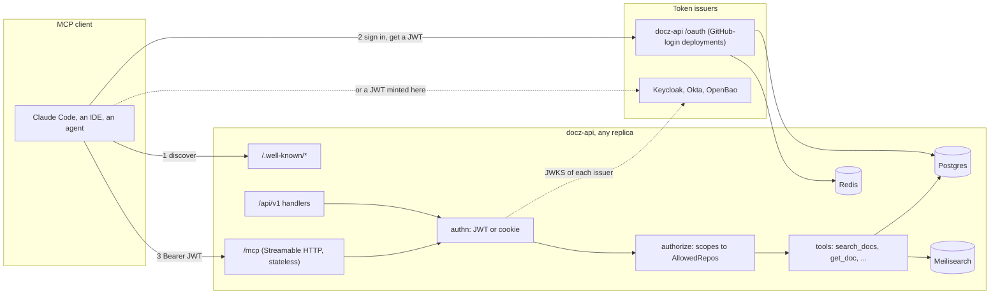
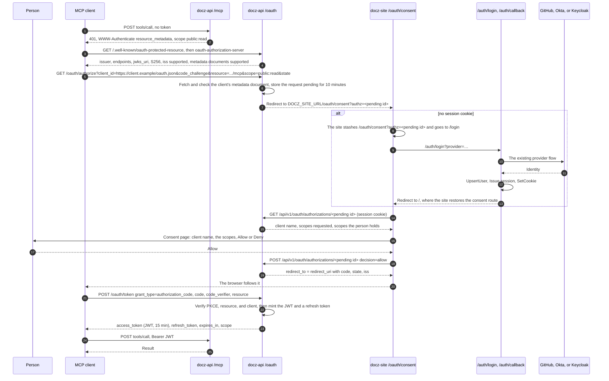
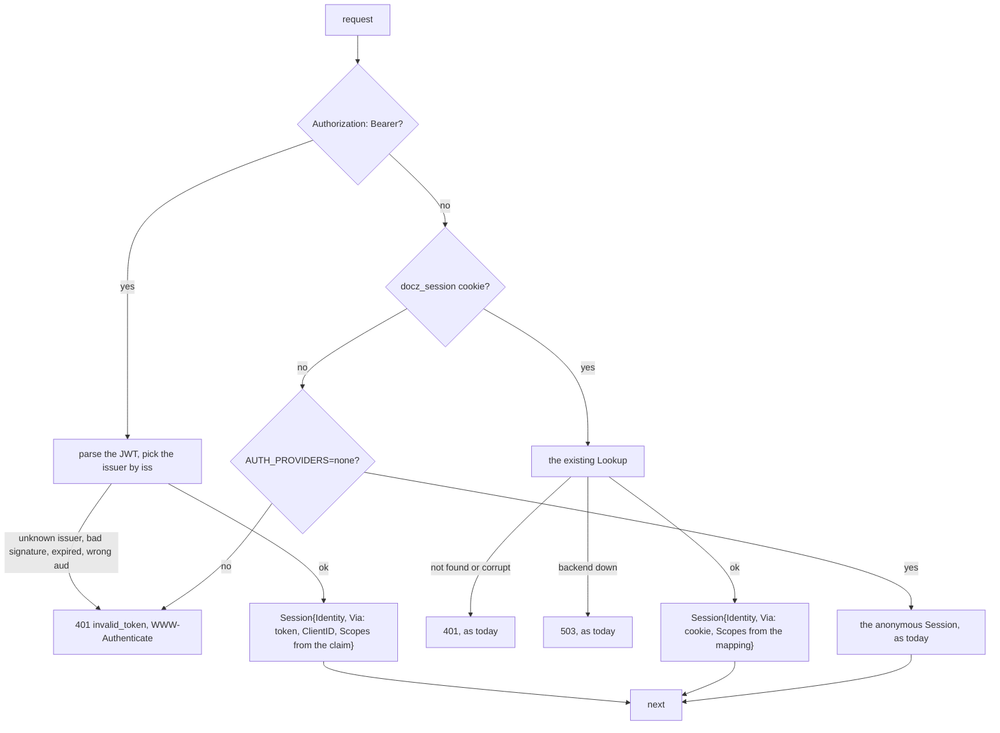
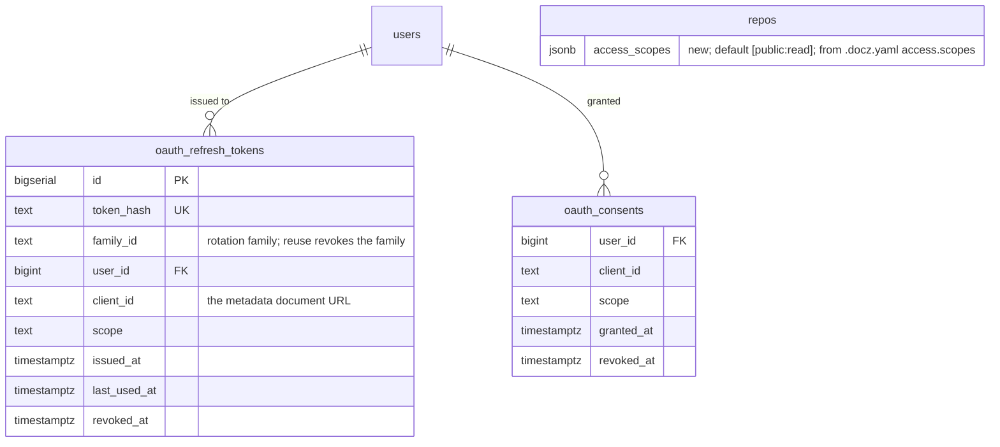

<!-- markdownlint-disable-file MD025 MD041 -->

# DESIGN-0023: A read-only MCP server in docz-api: OAuth 2.1 tokens, tools, and resources

<!--toc:start-->
<!-- markdownlint-capture -->
<!-- markdownlint-disable MD013 -->
- [Overview](#overview)
- [Goals and Non-Goals](#goals-and-non-goals)
  - [Goals](#goals)
  - [Non-Goals](#non-goals)
- [Background](#background)
- [Detailed Design](#detailed-design)
  - [1. Shape](#1-shape)
  - [2. The endpoint](#2-the-endpoint)
  - [3. Tools](#3-tools)
  - [4. Typed fields](#4-typed-fields)
  - [5. Tokens and the authorization server](#5-tokens-and-the-authorization-server)
    - [Trusted issuers](#trusted-issuers)
    - [The authorization code flow](#the-authorization-code-flow)
  - [6. One authentication middleware](#6-one-authentication-middleware)
  - [7. Scoped access](#7-scoped-access)
  - [8. Observability, limits, and audit](#8-observability-limits-and-audit)
  - [9. Security](#9-security)
- [API / Interface Changes](#api--interface-changes)
- [Data Model](#data-model)
- [Testing Strategy](#testing-strategy)
- [Migration / Rollout Plan](#migration--rollout-plan)
- [Open Questions](#open-questions)
  - [1. Which protocol revisions does /mcp speak?](#1-which-protocol-revisions-does-mcp-speak)
  - [2. What is an access token?](#2-what-is-an-access-token)
  - [3. Who serves the consent page and the provider chooser?](#3-who-serves-the-consent-page-and-the-provider-chooser)
  - [4. What does /mcp do under AUTH_PROVIDERS=none?](#4-what-does-mcp-do-under-auth_providersnone)
  - [5. How is access to a repository decided, and by whom?](#5-how-is-access-to-a-repository-decided-and-by-whom)
  - [6. Are there personal access tokens?](#6-are-there-personal-access-tokens)
  - [7. What does resources/list return?](#7-what-does-resourceslist-return)
  - [8. Is get_impl_progress a separate tool?](#8-is-get_impl_progress-a-separate-tool)
  - [9. What goes in api/openapi.yaml?](#9-what-goes-in-apiopenapiyaml)
  - [10. Is MCP on or off by default?](#10-is-mcp-on-or-off-by-default)
  - [11. Where does the rate limiter keep its buckets?](#11-where-does-the-rate-limiter-keep-its-buckets)
  - [12. What happens to INV-0024?](#12-what-happens-to-inv-0024)
  - [13. Where does the code live?](#13-where-does-the-code-live)
  - [14. What are the token lifetimes?](#14-what-are-the-token-lifetimes)
- [Decisions](#decisions)
- [References](#references)
<!-- markdownlint-restore -->
<!--toc:end-->

<!--docz:overview:start-->
## Overview

docz-api gains a Model Context Protocol (MCP) server at `/mcp`, in the same
binary and process as the REST API, speaking the stateless 2026-07-28
revision over Streamable HTTP through the official Go SDK. It is
**read-only as its whole scope**, not as a first phase: the tools answer
the questions an agent asks about a fleet's documentation (search, list,
read one document with its typed fields, read a plan's progress, read a
repository's pages), and nothing a caller can send changes a repository, a
page, or the server.

Three things have to exist for that endpoint to be usable by an MCP client,
and this design covers all three:

1. **Tokens.** `/mcp` and `/api/v1` accept JWT access tokens from a set of
   trusted issuers: docz-api's own, which mints them for a deployment whose
   login is GitHub and has no issuer of its own, and any external issuer
   the operator trusts (Keycloak, Okta, OpenBao), so an agent holding a
   token minted elsewhere needs nothing from docz-api. docz-api's own
   issuer is an OAuth 2.1 authorization server that delegates the login to
   the providers that already exist, with the consent page on docz-site.
2. **One authentication middleware.** A bearer token or the session cookie
   resolves to one principal through one middleware, so docz-site is
   unchanged, scripts get tokens, and there is one place that decides who
   a request is from.
3. **Scoped access.** A scope is `<audience>:<action>`. A repository
   declares in its `.docz.yaml` which scopes unlock it, `public:read` by
   default; every authenticated principal holds `public:read`, and holds
   more by the groups its identity provider asserts or the scopes its token
   carries. The same rule decides what the Confluence export may sync.
   `read` is the only action today, and the grammar is what a later design
   would use for a write.

The tools return document text as data an agent should treat as untrusted,
every call is rate limited per principal and logged with its principal, and
the whole surface is behind one flag, off by default, so an existing
deployment is unchanged until an operator turns it on.

<!--docz:overview:end-->

## Goals and Non-Goals

<!--docz:goals:start-->
### Goals

- An MCP client (Claude Code, Claude Desktop, an IDE, an agent framework)
  can connect to `<docz-api>/mcp` with no configuration beyond the URL,
  discover the server, sign in through the deployment's existing login,
  and read documentation.
- The 2026-07-28 revision only: no sessions, no `initialize`, any replica
  answers any call, and the `Mcp-Method` and `Mcp-Name` headers feed the
  request logger, the rate limiter, and the metrics without reading bodies.
- Six tools shaped for agents, not a mirror of the REST routes, with typed
  fields from `pkg/{rfc,adr,design,impl,investigation,runbook}` so an agent
  gets `phases[2].tasks[0].checked` and not a bag of markdown.
- JWT access tokens verified from a signing key, docz-api's own or a
  trusted issuer's, so a token OpenBao or Keycloak mints for an agent works
  on day one and docz-api never has to issue a credential to a machine.
- docz-api as an OAuth 2.1 authorization server for the deployments that
  need one: authorization code with PKCE, rotating refresh tokens, Client
  ID Metadata Documents, `iss` in authorization responses, RFC 9728 and
  RFC 8414 metadata, a JWKS.
- One `authn` middleware for cookie and bearer, and one `authorize` seam
  for REST and MCP that reads scopes instead of allowing everything.
- Audit, rate limits, metrics, and traces on every tool call, with the
  `traceparent` in `_meta` joining MCP calls to the traces docz-api emits.
- Everything behind `MCP_ENABLED`, off by default, with the chart and a
  RUNBOOK covering how to turn it on.

<!--docz:goals:end-->

<!--docz:non-goals:start-->
### Non-Goals

- **Write tools of any kind**: no `set_status`, `check_task`,
  `create_doc`, no PR opening, no Confluence writes. docz-api stays
  read-only (INV-0023, INV-0025, and INV-0026 are won't-do), so no scope
  with a `write` action exists, and there is no MRTR confirmation flow
  because nothing needs confirming. The scope grammar reserves the action
  so a later design does not have to invent a second one.
- **The Tasks extension and Temporal.** There is no long-running operation
  to hand back a task handle for. An agent that runs inside a Temporal
  workflow is just a caller with a token.
- **`subscriptions/listen`.** Change notifications are deferred; a client
  re-reads. The lists carry `ttlMs` so a client caches them sensibly.
- **Dynamic Client Registration** (RFC 7591). Deprecated in 2026-07-28, and
  docz-api is a new authorization server with no older clients to carry.
- **Client credentials, pre-registered clients, and personal access
  tokens.** An unattended caller gets its token from a trusted external
  issuer, which is what those issuers are for; docz-api's own issuer
  serves people through MCP clients and nothing else. A deployment with
  GitHub login and no external issuer therefore has no unattended path,
  and adding one later is additive.
- **An identity provider.** docz-api never holds a password. It
  authenticates people only by delegating to GitHub, Okta, or Keycloak, as
  the site login does today.
- **A separate MCP service** calling `/api/v1`, and a stdio server each
  person runs with a long-lived token (INV-0024 question 1).
- **Prompts** (`prompts/list`) in the first release. Nothing asks for them,
  and the tool descriptions carry what an agent needs.
- **Per-document authorization.** Scopes unlock a repository, as the REST
  API's existence hiding is today.

<!--docz:non-goals:end-->

<!--docz:background:start-->
## Background

[INV-0024] asked what an MCP server for docz-api should look like under the
2026-07-28 revision and how it should authenticate. It concluded
"inconclusive, direction clear": in-process at `/mcp`, docz-api as its own
authorization server, read-only tools first, and the authorization model
as the real work. Its eight questions were each recommended one way; this
design takes those recommendations as its starting point and resolves what
the investigation left open. Two of its threads are dropped here, by a
decision taken after it was written: the write tools and the IMPL run
handle depended on INV-0023's Temporal control plane and write access,
and docz-api stays read-only, so this design's scope is the read tools
with nothing deferred behind them. One is replaced: INV-0024 question 3's
client credentials for workers assumed docz-api would mint machine
credentials, and this design has an external issuer do that instead.

**What the protocol asks for** (INV-0024 Observation 1). The 2026-07-28
revision removed sessions and the `initialize` handshake. Every request
carries its protocol version and the client's capabilities in `_meta`; a
server answers `server/discover` with its versions, capabilities, and
identity; `tools/list` and `resources/list` are the same for every caller
and carry `ttlMs` and `cacheScope`; Streamable HTTP requests carry
`Mcp-Method` and `Mcp-Name` headers. For HTTP transports the server is an
OAuth 2.1 resource server: it publishes Protected Resource Metadata (RFC
9728), answers an unauthenticated call with `401` and a `WWW-Authenticate`
header naming that document, and accepts only tokens issued for it as the
audience. Clients use PKCE and RFC 8707 `resource`, and register through
Client ID Metadata Documents or pre-registration.

**What the SDK supports**, checked 2026-10-17. The official Go SDK,
`github.com/modelcontextprotocol/go-sdk`, ships 2026-07-28 support from
v1.7.0 and is at v1.8.0. Its Streamable HTTP handler serves the new
revision when `StreamableHTTPOptions.Stateless` is set, in which mode `GET`
and `DELETE` return `405`, no session id is consulted, and a server-to-
client request is refused. `ServerOptions.SupportedProtocolVersions`
narrows what the server advertises, and `ServerOptions.SetCacheable` sets
the per-request cache control the lists carry. It validates the
`Mcp-Method` and `Mcp-Name` headers against the body for 2026-07-28
requests, and bounds every decoding path. INV-0024 question 6's worry, that
the SDK might lag the revision, has not come to pass.

**What docz-api has** today, which this design extends rather than
replaces:

| Package | What it does | What changes |
| ------- | ------------ | ------------ |
| `internal/auth` | `Provider{Name, AuthCodeURL, Exchange}` returning an `Identity{Provider, Subject, Email, Login, Groups}`; GitHub OAuth, OIDC for Okta and Keycloak; a signed `state` with a 5-minute TTL | Nothing: the consent page returns through docz-site's own login return (IMPL-0026 question 4) |
| `internal/authhttp` | `/auth/login`, `/auth/callback`, `/api/v1/auth/session`, `/api/v1/auth/logout` | The session response gains `via` and `scopes` |
| `internal/session` | Opaque Redis sessions, the `docz_session` cookie, `Middleware`, `AnonymousMiddleware`, `FromContext` | `Middleware` becomes the cookie half of `authn`; `Session` gains `Via`, `ClientID`, and `Scopes` |
| `internal/authorize` | `AllowedRepos` in the context; `AllReposAuthorizer` returns every repository | `ScopeAuthorizer` intersects the principal's scopes with each repository's; the interface and `FromContext` are unchanged |
| `internal/httpapi` | The REST handlers over a `storeReader` and a `Searcher`; existence hiding through `AllowedRepos` | Unchanged; the MCP tools call the same `storeReader` and `Searcher`; two consent endpoints are added for docz-site |
| `internal/ingest` | Parses the fetched `.docz.yaml` with `config.ParseBytes` | Maps the new `access.scopes` list onto the repository row |
| `internal/export` | Runs the Confluence export after an ingest; refuses a site or space off the allow-list | Also refuses a repository whose scopes grant the export nothing (§7) |
| `internal/config` | Env-only, one `ErrInvalidConfig` listing every problem | `MCPConfig`, `OAuthConfig`, `AuthzConfig` |
| `cmd/docz-api` | `runServer` composes the gate `authn ∘ authorize.Middleware` | Mounts the well-known documents, the JWKS, the token endpoints, and `/mcp` when enabled |
| `pkg/doczcore/config` | The `.docz.yaml` schema | A top-level `access:` block (§7, API changes) |

The server has no rate limiter today. chi's `httprate` middleware gives a
keyed in-process bucket with `Retry-After` in a few lines (IMPL-0026
question 7).
`go-jose/v4` and `golang-jwt/jwt/v5` are already indirect dependencies, so
signing and verifying JWTs brings no new module.

**Document text is untrusted** (INV-0021, INV-0024 Observation 6). A
document is written by anyone with push access, and a page under the
`api:` block by anyone who can edit a markdown file in the repository. An
agent reading them through MCP can be prompt-injected by their content.
With no write tools the damage is bounded to what the agent does elsewhere
with what it read, but the server still returns text as data and never as
instructions, and never follows a link a document carries.

<!--docz:background:end-->

<!--docz:detailed-design:start-->
## Detailed Design

### 1. Shape

The work is in seven places. One is in `pkg/`: the `.docz.yaml` schema
gains an `access:` block, because the repository is where its audience is
declared.

| Where | What changes |
| ----- | ------------ |
| `internal/mcp` (new) | The server: tool and resource registration over the Go SDK, the result shapes, the `docz://` resource template, the typed-field switch (§3, §4) |
| `internal/oauth` (new) | The authorization server and the token verifier: metadata documents, the JWKS, `/oauth/authorize`, `/oauth/token`, `/oauth/revoke`, the two consent endpoints, client metadata resolution, JWT issue, and verification against every trusted issuer (§5, §6) |
| `internal/authhttp` | `via` and `scopes` on the session response (§5) |
| `internal/session` | `Session` gains `Via`, `ClientID`, and `Scopes`; `authn` resolves a bearer token or the cookie into one (§6) |
| `internal/authorize` | `ScopeAuthorizer` over the repositories' scope lists and the principal's; `AllReposAuthorizer` is kept for `AUTH_PROVIDERS=none` (§7) |
| `internal/ingest`, `internal/export`, `internal/store` | `repos.access_scopes` from the manifest; the export's scope refusal; `oauth_refresh_tokens` and `oauth_consents` (§7, Data Model) |
| `internal/telemetry` | MCP metrics, the tool name on the span, the audit line (§8) |
| `internal/config`, `cmd/docz-api` | `MCP_*`, `OAUTH_*`, `AUTHZ_*`; wiring behind `MCP_ENABLED` (§5, §9, Rollout) |
| `pkg/doczcore/config` | `AccessConfig{Scopes}` with the scope grammar; `docz init` writes the default block (§7, API changes) |
| `api/openapi.yaml`, `ui/` | The `bearerToken` scheme; the consent endpoints; the consent page (API changes) |
| `charts/docz` | `api.mcp.*` values, the signing key in the API Secret, an alert (Rollout) |

How a call reaches the data:



Layering is unchanged. `internal/mcp` imports the type packages under
`pkg/`, `internal/store`, `internal/search`, and `internal/authorize`,
exactly as `internal/httpapi` does; `internal/oauth` imports `auth`,
`session`, and `store`. Nothing under `pkg/` imports either, and the
`access:` block is a config struct with a validator, like `sync:`.

### 2. The endpoint

`/mcp` is one route on the root router, mounted by `runServer` only when
`MCP_ENABLED` is true. It is the Go SDK's `StreamableHTTPHandler` with
`Stateless: true`, wrapped in the same `authn` and `authorize` middleware
as `/api/v1` (§6, §7) and in a per-principal rate limiter (§8). The SDK's
server is built once per process with:

- `SupportedProtocolVersions` narrowed to `2026-07-28` (question 1). A
  client on 2025-11-25 gets the SDK's `UnsupportedProtocolVersionError`
  naming the version the server speaks, which is what the revision asks
  for; there is no stateful fallback to keep working.
- `Implementation{Name: "docz-api", Version: <build version>}`, which is
  what `server/discover` reports as the server's identity.
- `SetCacheable` on the list results with a `ttlMs` of one hour: the tool
  set and the resource templates are fixed at build time, so a client may
  cache them for the process's lifetime, and an hour is long enough to
  matter and short enough that a deploy is picked up.

In stateless mode `GET /mcp` and `DELETE /mcp` are `405`, which is the
SDK's behaviour and the right one: there is no stream to open and no
session to end. The handler validates the `Mcp-Method` and `Mcp-Name`
headers against the body, so by the time a request reaches a tool the
request logger has already recorded the tool's name from the header.

An unauthenticated `POST /mcp` is answered before the SDK sees it:

```http
HTTP/1.1 401 Unauthorized
WWW-Authenticate: Bearer resource_metadata="https://docz.example/.well-known/oauth-protected-resource", scope="public:read"
```

A token that is valid but whose scopes unlock no repository still reaches
the tools and sees an empty fleet, as a site user with no access would;
`insufficient_scope` is reserved for a route that names a scope, which no
read route does. Both answers are produced by the `authn` middleware (§6),
not by MCP code, so `/api/v1` answers a bad bearer the same way.

### 3. Tools

Six tools (question 7), each `readOnlyHint: true`, `idempotentHint: true`,
and `openWorldHint: false`. Every argument that names a repository takes
`owner/name`; every one that names a type takes the token the REST API
takes, resolved by the same `resolveType` over the repository's
`doc_types` row (name, prefix, or alias, folded). Every result has a
`structuredContent` object whose schema is the tool's `outputSchema`, and
one `text` block the client can show, so a client that reads only text
still gets the answer.

| Tool | Arguments | Returns | REST it stands on |
| ---- | --------- | ------- | ----------------- |
| `list_repos` | none | `repos[]{repo, default_branch, docs_dir, last_synced_sha, types[]{name, id_prefix, plural_label, statuses}}` | `GET /repos`, `GET /repos/{o}/{n}/types` folded into one call |
| `list_docs` | `repo`, optional `type`, `status` | `docs[]{repo, doc_id, type, title, status, author, created, path, updated_at}` | `GET …/types/{type}/docs` across every type when `type` is omitted |
| `get_doc` | `repo`, `id` (the frontmatter id, `IMPL-0018`; the type is derived from the prefix as `repo.Find` does) | the document summary, `markdown`, `confluence_url`, and `fields` (§4) | `GET …/docs/{doc_id}` plus the typed parse |
| `search_docs` | `query`, optional `repo`, `type`, `status`, `author`, `source`, `limit` | `hits[]{source, repo, doc_id, type, title, path, status, snippet}` and `facets` | `GET /search` with the caller's `AllowedRepos` |
| `get_impl_progress` | `repo`, `id` | `objective`, `phases[]{index, token, title, done, total, tasks[]{id, text, checked, deferred, verify}}`, `open_questions[]{number, text, resolved}` | `get_doc` for an IMPL, with the counts an agent would otherwise compute |
| `get_page` | `repo`, `path` (`index`, `changelog`, or a published page path) | `title`, `markdown`, `git_sha` | `GET …/index`, `…/changelog`, `…/pages/{path}` |

`get_impl_progress` is `get_doc` with the counts folded in and the markdown
left out (question 8). It exists because "how far along is IMPL-0018" is
the question an agent asks most, and answering it from `get_doc` costs the
whole document's text in the context window for a number.

What a tool does not do:

- It never returns a repository the caller's `AllowedRepos` does not
  contain. A `repo` argument outside the set is `NotFound`, the REST API's
  existence hiding, so a tool call cannot be used to enumerate.
- It never follows a link. A document's references are returned as the
  paths and ids the document wrote, not fetched.
- It never returns `raw_md` for more than one document per call. `list_docs`
  and `search_docs` return summaries and snippets; the full text is one
  `get_doc` or `get_page` at a time, which is both the context-window
  budget and the rate limiter's unit.
- It never writes. There is no tool with a side effect, so `destructiveHint`
  is never set and MRTR is never used.

Errors are the SDK's tool errors with `isError: true` and a message in the
REST API's wording: `repo not found`, `document not found`, `type not
found`, `search unavailable`. A tool never returns a store error's text.

### 4. Typed fields

`get_doc.fields` is the type package's `Doc` for the document's type,
serialised as JSON, under a `kind` that names which shape it is:

| Type | `fields.kind` | From | What an agent gets |
| ---- | ------------- | ---- | ------------------ |
| rfc | `rfc` | `rfc.Parse` | summary, motivation, proposal, alternatives, risks with mitigations, open questions |
| adr | `adr` | `adr.Parse` | context, decision, consequences (positive, negative, neutral), alternatives, superseded-by |
| design | `design` | `design.Parse` | goals, non-goals, decisions, open questions, references |
| impl | `impl` | `impl.Parse` | objective, phases with tasks (`id`, `text`, `checked`, `verify`, `deferred`), open questions, decisions |
| investigation | `investigation` | `investigation.Parse` | question, hypothesis, findings, conclusion with verdict, recommendation |
| runbook | `runbook` | `runbook.Parse` | overview (service, owner, alert), procedures with steps and commands, scenarios, last verified |
| custom, or a parse failure | `generic` | `docparse.Headings` and `kinds.ResolveRegions` | headings with lines, and the regions the document carries |

The switch on the type's canonical name is the same five-arm switch (six
with runbook) `cmd/validate.go` carries, and for the same reason: `repo`
and the core may not import a type package (DESIGN-0014 R2), so the server
is where the name picks the parser. A custom type whose documents carry a
built-in's regions parses with the built-in's package only when the type
is the built-in; a custom type is `generic`, which is still every heading
and every marked region.

`Parse` fails for exactly two things, no frontmatter and CR line endings,
and `pkg/impl` for a plan with no phases. A document that fails to parse
is still returned: `markdown` is complete, `fields.kind` is `generic`, and
`fields.parse_error` carries the message, because an agent asked for the
document and a half-written one is the normal state of a document.

Resources are the same documents by URI: `docz://<owner>/<name>/<type>/<id>`,
served by `resources/read` with the markdown as `text/markdown` and the
typed fields as a second `application/json` content, so a client can attach
a document as context without a tool call. `resources/list` returns **one
resource template** per enabled built-in type and one generic template,
not the documents (question 7): the revision requires lists to be the same
for every caller, and the set of documents a caller may see is not. A
client that wants the list calls `list_docs`, which is per-principal by
construction. `resources/templates/list` carries the same `ttlMs` as the
tools.

### 5. Tokens and the authorization server

A request to `/mcp` or `/api/v1` carries a **JWT** (question 2): signed by
one of the issuers the deployment trusts, with the audience
`<OAUTH_ISSUER>/mcp`, an expiry, a subject, and a `scope` claim. docz-api
verifies it from the issuer's signing key and never looks it up, so any
replica answers any call with no store hit and the token is revocable only
by its expiry, which is why it lives 15 minutes (question 14).

#### Trusted issuers

| Issuer | Who it serves | How docz-api verifies |
| ------ | ------------- | --------------------- |
| docz-api's own, `OAUTH_ISSUER` | People using an MCP client against a deployment whose login is GitHub, or any deployment that prefers one login | `OAUTH_SIGNING_KEY` (an ES256 private key, a `config.Secret`), whose public half is published at `/.well-known/jwks.json` with a `kid` |
| Each URL in `OAUTH_TRUSTED_ISSUERS` | Agents and jobs holding a token the operator's identity platform minted (Keycloak, Okta, OpenBao's OIDC provider); people whose MCP client is registered with that issuer directly | OIDC discovery at startup under the same bounded context as the login providers, so a bad issuer fails the boot; its JWKS cached and refreshed on an unknown `kid`; `iss` must match, `aud` must contain `<OAUTH_ISSUER>/mcp`, `exp` and `nbf` enforced with 30 seconds of skew |

Scopes come from the `scope` claim (space-separated) or `scp` (an array),
whichever the issuer writes; an external token's scopes are taken as-is,
because the issuer is the operator's and its policy is the operator's. The
subject key is `<issuer>:<sub>`, so two issuers cannot collide. Nothing
in docz-api mints a token for a machine: an unattended caller gets one from
an external issuer, which is what OpenBao's OIDC provider or a Keycloak
service account is for.

docz-api's own issuer is mounted only when `MCP_ENABLED` is true and
`AUTH_PROVIDERS` is not `none` (question 4). It publishes two metadata
documents and a JWKS, and serves three endpoints:

| Route | What it is |
| ----- | ---------- |
| `GET /.well-known/oauth-protected-resource` | RFC 9728: `resource` = `<OAUTH_ISSUER>/mcp`, `authorization_servers` = `[<OAUTH_ISSUER>]`, `scopes_supported` = `["public:read"]` plus every scope `AUTHZ_SCOPE_MAP` can grant, `bearer_methods_supported` = `["header"]` |
| `GET /.well-known/oauth-authorization-server` | RFC 8414: `issuer`, the endpoints, `jwks_uri`, `grant_types_supported` = `authorization_code`, `refresh_token`; `code_challenge_methods_supported` = `["S256"]`; `authorization_response_iss_parameter_supported` = true; `client_id_metadata_document_supported` = true; `token_endpoint_auth_methods_supported` = `["none"]` |
| `GET /.well-known/jwks.json` | The public key, `kid` = the key's SHA-256 thumbprint, so a token verifier elsewhere can check docz-api's tokens too |
| `GET /oauth/authorize` | The authorization request: validate, store it pending, send the person to docz-site's consent page |
| `POST /oauth/token` | The code and refresh grants; returns an access token, its lifetime, the scope, and a refresh token |
| `POST /oauth/revoke` | RFC 7009: revokes a refresh token and its family |

`OAUTH_ISSUER` is the server's public base URL, `https://docz.example`,
and is required when MCP is enabled. It is the `iss` of every token docz-api
mints, the audience every accepted token must name, and the prefix of the
PRM's `resource`. `AUTH_REDIRECT_BASE` already carries the same value for
the site login; `OAUTH_ISSUER` defaults to it and is separate only so a
deployment that serves the two on different hosts can say so.

#### The authorization code flow

The consent page is docz-site's (question 3), so a person sees the site
they know, logs in through its login UI if they have no session, and
approves the client there. The API owns the decision and the code; the
site owns the pixels.



Each step's rules:

- **Validation before anything is stored.** `response_type=code`,
  `code_challenge` with `S256` only, `resource` equal to the PRM's
  `resource` (a request for any other audience is refused with
  `invalid_target`), `scope` a subset of the scopes docz-api can grant
  (empty means `public:read`), `redirect_uri` exactly one of the client's
  registered URIs, and `state` present. A failure that happens before the
  `redirect_uri` is trusted is shown on an error page; after, it is
  returned to the client as an OAuth error redirect with `iss`.
- **The client.** `client_id` is an `https` URL resolved as a Client ID
  Metadata Document (question 5 of INV-0024, pre-registration dropped with
  client credentials). The document is fetched with a 5-second timeout, a
  64 KiB cap, no redirects, `https` only, and a resolver that refuses
  loopback, link-local, and private address ranges (the SSRF guard an
  authorization server fetching URLs needs); its `client_id` must equal the
  URL it was fetched from, and its `redirect_uris` are the only ones
  accepted. It is cached in Redis for its `Cache-Control` max-age, at most
  one hour, so a client's second authorization costs no fetch. A document
  that fails any check is `invalid_client`.
- **The pending request** is a 32-byte random id in Redis for 10 minutes,
  holding the validated request. The person is sent to
  `<DOCZ_SITE_URL>/oauth/consent?authz=<id>`.
- **The login.** docz-site's consent route checks for a session as every
  site route does. A person without one is sent to the site's `/login`
  with the consent route stashed in `sessionStorage`
  (`docz:auth:return-to`), which the site already restores once the
  callback lands on `/`; the whole redirect chain stays in one tab, so the
  stash is there. `/auth/login` is unchanged (a `return_to` parameter was
  struck 2026-10-17, IMPL-0026 question 4). With several providers the
  site's existing chooser shows them.
- **The consent endpoints** are two gated routes under `/api/v1`, in the
  spec, so docz-site's generated client has them:
  `GET /api/v1/oauth/authorizations/{id}` returns the client's name and
  `client_uri` from its metadata document, the scopes it asked for, and
  the scopes the person holds (so the page can say which it will actually
  get); `POST` with `{"decision": "allow"}` or `"deny"` returns
  `{"redirect_to": "<redirect_uri>?code=…&state=…&iss=…"}` or the error
  redirect, and the site navigates the browser there. The id in the path
  is the only secret the page handles, it is single-use, and a `POST` from
  a session other than the one the `GET` saw is refused. Consent is
  remembered per `(user, client)` in `oauth_consents`, so a refresh that
  has expired is renewed without the page.
- **The code** is a 32-byte random value in Redis for 60 seconds, single
  use, holding the pending request and the user id. Redeeming it twice
  revokes every token it issued, as OAuth 2.1 requires.
- **The tokens.** The access token is a JWT signed with
  `OAUTH_SIGNING_KEY`: `iss`, `sub` (`user:<provider>:<subject>`), `aud`
  (`<OAUTH_ISSUER>/mcp`), `exp` (15 minutes), `iat`, `jti`, `scope` (the
  requested scopes the person holds, §7), `client_id`, and `email` and
  `login` so the session endpoint can name the person. A refresh token is
  opaque, stored **hashed** in Postgres `oauth_refresh_tokens` with a
  family id, rotated on every use, and expiring after `OAUTH_REFRESH_TTL`
  (default 30 days) of disuse; presenting a rotated-out token revokes its
  whole family, the reuse detection OAuth 2.1 asks for. A refresh re-reads
  the person's scopes, so a group change takes effect within one access
  lifetime.
- **`iss`** is on every authorization response, success or error (RFC
  9207), and the metadata says so.

### 6. One authentication middleware

`authn` today is a chooser between `session.Middleware` and
`AnonymousMiddleware`. It becomes one middleware that resolves a request
to a `Session` from whichever credential it carries:



The rules that matter:

- **Bearer wins when present.** A request carrying both is judged by the
  token, so a script that sends a token from a browser profile that also
  has a cookie behaves as the token says. A bearer header that is malformed
  or names an issuer the deployment does not trust is `401`, never a
  fall-through to the cookie.
- **The `WWW-Authenticate` challenge** is on every `401` from `authn`,
  cookie or bearer, naming the PRM and `public:read`, because the MCP
  client that gets it is the one that needs it and a browser ignores it.
  docz-site's login UI keys off the status alone, so it is unchanged.
- **`Session.Via`** is `cookie`, `token`, or `anonymous`;
  `Session.ClientID` names the OAuth client a token was issued to; and
  `Session.Scopes` is the principal's scope set, read from the token's
  claim or computed for a cookie session (§7). All three are on the audit
  line (§8).
- **`session.FromContext`** is unchanged in signature and every REST
  handler keeps working: a token caller reads `/api/v1/auth/session` and
  sees the identity the token acts for, with `via` and `scopes` added to
  the response (additive spec changes).
- **`AUTH_PROVIDERS=none`** keeps its meaning: with no login there is no
  one to issue a token to, the authorization server is not mounted, no
  issuer is trusted, and `/mcp`, like `/api/v1`, answers the anonymous
  principal, which sees every repository as it does today (question 4).
  The chart and both READMEs already state that exposure.

`/api/v1` accepting bearer tokens is INV-0024 question 4's answer and
costs nothing beyond this middleware: the same token a client uses for
`/mcp` works in `curl`, and a person who wants a token for a script gets
one by connecting any MCP client once, or from the operator's issuer.

### 7. Scoped access

`authorize.Middleware` and `AllowedRepos` stay. What changes is the
`Authorizer` behind them: `ScopeAuthorizer` replaces `AllReposAuthorizer`
except under `AUTH_PROVIDERS=none`, where the anonymous principal keeps
seeing everything.

**The grammar.** A scope is `<audience>:<action>`: the audience is
`[a-z0-9][a-z0-9-]{0,62}`, the action is `read`. `write` is reserved and
rejected by every validator today, so a later design that adds a write
tool has a scope to require without inventing a second grammar.
`public` is the one audience with a defined meaning: every authenticated
principal holds `public:read`.

**A repository declares what unlocks it.** `.docz.yaml` gains a top-level
block:

```yaml
access:
  scopes: [public:read]   # the scopes that unlock this repository on docz-api
```

Absent or empty means `[public:read]`. A team that wants its documentation
visible only to itself writes `scopes: [platform-team:read]`; one that
wants it visible to the team and to the Confluence export writes
`scopes: [platform-team:read, confluence:write]` (below). `config.Validate`
checks each entry against the grammar and rejects a duplicate, as it does
`sync.confluence.types`. Ingest maps the list onto `repos.access_scopes`,
so a change takes effect at the next ingest like every other setting, and
the repository's own `.docz.yaml` is the record of who may read it.

**A principal holds scopes.** The set is computed per request from the
groups and login in the session record and the current `AUTHZ_SCOPE_MAP`
(amended 2026-10-17, IMPL-0026 question 5: a mapping change is live on
restart and nothing new is stored), and written into the `scope` claim of
every token docz-api mints:

| Source | Scopes |
| ------ | ------ |
| Every authenticated principal | `public:read` |
| `AUTHZ_SCOPE_MAP` | A mapping from an identity's provider and group, or provider and login, to scopes: `okta:group:platform-team=platform-team:read;github:login:donaldgifford=platform-team:read`. Groups are what Okta and Keycloak assert in the `id_token` (`Identity.Groups`, until now passthrough only); a GitHub login has no groups and is named directly |
| An external JWT | Its `scope` or `scp` claim, as-is; the mapping is not applied, because the issuer's policy decided the token's scopes |

A mapping entry naming a scope with a `write` action fails config
validation, as does one whose audience is `public`.

**The rule.** A principal may read a repository when the intersection of
the principal's scopes and the repository's `access.scopes` is not empty.
`ScopeAuthorizer.Allowed` is one query, `ListRepoIDsForScopes(scopes)`
(`access_scopes ?| $1` over the JSONB array), cached in process per
principal for `AUTHZ_CACHE_TTL` (default 30 seconds), so a burst of tool
calls does not hit Postgres per call and a change is live within that
window. The REST handlers and the tools consume the result the same way,
so authorization is decided in one place, as INV-0024 Observation 5 asked.

**Confluence.** The server's export is a principal too, holding
`public:read` and `confluence:write`. A repository whose `access.scopes`
grants it neither is `refused`, recorded and warned like a space off the
allow-list, never an error: a public repository syncs as today, and a
private one syncs only when it names `confluence:write`, which is the
repository saying its private documentation may be written to the space
its `sync:` block names. The server's space allow-list still applies on
top. The CLI's `docz export confluence` is unaffected: a person running it
holds the repository. `confluence:write` is the one scope whose action is
not `read`, and it is held by the export alone; a token presenting it is
not refused, but no route reads it, so it grants a caller nothing.

**What a scope does not do.** It does not name a document, a type, or a
tool: the unit is the repository, and every read tool needs the same
thing. `scopes_supported` in the PRM lists `public:read` and every scope
the mapping can grant, so a client can ask for exactly what it will use.

### 8. Observability, limits, and audit

Every tool call is one request, so the existing HTTP middleware already
logs and meters it; what is added is the tool's name and the principal.

- **Metrics**: `docz_api_mcp_calls_total{tool,status}` and
  `docz_api_mcp_call_duration_seconds{tool}` beside the HTTP RED metrics,
  and `docz_api_oauth_tokens_total{grant,status}` for the token endpoint
  plus `docz_api_token_verifications_total{issuer,status}` for the bearer
  path and `docz_api_rate_limited_total{surface,via}` for every throttled
  request (IMPL-0026 question 7). The `tool` label is the `Mcp-Name` header's value when `Mcp-Method`
  is `tools/call`, else the method, so cardinality is the tool set; the
  `issuer` label is the configured issuer URL, a bounded set.
- **Traces**: the request span is named by the route, `POST /mcp`, and a
  child span `mcp.<method>` carries the tool name. The `traceparent` in the
  request's `_meta` is extracted as the parent when the HTTP headers carry
  none, so an agent's trace continues into the server.
- **Audit**: one slog line at Info per tool call, `mcp call`, with
  `principal`, `via`, `client_id`, `issuer`, `scopes`, `tool`, `repo`,
  `doc_id`, `status`, and `duration`, and never the arguments' free text (a
  search query is a person's words) or any document text. The token
  endpoint logs `oauth token` with `grant`, `client_id`, `principal`, and
  `status`. The token itself appears in no log, no error, and no span
  attribute; the `config.Secret` discipline applies to it.
- **Rate limits**: a token bucket per principal, `MCP_RATE_LIMIT` calls
  per minute (default 120) with a burst of the same, applied to `/mcp` and
  to `/api/v1` for token callers alike; the cookie path is not limited,
  because docz-site is one page load of many calls and today has none. A
  limited call is `429` with `Retry-After`. The limiter is in-process per
  replica (question 11), so the effective limit is the configured one
  times the replica count; that is stated in the chart's values, and a
  shared limiter in Redis is a follow-up if it is ever needed.
- **Readiness**: nothing is added to `/readyz`. A trusted issuer's JWKS
  is fetched at boot and refreshed on demand; an issuer that goes away
  after boot fails only the tokens it signed, which is the right blast
  radius for a dependency that serves no request of its own.

### 9. Security

- **The resource server rules**: only tokens whose audience is
  `<OAUTH_ISSUER>/mcp` and whose issuer is trusted are accepted, a token
  is never forwarded anywhere, and the challenge names the PRM.
- **The authorization server rules**: PKCE `S256` on every code request,
  exact `redirect_uri` matching, `resource` required and checked, `iss` on
  every response, single-use codes with reuse revoking what they issued,
  rotating refresh tokens with family revocation, refresh tokens stored
  hashed, access tokens short-lived, no DCR, no client credentials, no
  implicit grant, no password grant. The signing key is a `config.Secret`
  from the API Secret, never generated into Postgres, and rotating it
  invalidates at most 15 minutes of tokens.
- **Fetching client metadata documents** is the one outbound request an
  attacker can direct: the resolver refuses non-public addresses, redirects
  are not followed, the body is capped, the scheme is `https`, and the
  document is validated before it is cached. JWKS fetches go only to the
  issuers the operator configured.
- **The consent hand-off**: the pending id is unguessable, expires in 10
  minutes, is bound to the session that first read it, and is consumed by
  the decision; the return to the consent page after a login is the
  site's own, inside the browser.
  The site's `POST` carries the session cookie and is same-origin, as
  every site call is.
- **Origin**: `/mcp` sends no CORS headers, the same as `/api/v1`, and
  `POST` with a `Bearer` header is not a simple request, so a page on
  another origin cannot make one.
- **Untrusted text**: tool results carry document text as data in
  `structuredContent` and in a text block, and each tool's description says
  the text is authored by the repository's committers and is not an
  instruction. The server never acts on anything a document says because
  it has nothing to act with.
- **Enumeration**: a repository outside `AllowedRepos` is `not found`,
  not `forbidden`, on every tool and resource, as on REST. A principal
  with scopes that unlock nothing sees an empty fleet, not an error.
- **The flag**: with `MCP_ENABLED` unset, none of the new routes exist,
  `authn` trusts no issuer and so has no bearer path, and the only change
  an existing deployment sees is the migration adding empty tables and a
  column that defaults to `["public:read"]`.

<!--docz:detailed-design:end-->

<!--docz:api-changes:start-->
## API / Interface Changes

**New HTTP routes**, present only when `MCP_ENABLED` is true:

| Route | Gate | Contract |
| ----- | ---- | -------- |
| `POST /mcp` | `authn` (bearer or cookie), `authorize`, the rate limiter | MCP 2026-07-28; `GET` and `DELETE` are `405` |
| `GET /.well-known/oauth-protected-resource` | none | RFC 9728 |
| `GET /.well-known/oauth-authorization-server` | none | RFC 8414 |
| `GET /.well-known/jwks.json` | none | RFC 7517 |
| `GET /oauth/authorize` | none (the consent page is behind the site's login) | OAuth 2.1 authorization endpoint |
| `POST /oauth/token` | PKCE verifier, or the refresh token | OAuth 2.1 token endpoint |
| `POST /oauth/revoke` | the refresh token | RFC 7009 |
| `GET`, `POST /api/v1/oauth/authorizations/{id}` | the `/api/v1` gate (session cookie) | the consent read and decision, for docz-site |

The well-known, `/oauth/*`, and consent routes are absent when
`AUTH_PROVIDERS` is `none`; `/mcp` is still mounted and serves the
anonymous principal.

**Changed routes**:

- Every `/api/v1` route accepts `Authorization: Bearer <jwt>` as well as
  the cookie. A `401` from any of them now carries `WWW-Authenticate`.
- `GET /api/v1/auth/session` gains `via` (`cookie`, `token`, `anonymous`),
  `scopes` (the principal's set), and, for a token, `client_id` and
  `issuer`. All additive.
**`api/openapi.yaml`** goes to `1.7.0` (minor, additive; question 9): a
`bearerToken` security scheme (`type: http`, `scheme: bearer`,
`bearerFormat: JWT`) is added beside `sessionCookie` and every `/api/v1`
operation lists both; the session fields above; the two consent endpoints
(docz-site's generated client needs them); `/oauth/token`, `/oauth/revoke`,
and the three well-known documents, because a script author reads the
spec to learn how to get a token. `/mcp` is **not** in the OpenAPI
document: its contract is the MCP specification's, and `server/discover`
plus `tools/list` describe the tools to the one kind of client that calls
it. `api/README.md` gains a "Tokens" section.

**docz-site** gains one route, `/oauth/consent`, rendered from the two
consent endpoints with the site's existing login gate and provider
chooser. The API learns the site's URL from `DOCZ_SITE_URL`.

**Tool contract.** The tool names, argument schemas, output schemas, and
annotations in §3 are a public contract from the first release, versioned
with the binary and listed in the CHANGELOG under `mcp`. A tool is renamed
by adding the new name and keeping the old one for a release.

**`.docz.yaml`** gains the `access:` block (§7), a `pkg/doczcore/config`
change on the stable v2 line: `AccessConfig{Scopes []string}` with yaml
and json tags, a default of `[public:read]`, normalised and validated on
both `Load` paths like `sync:`. `docz init` writes the block with its
default and a comment, which is a new permitted parity delta handled by an
`access` normaliser beside `sync`. Nothing in `cmd/` reads it; `docz
config` prints it.

**Configuration** (`internal/config`, env-only, every problem in one
`ErrInvalidConfig`):

| Variable | Default | Meaning |
| -------- | ------- | ------- |
| `MCP_ENABLED` | `false` | mounts `/mcp`, the token verifier, and the authorization server |
| `MCP_RATE_LIMIT` | `120` | tool calls per minute per principal, per replica |
| `OAUTH_ISSUER` | `AUTH_REDIRECT_BASE` | the public base URL: the `iss` of docz-api's tokens, the audience's prefix, the PRM's `resource` |
| `OAUTH_SIGNING_KEY` | required with MCP on and a login | ES256 private key, PEM; a `config.Secret` |
| `OAUTH_TRUSTED_ISSUERS` | empty | comma-separated issuer URLs whose JWTs are accepted; each discovered at boot |
| `OAUTH_ACCESS_TTL` | `15m` | access token lifetime |
| `OAUTH_REFRESH_TTL` | `720h` | refresh token lifetime from last use |
| `DOCZ_SITE_URL` | required with MCP on and a login | where `/oauth/authorize` sends the person for consent |
| `AUTHZ_SCOPE_MAP` | empty | `provider:group:<name>=<scopes>` and `provider:login:<name>=<scopes>` entries, `;`-separated, scopes `,`-separated |
| `AUTHZ_CACHE_TTL` | `30s` | how long a principal's allowed set is held in process |

`OAUTH_ISSUER` and each trusted issuer must be `https` with a host and no
query or fragment, as the site validates `sync.confluence.site`; a path is
allowed for an issuer, because Keycloak's issuers carry one.

<!--docz:api-changes:end-->

<!--docz:data-model:start-->
## Data Model

One migration, `add_oauth`, adds two tables and one column. `users` is the
principal table for people and is referenced by id.



Notes on the shape:

- There is no clients table: every client is a Client ID Metadata
  Document, fetched and cached (Redis `cimd:<sha256(url)>`), and its URL
  is the `client_id` everywhere.
- There is no access-token table: an access token is a JWT, verified and
  never stored. Revocation is by expiry.
- `repos.access_scopes` is a JSONB array with a GIN index, written by
  ingest from the manifest and read by `ListRepoIDsForScopes` with `?|`.
  The migration backfills `["public:read"]`, so every existing repository
  stays readable by every authenticated principal.
- `oauth_consents` has a unique key on `(user_id, client_id)`; a consent
  records the scope it was given for, and a request for a wider scope asks
  again.
- Deleting a user is not something docz-api does; a revoked refresh token
  keeps its row for audit until `OAUTH_REFRESH_TTL` has passed.

**Redis keys**, beside `sess:<id>`:

| Key | Value | TTL |
| --- | ----- | --- |
| `authz:<id>` | the validated authorization request, then the session id that first read it | 10 minutes |
| `code:<id>` | the pending id, the user id, the PKCE challenge; deleted on first redeem | 60 seconds |
| `cimd:<sha256(url)>` | the validated metadata document | its `max-age`, at most 1 hour |
| `jwks:<sha256(issuer)>` | an issuer's key set | 1 hour, refreshed early on an unknown `kid` |

sqlc generates the queries as for every other table: `InsertRefreshToken`,
`RotateRefreshToken` (one statement: mark the old row used and insert the
new), `RevokeRefreshFamily`, `UpsertConsent`, `GetConsent`,
`ListRepoIDsForScopes(scopes)`, and `UpsertRepo` gains `access_scopes`.

<!--docz:data-model:end-->

<!--docz:testing:start-->
## Testing Strategy

The standard-library `testing` package only, as the rest of `internal/`.

**Unit, `pkg/doczcore/config`.** The scope grammar: every accepted and
rejected spelling by name (`write` rejected, `public` folded, duplicates,
the 63-character audience), the default on an absent block, `ParseBytes`
equal to `Load`, the json tags pinned by the existing
`TestJSONTags_MirrorYAML`, and the parity normaliser for the block
`docz init` now writes.

**Unit, `internal/oauth`.** Table tests over the authorization request
validator (every refusal in §5 by name), the PKCE check, the metadata
document fetcher against an `httptest` server (the size cap, the redirect
refusal, the private-address refusal through an injected resolver, the
`client_id` mismatch), JWT issue and verification (a token from docz-api's
key, a token from a fake trusted issuer served by an `httptest` discovery
and JWKS, a token from an untrusted issuer, a wrong audience, an expired
token, an unknown `kid` forcing a JWKS refresh, `scope` and `scp` both
read), refresh rotation and family revocation, code single-use, and the
consent hand-off bound to a session. The three metadata documents are
golden JSON.

**Unit, `internal/mcp`.** The Go SDK's in-memory transport connects a
client to the server with no HTTP: `server/discover` reports the version
and identity, `tools/list` is the six tools with the annotations in §3,
and each tool is called against the fake `storeReader` and `Searcher`
`internal/httpapi` already has. `get_doc.fields` is pinned against the
type packages' own golden corpora: for each `.md` under
`pkg/<type>/testdata`, the tool's `fields` equals `Parse`'s result
marshalled, so the tool can never disagree with the library. The `generic`
fallback is tested with a custom type and with a document that fails to
parse.

**Unit, `authn` and `authorize`.** The flowchart in §6 as a table, one row
per edge, over a fake verifier and a fake session lookup; the scope rule
of §7 against a fake repository list (a public repository, a team
repository, a principal with each scope set, the anonymous principal under
`none`); the mapping parser; the cache's TTL. The export's refusal is a
table in `internal/export`: public, private without `confluence:write`,
private with it.

**Contract.** `openapi_contract_test.go` gains the `bearerToken` round
trips (every read route with a token, a bad token's `401` and its
challenge), the two consent endpoints, the token endpoint's two grants, and
the well-known documents. `/mcp` is covered by its own conformance test:
the SDK's Streamable HTTP client against the full `runServer` stack with
in-package fakes, so the headers, the `401` challenge, the `405`s, and a
tool call through real middleware are all exercised. The `Mcp-Name`
metric label and the audit line are asserted from a captured slog handler.
docz-site's consent route is tested with MSW against the spec, as its
other routes are.

**Integration** (`//go:build integration`, real Postgres and Redis through
testcontainers). The full code flow with a fake provider and a fake site
(an `httptest` handler that plays `/oauth/consent` by calling the two
endpoints): `/oauth/authorize` → consent → `/auth/login` → the fake's
callback → the consent route → decision → code → token → a tool call that
returns a document from a reconciled repository; a `none` deployment
where the same call needs no token; a repository ingested with
`access.scopes: [team:read]` invisible to a `public:read` token and
visible to a `team:read` one; a token from a fake external issuer reading
with the scopes it carries; refresh reuse revoking the family; the
export refusing a private repository and accepting it once it names
`confluence:write`.

**Live.** The first release is checked by hand with two real clients,
recorded in the RUNBOOK: Claude Code (`claude mcp add --transport http
docz https://…/mcp`), which exercises the code flow with a metadata
document and the site's consent page, and `curl` with a token minted by
the homelab's Keycloak against `/api/v1` and `/mcp`.

**What is not tested here**: the provider logins themselves, which the
existing suites cover and this design does not change.

<!--docz:testing:end-->

<!--docz:rollout:start-->
## Migration / Rollout Plan

1. **Library.** `AccessConfig` in `pkg/doczcore/config`, the scope
   grammar, the `docz init` block, and the parity normaliser. A `minor`
   on the stable line; nothing reads the block yet. Add
   `github.com/modelcontextprotocol/go-sdk` as a direct dependency
   (promoted through the require block, never a bare `go mod tidy`);
   confirm `v1.8.0` or later builds under `go 1.26.9`. `layer_test.go`'s
   allow-list is untouched because nothing under `pkg/` imports it.
2. **Migration and config.** `add_oauth` with the backfilled column;
   `MCPConfig`, `OAuthConfig`, `AuthzConfig` in `internal/config` with
   their validation. Ingest maps `access.scopes`. A deployment that
   upgrades gets the tables, the column, and nothing else.
3. **`authn` and `authorize`.** The one middleware, the verifier for
   docz-api's own key and the trusted issuers, and the scope authorizer.
   Every existing deployment behaves as before, because every repository
   is `public:read` and every principal holds it. This step ships on its
   own and is observable: the `via` and `scopes` fields on the session
   response, and the export refusing a repository that opts out.
4. **The authorization server.** `internal/oauth`, the well-known
   documents, the JWKS, the three endpoints, the two consent endpoints,
   behind `MCP_ENABLED`. docz-site's `/oauth/consent` route
   lands in the same PR, since the spec change regenerates its client.
5. **The MCP server.** `internal/mcp`, `/mcp`, the tools, the resources,
   the metrics and audit line.
6. **Chart `charts/docz`.** `api.mcp.enabled` (default `false`),
   `api.mcp.issuer` (defaulting to the API's external URL when an ingress
   or route is set), `api.mcp.siteUrl` (defaulting to the site's),
   `api.mcp.trustedIssuers`, `api.mcp.rateLimit`, `api.authz.scopeMap`,
   and the `oauth-signing-key` key in the API Secret (`required` while
   enabled, through the `existingSecret` seam like the others); each
   rendered only while `enabled`. One alert, `DoczAPITokenFailures` (a
   sustained rate of `status="error"` on the token endpoint or the
   verifier), in the PrometheusRule and in `contrib/prometheus/alerts.yaml`.
   The chart's unit tests cover the values rendering nothing while
   disabled.
7. **RUNBOOK-0004, "Enable MCP on docz-api"**: generate the signing key,
   set the issuer and site URL, turn the flag on, trust the identity
   platform's issuer, map a group to a scope, mark a repository private,
   connect Claude Code, mint a token from the platform for an agent, read
   the metrics, and the three failure modes an operator will meet (a
   metadata document the server refuses, a token with the wrong audience,
   a principal whose scopes unlock nothing). RUNBOOK-0003's shape.
8. **The homelab deployment** turns it on first, with GitHub login and the
   homelab Keycloak as a trusted issuer, and the live check in Testing is
   run there before the release note says the feature exists.
9. **Release.** A `minor`: the spec goes to `1.7.0`, the CHANGELOG carries
   the tool contract and the `access:` block, and INV-0024 is Concluded
   pointing here (question 12).

Nothing here is a breaking change for an existing deployment: `/api/v1`
keeps the cookie, the session response gains fields, every repository is
public until its manifest says otherwise, and every new route is behind a
flag that defaults off. Rolling back is turning the flag off; the tables
and the column stay and are inert.

<!--docz:rollout:end-->

<!--docz:open-questions:start-->
## Open Questions

### 1. Which protocol revisions does `/mcp` speak?

- a. **`2026-07-28` only, stateless.** *(recommendation)* The SDK's
  `SupportedProtocolVersions` narrows to it; a 2025-11-25 client gets the
  typed `UnsupportedProtocolVersionError` naming the version and can tell
  its user. There is no session store to run, no sticky routing, and no
  second code path to test. Every Tier 1 SDK and the major clients speak
  the revision as of this design's date.
- b. Both revisions: a stateless handler for 2026-07-28 and the SDK's
  stateful one, with sessions, for 2025-11-25 clients. Wider
  compatibility for a few months, at the cost of session state in Redis,
  replica affinity or a shared session store, and two conformance tests.
- c. Other.

> **Resolved 2026-10-17: (a).**

### 2. What is an access token?

- a. **An opaque random id in Redis, the shape of a session.**
  *(recommendation)* One lookup per request, which Redis already serves
  for every cookie request; revocation is a delete; no signing key, no JWT
  library on the request path, and nothing to rotate. The audience is a
  field in the record.
- b. A signed JWT (`ES256`, a key the operator supplies), verified locally
  with no store hit, as INV-0024 question 2 sketched. Faster per call and
  self-describing; revocation is by expiry, so the lifetime is short, and
  the key needs managing. It is also the shape every external issuer
  mints, so one verifier covers docz-api's tokens and theirs.
- c. Other.

> **Resolved 2026-10-17: (b).** A JWT, because the deployment's identity
> platform (Keycloak, Okta, OpenBao's OIDC provider) mints JWTs with scope
> claims for agents, and verifying those and docz-api's own through one
> verifier is what makes a token minted elsewhere work on day one. The
> short lifetime (question 14) is the price of no revocation list.

### 3. Who serves the consent page and the provider chooser?

- a. **docz-api, as one minimal HTML page each, embedded.**
  *(recommendation)* An authorization server has to be usable without the
  site: an MCP client is pointed at the API's URL, and a deployment may
  run docz-api alone. The pages are a client name, a sentence, two
  buttons, and a list of providers, with no script. docz-site's look is
  not matched, and that is acceptable for a page seen once per client.
- b. docz-site serves them at `/oauth/consent`, calling two endpoints on
  the API, so the page matches the site and reuses its login gate and
  provider chooser. The API then needs the site's URL to redirect to, and
  a deployment without the site has no interactive login for MCP.
- c. No consent page: a pre-registered client is trusted and a metadata
  document client is shown consent. Fewer clicks for docz's own tooling;
  but "a pre-registered client" is an operator's decision and consent is
  the person's, and OAuth 2.1 expects the person to be asked.
- d. Other.

> **Resolved 2026-10-17: (b).** The site already has the login gate and
> the provider chooser, and a person approving a client should see the
> site they know. `DOCZ_SITE_URL` is required while the authorization
> server is mounted.

### 4. What does `/mcp` do under `AUTH_PROVIDERS=none`?

- a. **It serves the anonymous principal with no token, as `/api/v1` does,
  and the authorization server is not mounted.** *(recommendation)* `none`
  already means "anyone who can reach the Service reads everything", the
  chart and both READMEs say so, and an MCP client on the same network
  gets the same. There is nobody to issue a token to.
- b. `/mcp` requires a token even under `none`, issued only by an external
  issuer. Unattended callers get a credential without a login; but a
  person's MCP client cannot connect at all, which is the main use.
- c. `/mcp` is not mounted under `none`; `MCP_ENABLED` with `none` is a
  config error. The simplest rule, and it makes the first-setup mode
  unable to try the feature.
- d. Other.

> **Resolved 2026-10-17: (a).**

### 5. How is access to a repository decided, and by whom?

- a. **A `repo_grants` table written by admin flags on the binary,
  `AUTHZ_DEFAULT=all` by default, `AUTHZ_ADMINS` as the lock-out guard,
  and one automatic rule: a GitHub login that owns a user installation is
  granted it.** *(recommendation)* Every existing deployment keeps its
  behaviour; a multi-audience one flips to `none` and grants people in.
  No HTTP surface, so nothing new is exposed and nothing new needs
  authorization of its own.
- b. As (a), plus organisation membership looked up at login through the
  GitHub OAuth token (`read:org`), stored as `Identity.Groups`, and an
  installation whose account is an organisation granted to its members.
  Closer to "what you can see on GitHub", at the cost of a wider OAuth
  scope on the login, a lookup per login, and a rule for Okta and Keycloak
  users who have no GitHub identity.
- c. `AUTHZ_DEFAULT=none` by default. Safer for a new multi-tenant
  deployment, and a breaking change for every existing one on upgrade.
- d. An HTTP admin API for grants and clients, behind an admin scope, so
  docz-site can grow a settings page. More surface to design and secure
  before the first release; the flags can be wrapped by an API later.
- e. Other.

> **Resolved 2026-10-17: (e).** Scopes, not grants, and no admin flags.
> A scope is `<audience>:<action>`; a repository declares in its own
> `.docz.yaml` which scopes unlock it (`[public:read]` by default), a
> principal holds `public:read` plus what the identity provider's groups
> map to or what its token carries, and a repository is readable when the
> two sets meet (§7). Four reasons: the repository owner knows who the
> documentation is for; the identity platform already asserts groups, so
> nothing needs an admin operation; the same scope decides what the
> Confluence export may sync; and the grammar is the one a later write
> tool would require, so an agent could one day be given exactly
> `impl:write` on its own repository and nothing else, without a second
> model. Every existing repository is public, so nothing changes on
> upgrade.

### 6. Are there personal access tokens?

- a. **No.** *(recommendation)* A person who wants a token for a script
  connects an MCP client once (the refresh token keeps it alive) or gets
  one from the operator's identity platform. A PAT is a long-lived secret
  in a dotfile, which is what the OAuth flow exists to avoid, and it
  would be a third token kind with its own table and lifecycle.
- b. Yes: `/api/v1/auth/tokens` lets a signed-in person mint a named,
  expiring token bound to their scopes, and list and revoke them. The
  familiar GitHub shape, useful for `curl`, and a second place tokens are
  made.
- c. Other.

> **Resolved 2026-10-17: (a).** No PATs, and with question 2 no client
> credentials either: every token is a JWT with an expiry and a scope
> claim, from docz-api's code flow or from a trusted issuer.

### 7. What does `resources/list` return?

- a. **Resource templates only: one `docz://{owner}/{name}/{type}/{id}`
  template per built-in type and one generic, with `list_docs` as the way
  to enumerate.** *(recommendation)* The revision requires list results to
  be the same for every caller and cacheable; the set of documents a
  caller may read is per-principal and changes on every ingest. Templates
  are the one honest answer, and `resources/read` still serves any
  document by URI.
- b. Every document the caller may read, with `cacheScope` marking the
  list private. Clients can browse without a tool call; the list is
  thousands of entries across a fleet, is built per call, and is exactly
  the per-caller list the revision moved away from.
- c. No resources at all; tools only. Simplest, and a client cannot attach
  a document as context by URI.
- d. Other.

> **Resolved 2026-10-17: (a).** The tool set was confirmed at the same
> time: `get_doc`, `list_docs`, and `list_repos` are the floor, and
> `search_docs`, `get_page`, and `get_impl_progress` are in the first
> release with them.

### 8. Is `get_impl_progress` a separate tool?

- a. **Yes, beside `get_doc`.** *(recommendation)* Progress is the one
  question asked often enough to deserve an answer without the document's
  text in the context window, and the counts (done, total, deferred per
  phase) are derived once in the server rather than by every agent.
- b. No: `get_doc` with `include_markdown: false` returns the typed fields
  alone, and the agent counts. One tool fewer, and every agent computes
  the same sums.
- c. Other.

> **Resolved 2026-10-17: (a).**

### 9. What goes in `api/openapi.yaml`?

- a. **The `bearerToken` scheme on every `/api/v1` operation, the session
  fields, the consent endpoints, the token and revoke endpoints, and the
  well-known documents; `/mcp` stays out.** *(recommendation)* A script
  author learns how to get and use a token from the spec, and docz-site's
  generated client gets the consent endpoints; the MCP contract is
  described by the protocol itself.
- b. Only the `bearerToken` scheme and the session fields; the OAuth
  endpoints are documented in `api/README.md` prose. A smaller spec change,
  and the token endpoint is the thing a script author needs most.
- c. Also `/mcp` as an operation with a free-form JSON-RPC body. It lets
  the contract test exercise the route, and says nothing useful about it.
- d. Other.

> **Resolved 2026-10-17: (a).**

### 10. Is MCP on or off by default?

- a. **Off: `MCP_ENABLED=false`, and `api.mcp.enabled: false` in the
  chart.** *(recommendation)* Turning it on needs an issuer, a signing
  key, a site URL, and a decision about audiences, which an operator
  should make on purpose. An existing deployment upgrades with no new
  route.
- b. On whenever `OAUTH_ISSUER` can be derived, so a deployment with a
  login already has MCP. Fewer steps, and a new public endpoint appears
  on upgrade.
- c. Other.

> **Resolved 2026-10-17: (a).**

### 11. Where does the rate limiter keep its buckets?

- a. **In process, per replica, with the documented multiplier.**
  *(recommendation)* `x/time/rate` is already a dependency, the limit is a
  guard against a runaway agent rather than a quota, and the chart's
  replica count is small. No Redis round trip per call.
- b. In Redis, shared across replicas, so the configured number is the
  effective one. Exact, and a `INCR` per call on the request path, plus a
  new failure mode when Redis is slow.
- c. Other.

> **Resolved 2026-10-17: (a).** Taken as recommended; not discussed
> separately.
> IMPL-0026 question 7 chose chi's `httprate` over a hand-written limiter,
> with a metric for every throttled request.

### 12. What happens to INV-0024?

- a. **Marked Concluded, its conclusion rewritten to point here, with a
  note that its write tools, MRTR confirmation, Tasks handle, and Temporal
  references were dropped when docz-api was decided read-only.**
  *(recommendation)* The investigation stays as the record of the
  protocol reading; the design is the record of what is built.
- b. Left open until the first release ships, then concluded with the live
  result.
- c. Other.

> **Resolved 2026-10-17: (a).** Done in the same pull request as this
> resolution.

### 13. Where does the code live?

- a. **Two new packages, `internal/mcp` and `internal/oauth`, with the
  middleware changes in `session` and `authorize`.** *(recommendation)*
  Each is one concern with one consumer, `runServer`; neither imports the
  other. The token verifier sits in `internal/oauth` beside the issuer,
  since the two share the JWT shape and the claims.
- b. One package, `internal/mcp`, holding the authorization server too.
  Fewer packages, and the OAuth code is useful to `/api/v1` with no MCP in
  the picture, which (a) makes visible.
- c. Other.

> **Resolved 2026-10-17: (a).** Taken as recommended; not discussed
> separately.

### 14. What are the token lifetimes?

- a. **Access 15 minutes, refresh 30 days from last use, codes 60
  seconds, pending authorizations 10 minutes.** *(recommendation)* A JWT
  is revocable only by expiry, so the access lifetime is short; refresh
  rotation keeps an MCP client alive, and 30 days matches `SESSION_TTL`'s
  default so a client and a browser tab go stale together.
- b. Access 1 hour, refresh 30 days. Fewer refreshes on a long agent
  session; a leaked token is good for an hour.
- c. Access 15 minutes, refresh 7 days. Tighter, with a weekly re-login.
- d. Other.

> **Resolved 2026-10-17: (a).**

<!--docz:open-questions:end-->

<!--docz:decisions:start-->
## Decisions

Resolved 2026-10-17, numbered as the questions above:

| # | Question | Decision |
| - | -------- | -------- |
| 1 | Protocol revisions | (a) `2026-07-28` only, stateless |
| 2 | Access token shape | (b) A JWT, from docz-api's key or a trusted issuer's, verified locally |
| 3 | Consent page | (b) docz-site at `/oauth/consent`, over two consent endpoints on the API |
| 4 | `AUTH_PROVIDERS=none` | (a) `/mcp` serves the anonymous principal; no authorization server |
| 5 | Access model | (e) Scopes: a repository declares what unlocks it, a principal holds what its groups or token say; no grants table, no admin flags |
| 6 | Personal access tokens | (a) None; every token is a JWT from the code flow or a trusted issuer |
| 7 | `resources/list` | (a) Templates only; six tools confirmed |
| 8 | `get_impl_progress` | (a) A separate tool beside `get_doc` |
| 9 | OpenAPI | (a) Bearer scheme, session fields, consent and token endpoints, well-known documents; `/mcp` out |
| 10 | Default | (a) Off, `MCP_ENABLED=false` |
| 11 | Rate limiter | (a) In process, per replica |
| 12 | INV-0024 | (a) Concluded, pointing here |
| 13 | Packages | (a) `internal/mcp` and `internal/oauth` |
| 14 | Lifetimes | (a) Access 15 min, refresh 30 days, codes 60 s, pending 10 min |

Amended 2026-10-17 by IMPL-0026's resolutions: no `return_to` on
`/auth/login` (its question 4, §5), scopes computed per request (question
5, §7), and chi's `httprate` with a `docz_api_rate_limited_total` metric
(question 7, §8).

<!--docz:decisions:end-->

<!--docz:references:start-->
## References

- [INV-0024](../investigation/0024-an-mcp-server-for-docz-api-with-oauth-and-token-auth.md):
  the protocol reading and the eight recommendations this design starts
  from
- [INV-0021](../investigation/0021-confluence-comments-as-a-view-layer-kept-across-source-changes.md):
  comments and documents as untrusted text
- [DESIGN-0014](0014-the-docz-api-as-one-unit-packages-types-functions-and-the-cmd.md):
  R2, the core never imports a type package, which is why the typed-field
  switch lives in the server
- [DESIGN-0020](0020-confluence-export-docz-documents-as-confluence-cloud-pages.md)
  and [DESIGN-0021](0021-confluence-export-from-docz-api-per-repository-folders-in.md):
  the `sync:` block and the server export whose refusal rules §7 extends
- [Model Context Protocol specification 2026-07-28](https://modelcontextprotocol.io/specification/2026-07-28),
  its [changelog](https://modelcontextprotocol.io/specification/2026-07-28/changelog),
  [authorization](https://modelcontextprotocol.io/specification/2026-07-28/basic/authorization),
  and [versioning](https://modelcontextprotocol.io/specification/versioning)
- [The official Go SDK](https://github.com/modelcontextprotocol/go-sdk)
  and its [releases](https://github.com/modelcontextprotocol/go-sdk/releases):
  v1.7.0 added 2026-07-28, v1.8.0 is current
- [RFC 9728](https://www.rfc-editor.org/rfc/rfc9728) (Protected Resource
  Metadata), [RFC 8414](https://www.rfc-editor.org/rfc/rfc8414)
  (Authorization Server Metadata),
  [RFC 8707](https://www.rfc-editor.org/rfc/rfc8707) (Resource
  Indicators), [RFC 9207](https://www.rfc-editor.org/rfc/rfc9207) (Issuer
  Identification), [RFC 7009](https://www.rfc-editor.org/rfc/rfc7009)
  (Token Revocation), [RFC 7517](https://www.rfc-editor.org/rfc/rfc7517)
  (JWK), [RFC 9068](https://www.rfc-editor.org/rfc/rfc9068) (JWT access
  tokens), and
  [OAuth 2.1](https://datatracker.ietf.org/doc/draft-ietf-oauth-v2-1/)
- [`internal/`](../../internal/): `auth`, `authhttp`, `session`,
  `authorize`, `httpapi`, `export`, `config`;
  [`cmd/docz-api/main.go`](../../cmd/docz-api/main.go) (`runServer`,
  `authn`); [`api/openapi.yaml`](../../api/openapi.yaml);
  [`pkg/doczcore/config/sync.go`](../../pkg/doczcore/config/sync.go), the
  shape the `access:` block follows

[INV-0024]: ../investigation/0024-an-mcp-server-for-docz-api-with-oauth-and-token-auth.md

<!--docz:references:end-->
