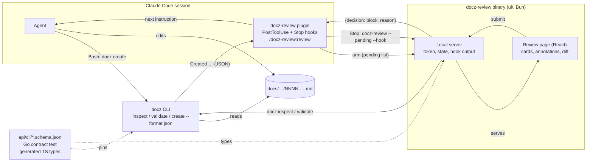
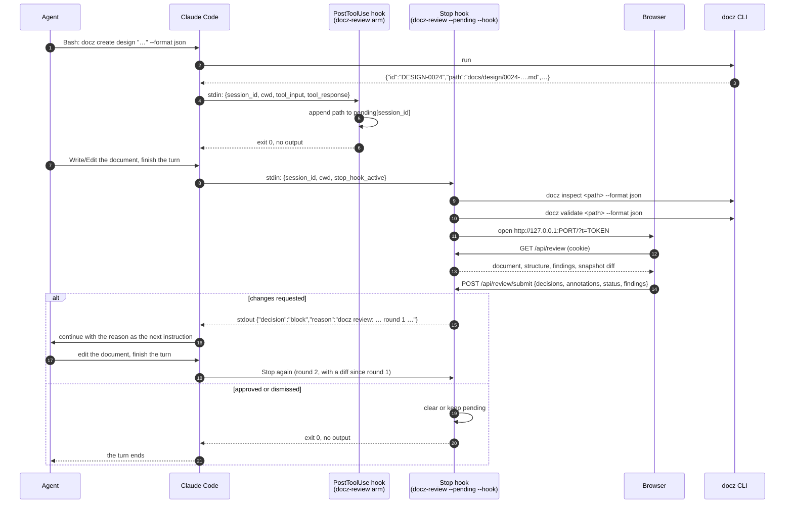
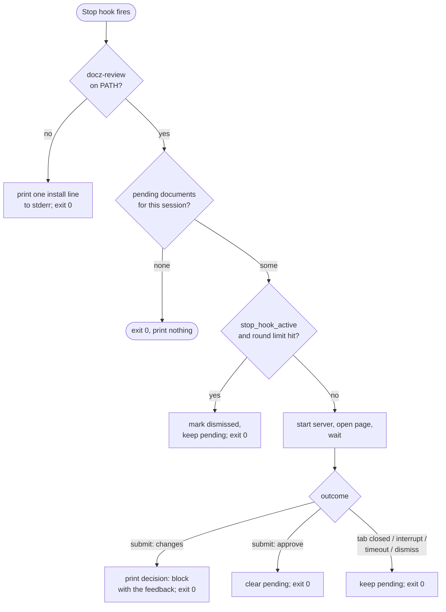
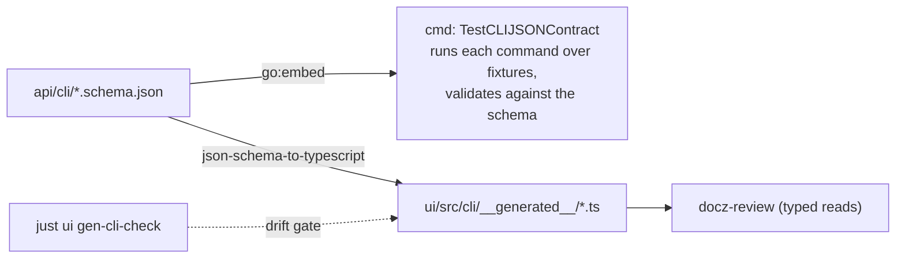

<!-- markdownlint-disable-file MD025 MD041 -->

# DESIGN-0024: docz-review: a blocking review page for agent-written documents

<!--toc:start-->
<!-- markdownlint-capture -->
<!-- markdownlint-disable MD013 -->
- [Overview](#overview)
- [Goals and Non-Goals](#goals-and-non-goals)
  - [Goals](#goals)
  - [Non-Goals](#non-goals)
- [Background](#background)
- [Detailed Design](#detailed-design)
  - [1. Shape](#1-shape)
  - [2. A session, end to end](#2-a-session-end-to-end)
  - [3. docz inspect and the JSON contract](#3-docz-inspect-and-the-json-contract)
  - [4. Validation of one document](#4-validation-of-one-document)
  - [5. The review page](#5-the-review-page)
  - [6. The local server](#6-the-local-server)
  - [7. Anchors](#7-anchors)
  - [8. The feedback and the review record](#8-the-feedback-and-the-review-record)
  - [9. The plugin](#9-the-plugin)
  - [10. Release and install](#10-release-and-install)
- [API / Interface Changes](#api--interface-changes)
- [Data Model](#data-model)
- [Testing Strategy](#testing-strategy)
- [Migration / Rollout Plan](#migration--rollout-plan)
- [Open Questions](#open-questions)
  - [1. What does the design assume about the Stop hook's timeout ceiling?](#1-what-does-the-design-assume-about-the-stop-hooks-timeout-ceiling)
  - [2. What should docz-review do when the session is interrupted mid-review?](#2-what-should-docz-review-do-when-the-session-is-interrupted-mid-review)
  - [3. How are the TypeScript types produced from the schemas?](#3-how-are-the-typescript-types-produced-from-the-schemas)
  - [4. Is there a limit on review rounds?](#4-is-there-a-limit-on-review-rounds)
  - [5. How is docz list --format json governed?](#5-how-is-docz-list---format-json-governed)
  - [6. Does docz inspect carry the document's content?](#6-does-docz-inspect-carry-the-documents-content)
  - [7. How are the page's assets bundled into the binary?](#7-how-are-the-pages-assets-bundled-into-the-binary)
  - [8. What renders selections and existing annotations in the page?](#8-what-renders-selections-and-existing-annotations-in-the-page)
  - [9. How is the diff since the previous round computed and shown?](#9-how-is-the-diff-since-the-previous-round-computed-and-shown)
  - [10. Where does docz-review keep its state?](#10-where-does-docz-review-keep-its-state)
  - [11. Where is docz-review configured?](#11-where-is-docz-review-configured)
  - [12. Does the arming hook use Claude Code's if pre-filter?](#12-does-the-arming-hook-use-claude-codes-if-pre-filter)
- [References](#references)
<!-- markdownlint-restore -->
<!--toc:end-->

<!--docz:overview:start-->
## Overview

`docz-review` is a local, opt-in review step for documents an agent writes
in a Claude Code session. A `PostToolUse` hook arms it when `docz create`
runs; a `Stop` hook opens a page at the end of the agent's turn; the
person answers open questions by letter, annotates passages, and submits;
the review returns to the agent as one message through the hook's
`decision: block` output, and the rounds repeat until the person approves.

It is a Bun/TypeScript binary built as a second entry point in `ui/`, with
its own Claude Code plugin in claude-skills. The docz CLI gains JSON
output and nothing else: `docz inspect <id|path> --format json` reports one
document's structure, `docz validate` accepts an ID or path, and
`docz create --format json` reports what it wrote. Each JSON output has a
committed JSON Schema, a Go contract test, and generated TypeScript types.
This is the design INV-0027 asked for.

<!--docz:overview:end-->

## Goals and Non-Goals

<!--docz:goals:start-->
### Goals

- **One message per round.** Every decision a reviewer makes on the page
  (a letter per open question, an annotation per passage, a status, a
  dismissed or accepted finding) reaches the agent as one ordered message
  it can act on without searching the document.
- **No second parser.** The page's structure (regions, open questions,
  tasks, headings, findings, statuses) comes from the Go readers through
  the CLI's JSON, so it cannot drift from what `docz validate` sees.
- **A pinned contract.** Each JSON output is governed by a committed
  schema with a `schema_version`, held by a Go test over the CLI's real
  output, and typed on the TypeScript side from the same schema.
- **Anchors that survive edits.** An annotation names its region, the
  nearest heading, and a quote with context, and is resolved again when
  the feedback is written, so the line the agent sees is current.
- **Opt-in and inert when absent.** Nothing changes for a session without
  the `docz-review` plugin, and a plugin installed without its binary
  never blocks a session.
- **The same release.** `docz-review` ships from the same `v*` tag as
  `docz` and `docz-api`, attached to the same GitHub release, installable
  with mise.
- **Ready for a hosted version.** The review components, the inspect
  shape, and the submitted review's JSON are the pieces a docz-api and
  docz-site version (INV-0023) would reuse.

<!--docz:goals:end-->

<!--docz:non-goals:start-->
### Non-Goals

- **Writing the document from the page.** The review writes nothing; the
  agent edits in response. INV-0027 question 5 settled this: a second
  writer racing the agent is worse than a round trip.
- **A review server in the `docz` binary**, or any page rendered in Go.
  INV-0027's Context explains why the first draft was dropped.
- **docz-site or docz-api changes.** `api/openapi.yaml` is untouched. The
  review runs on a working copy, usually on a feature branch docz-api
  never ingests.
- **A history store, share links, URL or HTML annotation, code review,
  an "ask AI" button.** Plannotator has them; this tool does not.
- **Unauthenticated access to the local server.** Section 6 requires a
  per-session token.
- **Other agents' hook formats.** The first release targets Claude Code's
  hook contract. The feedback message and its JSON are agent-neutral so a
  second integration is a thin adapter, but none is built here.
- **A neovim or terminal front end.** The feedback format is kept
  independent of the page so one could follow (INV-0027 Observation 10),
  but the browser page is the only front end designed here.

<!--docz:non-goals:end-->

<!--docz:background:start-->
## Background

INV-0027 (Concluded 2026-10-10) studied the loop of writing docz
documents with an agent: the agent creates and fills a document, the
person reads it in a read-only viewer, re-locates each thing to change in
chat, answers the open questions as prose, and reads the whole document
again to find what changed. It compared Plannotator, whose concept is a
page that blocks a hook until a person decides, and concluded that the
page is the hard part and that docz already computes everything the page
needs except the page itself. Its nine open questions were all resolved:
the tool lives in `ui/`; the CLI exposes `docz inspect` and a
single-document `docz validate`; the contract is JSON Schema plus a Go
test plus generated types; `docz create` arms and the `Stop` hook opens;
the review writes nothing; anchors are region, heading, and a quote with
context; the hook blocks with a long ceiling; it releases from the same
tag; and it has its own plugin. This design does not reopen them.

The pieces this design builds on:

- **`pkg/doczcore/docparse` and `kinds`** (DESIGN-0014, DESIGN-0015) are
  the readers: `Headings`, `TaskItems`, `Regions`, and
  `kinds.OpenQuestions`, which reads `Question{Number, Title, Options[]
  {Letter, Text, Recommended}, Resolved, Line}` from an `open-questions`
  region. The fleet's open-questions format (`### N.` headings, `- a.`
  options, a `*(recommendation)*` marker, a `> **Resolved DATE: (a).**`
  quote) is what the page's question cards render.
- **`pkg/doczcore/repo`** holds `Find`, `FindIn`, `Validate`, and the
  typed errors every command maps to exit codes; `cmd/validate.go` is the
  one place that composes the three validation tiers, and the only type
  switch in the repository.
- **The CLI's JSON today.** `docz list --format json` prints a bare array
  of `listEntry`; `docz validate --format json` prints
  `repo.ValidateReport` (or `validateFixOutput` under `--fix`);
  `docz status set` and `docz export confluence` have their own shapes.
  None has a schema or a version field.
- **`ui/`** is docz-site: Bun, Vite, React 19, a markdown pipeline in
  `src/markdown` (unified, remark-gfm, GitHub alerts, Shiki, Mermaid,
  cross-references, `rehype-sanitize` with an XSS test), and a Bun
  production server in `server/serve.ts`. `preprocess.ts` cuts the
  frontmatter and the ToC block before rendering, which shifts every
  later line; the review needs positions, so it renders differently
  (section 4).
- **Claude Code hooks.** Verified against the current documentation for
  this design: a `PostToolUse` hook receives JSON on stdin with
  `session_id`, `cwd`, `tool_name`, `tool_input` (for `Bash`: `command`,
  `description`, `timeout`), and `tool_response`; a `Stop` hook blocks by
  printing `{"decision":"block","reason":"…"}`, and the reason is what the
  agent continues with; a command hook's default timeout is 600 seconds
  and each hook may set its own `timeout`; a plugin declares hooks in
  `hooks/hooks.json` and reaches its files through `${CLAUDE_PLUGIN_ROOT}`.
  The donald-loop plugin in claude-skills is the working proof of the
  block-and-continue contract: its `Stop` hook prints exactly that JSON
  and the agent resumes with the reason as its instruction. Three things
  the documentation does not state are listed in the open questions:
  the exact `tool_response` shape for a `Bash` call, what interrupting
  the session does to a running `Stop` hook, and whether there is a
  ceiling on `timeout`.
- **The docz plugin** (claude-skills `plugins/docz`, 2.0.1) carries
  skills and agents only, no hooks. It stays that way.

<!--docz:background:end-->

<!--docz:detailed-design:start-->
## Detailed Design

### 1. Shape

Five pieces, three of them new, in two repositories.



| Piece | Where | New? |
| --- | --- | --- |
| `docz inspect`, `docz validate <id\|path>`, `docz create --format json` | `cmd/`, over `pkg/doczcore/repo` | New commands and flags; no new library package |
| JSON Schemas, Go contract test, generated TypeScript types | `api/cli/`, `cmd/`, `ui/src/cli/__generated__/` | New |
| `docz-review` server and page | `ui/review/`, `ui/src/review/`, sharing `ui/src/markdown` | New entry point |
| Release artifacts | `.goreleaser.yml`, `release.yml`, `prerelease.yml` | Extended |
| `docz-review` plugin | claude-skills `plugins/docz-review` | New plugin |

The `docz` binary stays headless: it reads a repository and prints JSON.
`docz-review` owns everything interactive. The CLI never knows the review
exists, which is what keeps the two releasable from one tag without one
depending on the other's code.

### 2. A session, end to end



**Arming.** The `PostToolUse` hook matches `Bash`. The hook command is
`docz-review arm --from-hook`; it reads the hook JSON, and when
`tool_input.command` invokes `docz create` it records the created
document under the session's pending list. Two readings of the result
are supported, in this order:

1. `tool_response` carries the JSON `docz create --format json` printed:
   the `path` field is recorded.
2. Otherwise the `Created <TYPE>: <path>` line is parsed from the tool's
   output. This keeps a session whose agent ran `docz create` without the
   flag reviewable; the plugin's skill tells the agent to pass the flag.

Any other command exits 0 silently. The hook never prints to stdout, so
nothing lands in the transcript (a `PostToolUse` hook that exits 0 shows
nothing).

**Opening.** The `Stop` hook runs `docz-review --pending --hook`. Its
decision tree:



- With nothing pending it prints nothing, so a session that never ran
  `docz create` is unaffected even with the plugin installed.
- With several pending documents one server serves them all with a
  switcher; each has its own round counter and outcome. The feedback for
  all reviewed documents is one message, document by document.
- `stop_hook_active` is true when Claude Code is already continuing
  because a `Stop` hook blocked. `docz-review` uses it only for the round
  limit (open question 4); it does not suppress the review, because the
  agent's revision is exactly what the next round reviews.
- **Approve** clears the document from the pending list and prints
  nothing. **Dismiss**, closing the tab, interrupting the session, and the
  hook timeout all keep it pending and print nothing, so the agent stops
  and `/docz-review:review` or the next `Stop` picks it up. A dismissed
  document is not re-opened by the next `Stop` in the same session unless
  the agent ran `docz create` again or the person asked; otherwise every
  later turn of an unrelated task would re-open the same page.

**`/docz-review:review <id|path>…`** is the plugin's skill. It runs
`docz-review <id|path> --hook` and then the same block-or-stop protocol
applies to that turn's `Stop`: the skill adds the document to the pending
list and tells the agent to finish its turn, which opens the page.
A bare `/docz-review:review` lists the session's pending documents.

**Walking away.** The review ends in minutes in the normal case; the hook
`timeout` (INV-0027 question 7: 86400 seconds, a ceiling) is what
happens when it does not. On timeout Claude Code discards the hook's
result and the agent stops, which is "dismiss". `docz-review` installs
handlers for `SIGTERM`, `SIGHUP`, `SIGINT`, and end-of-stdin and treats
each as dismiss, writing the pending state before it opens the page, so
whatever Claude Code does to a hook on interrupt (open question 2) loses
nothing: the worst case is a page that stops answering.

### 3. `docz inspect` and the JSON contract

`docz inspect <id|path> [--format text|json]` prints one document's
structure. The argument resolves as `repo.Find` does for an ID and as a
repo-relative or absolute path otherwise; a path outside the repository
root is an error (exit 2), because `repo` reports repo-relative paths and
a document the config does not own has no type. `text` is a short
summary for people; `json` is the contract:

```json
{
  "schema_version": 1,
  "docz_version": "2.2.0",
  "path": "docs/design/0024-docz-review-….md",
  "type": "design",
  "id": "DESIGN-0024",
  "schema": "design",
  "frontmatter": {
    "id": "DESIGN-0024",
    "title": "docz-review: …",
    "status": "Draft",
    "author": "Donald Gifford",
    "created": "2026-10-23"
  },
  "statuses": ["Draft", "In Review", "Approved", "Implemented", "Rejected"],
  "inferred": false,
  "regions": [
    { "kind": "overview", "start": 48, "end": 66, "depth": 0, "closed": true }
  ],
  "headings": [
    { "level": 2, "text": "Overview", "anchor": "overview", "line": 49 }
  ],
  "open_questions": [
    {
      "number": 1,
      "title": "Where do the schemas live?",
      "line": 812,
      "options": [
        { "letter": "a", "text": "…", "recommended": true },
        { "letter": "b", "text": "…", "recommended": false }
      ],
      "resolved": null
    }
  ],
  "tasks": [
    { "line": 300, "text": "Add the schema", "checked": false, "indent": 0 }
  ],
  "content": "---\nid: DESIGN-0024\n…"
}
```

Each field is one call: `document.ParseFrontmatter`, `docparse.Regions`
through `kinds.ResolveRegions` with the type's spec (so an unmarked
document reports `inferred: true` and regions all the same),
`docparse.Headings` plus `AnchorSlug`, `kinds.OpenQuestions` shifted to
document lines, `docparse.TaskItems`, and `TypeConfig.Statuses` from the
resolved config. `resolved` is the `Resolved` field when the question
carries a resolution quote and `null` otherwise. `content` is the bytes
the readers were run over, so the page renders exactly what the lines
refer to and a concurrent edit cannot split the two (open question 6).
The frontmatter is reported as the parsed `Frontmatter` with its yaml
names; unknown keys are not carried.

Line numbers everywhere are 1-based document lines, the shape `validate`
already reports, so a region's content is `start+1` through `end-1` and
an annotation's `line` is comparable with a finding's.

**Where the structure comes from is the rule.** `inspect` calls readers
in `pkg/doczcore`; it adds no reader of its own, no per-type field, and no
type switch. Typed fields (`impl.Doc.Phases`) stay out: the page does not
need them, and the server's `internal/mcp` already has the one type-name
switch that maps a name to a package. If a later consumer wants them,
they are a `--typed` flag mirroring the MCP server's `Fields`, not a
change to this shape.

**The contract.** Three JSON outputs are governed:

| Output | Schema | `schema_version` |
| --- | --- | --- |
| `docz inspect --format json` | `api/cli/inspect.schema.json` | top-level field |
| `docz validate … --format json` | `api/cli/validate.schema.json` | top-level field, added to `ValidateReport` and `validateFixOutput` |
| `docz create --format json` | `api/cli/create.schema.json` | top-level field |

`docz list --format json` keeps its bare array; a schema is committed for
it too, but the array cannot carry a version field and the shape is
frozen by the parity suite, so it is governed by the schema file's own
`$id` only (open question 5).

The schemas live beside `api/openapi.yaml` and are embedded by a sibling
Go package `api/cli` (`//go:embed *.schema.json`), so the contract test
and any consumer read the same bytes. Draft 2020-12, `additionalProperties:
false` everywhere, as the OpenAPI spec does, so an added or renamed field
fails the test rather than drifting. `schema_version` is an integer that
bumps on a breaking change only; an additive field bumps nothing and the
schema. `docz-review` reads `schema_version` and `docz_version` from the
first `inspect` call and refuses, naming the minimum docz version it was
built against, when the version is not the one it knows.



The Go test uses a JSON Schema validator as a test-only dependency (as
`kin-openapi` is for the API's contract test) and runs each command
through the `Runner` with `Out: &bytes.Buffer{}` over the parity
fixtures, which already carry a document of every built-in type plus a
custom one. The TypeScript types are generated into
`ui/src/cli/__generated__/`, gitignored like the orval client, with
`gen-cli` and `gen-cli-check` recipes mirroring `gen-api` and
`gen-api-check` (open question 3).

### 4. Validation of one document

`docz validate` today takes type names. It gains the `inspect` argument
grammar: an argument that resolves as an ID or a path validates that
document alone, through the same three tiers (`repo.Validate` scoped to
one entry, then `typeValidator`), and prints the same `ValidateReport`
shape with one type and one document in it. Index drift and the template
check are skipped for a single document, because they are repository
findings, not the document's; `--fix` works on the one document. An
argument that is neither a type, an ID, nor a path is the existing
unknown-type error. The resolution order is type name, then ID, then
path, so a file named like a type cannot shadow the type listing.

`docz-review` runs `validate` once per round and shows the findings before
the text: an error is red, a warning amber, each with "dismiss" (recorded
in the feedback as dismissed) and "fix this" (recorded as a request).
The `Code` is the key the page switches on for wording and for the
"fix" shortcut; `Detail` is shown as is.

### 5. The review page

The page is React in `ui/src/review/`, sharing `ui/src/markdown` and the
document header, status badge, and frontmatter table components with
docz-site. What it adds:

- **A position-preserving render mode.** `preprocess.ts` cuts the
  frontmatter and the ToC block, shifting every later line. The review
  mode blanks those lines instead (as `pkg/export/confluence` does), so
  the mdast `position` of every block is its document line. A rehype
  step stamps `data-line` on each block element from that position, and
  the sanitize schema (`schema.ts`) allows the attribute on the elements
  it stamps and nothing else, keeping the XSS test honest. The ToC block
  is blanked rather than rendered because the page has its own outline.
- **Region wrappers.** With `regions[]` from `inspect` and `data-line` on
  every block, the page wraps each region's blocks in a labelled
  `<section data-region="findings" data-ordinal="0">`. Regions nest, so
  the wrap walks depth-first and a block belongs to the deepest region
  that contains its line. The wrapper is what an annotation's anchor is
  computed from.
- **Question cards.** One card per `open_questions[]` entry, rendered in
  a sidebar and also inline at the question's heading: a button per
  option with the recommended one preselected, an "Other" text box, and
  an optional note. A question with `resolved` set is read-only and shows
  its resolution. A card with no choice made sends nothing, which the
  feedback lists as "no answer; leave open".
- **Annotations.** Selecting text in the document opens a popover with
  four actions: comment, replace (with a text box), delete, and "looks
  good"; a document-level comment box sits at the top. Each annotation is
  anchored (section 7) and listed in the sidebar in document order, where
  it can be edited or removed before submitting. The rendering of
  existing annotations uses the CSS Custom Highlight API, so no DOM is
  inserted into the rendered markdown (open question 8).
- **Findings** from section 4, above the document.
- **Status.** A select over `statuses` with the current status chosen;
  changing it is a request in the feedback, not a write.
- **IMPL tasks.** Each `tasks[]` entry renders with a checkbox; toggling
  one is a request ("check task at line 300"), not a write.
- **A diff since the previous round.** The server snapshots `content` at
  each round's open; from round two the page shows a per-region "changed"
  badge and a word-level diff toggle inside the region, computed with
  the `diff` package (open question 9). Unchanged regions can be
  collapsed in one click, which is how the second reading stops costing
  the first reading's time.
- **Submit, approve, dismiss.** Three buttons. Submit with no decisions
  and no annotations is approve.

No Tailwind, no CodeMirror: the page uses docz-site's theme and
components, and editing in the page is a non-goal.

### 6. The local server

`ui/review/server.ts` is a Bun HTTP server in the shape of
`ui/server/serve.ts`, without the proxy, metrics, or tracing. It:

1. Resolves the repository root (`--repo-root`, else the hook's `cwd`,
   else the working directory) and the `docz` binary (`--docz`, else
   `PATH`), and checks `docz version` and the schema version once.
2. For each document runs `docz inspect` and `docz validate`, keeps the
   results as the round's snapshot, and stores the previous round's
   snapshot for the diff.
3. Binds `127.0.0.1` on a random port, generates a 32-byte random token,
   and opens `http://127.0.0.1:<port>/?t=<token>` in the default browser
   (`open`, `xdg-open`, or the `BROWSER` variable; `--no-open` prints the
   URL).
4. Serves the page's assets (bundled into the binary at compile time,
   open question 7), `GET /api/review`, `POST /api/review/submit`,
   `POST /api/review/dismiss`, and a `GET /api/events` server-sent
   stream the page uses to learn that the server is gone.
5. On submit, writes the review record (section 8), prints the hook
   output or the `--json` record or the text, and exits.

**Token and origin.** Every request after the first load must carry the
token: the first `GET /?t=` sets it as an `HttpOnly`, `SameSite=Strict`
cookie and redirects to `/`; `/api/*` compares the cookie in constant
time and answers 401 without it. The `Host` header must be
`127.0.0.1:<port>` or `localhost:<port>`, else 421. No CORS headers are
sent, and `POST` requires `Content-Type: application/json` and
`Sec-Fetch-Site: same-origin` when the browser sends it. The port is not
a secret; the token is. A submission becomes the agent's next
instruction, which is why a forged one is a prompt injection and the
defence is not optional. The token is never logged or written to disk.

**Hook output.** Under `--hook`, stdout carries exactly one JSON object
when changes are requested and nothing otherwise, as the donald-loop
Stop hook does; every diagnostic goes to stderr. Under `--json` the
review record is printed; with neither, the text message.

### 7. Anchors

An annotation's anchor is INV-0027 question 6's shape:

```json
{
  "region": "findings",
  "ordinal": 0,
  "heading": "Observation 2",
  "exact": "Anchors are quotes.",
  "prefix": "the passage, or the text appears twice, the anchor is lost. ",
  "suffix": " When the agent rewrites",
  "line": 212
}
```

- `region` and `ordinal` name the deepest region containing the
  selection and which one of that kind it is in document order;
  `heading` is the nearest heading above the selection's first line, as
  `headings[]` reports it; `exact` is the selected text, `prefix` and
  `suffix` up to 32 characters each side within the same block; `line` is
  the document line of the block the selection starts in. A selection
  that spans blocks is anchored at its first block and `exact` is cut at
  the block's end, with the full selection kept in the annotation's
  `selection` for the person's own reference.
- **Resolution happens when the feedback is written**, against the
  document as it is then: find `exact` in the region's current bytes;
  with several hits, pick the one whose `prefix` and `suffix` score best
  and whose line is nearest the hint; with none, report the region and
  heading with the line as "about line N". The feedback line carries the
  resolved line, so the agent reads where the text is now.
- The same shape is what INV-0021 question 2 recommended for Confluence
  comments, and `pkg/export/confluence`'s `carryMarkers` already scores
  context and heading the same way. The TypeScript resolver follows its
  rules (an exact single hit wins; a strict-best context score wins; a
  tie is lost) so the two tools agree on what an anchor means.

### 8. The feedback and the review record

The text message is INV-0027 Observation 7's, one per round, document by
document:

```text
docz review: DESIGN-0024 docz-review…, round 2: changes requested

Open questions:
- Q1 Where do the schemas live? → a
- Q3 How are the TypeScript types produced? → other:
  "put the shapes in api/openapi.yaml"
- Q5 (no answer; leave open)

Annotations:
1. [detailed-design › 3. docz inspect, line 212] "Anchors are quotes."
   comment: Say what INV-0021 decided once it closes.
2. [open-questions › 4., line 401] delete: option (c)
3. [background, line 96] replace "day-to-day" → "everyday"
4. [document] Shorten the Background section.

Status: set to In Review
Tasks: check line 300
Validation: 1 warning dismissed (references.no-link, line 589);
  fix frontmatter.status at line 3

Resolve each open question in the document in the fleet's format
(`> **Resolved 2026-10-23: (a).**`), apply the annotations, then finish
your turn so the next round can open.
```

The closing instruction is what makes the round loop self-driving: the
agent edits, finishes, and the `Stop` hook opens the next round. It is
emitted only for `block`.

The review record is the same content as JSON, written under the
session's state directory as `reviews/<id>/round-<n>.json` and printed
under `--json`:

```json
{
  "schema_version": 1,
  "document": { "id": "DESIGN-0024", "path": "docs/design/0024-….md", "type": "design" },
  "round": 2,
  "outcome": "changes",
  "questions": [
    { "number": 1, "choice": "a" },
    { "number": 3, "choice": "other", "text": "put the shapes in api/openapi.yaml" }
  ],
  "annotations": [
    { "kind": "comment", "anchor": { "…": "…" }, "text": "Say what INV-0021 decided once it closes." },
    { "kind": "replace", "anchor": { "…": "…" }, "replacement": "everyday" },
    { "kind": "delete", "anchor": { "…": "…" } },
    { "kind": "document", "text": "Shorten the Background section." }
  ],
  "status": "In Review",
  "tasks": [ { "line": 300, "checked": true } ],
  "findings": [
    { "code": "references.no-link", "line": 589, "action": "dismiss" },
    { "code": "frontmatter.status", "line": 3, "action": "fix" }
  ]
}
```

This record is the payload a hosted version would send as a workflow
signal (INV-0027 Observation 9), and its schema lives beside the CLI's
in `api/cli/review.schema.json`, so the shape is governed from the start
even though only `docz-review` writes it today.

### 9. The plugin

`plugins/docz-review` in claude-skills:

```text
plugins/docz-review/
  .claude-plugin/plugin.json
  hooks/hooks.json
  hooks/arm.sh          # exec docz-review arm --from-hook, or exit 0 with a note
  hooks/stop.sh         # exec docz-review --pending --hook, or exit 0 with a note
  skills/review/SKILL.md   # /docz-review:review
  README.md
```

```json
{
  "hooks": {
    "PostToolUse": [
      {
        "matcher": "Bash",
        "hooks": [
          { "type": "command", "command": "bash \"${CLAUDE_PLUGIN_ROOT}/hooks/arm.sh\"", "timeout": 30 }
        ]
      }
    ],
    "Stop": [
      {
        "hooks": [
          { "type": "command", "command": "bash \"${CLAUDE_PLUGIN_ROOT}/hooks/stop.sh\"", "timeout": 86400 }
        ]
      }
    ]
  }
}
```

The two shell wrappers exist so a plugin installed without the binary
prints one line (`docz-review is not installed; see <url>`) to stderr and
exits 0. They pass stdin through unchanged. The `PostToolUse` hook could
use Claude Code's `if` pre-filter (`"if": "Bash(docz *)"`) to skip
running for unrelated commands; it is added once the field is confirmed
in the plugin's minimum Claude Code version, and the wrapper's own check
on `tool_input.command` stays either way.

The `review` skill tells the agent: run `docz-review <args> --hook`'s
arming equivalent (`docz-review arm <id|path>`), then finish the turn.
The plugin's README says to pass `--format json` to `docz create`, which
the docz plugin's `create` skill will also say once the flag exists.

### 10. Release and install

`bun build --compile` produces one executable per target from
`ui/review/server.ts` with the page's assets embedded:
`bun-linux-x64`, `bun-linux-arm64`, `bun-darwin-x64`, `bun-darwin-arm64`,
named `docz-review_<os>_<arch>` to match the Go archives' names.

goreleaser has no Bun builder, so the artifacts come from a step in the
release workflow rather than from `.goreleaser.yml`: the `goreleaser`
job gains a `bun` setup, runs `just ui build-review` (which builds the
page, then compiles the four targets into `ui/dist-review/`), and
goreleaser attaches them through `release.extra_files`. The same step
runs in `prerelease.yml`, so a beta carries the binaries. The
`checksums.txt` goreleaser signs is computed over its own artifacts
only; the Bun binaries get their own `docz-review_checksums.txt` listed
in `extra_files`, signed by the same GPG step. A Bun binary is not a Go
build, so the SBOM step does not cover it; `just ui licenses` (the Bun
licence check from #134, when it lands) is the equivalent gate.

Install with mise's `github:` backend and an asset pattern, documented
in the plugin's README and `ui/README.md`:

```toml
[tools]
"github:donaldgifford/docz" = { version = "latest", asset_pattern = "docz-review_{{os}}_{{arch}}" }
```

`docz-review --version` prints its own version, the docz version it
was built against, and the schema versions it knows.

<!--docz:detailed-design:end-->

<!--docz:api-changes:start-->
## API / Interface Changes

**docz CLI** (additive; the parity suite is unaffected because every
change is a new command, a new argument form, or a new flag value):

| Change | Exit codes |
| --- | --- |
| `docz inspect <id\|path> [--format text\|json]` | 0; 1 not found; 2 unknown type, path outside the root, bad `--format` |
| `docz validate <id\|path> [--format] [--strict] [--fix]` | As today: 0 clean; 1 findings; 2 usage |
| `docz create <type> <title> --format json` | As today; the JSON carries `id`, `path`, `type`, `generic_template` |
| `schema_version` on `validate --format json` | Additive field |

`docz inspect --format json` output is section 3's shape. `docz create
--format json` prints `{"schema_version":1,"id","type","path","title",
"generic_template"}`; the stderr note about the generic template is
unchanged.

**Library.** No new package. `cmd/inspect.go` composes existing readers;
if a second consumer wants the composition, it moves to `repo.Inspect`
then, not before.

**`api/`** gains `api/cli/` with `inspect`, `validate`, `create`,
`list`, and `review` schemas and a Go package embedding them.
`api/openapi.yaml` is unchanged.

**`ui/`** gains the `review` entry point, `src/review/`, `src/cli/`
(generated types), and recipes `gen-cli`, `gen-cli-check`,
`build-review`, `test-review`, and `dev-review` (the page against a
fixture repository, no hook). The `ui` CI job runs them; the path filter
is unchanged because the new inputs are under `ui/` and `api/`
already. `ui/CLAUDE.md` gains a docz-review section.

**docz-review** (new binary):

| Command | Does |
| --- | --- |
| `docz-review <id\|path>… [--hook\|--json] [--repo-root] [--no-open] [--timeout]` | Review the named documents now |
| `docz-review --pending --hook` | The `Stop` hook: review the session's pending documents |
| `docz-review arm <id\|path>… \| --from-hook` | Add to the pending list |
| `docz-review pending [--clear]` | List or clear the session's pending documents |
| `docz-review --version` | Versions and known schema versions |

Environment: `DOCZ_REVIEW_BROWSER` (else `BROWSER`),
`DOCZ_REVIEW_STATE_DIR` (else `$XDG_STATE_HOME/docz/review`),
`DOCZ_REVIEW_DOCZ` (the `docz` binary), `DOCZ_REVIEW_PORT` (else random).

**claude-skills** gains `plugins/docz-review`; `plugins/docz` is
unchanged except a sentence in its `create` skill about `--format json`.

<!--docz:api-changes:end-->

<!--docz:data-model:start-->
## Data Model

Nothing is stored in the repository or in any database. `docz-review`'s
state is per person, per session, under
`$XDG_STATE_HOME/docz/review/<session_id>/`:

```text
<session_id>/
  pending.json        # [{path, id, type, added, rounds, dismissed}]
  reviews/<id>/
    round-1.snapshot.md    # content at the round's open, for the diff
    round-1.json           # the review record (section 8)
```

`session_id` is the hook's; `docz-review` run by hand without a session
uses `manual`. The directory is removed when its pending list empties
and no review record is newer than seven days, on the next run.

The JSON Schemas under `api/cli/` are the only committed artefacts:

| Schema | Governs | Written by |
| --- | --- | --- |
| `inspect.schema.json` | `docz inspect --format json` | docz |
| `validate.schema.json` | `docz validate --format json` | docz |
| `create.schema.json` | `docz create --format json` | docz |
| `list.schema.json` | `docz list --format json` | docz |
| `review.schema.json` | the review record | docz-review |

Each has an `$id` of the form
`https://docz.dev/schemas/cli/<name>/v<schema_version>` and the
`schema_version` constant pinned as a `const` in the schema, so a
version bump is a schema edit and a Go constant edit that the contract
test ties together.

<!--docz:data-model:end-->

<!--docz:testing:start-->
## Testing Strategy

**Go.**

- `cmd/inspect_test.go`: the resolution grammar (ID, repo-relative path,
  absolute path inside the root, a path outside, an unknown ID), the
  text form, and the JSON form over a document of each built-in type
  and a custom one; an unmarked document reports `inferred: true`.
- `cmd/validate_test.go` gains the single-document cases: a document
  with findings, a clean one, `--fix` on one document, and the
  type-name-first resolution.
- `cmd/create_test.go` gains `--format json`.
- `cmd/cli_contract_test.go` (new): every governed command over the
  parity fixtures, output validated against its embedded schema, and the
  `schema_version` constants equal to the schemas' `const`s. A
  revert drill in the IMPL proves a renamed field fails it.
- `api/cli`'s package test parses every schema and checks
  `additionalProperties: false` is set on every object.
- The parity suite is unchanged: no normaliser is added, because no
  existing output changes.

**TypeScript.**

- Unit tests (vitest) for the position-preserving preprocess (line
  numbers of every block equal the document's), the `data-line` stamp,
  the region wrap over nested regions, the anchor computation from a
  `Range`, and the anchor resolver over the cases
  `pkg/export/confluence`'s `carryMarkers` tests (one hit, several with
  context, none), ported with the same expected outcomes.
- The feedback formatter, golden-tested against section 8's text from
  the record.
- Server tests (`bun test ui/review/`): token and `Host` enforcement,
  the three endpoints, the hook output under each outcome, signal
  handling as dismiss, and the pending list.
- The schema drift gate: `gen-cli-check` in `just ui ci`.
- Playwright: one end-to-end review over the MSW-free fixture
  repository: open, answer a question, annotate, submit, read the
  printed message.

**Hook contract.** A Phase 0 drill in the IMPL, run by hand before any
page exists: a plugin with a `Stop` hook that sleeps longer than the
600-second default under a configured `timeout`, prints `block`, and is
interrupted mid-wait, to settle open questions 1 and 2 by observation.
The findings go into the design's Decisions section and the hook
wrappers.

**Release.** A beta tag carrying the four `docz-review` binaries,
installed with mise on a macOS and a Linux machine, running one review
against this repository.

<!--docz:testing:end-->

<!--docz:rollout:start-->
## Migration / Rollout Plan

Nothing migrates: no existing output, file, or config changes. The IMPL
sequences the work so each step is usable alone:

1. **Phase 0, the hook drill** (claude-skills, no release): confirm the
   `Bash` `tool_response` shape, the `timeout` ceiling, and interrupt
   behaviour; record them in Decisions.
2. **Phase 1, the CLI** (docz, `minor`): `docz inspect`, single-document
   `docz validate`, `docz create --format json`, `api/cli/` schemas and
   the contract test. Useful to agents and scripts on its own; the docz
   plugin's skills can start using `inspect` to list open questions.
3. **Phase 2, the types and the page** (docz, `dont-release` PRs):
   generated types, the position-preserving renderer, question cards,
   annotations and anchors, findings, the diff.
4. **Phase 3, the server and the binary**: token, endpoints, hook
   output, state, `bun build --compile`, the release workflow step; a
   beta tag with the binaries.
5. **Phase 4, the plugin** (claude-skills): hooks, wrappers, the skill,
   the README; a trial on this repository's own documents.
6. **Phase 5, release** (docz, `minor`): the first tag carrying the
   binaries; `ui/CLAUDE.md`, the root `CLAUDE.md`, and the memory
   updated.

Rollback at any phase is to not install the plugin: the CLI additions
are inert without a caller, and the binaries are release assets nobody
has to download.

<!--docz:rollout:end-->

<!--docz:open-questions:start-->
## Open Questions

### 1. What does the design assume about the `Stop` hook's timeout ceiling?

The documentation gives the command-hook default (600 seconds) and the
per-hook `timeout` field, but states no maximum. INV-0027 chose 86400
as a ceiling, not an expected wait.

- a. **Keep 86400 in the plugin and verify it in the Phase 0 drill;
  if Claude Code caps it lower, document the cap and let
  `docz-review --timeout` be the tunable.** *(recommendation)* The drill
  is one afternoon and settles it by observation; the plugin ships with
  what was observed.
- b. Ship 3600 now, on the grounds that a review longer than an hour is
  a walk-away either way, and let `--timeout` go longer for whoever
  wants it.
- c. Ship with no `timeout`, taking the 600-second default, and treat a
  ten-minute review as the norm with everything else dismissed.
- d. Other.

### 2. What should `docz-review` do when the session is interrupted mid-review?

The documentation does not say whether a running `Stop` hook is killed,
left to finish, or has its output ignored when the person presses
Escape.

- a. **Treat every exit signal and end-of-stdin as dismiss, write the
  pending state before opening the page, and confirm in Phase 0 what
  Claude Code actually does.** *(recommendation)* Nothing is lost
  whichever it is: the document stays pending and the next `Stop` or
  `/docz-review:review` reopens it.
- b. Detach the server from the hook process so the page survives the
  interrupt and the review is delivered as a message on the next turn
  (Plannotator's newer mode). More to build, and INV-0027 question 7
  chose blocking.
- c. Other.

### 3. How are the TypeScript types produced from the schemas?

- a. **`json-schema-to-typescript` in a `gen-cli` script, output
  gitignored under `ui/src/cli/__generated__/`, with `gen-cli-check` as
  the drift gate, mirroring orval's `gen-api`.** *(recommendation)* One
  dev dependency, one recipe shape the project already has.
- b. Hand-written types with a vitest that validates a fixture of each
  command's output against both the schema and the type (through a
  schema validator). No generator, but two things to edit per change.
- c. Commit the generated types and check them in CI.
- d. Other.

### 4. Is there a limit on review rounds?

The rounds repeat by themselves until approval. An agent that cannot
satisfy a request would reopen the same page every turn.

- a. **A soft limit: after `--max-rounds` (default 10) in one session,
  the `Stop` hook dismisses instead of opening, leaving the document
  pending, and the page shows the round number throughout.**
  *(recommendation)* The person can always continue with
  `/docz-review:review`; the limit only stops an unattended loop.
- b. No limit; approve or dismiss is the only way out, as INV-0027
  states.
- c. A limit of 3, on the theory that a third round means the
  conversation should move to chat.
- d. Other.

### 5. How is `docz list --format json` governed?

It is a bare array frozen by the parity suite, so a `schema_version`
field has nowhere to go.

- a. **Commit `list.schema.json` and validate it in the contract test
  without a version field; leave the output unchanged.**
  *(recommendation)* The shape is frozen anyway; the schema documents
  it and the test catches a drift. `docz-review` does not read it.
- b. Add `docz list --format json2` (or `--format json --envelope`)
  printing `{schema_version, documents}`, and deprecate the bare array
  on the v3 line.
- c. Leave `list` out of the contract entirely.
- d. Other.

### 6. Does `docz inspect` carry the document's content?

- a. **Yes, as `content`, the bytes the readers ran over.**
  *(recommendation)* One call gives the page a consistent structure and
  text; a file read between two calls could see an edit the line numbers
  do not. The cost is a larger JSON for a large document, which is
  nothing at the sizes docz documents have.
- b. No; the caller reads the file, and `inspect` reports a
  `content_sha256` the caller compares to detect a race.
- c. Behind a `--content` flag, off by default.
- d. Other.

### 7. How are the page's assets bundled into the binary?

- a. **Vite builds the review page (`ui/review.html` as a second input)
  into `ui/dist-review/`, and `server.ts` imports the built files with
  Bun's file imports so `bun build --compile` embeds them.**
  *(recommendation)* The page keeps docz-site's Vite config, plugins,
  and tests; only the server is Bun-bundled.
- b. Build the page with Bun's bundler too, skipping Vite. One tool, but
  the page then leaves the config docz-site's tests and Shiki/Mermaid
  setup depend on.
- c. Ship the assets beside the binary in the release archive instead of
  inside it. Simpler build, but no longer a single file for mise.
- d. Other.

### 8. What renders selections and existing annotations in the page?

- a. **A small in-house module: `window.getSelection()` to a `Range`,
  the anchor from the range and `data-line`, and the CSS Custom
  Highlight API to paint existing annotations without inserting DOM.**
  *(recommendation)* No dependency, no DOM mutation inside sanitized
  markdown (so the XSS test and the markdown components stay as they
  are), and the API is in every current browser.
- b. Fork or vendor Plannotator's `web-highlighter`, which wraps
  selections in `<span>` elements. Proven, but it mutates the rendered
  markdown and adds a dependency.
- c. Other.

### 9. How is the diff since the previous round computed and shown?

- a. **The `diff` package, word-level, per region: a changed region gets
  a badge and an inline toggle; unchanged regions collapse.**
  *(recommendation)* Small dependency, and regions are the unit the
  reviewer thinks in.
- b. CodeMirror's merge view over the whole document. Heavier, and it
  brings an editor the page does not otherwise need.
- c. No diff in the first release; changed regions are badged from a
  byte comparison only.
- d. Other.

### 10. Where does `docz-review` keep its state?

- a. **`$XDG_STATE_HOME/docz/review/<session_id>/`, outside the
  repository.** *(recommendation)* Nothing to gitignore, nothing a
  `docz validate` or `test/archive` scan can trip over, and a session's
  state is found by the id the hook passes.
- b. In the project, as `.claude/docz-review.local.json`, as donald-loop
  does. Visible beside the work, but it needs an ignore rule in every
  repository and two sessions in one checkout share a file.
- c. Other.

### 11. Where is `docz-review` configured?

Browser, port, timeout, round limit, and the `docz` binary.

- a. **Flags with `DOCZ_REVIEW_*` environment variables, no `.docz.yaml`
  block.** *(recommendation)* These are per-person settings; the
  repository's config describes the repository.
- b. A `review:` block in `.docz.yaml` for repository defaults, flags
  and variables over it. It would also be the first config block the
  Go side reads for nothing.
- c. Other.

### 12. Does the arming hook use Claude Code's `if` pre-filter?

- a. **Add `"if": "Bash(docz *)"` to the `PostToolUse` entry once the
  Phase 0 drill confirms the field on the plugin's minimum version, and
  keep the wrapper's own command check regardless.** *(recommendation)*
  It saves a process start per `Bash` call; the wrapper is correct
  without it.
- b. No pre-filter; the wrapper's check is enough and the plugin has one
  fewer version dependency.
- c. Other.

<!--docz:open-questions:end-->

<!--docz:references:start-->
## References

- [INV-0027](../investigation/0027-interactive-mode.md): the
  investigation this design implements
- [INV-0021](../investigation/0021-confluence-comments-as-a-view-layer-kept-across-source-changes.md):
  comment anchoring, the same shape
- [INV-0023](../investigation/0023-a-temporal-control-plane-for-docz-with-docz-api-as-coordinator.md):
  the hosted version this keeps ready for
- [DESIGN-0014](0014-the-docz-api-as-one-unit-packages-types-functions-and-the-cmd.md):
  the readers and the repository tier
- [DESIGN-0015](0015-structured-regions-and-docz-validate.md): regions,
  open questions, and validation
- [DESIGN-0021](0021-confluence-export-from-docz-api-per-repository-folders-in.md):
  `carryMarkers` and anchor scoring
- [DESIGN-0023](0023-a-read-only-mcp-server-in-docz-api-oauth-21-tokens-tools-and.md): the
  server's one type-name switch, `Fields`
- [Issue #116](https://github.com/donaldgifford/docz/issues/116): the
  decisions table from open questions
- [Claude Code hooks reference](https://code.claude.com/docs/en/hooks)
- [Claude Code plugin components](https://code.claude.com/docs/en/plugins/components)
- [Bun single-file executables](https://bun.sh/docs/bundler/executables)
- [CSS Custom Highlight API](https://developer.mozilla.org/en-US/docs/Web/API/CSS_Custom_Highlight_API)
- [json-schema-to-typescript](https://github.com/bcherny/json-schema-to-typescript)
- [Plannotator: approval gates and hooks](https://docs.plannotator.ai/open-source/reference/hooks)
- [mise `github:` backend](https://mise.jdx.dev/dev-tools/backends/github.html)

<!--docz:references:end-->
