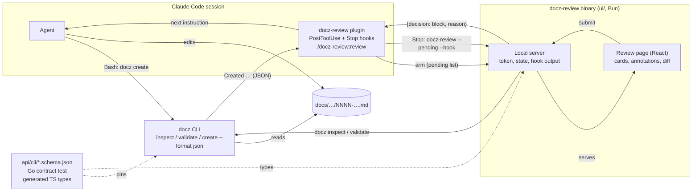
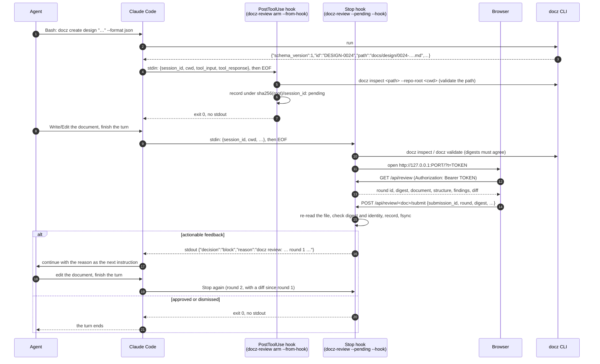
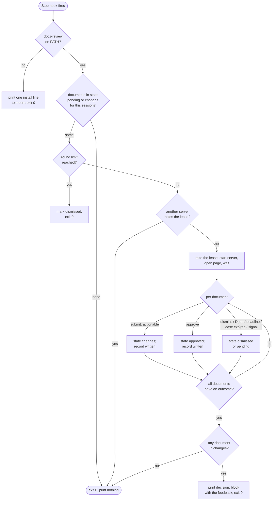
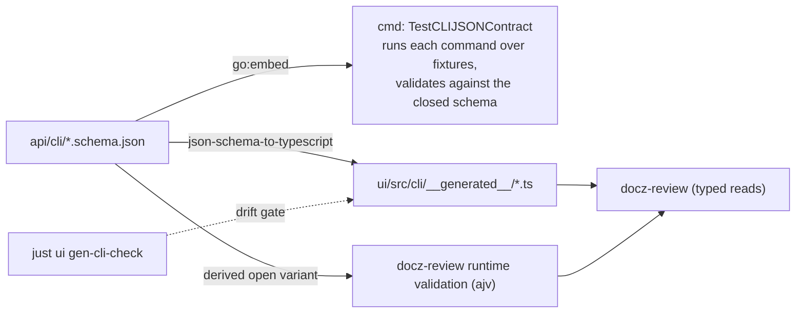

<!-- markdownlint-disable-file MD025 MD041 -->

# DESIGN-0024: docz-review: a blocking review page for agent-written documents

<!--toc:start-->
<!-- markdownlint-capture -->
<!-- markdownlint-disable MD013 -->
- [Overview](#overview)
- [Goals and Non-Goals](#goals-and-non-goals)
  - [Goals](#goals)
  - [Non-Goals](#non-goals)
- [Background](#background)
- [Detailed Design](#detailed-design)
  - [1. Shape](#1-shape)
  - [2. A session, end to end](#2-a-session-end-to-end)
  - [3. docz inspect and the JSON contract](#3-docz-inspect-and-the-json-contract)
  - [4. Validation of one document](#4-validation-of-one-document)
  - [5. The review page](#5-the-review-page)
  - [6. The local server](#6-the-local-server)
  - [7. Anchors](#7-anchors)
  - [8. The feedback and the review record](#8-the-feedback-and-the-review-record)
  - [9. The plugin](#9-the-plugin)
  - [10. Release and install](#10-release-and-install)
- [API / Interface Changes](#api--interface-changes)
- [Data Model](#data-model)
- [Testing Strategy](#testing-strategy)
- [Migration / Rollout Plan](#migration--rollout-plan)
- [Adversarial Review](#adversarial-review)
  - [Blocking findings](#blocking-findings)
  - [Additional suggestions and corrections](#additional-suggestions-and-corrections)
  - [Acceptance checks before approval](#acceptance-checks-before-approval)
- [Open Questions](#open-questions)
  - [1. What does the design assume about the Stop hook's timeout ceiling?](#1-what-does-the-design-assume-about-the-stop-hooks-timeout-ceiling)
  - [2. What should docz-review do when the session is interrupted mid-review?](#2-what-should-docz-review-do-when-the-session-is-interrupted-mid-review)
  - [3. How are the TypeScript types produced from the schemas?](#3-how-are-the-typescript-types-produced-from-the-schemas)
  - [4. Is there a limit on review rounds?](#4-is-there-a-limit-on-review-rounds)
  - [5. How is docz list --format json governed?](#5-how-is-docz-list---format-json-governed)
  - [6. Does docz inspect carry the document's content?](#6-does-docz-inspect-carry-the-documents-content)
  - [7. How are the page's assets bundled into the binary?](#7-how-are-the-pages-assets-bundled-into-the-binary)
  - [8. What renders selections and existing annotations in the page?](#8-what-renders-selections-and-existing-annotations-in-the-page)
  - [9. How is the diff since the previous round computed and shown?](#9-how-is-the-diff-since-the-previous-round-computed-and-shown)
  - [10. Where does docz-review keep its state?](#10-where-does-docz-review-keep-its-state)
  - [11. Where is docz-review configured?](#11-where-is-docz-review-configured)
  - [12. Does the arming hook use Claude Code's if pre-filter?](#12-does-the-arming-hook-use-claude-codes-if-pre-filter)
- [References](#references)
<!-- markdownlint-restore -->
<!--toc:end-->

<!--docz:overview:start-->
## Overview

`docz-review` is a local, opt-in review step for documents an agent writes
in a Claude Code session. A `PostToolUse` hook arms it when `docz create`
runs; a `Stop` hook opens a page at the end of the agent's turn; the
person answers open questions by letter, annotates passages, and submits;
the review returns to the agent as one message through the hook's
`decision: block` output, and the rounds repeat until the person approves.

It is a Bun/TypeScript binary built as a second entry point in `ui/`, with
its own Claude Code plugin in claude-skills. The docz CLI gains JSON
output and two scoped library operations and nothing else:
`docz inspect <id|path> --format json` reports one document's structure,
`docz validate` accepts an ID or path, and `docz create --format json`
reports what it wrote. Each JSON output has a committed JSON Schema, a Go
contract test, and generated TypeScript types. This is the design
INV-0027 asked for, revised after the adversarial review below.

<!--docz:overview:end-->

## Goals and Non-Goals

<!--docz:goals:start-->
### Goals

- **One message per round.** Every actionable decision a reviewer makes
  on the page (a letter per open question, an annotation per passage, a
  status, a finding marked for fixing) reaches the agent as one ordered
  message it can act on without searching the document.
- **No second parser for docz facts.** Regions, open questions, tasks,
  findings, and statuses come from the Go readers through the CLI's
  JSON, so they cannot drift from what `docz validate` sees. The page's
  rendering grammar is mdast's; DOM parity with the Go readers is not
  claimed.
- **A pinned contract.** Each JSON output is governed by a committed
  schema with a `schema_version`, held by a Go test over the CLI's real
  output, validated at runtime by the consumer, and typed on the
  TypeScript side from the same schema.
- **The bytes the person saw.** A round is one content digest from the
  first read to the submission; a document that changed underneath the
  reviewer is never approved or annotated by mistake.
- **Anchors that say what they found.** An annotation names its region,
  the nearest heading, and a quote with context, is resolved again when
  the feedback is written, and reports whether the match was exact,
  ambiguous, or lost.
- **Opt-in and inert when absent.** Nothing changes for a session without
  the `docz-review` plugin, and a plugin installed without its binary
  never blocks a session.
- **The same release.** `docz-review` ships from the same `v*` tag as
  `docz` and `docz-api`, attached to the same GitHub release, installable
  with mise beside `docz`.
- **Ready for a hosted version.** The review components, the inspect
  shape, and the submitted review's JSON are the pieces a docz-api and
  docz-site version (INV-0023) would reuse.

<!--docz:goals:end-->

<!--docz:non-goals:start-->
### Non-Goals

- **Writing the document from the page.** The review writes nothing; the
  agent edits in response. INV-0027 question 5 settled this: a second
  writer racing the agent is worse than a round trip.
- **A review server in the `docz` binary**, or any page rendered in Go.
  INV-0027's Context explains why the first draft was dropped.
- **docz-site or docz-api changes.** `api/openapi.yaml` is untouched. The
  review runs on a working copy, usually on a feature branch docz-api
  never ingests.
- **A history store, share links, URL or HTML annotation, code review,
  an "ask AI" button.** Plannotator has them; this tool does not.
- **A rebase of stale feedback.** A round whose document changed is
  reopened over the new bytes; nothing tries to transplant decisions
  made against old ones.
- **Unauthenticated access to the local server.** Section 6 requires a
  per-session credential.
- **Other agents' hook formats.** The first release targets Claude Code's
  hook contract. The feedback message and its JSON are agent-neutral so a
  second integration is a thin adapter, but none is built here.
- **A neovim or terminal front end.** The feedback format is kept
  independent of the page so one could follow (INV-0027 Observation 10),
  but the browser page is the only front end designed here.
- **Word-level diffs and task toggles in the first release.** Both are
  deferred to a phase after the hook round trip is proven (review S6).

<!--docz:non-goals:end-->

<!--docz:background:start-->
## Background

INV-0027 (Concluded 2026-10-10) studied the loop of writing docz
documents with an agent: the agent creates and fills a document, the
person reads it in a read-only viewer, re-locates each thing to change in
chat, answers the open questions as prose, and reads the whole document
again to find what changed. It compared Plannotator, whose concept is a
page that blocks a hook until a person decides, and concluded that the
page is the hard part and that docz already computes everything the page
needs except the page itself. Its nine open questions were all resolved:
the tool lives in `ui/`; the CLI exposes `docz inspect` and a
single-document `docz validate`; the contract is JSON Schema plus a Go
test plus generated types; `docz create` arms and the `Stop` hook opens;
the review writes nothing; anchors are region, heading, and a quote with
context; the hook blocks with a long ceiling; it releases from the same
tag; and it has its own plugin. This design does not reopen them.

The first draft of this design was given an adversarial review (the
section before the open questions), which found twelve blocking
problems at the boundaries between those decisions: hook lifecycle,
session identity, batch state, snapshot consistency, anchor resolution,
reviewer consent, the browser trust boundary, schema evolution, scoped
validation, arming, CI coverage, and installation. Every finding was
accepted; the body below is the revised design and each response under
the finding says what changed.

The pieces this design builds on:

- **`pkg/doczcore/docparse` and `kinds`** (DESIGN-0014, DESIGN-0015) are
  the readers: `Headings` (which assigns the duplicate anchor suffixes),
  `TaskItems`, `Regions`, and `kinds.OpenQuestions`, which reads
  `Question{Number, Title, Options[]{Letter, Text, Recommended},
  Resolved, Line}` from an `open-questions` region. The fleet's
  open-questions format (`### N.` headings, `- a.` options, a
  `*(recommendation)*` marker, a `> **Resolved DATE: (a).**` quote) is
  what the page's question cards render.
- **`pkg/doczcore/repo`** holds `Find`, `FindIn`, `Validate`,
  `InsertRegions`, and the typed errors every command maps to exit
  codes. `Validate` takes type names and `ValidateOptions{Strict}` only,
  and `checkType` scans a whole type directory; `InsertRegions` writes at
  the same granularity. `cmd/validate.go` composes the three validation
  tiers and is the only type switch in the repository, and today its
  `applyTypeTier` re-reads each file after the generic tier. Section 4
  adds the scoped operations this design needs.
- **The CLI's JSON today.** `docz list --format json` prints a bare array
  of `listEntry`; `docz validate --format json` prints
  `repo.ValidateReport` (or `validateFixOutput` under `--fix`);
  `docz status set` and `docz export confluence` have their own shapes.
  None has a schema or a version field. `docz create` prints a
  `Created <TYPE>: <path>` line followed by the type report and the
  MkDocs nav result as prose.
- **`ui/`** is docz-site: Bun, Vite, React 19, a markdown pipeline in
  `src/markdown` (unified, remark-gfm, GitHub alerts, Shiki, Mermaid,
  cross-references, `rehype-sanitize` over `defaultSchema` with an XSS
  test), and a Bun production server in `server/serve.ts`.
  `preprocess.ts` cuts the frontmatter and the ToC block before
  rendering, which shifts every later line; the review needs positions,
  so it renders differently (section 5).
- **Claude Code hooks**, read from the current reference for this
  design. A command hook receives one JSON request on stdin and the
  caller closes the pipe; for `PostToolUse` it carries `session_id`,
  `cwd`, `tool_name`, `tool_input` (for `Bash`: `command`,
  `description`, `timeout`), and `tool_response`, whose shape for `Bash`
  is not documented. A `Stop` hook blocks by printing
  `{"decision":"block","reason":"…"}`, and may add a `systemMessage`
  shown to the person; the default `timeout` for a command hook is 600
  seconds, each hook may set its own, and no maximum is stated. A hook
  entry may carry an `if` pre-filter in permission-rule syntax
  (`Bash(docz *)`), matched per subcommand. A plugin declares hooks in
  `hooks/hooks.json` and reaches its files through
  `${CLAUDE_PLUGIN_ROOT}`. The donald-loop plugin in claude-skills is the
  working proof of the block-and-continue contract: its `Stop` hook
  prints exactly that JSON and the agent resumes with the reason as its
  instruction. Not in the reference, and therefore observed in Phase 0
  rather than assumed: a `stop_hook_active` input field, any cap on
  consecutive continuations, what interrupting the session does to a
  running `Stop` hook, whether a `timeout` above 600 is honoured, and
  the `Bash` `tool_response` shape.
- **The docz plugin** (claude-skills `plugins/docz`, 2.0.1) carries
  skills and agents only, no hooks. It stays that way.
- **The mise `github:` backend** installs a release asset by
  `asset_pattern` with `{{ os() }}` and `{{ arch() }}` templates, maps
  names through keyword arguments (`os(macos="darwin")`), names a raw
  executable with `bin`, and installs two tools from one repository
  only through a tool alias (section 10).

<!--docz:background:end-->

<!--docz:detailed-design:start-->
## Detailed Design

### 1. Shape

Five pieces, three of them new, in two repositories.



| Piece | Where | New? |
| --- | --- | --- |
| `docz inspect`, `docz validate <id\|path>`, `docz create --format json` | `cmd/`, over `pkg/doczcore/repo` | New commands and flags; two additive operations in `repo` (section 4) |
| JSON Schemas, Go contract test, generated TypeScript types | `api/cli/`, `cmd/`, `ui/src/cli/__generated__/` | New |
| `docz-review` server and page | `ui/review/`, `ui/src/review/`, sharing `ui/src/markdown` | New entry point |
| Release artifacts | `.goreleaser.yml`, `release.yml`, `prerelease.yml` | Extended |
| `docz-review` plugin | claude-skills `plugins/docz-review` | New plugin |

The `docz` binary stays headless: it reads a repository and prints JSON.
`docz-review` owns everything interactive. The CLI never knows the review
exists, which is what keeps the two releasable from one tag without one
depending on the other's code.

### 2. A session, end to end



**Arming.** The `PostToolUse` hook matches `Bash` and runs
`docz-review arm --from-hook`. It is the **only writer of session
state**, because it is the only process that receives `session_id`. It
reads the request to EOF, and recognises two commands in
`tool_input.command`, checked only by whether `docz` or `docz-review`
appears as a word; it never executes or interprets the shell text:

1. **`docz create`.** When `tool_response` carries the JSON envelope
   `docz create --format json` printed, the `path` field is the
   candidate. Otherwise every `Created <TYPE>: <path>` line in the
   response text is a candidate (one per creation; a command that only
   echoed the string produces no such line, so it arms nothing).
2. **`docz-review arm <id|path>…`**, the explicit form the skill uses
   (section 9). The command itself, run by the agent's shell, only
   validates its arguments through `docz inspect` and prints what it
   found; the recording is the hook's.

Every candidate is validated through `docz inspect <path> --repo-root
<cwd> --format json` before it is recorded; the entry persists the
canonical repository root (the real path, symlinks resolved), the config
file and docs dir in effect, the repo-relative path, the document id,
and the type. A candidate that does not resolve is dropped with a
`systemMessage` line in the hook's JSON output (shown to the person, not
to the agent) naming it. Any other command exits 0 with no output. State
is namespaced by `sha256(root)` and `session_id` (Data Model), so two
checkouts, two worktrees, or two sessions with the same document id
never read or clear each other's entries. Phase 0 captures real
`tool_response` fixtures (success, failure, truncated, multi-command)
before the parser is written.

**Opening.** The `Stop` hook runs `docz-review --pending --hook`. It
reads the request to EOF, and from then on nothing about stdin matters:
the server waits for an explicit outcome, a signal, or its own deadline.
Its decision tree:



- The documents it opens are the session's entries in state `pending`
  or `changes` (Data Model, the state machine). With nothing to open it
  prints nothing, so a session that never ran `docz create` is
  unaffected even with the plugin installed.
- Several documents share one server with a switcher. **Submission is
  per document**: each has its own Submit, Approve, and Dismiss, the
  server stays up until every open document has an outcome or the
  person clicks Done (which dismisses the rest), and a document never
  visited stays `pending`. The hook output is one message covering
  every document that ended in `changes`, document by document.
- **The round limit** is docz-review's own (`--max-rounds`, open
  question 4) and is independent of whatever the host enforces on
  consecutive continuations; the two are observed separately in
  Phase 0.
- **Approve** moves the document to `approved` and it is never opened
  again unless re-armed. **Changes** is reopened by the next `Stop` as
  the next round. **Dismiss**, Done, the deadline, an expired lease, and
  a signal all leave the document `dismissed`: kept, listed by
  `docz-review pending`, and not reopened by `Stop` until it is re-armed
  by a `docz create` or named through the skill. Without that rule every
  later turn of an unrelated task would reopen the same page.

**`/docz-review:review <id|path>…`** is the plugin's skill. It tells the
agent to run `docz-review arm <id|path>…` as a Bash command and then
finish its turn; the `PostToolUse` hook records the entries under the
session (above) and the turn's `Stop` opens them. A bare
`/docz-review:review` runs `docz-review pending`, which lists the
session's documents and their states. A review started by hand outside
any session (`docz-review DESIGN-0024`) gets a fresh random review id,
printed so it can be resumed with `--resume <id>`; it never shares a
namespace with a session.

**Walking away.** A review ends in minutes in the normal case. The hook
`timeout` (INV-0027 question 7: 86400 seconds, a ceiling) is the host's
limit; the server's own deadline is `--timeout`, defaulting to the hook
timeout minus sixty seconds, so the state is persisted and the outcome
recorded before the host can kill the process. The pending state is
written before the page opens, so nothing depends on catching a hard
kill. `SIGTERM`, `SIGHUP`, and `SIGINT` are dismiss. A browser
disconnect is **not** an outcome: the page holds a lease the server
renews on every event-stream connection, a disconnect starts a grace
period (`--grace`, default two minutes) during which a reload or a
dropped connection reconnects without losing the draft, and only an
explicit dismiss, an expired grace period, or the deadline ends a
disconnected review. Whatever Claude Code does to a running hook on
interrupt (observed in Phase 0, open question 2), the worst case is a
page that stops answering and a document left `dismissed`.

### 3. `docz inspect` and the JSON contract

`docz inspect <id|path> [--format text|json]` prints one document's
structure. The argument resolves as a type name first (which `inspect`
rejects, since it takes a document), then as `repo.Find` does for an
ID, then as a path, repo-relative or absolute. A path is accepted only
when its real path (symlinks resolved) lies under the repository root
and under an enabled type's directory; anything else is exit 2, because
`repo` reports repo-relative paths and a document the config does not
own has no type. A path need not match the docz filename convention and
is read directly, not through `ScanDocuments`: a half-written document
is exactly what this tool needs to inspect. `text` is a short summary
for people; `json` is the contract:

```json
{
  "schema_version": 1,
  "docz_version": "2.2.0",
  "path": "docs/design/0024-docz-review-….md",
  "type": "design",
  "id": "DESIGN-0024",
  "schema": "design",
  "content_sha256": "9f3c…",
  "frontmatter": {
    "id": "DESIGN-0024",
    "title": "docz-review: …",
    "status": "Draft",
    "author": "Donald Gifford",
    "created": "2026-10-23"
  },
  "statuses": ["Draft", "In Review", "Approved", "Implemented", "Rejected"],
  "inferred": false,
  "regions": [
    { "kind": "overview", "start": 48, "end": 66, "depth": 0, "closed": true }
  ],
  "headings": [
    { "level": 2, "text": "Overview", "anchor": "overview", "line": 49 }
  ],
  "open_questions": [
    {
      "number": 1,
      "title": "Where do the schemas live?",
      "line": 812,
      "options": [
        { "letter": "a", "text": "…", "recommended": true },
        { "letter": "b", "text": "…", "recommended": false }
      ],
      "resolved": null
    }
  ],
  "tasks": [
    { "line": 300, "text": "Add the schema", "checked": false, "indent": 0 }
  ],
  "content": "---\nid: DESIGN-0024\n…"
}
```

The command reads the file **once**; `content` is those bytes and
`content_sha256` their digest, so a caller holding both can prove every
line number refers to the text it has (open question 6). Each field is
one call over those bytes: `document.ParseFrontmatter` (`frontmatter`
is `null` and `id` is derived from the filename when the frontmatter is
missing or malformed; the `frontmatter.*` findings belong to
`validate`), `docparse.Regions` through `kinds.ResolveRegions` with the
type's spec (an unmarked document reports `inferred: true`, and an
inferred region whose heading is line 1 reports `start: 0`, the one
sentinel the schema pins), `docparse.Headings` including the anchors it
assigns (duplicate suffixes included; `AnchorSlug` alone cannot assign
them), `kinds.OpenQuestions` shifted to document lines, `docparse.
TaskItems`, and `TypeConfig.Statuses` from the resolved config.
`resolved` is the `Resolved` field when the question carries a
resolution quote and `null` otherwise. The output is built from DTOs in
`cmd/inspect.go` with json tags; no tag is added to the frozen
`document`, `docparse`, or `kinds` structs. Empty arrays are `[]`,
never `null`; optional fields are absent, never `null`, except
`frontmatter` and `resolved`, which are `null` by design.

Line numbers everywhere are 1-based document lines, the shape `validate`
already reports, so a region's content is `start+1` through `end-1` and
an annotation's `line` is comparable with a finding's.

**Where the structure comes from is the rule.** `inspect` calls readers
in `pkg/doczcore`; it adds no reader of its own, no per-type field, and no
type switch. Typed fields (`impl.Doc.Phases`) stay out: the page does not
need them, and the server's `internal/mcp` already has the one type-name
switch that maps a name to a package. If a later consumer wants them,
they are a `--typed` flag mirroring the MCP server's `Fields`, not a
change to this shape.

**The contract.** Four JSON outputs and one record are governed:

| Output | Schema | `schema_version` |
| --- | --- | --- |
| `docz inspect --format json` | `api/cli/inspect.schema.json` | top-level field |
| `docz validate … --format json` | `api/cli/validate.schema.json`, a `oneOf` of the plain report and the `--fix` output | top-level field, added to both |
| `docz create --format json` | `api/cli/create.schema.json` | top-level field |
| `docz list --format json` | `api/cli/list.schema.json` | none: a bare array frozen by the parity suite, the one exception to the rule (open question 5) |
| the review record (section 8) | `api/cli/review.schema.json` | top-level field, written by docz-review |

The schemas live beside `api/openapi.yaml` and are embedded by a sibling
Go package `api/cli` (`//go:embed *.schema.json`), so the contract test
and any consumer read the same bytes. Draft 2020-12 with
`additionalProperties: false` on every object, as the OpenAPI spec does.

**Evolution policy.** Two readers, two rules:

- **The producer** (the Go contract test, section 11 of Testing) validates
  against the closed schema: an added, renamed, or removed field fails
  the test, which is the drift detector.
- **A consumer** validates against the same schema with
  `additionalProperties` relaxed, a variant the generator derives, and
  must ignore unknown fields.

A new optional field bumps the schema file's `$version` (minor) and not
`schema_version`; a removed, renamed, or retyped field bumps
`schema_version`, and the previous schema file is kept under its `$id`,
which is immutable. `docz-review` states the `schema_version` it supports
and the first docz version that produced it; any docz at or above that
version with the same `schema_version` interoperates, and a different
one is refused with both versions named. Adding `schema_version` to
`validate --format json` is itself an additive change to an existing
output, outside the parity suite's coverage (v1.2.2 had no `validate`),
and gets before-and-after JSON tests of its own.



The Go test uses a JSON Schema validator as a test-only dependency (as
`kin-openapi` is for the API's contract test) and runs each command
through the `Runner` with `Out: &bytes.Buffer{}` over the parity
fixtures, which already carry a document of every built-in type plus a
custom one. The TypeScript types are generated into
`ui/src/cli/__generated__/`, gitignored like the orval client, with
`gen-cli` and `gen-cli-check` recipes mirroring `gen-api` and
`gen-api-check` (open question 3). Generated types do not validate at
runtime, so `docz-review` validates every CLI output with ajv over the
open variant, under a size limit, before reading it. **Errors are not
findings**: a non-zero exit with no JSON, malformed JSON, or a failure
to spawn `docz` is an error the server reports and stops on, distinct
from a `validate` exit 1 that carries a report; nothing turns an error
into an empty clean report.

### 4. Validation of one document

`docz validate` today takes type names and `repo.Validate` scans a whole
type. The design adds two **additive** operations to
`pkg/doczcore/repo`, both reusing the existing byte readers and checks:

- `ValidateDocument(ctx, path) (DocumentReport, error)` reads the file
  once, returns its bytes and digest with the generic and repository
  tier findings for that one entry, and never touches a sibling. A
  broken sibling cannot prevent the selected document's review.
- `InsertRegionsIn(ctx, paths) (InsertRegionsReport, error)` writes the
  named files only.

`docz validate <id|path>` resolves its argument as `inspect` does (type
name first, so a file named like a type cannot shadow the type listing;
a duplicate id resolves by path when a path was given and is a finding
otherwise), calls `ValidateDocument`, and then runs `typeValidator` over
the **same bytes** the report returned; the `applyTypeTier` re-read in
`cmd/validate.go` goes away for every path, so the three tiers can never
disagree about which bytes they judged. The report carries
`content_sha256` and prints the same `ValidateReport` shape with one
type and one document in it; index drift and the template check are
skipped, because they are repository findings, not the document's.
`--fix` on a document calls `InsertRegionsIn` with that one path, and a
test walks the whole fixture tree afterwards to prove every other byte
is untouched. A document with missing or malformed frontmatter is
validated, not refused: the `frontmatter.*` findings are the point.

`docz-review` runs `inspect` and `validate` once per round, compares the
two digests, retries once on a mismatch, and fails the round on a second
one, so the findings always refer to the bytes on the page. Findings
show before the text: an error red, a warning amber, each with "dismiss"
(recorded, not actionable) and "fix this" (actionable). The `Code` is
the key the page switches on for wording; `Detail` is shown as is.

### 5. The review page

The page is React in `ui/src/review/`, sharing `ui/src/markdown` and the
document header, status badge, and frontmatter table components with
docz-site. What it adds:

- **A position-preserving render mode.** `preprocess.ts` cuts the
  frontmatter and the ToC block, shifting every later line. The review
  mode blanks those lines instead (as `pkg/export/confluence` does), so
  the mdast `position` of every block is its document line. A rehype
  step that runs **after** sanitize stamps `data-line` on each block
  element from the position the parser recorded, so an author-supplied
  `data-line` is stripped first and cannot be forged by the document.
  The stamp is carried through the alert, Shiki, table-wrap, and Mermaid
  components. The ToC block is blanked rather than rendered because the
  page has its own outline.
- **Region wrappers.** With `regions[]` from `inspect` and `data-line` on
  every block, the page wraps each region's blocks in a labelled
  `<section data-region="findings" data-ordinal="0">`. Regions nest, so
  the wrap walks depth-first and a block belongs to the deepest region
  that contains its line. Where a region cannot be wrapped (a block
  crossing its boundary, a malformed region) the content renders
  unwrapped and annotations there fall back to heading and line; nothing
  is hidden.
- **Question cards.** One card per `open_questions[]` entry, rendered in
  a sidebar and also inline at the question's heading. Every question
  **starts unanswered**; the recommended option is badged, never
  preselected, and an "accept all recommendations" button fills the
  unanswered ones explicitly. Each card offers a button per option, an
  "Other" text box, and an optional note. A question with `resolved` set
  is read-only and shows its resolution. An unanswered card sends
  nothing, which the feedback lists as "no answer; leave open".
- **Annotations.** Selecting text in the document opens a popover with
  four actions: comment, replace (with a text box), delete, and "looks
  good"; a document-level comment box sits at the top. Each annotation
  is anchored (section 7) and listed in the sidebar in document order,
  where it can be edited or removed before submitting. A selection that
  spans blocks may carry a comment; the UI refuses delete and replace on
  it rather than truncating. Existing annotations are painted with the
  CSS Custom Highlight API, so no DOM is inserted into the rendered
  markdown (open question 8).
- **Findings** from section 4, above the document.
- **Status.** A select over `statuses` with the current status chosen;
  changing it is actionable.
- **A diff since the previous round.** The server snapshots `content` at
  each round's open. From round two the page shows a whole-source line
  diff as the baseline, with deleted regions and frontmatter changes
  listed, and overlays a "changed" badge on each region matched by kind
  and heading (a nested parent shows only its own text's changes).
  Unchanged regions collapse in one click. Annotations are disabled on
  diff text. Diff work is bounded: past a size limit the page shows the
  badges only. A word-level toggle is deferred (open question 9).
- **Actionable and not.** The outcome of a submission is derived from a
  defined set of actionable items: a question answer, a comment, a
  replace, a delete, a document comment, a status change, and a finding
  marked "fix". "Looks good" annotations and dismissed findings are
  recorded and listed as "no action" lines; they never start a round.
- **Submit, approve, dismiss.** Per document. **Approve is enabled only
  while the draft holds no actionable item**, so nothing is discarded
  behind it; with actionable items the paths are Submit or an explicit
  "discard draft and approve" confirmation. Done dismisses every
  document without an outcome.

IMPL tasks render with their state but are not toggled from the page in
the first release. No Tailwind, no CodeMirror: the page uses docz-site's
theme and components, and editing in the page is a non-goal.

### 6. The local server

`ui/review/server.ts` is a Bun HTTP server in the shape of
`ui/server/serve.ts`, without the proxy, metrics, or tracing. It:

1. Reads the hook request on stdin to EOF (under `--hook`), then closes
   stdin. Resolves the `docz` binary (`--docz`, else `PATH`) and checks
   `docz version` and the schema version once.
2. Takes the session's lease (Data Model): a lease file with pid and
   expiry under the session directory; a second server refuses while
   the lease is live and takes over an expired one.
3. For each document runs `docz inspect` and `docz validate` with the
   entry's recorded `--repo-root` and `--config`, compares the digests
   (section 4), assigns a round id, and keeps the results as the
   round's snapshot beside the previous round's for the diff.
4. Binds `127.0.0.1` on a random port (`--port` to fix it), generates a
   32-byte random token, and opens `http://127.0.0.1:<port>/?t=<token>`
   through `execFile` with an argument list (`open`, `xdg-open`, or
   `DOCZ_REVIEW_BROWSER`; `--no-open` prints the URL, to stderr under
   `--hook`, since the URL is a credential).
5. Serves the page's assets (embedded at compile time, section 10),
   `GET /api/review`, `POST /api/review/{doc}/submit`,
   `POST /api/review/{doc}/approve`, `POST /api/review/{doc}/dismiss`,
   `POST /api/review/done`, `PUT /api/review/{doc}/draft` (autosave),
   and `GET /api/events`, the event stream that also renews the lease.
6. On each submission re-reads the file, checks identity and digest
   (below), writes the record and fsyncs it, updates the state under the
   lock, and only then answers. When every document has an outcome, or
   on Done, the deadline, an expired grace period, or a signal, it
   records the outcomes and exits, printing the hook output **last**.

**Credential and origin.** There is one canonical origin,
`http://127.0.0.1:<port>`; a `Host` of `localhost` or anything else is
421. The page's script takes the token from the URL, removes it with
`history.replaceState`, keeps it in memory, and sends it as
`Authorization: Bearer` on every API call; the server sets **no
cookie**, so two servers cannot clobber each other's credential and no
ambient credential reaches another loopback port. A missing or wrong
token is 401, compared in constant time. Mutations additionally require
an exact `Origin` match and, when the browser sends it,
`Sec-Fetch-Site: same-origin`, and `Content-Type: application/json`. No
CORS headers are sent. Every response carries
`Content-Security-Policy: default-src 'self'; img-src 'self' data:;
connect-src 'self'; frame-ancestors 'none'`, so document images from
remote or other loopback hosts never load, plus `Referrer-Policy:
no-referrer` and `Cache-Control: no-store`. Document links open in a
new tab and the page warns before unload while a draft exists. The
port is not a secret; the token is. A submission becomes the agent's
next instruction, which is why a forged one is a prompt injection and
the defence is not optional. The server never logs the token and the
URL leaves the visible location bar on load; the browser's own history
and diagnostics are outside the design's control, which is why the
token is single-session and dies with the server.

**Staleness.** Every submission, Approve included, carries the round id,
the digest it was made against, and a client-generated submission id.
The server re-reads the file: a path that no longer resolves to the same
id, or bytes whose digest differs, makes the submission `stale` (409);
the page shows what changed, keeps the draft, and the person reviews the
new bytes before anything is recorded. A submission id already recorded
is acknowledged again without a second record; one against a closed
round is refused. Question choices, status values, and finding
identities in a submission are checked against the round that was
served: an unknown option letter, a status the type does not allow, or
a finding the round did not report is 400.

**Hook output.** Under `--hook`, stdout carries exactly one JSON object
when any document ended in `changes` and nothing otherwise, as the
donald-loop Stop hook does; every diagnostic goes to stderr, and a
`systemMessage` may ride in the same object. Under `--json` the review
records are printed; with neither, the text message. **Stdout has no
receipt**: a record on disk proves the review was made, not that the
agent read it, which is why a `changes` document is reopened by the
next `Stop` rather than assumed delivered.

### 7. Anchors

An annotation's anchor is INV-0027 question 6's shape, with the match
outcome made explicit:

```json
{
  "region": "findings",
  "ordinal": 0,
  "heading": "Observation 2",
  "exact": "Anchors are quotes.",
  "prefix": "the passage, or the text appears twice, the anchor is lost. ",
  "suffix": " When the agent rewrites",
  "line": 212,
  "resolution": "exact"
}
```

- **Both sides are rendered text.** `exact`, `prefix`, and `suffix` are
  taken from the page's text, and resolution runs against rendered text
  too: the resolver parses the current source with the same remark
  pipeline, takes each block's plain text (`mdast-util-to-string` over
  the inline tree, the text the DOM shows) with the block's source
  position, and searches that. Bold, links, code spans, entities, and
  soft wraps are therefore normalised identically on both sides, and a
  selection of `use Postgres` in `use **Postgres**` resolves. Offsets
  are counted in Unicode code points; `prefix` and `suffix` are up to 32
  code points each side within the same block.
- `region` and `ordinal` name the deepest region containing the
  selection and which one of that kind it is in document order; text
  outside any region carries `region: ""`. `heading` is the nearest
  heading above the selection's first line, as `headings[]` reports it.
  `line` is the document line of the block the selection starts in. A
  selection spanning blocks is anchored at its first block with `exact`
  cut at the block's end, and the full selection is kept in the
  annotation's `selection`; only comments may span blocks (section 5).
- **Resolution happens when the feedback is written**, against the
  document as it is then, and reports one of three outcomes: `exact`
  (one hit in the region, or in the document when the region is gone),
  `ambiguous` (several hits and neither context nor heading picks a
  strict best; **the line hint never breaks a tie**), or `lost` (no
  hit). A moved region is found by heading and context, not by ordinal,
  with the ordinal reported as where it was. The feedback line carries
  the outcome and, for `exact`, the current line; for the other two it
  says "about line N" from the hint, so the agent still knows where to
  look and never acts on a plausible wrong occurrence.
- The shape and the rules are the ones INV-0021 question 2 recommended
  for Confluence comments and `pkg/export/confluence`'s `carryMarkers`
  implements over decoded text nodes (one hit wins; a strict-best
  context score wins; a tie is lost), so the two tools agree on what an
  anchor means. The ported resolver tests are the unit tier; the proof
  is Playwright over formatted, multiline, Unicode, repeated, and
  cross-block selections in a real browser.

### 8. The feedback and the review record

The text message is INV-0027 Observation 7's, one per round, document by
document, with the match outcome on each annotation:

```text
docz review: DESIGN-0024 docz-review…, round 2: changes requested

Open questions:
- Q1 Where do the schemas live? → a
- Q3 How are the TypeScript types produced? → other:
  "put the shapes in api/openapi.yaml"
- Q5 (no answer; leave open)

Annotations:
1. [detailed-design › 3. docz inspect, line 212] "Anchors are quotes."
   comment: Say what INV-0021 decided once it closes.
2. [open-questions › 4., line 401] delete: option (c)
3. [background, about line 96; quote not found] replace "day-to-day"
   → "everyday"
4. [document] Shorten the Background section.

Status: set to In Review
Validation: fix frontmatter.status at line 3

No action: 1 "looks good" (overview, line 50); 1 warning dismissed
(references.no-link, line 589)

Resolve the questions answered above in the document in the fleet's
format (`> **Resolved 2026-10-24: (a).**`), apply the annotations, then
finish your turn so the next round can open.
```

The closing instruction is what makes the round loop self-driving: the
agent edits, finishes, and the `Stop` hook opens the next round. It is
emitted only for `block`, and it names the questions answered, never
"each open question".

The review record is the same content as JSON, written under the
session's state directory as `reviews/<doc>/round-<n>.json` and printed
under `--json`:

```json
{
  "schema_version": 1,
  "review_id": "r_3f9a…",
  "round": 2,
  "submission_id": "s_17c2…",
  "submitted_at": "2026-10-24T15:04:05Z",
  "document": {
    "id": "DESIGN-0024",
    "path": "docs/design/0024-….md",
    "type": "design",
    "content_sha256": "9f3c…"
  },
  "outcome": "changes",
  "questions": [
    { "number": 1, "choice": "a", "note": "" },
    { "number": 3, "choice": "other", "text": "put the shapes in api/openapi.yaml" }
  ],
  "annotations": [
    { "order": 1, "kind": "comment", "anchor": { "…": "…" }, "selection": "Anchors are quotes.", "text": "Say what INV-0021 decided once it closes." },
    { "order": 2, "kind": "delete", "anchor": { "…": "…" }, "selection": "c. …" },
    { "order": 3, "kind": "replace", "anchor": { "…": "…" }, "selection": "day-to-day", "replacement": "everyday" },
    { "order": 4, "kind": "document", "text": "Shorten the Background section." },
    { "order": 5, "kind": "looks-good", "anchor": { "…": "…" }, "selection": "…" }
  ],
  "status": "In Review",
  "findings": [
    { "code": "references.no-link", "line": 589, "action": "dismiss" },
    { "code": "frontmatter.status", "line": 3, "action": "fix" }
  ]
}
```

Every annotation carries its order, kind, anchor with its `resolution`,
and the full `selection`; questions carry notes; the record carries the
round, the submission id, the timestamp, and the digest it was made
against. This record is the payload a hosted version would send as a
workflow signal (INV-0027 Observation 9); its schema lives beside the
CLI's in `api/cli/review.schema.json` and has its own TypeScript
contract test over committed fixtures, so the shape is governed from the
start even though only `docz-review` writes it today.

### 9. The plugin

`plugins/docz-review` in claude-skills:

```text
plugins/docz-review/
  .claude-plugin/plugin.json
  hooks/hooks.json
  hooks/arm.sh          # exec docz-review arm --from-hook, or exit 0 with a note
  hooks/stop.sh         # exec docz-review --pending --hook, or exit 0 with a note
  skills/review/SKILL.md   # /docz-review:review
  README.md
```

```json
{
  "hooks": {
    "PostToolUse": [
      {
        "matcher": "Bash",
        "if": "Bash(docz *)",
        "hooks": [
          { "type": "command", "command": "bash \"${CLAUDE_PLUGIN_ROOT}/hooks/arm.sh\"", "timeout": 30 }
        ]
      }
    ],
    "Stop": [
      {
        "hooks": [
          { "type": "command", "command": "bash \"${CLAUDE_PLUGIN_ROOT}/hooks/stop.sh\"", "timeout": 86400 }
        ]
      }
    ]
  }
}
```

The two shell wrappers exist so a plugin installed without the binary
prints one line (`docz-review is not installed; see <url>`) to stderr and
exits 0. They pass stdin through unchanged and never interpolate a path
or a command into a shell string. The `if` pre-filter is documented in
the current hooks reference and matched per subcommand, so the arming
hook does not start a process for unrelated `Bash` calls; the wrapper's
own check on `tool_input.command` stays regardless, and the field is
kept only if Phase 0 confirms it on the plugin's minimum Claude Code
version (open question 12). A second `if` entry covers
`Bash(docz-review *)`.

The `review` skill tells the agent: run `docz-review arm <id|path>…`
as a Bash command, then finish the turn. The plugin's README says to
pass `--format json` to `docz create`, which the docz plugin's `create`
skill will also say once the flag exists.

### 10. Release and install

`bun build --compile` produces one executable per target from
`ui/review/server.ts` with the page's assets embedded:
`bun-linux-x64`, `bun-linux-arm64`, `bun-darwin-x64`, `bun-darwin-arm64`,
named `docz-review_<os>_<arch>` to match the Go archives' names.

The page is built by Vite as a second input (`ui/review.html`, open
question 7) into `ui/dist-review/`. A build step then generates an
import module from Vite's manifest, one file import per emitted asset
with its MIME type, so every lazy chunk and every Shiki and Mermaid
payload is embedded by `bun build --compile`; the compiled binaries go
to a directory outside the inputs so a rebuild never embeds a previous
binary, and the release test runs a binary from an empty directory with
no `dist-review` present.

goreleaser has no Bun builder, so the artifacts come from a step in the
release workflow rather than from `.goreleaser.yml`: the `goreleaser`
job gains a `bun` setup, runs `just ui build-review`, and goreleaser
attaches the four binaries and `docz-review_checksums.txt` through
`release.extra_files`. goreleaser signs only its own `checksums.txt`, so
a separate step signs `docz-review_checksums.txt` with the same GPG key
and uploads the signature with `gh release upload`; the verification
instructions name both checksum files. The same steps run in
`prerelease.yml`, so a beta carries the binaries. An SBOM for the
binaries is produced by syft over `ui/` (the lockfile's dependency tree)
with the Bun version recorded in it and attached beside them; the gap
that remains, Bun's own bundled runtime, is stated in the release notes.
`just ui licenses` (the Bun licence check from #134, when it lands) is
the licence gate, which is not an SBOM.

Install with mise's `github:` backend through a **tool alias**, since
`docz` can already be installed from the same repository and two entries
on one key are one tool:

```toml
[tool_alias]
docz-review = "github:donaldgifford/docz"

[tools]
docz-review = { version = "latest", asset_pattern = "docz-review_{{ os(macos=\"darwin\") }}_{{ arch(x64=\"amd64\") }}", bin = "docz-review" }
```

The release test installs `docz` and `docz-review` side by side from
the beta on macOS and Linux, pins the mise version it was verified with,
and documents the example in the plugin's README and `ui/README.md`.
`docz-review --version` prints its own version, the docz version it was
built against, and the schema versions it knows.

<!--docz:detailed-design:end-->

<!--docz:api-changes:start-->
## API / Interface Changes

**docz CLI** (additive; the parity suite is unaffected because every
change is a new command, a new argument form, a new flag value, or a
field on a v2-only output):

| Change | Exit codes |
| --- | --- |
| `docz inspect <id\|path> [--format text\|json]` | 0; 1 not found; 2 a type name, a path outside the root or outside an enabled type's directory, bad `--format` |
| `docz validate <id\|path> [--format] [--strict] [--fix]` | As today: 0 clean; 1 findings; 2 usage |
| `docz create <type> <title> --format json` | As today; stdout is one JSON envelope |
| `schema_version` and `content_sha256` on `validate --format json` | Additive fields on a v2-only output, with before-and-after JSON tests |

`docz inspect --format json` output is section 3's shape. `docz create
--format json` makes the whole of stdout one envelope:
`{"schema_version":1,"id","type","path","title","generic_template",
"update":{…the type report…},"nav":{…the MkDocs nav result…}}`; the
prose for the type report and the nav is suppressed under JSON, and the
generic-template note stays on stderr.

**Library.** Two additive operations on `pkg/doczcore/repo`:
`ValidateDocument(ctx, path)` and `InsertRegionsIn(ctx, paths)` (section
4). `cmd/inspect.go` composes existing readers with its own DTOs; if a
second consumer wants the composition, it moves to `repo.Inspect` then,
not before.

**`api/`** gains `api/cli/` with `inspect`, `validate`, `create`,
`list`, and `review` schemas and a Go package embedding them.
`api/openapi.yaml` is unchanged.

**`ui/`** gains the `review` entry point, `src/review/`, `src/cli/`
(generated types), and recipes `gen-cli`, `gen-cli-check`,
`build-review`, `test-review`, `e2e-review`, and `dev-review` (the page
against a fixture repository, no hook). `ui/CLAUDE.md` gains a
docz-review section.

**CI.** The `ui` path filter in `ci.yml` is today `ui/**`,
`api/openapi.yaml`, and `Dockerfile.ui`; it gains `api/cli/**` and
`ui.just`, so a schema-only PR runs the consumer tests. The `ui` job
gains explicit steps for `test-review`, `build-review` (and the run from
an empty directory), and `e2e-review`, which needs a built `docz`: that
step installs Go and builds it, and the `go` filter already covers the
Go inputs, so a Go-side change that breaks the page fails the same PR.

**docz-review** (new binary):

| Command | Does |
| --- | --- |
| `docz-review <id\|path>… [--hook\|--json] [--repo-root] [--config] [--no-open] [--timeout] [--grace] [--max-rounds]` | Review the named documents now, under a fresh review id |
| `docz-review --resume <review id>` | Resume a review started by hand |
| `docz-review --pending --hook` | The `Stop` hook: review the session's `pending` and `changes` documents |
| `docz-review arm <id\|path>… \| --from-hook` | Validate and print (by hand), or record under the session (from the hook) |
| `docz-review pending [--purge]` | List the session's documents and states, or purge expired state |
| `docz-review --version` | Versions and known schema versions |

Environment: `DOCZ_REVIEW_BROWSER` (else `BROWSER`),
`DOCZ_REVIEW_STATE_DIR` (else `$XDG_STATE_HOME/docz/review`, else
`$HOME/.local/state/docz/review`), `DOCZ_REVIEW_DOCZ` (the `docz`
binary), `DOCZ_REVIEW_PORT` (else random). Configuration is flags and
these variables only; there is no `.docz.yaml` block (open question 11).

**claude-skills** gains `plugins/docz-review`; `plugins/docz` is
unchanged except a sentence in its `create` skill about `--format json`.

<!--docz:api-changes:end-->

<!--docz:data-model:start-->
## Data Model

Nothing is stored in the repository or in any database. `docz-review`'s
state is per person, per repository, per session, under
`$XDG_STATE_HOME/docz/review/` (falling back to `$HOME/.local/state`),
with directories 0700, files 0600, every file opened without following
symlinks, and identifiers that are hashes rather than untrusted path
components:

```text
<sha256(root)>/<session_id>/     # session_id from the hook; a review by hand gets a random review id instead
  lock                            # flock around every read-modify-write
  lease.json                      # {pid, expires_at}: one server owns a session at a time
  state.json                      # one entry per document (below), replaced atomically
  reviews/<sha256(path)>/
    round-1.snapshot.md           # content at the round's open, for the diff
    round-1.draft.json            # autosaved draft, so a tab crash loses nothing
    round-1.json                  # the review record (section 8)
```

Each entry in `state.json` carries the canonical root, config file,
docs dir, repo-relative path, id, type, state, round, the digest of the
last round's open, and timestamps. **The state machine** per document:

| State | Entered by | `Stop` opens it? |
| --- | --- | --- |
| `pending` | arming (`docz create`, `docz-review arm`) | yes |
| `open` | a server taking the lease and serving it | no (another server holds the lease) |
| `changes` | a submission with actionable items; the record is written first | yes, as the next round |
| `approved` | Approve; the record is written first | never, until re-armed |
| `dismissed` | Dismiss, Done, the deadline, an expired grace period, a signal, or the round limit | no, until re-armed or named by the skill |

Re-arming a `changes`, `approved`, or `dismissed` document returns it to
`pending` with its round counter kept, so the diff still has a previous
round to show. A transition is a read-modify-write under `lock` with an
atomic replace of `state.json`; a crash between writing a record and
updating the state leaves the record on disk and the document in its
previous state, which the next server reconciles by the record's
submission id. Pending entries expire after 30 days and a session
directory is purged 30 days after its last write whatever its entries
hold; `docz-review pending --purge` does it on demand. Drafts are
autosaved on every change, which is what "nothing is lost" covers:
reviewer input within a round survives a tab crash; a draft is
discarded only by the person.

The JSON Schemas under `api/cli/` are the only committed artefacts:

| Schema | Governs | Written by | `schema_version` |
| --- | --- | --- | --- |
| `inspect.schema.json` | `docz inspect --format json` | docz | yes |
| `validate.schema.json` | `docz validate --format json`, plain and `--fix` | docz | yes |
| `create.schema.json` | `docz create --format json` | docz | yes |
| `list.schema.json` | `docz list --format json` | docz | **no**: the bare array is frozen by the parity suite and has nowhere to carry one (open question 5) |
| `review.schema.json` | the review record | docz-review | yes |

Each has an immutable `$id` of the form
`https://docz.dev/schemas/cli/<name>/v<schema_version>` and a `$version`
(minor, bumped by an added optional field) beside the `schema_version`
`const`, so a version bump is a schema edit and a Go constant edit that
the contract test ties together, and a superseded schema file stays in
the tree under its `$id`.

<!--docz:data-model:end-->

<!--docz:testing:start-->
## Testing Strategy

**Go.**

- `cmd/inspect_test.go`: the resolution grammar (a type name is
  refused, ID, repo-relative path, absolute path inside the root, a
  path outside the root, a path under a disabled type's directory, a
  symlink escaping the root, an unknown ID, a duplicate ID), the text
  form, and the JSON form over a document of each built-in type and a
  custom one; an unmarked document reports `inferred: true` and
  `start: 0` for a heading on line 1; a document with no frontmatter
  reports `frontmatter: null` and still reports its regions.
- `pkg/doczcore/repo`: `ValidateDocument` over one entry with a broken
  sibling present; `InsertRegionsIn` with a tree digest before and
  after proving only the named file changed.
- `cmd/validate_test.go` gains the single-document cases: findings,
  clean, `--fix` on one document with the sibling-bytes check, the
  type-name-first resolution, and the digest in the report equal to the
  file's.
- `cmd/create_test.go` gains `--format json`: stdout parses as one
  object carrying `update` and `nav`, and the note stays on stderr.
- `cmd/cli_contract_test.go` (new): every governed command over the
  parity fixtures, output validated against its embedded closed
  schema; the `schema_version` constants equal to the schemas'
  `const`s; committed fixtures from each supported schema version
  re-validated, not only the same job's regeneration. A revert drill in
  the IMPL proves a renamed field fails it. Before-and-after JSON tests
  pin the `validate` output change.
- `api/cli`'s package test parses every schema, checks
  `additionalProperties: false` on every object, and that every `$id`
  present at the previous release is still present.
- The parity suite is unchanged: no normaliser is added, because no
  output it covers changes.

**TypeScript.**

- Unit tests (vitest) for the position-preserving preprocess (line
  numbers of every block equal the document's), the post-sanitize
  `data-line` stamp (a forged attribute in the source is stripped), the
  region wrap over nested lists, raw HTML, malformed regions, and a
  block crossing a region boundary, the rendered-text anchor
  computation from a `Range`, and the anchor resolver over the cases
  `pkg/export/confluence`'s `carryMarkers` tests (one hit, several with
  context, a tie, none), ported with the same expected outcomes and
  reporting `exact`, `ambiguous`, and `lost`.
- The feedback formatter, golden-tested against section 8's text from
  the record, including the "no action" lines and the closing
  instruction naming only the answered questions.
- Runtime validation: each CLI output fixture, a fixture with an extra
  unknown field (accepted), one with a missing required field
  (refused), one over the size limit, and a submission with an unknown
  option letter, a disallowed status, and an unreported finding (all
  400).
- Server tests (`bun test ui/review/`): stdin read to EOF and the
  server still serving; the bearer and `Origin` enforcement; `Host`
  `localhost` refused; the CSP and the other headers; the endpoints;
  per-document outcomes in a three-document batch (approve A, request
  changes on B, leave C: only B in the message, A `approved`, C
  `pending`); a stale submission (file edited, replaced, and deleted
  while open) refused and the draft kept; a replayed submission id
  acknowledged once; two arming calls racing on the lock; a crash
  between record and state reconciled on restart; the hook output
  printed once and last; each signal and the deadline recorded as
  dismiss; the lease refusing a second server and expiring.
- The review record's contract test over committed fixtures.
- The schema drift gate: `gen-cli-check` in `just ui ci`.
- Playwright (`e2e-review`, against the fixture repository through a
  built `docz`): open, answer a question, accept all recommendations,
  select formatted, multiline, Unicode, repeated, and cross-block text,
  submit, read the printed message; forged `data-line` in the fixture
  never becomes a coordinate; a hostile `Origin`, framing, and an
  oversized payload are refused.

**Hook contract (Phase 0).** A drill run by hand before any page exists,
with a plugin whose `Stop` hook is a script, recording the Claude Code
version and each observation rather than assuming it: the request is
followed by immediate EOF and the hook keeps running; a sleep past 600
seconds under a configured `timeout`, and separately a sleep past the
configured value; `block` resumes the agent with the reason; the
no-tool repeat and any host cap on consecutive continuations; interrupt
and hard termination, separately; the `Bash` `tool_response` shape for
a success, a failure, a truncated output, and a multi-command call; and
whether the `if` field is honoured on the plugin's minimum version. The
findings go into a Decisions section added at that point and into the
hook wrappers.

**Release.** A beta tag carrying the four `docz-review` binaries, their
checksum file and signature, and the SBOM; both checksum files verified;
`docz` and `docz-review` installed side by side with mise on a macOS and
a Linux machine; a binary run from an empty directory outside the source
checkout; and one full review against this repository offline.

**Security.** A pass over the server with the go-security agent's
checklist applied to the TypeScript: credential handling, the origin
rules, path containment, the state directory's modes, and that no
untrusted document content can become reviewer intent.

<!--docz:testing:end-->

<!--docz:rollout:start-->
## Migration / Rollout Plan

Nothing migrates: no existing file or config changes, and the one
existing output that changes (`validate --format json`) gains fields
only. The IMPL sequences the work so each step is usable alone:

1. **Phase 0, the hook drill** (claude-skills, no release): the Testing
   Strategy's drill, with every observation recorded in a new Decisions
   section of this design; until then the open questions carry the
   provisional choices, and wherever the body assumes an answer it
   cites the question, so a changed answer has a known blast radius.
2. **Phase 1, the CLI** (docz, `minor`): `docz inspect`,
   `ValidateDocument` and `InsertRegionsIn`, single-document
   `docz validate`, `docz create --format json`, `api/cli/` schemas and
   the contract test, the CI filter change. Useful to agents and scripts
   on its own; the docz plugin's skills can start using `inspect` to
   list open questions.
3. **Phase 2, the types and the page** (docz, `dont-release` PRs):
   generated types and runtime validation, the position-preserving
   renderer, question cards, annotations and anchors with their
   outcomes, findings, the baseline diff.
4. **Phase 3, the server and the binary**: lease and lock, endpoints,
   staleness, the credential and headers, hook output, state and
   drafts, `bun build --compile` with the manifest import module, the
   release workflow steps; a beta tag with the binaries.
5. **Phase 4, the plugin** (claude-skills): hooks, wrappers, the skill,
   the README; a trial on this repository's own documents.
6. **Phase 5, release** (docz, `minor`): the first tag carrying the
   binaries; `ui/CLAUDE.md`, the root `CLAUDE.md`, and the memory
   updated.
7. **Later**: the word-level diff toggle and task toggles from the page,
   once the round trip has been used.

Rollback at any phase is to not install the plugin: the CLI additions
are inert without a caller, and the binaries are release assets nobody
has to download.

<!--docz:rollout:end-->

<!--docz:adversarial-review:start-->
## Adversarial Review

Reviewed 2026-10-23 against the repository and the linked Claude Code and
mise references. **Recommendation: request changes before approving this
design; proceed with the Phase 0 experiments.** The headless CLI boundary,
reuse of Go readers, and separate opt-in plugin are sound. The unresolved
risks are mostly at the boundaries between them: lifecycle, identity,
reviewer intent, snapshot consistency, and delivery. These findings refine
INV-0027's chosen architecture rather than propose a different product.

### Blocking findings

1. **[blocking] R1: stdin EOF is not a cancellation signal.**
   Sections 2 and 9 and open question 2 treat end-of-stdin as dismiss.
   Hook stdin is a finite JSON request, not a connection kept open for
   the review's lifetime. A normal caller can write that JSON and close
   the pipe immediately; dismissing on EOF would close the page before
   the reviewer can use it. EOF is also how a read-to-end JSON decoder
   knows it has the complete request.

   **Change:** read the request once, then wait independently for an
   explicit outcome, a signal, or the binary's own deadline. Give the
   binary a deadline shorter than the hook timeout so it can persist
   state before the host kills it. Do not depend on catching SIGKILL or
   assume that interrupt always kills the child. Closing a browser tab
   is not reliably observable either: an SSE disconnect can also mean
   reload or temporary loss of connectivity. Specify a reconnect grace
   period/lease, or admit that only explicit dismiss and timeout end a
   disconnected review.

   **Verify:** Phase 0 must send JSON followed by immediate EOF, exercise
   interrupt and hard termination separately, and record the supported
   Claude Code version. The current hooks reference also documents an
   eight-consecutive-continuation cap that resets on tool calls; it is
   not equivalent to ten review rounds. A sleep beyond 600 seconds proves
   that the default was overridden, not that 86400 is honored. Record
   exactly which timeout behavior was observed and which remains assumed.

   **Response (2026-10-23): accepted, and the design was wrong.** Hook
   stdin is one finite JSON request; the server reads it to EOF, closes the
   pipe, and from then on waits only for an explicit outcome, a signal, or
   its own deadline. The deadline is `--timeout`, defaulting to the hook
   `timeout` minus sixty seconds, so the state is persisted before the host
   can kill the process; nothing depends on catching a hard kill, because
   the pending state is written before the page opens. A browser disconnect
   is a lease, not an outcome: the page holds a lease the server renews on
   every event stream connection, a disconnect starts a grace period
   (default two minutes, `--grace`), and only an explicit dismiss, an
   expired lease, or the deadline ends a disconnected review. Open question
   2's option (a) is reworded to this and "end-of-stdin" is removed from
   sections 2 and 9. Phase 0 adds the stated cases (JSON then immediate
   EOF, interrupt and hard termination separately, a sleep past 600 seconds
   and separately a sleep past the configured value) and records the Claude
   Code version. The continuation cap: the current hooks reference, read
   for this response, carries no such limit and no `stop_hook_active` field
   either, so both go on the Phase 0 list as "observe, do not assume", and
   open question 4's round limit is stated as independent of whatever the
   host enforces.

2. **[blocking] R2: manual arming has no defined session handoff, and
   pending paths have no repository identity.** Section 9 tells the
   skill to invoke `docz-review arm <path>` as a shell command. The Data
   Model says an invocation without a session uses `manual`; the next
   Stop reads the hook's `session_id` instead. No flag, environment
   variable, or other mechanism connects those namespaces. The skill can
   therefore arm a review that its Stop hook never finds.

   Pending entries also retain only a repo-relative path, while the
   server takes the *current* hook `cwd` as the root. Entering a
   subdirectory, another repository, or a worktree between creation and
   Stop can resolve the same path to a different document. Two manual
   invocations can share both `manual` and `DESIGN-0024` despite reviewing
   unrelated repositories. `--config` and `--docs-dir` overrides used at
   creation are not retained either.

   **Change:** define an explicit session propagation mechanism supported
   by the minimum Claude Code version, and make the skill use it. Persist
   a canonical worktree root, effective config context, and document path
   at arming time. Namespace state by repository/worktree plus session;
   give standalone reviews unique identities or an explicit resume key.
   Do not infer identity later from whichever directory Stop happens in.

   **Response (2026-10-23): accepted.** The skill will not call
   `docz-review arm` as the writer of session state. The `PostToolUse`
   hook, which is the only process that receives `session_id`, becomes the
   sole writer: it recognises both `docz create` and `docz-review arm
   <id|path>` in `tool_input.command`, so the skill runs the latter as an
   ordinary Bash command (which only validates the argument through `docz
   inspect` and prints what it found) and the hook records it under the
   session. No undocumented environment variable is relied on. An
   invocation outside a session (`docz-review <id>` by hand) gets a fresh
   random review id rather than the shared `manual` namespace, printed so
   it can be resumed with `--resume`. Each pending entry persists the
   canonical repository root (the real path, symlinks resolved), the config
   file and docs dir in effect, the repo-relative path, and the document
   id, all taken from `docz inspect` at arming time, and state is
   namespaced by `sha256(root)` plus session id. Stop never infers identity
   from its `cwd`; it reads the entries and runs docz with `--repo-root`
   and `--config` from each. Open question 10 is amended to carry this.

3. **[blocking] R3: the pending list and batch outcome need a transactional
   state machine.** Section 2 promises per-document outcomes in one
   server, but section 6 exits on submit and section 8 defines only a
   single-document record. What happens when A is approved, B requests
   changes, and C has not been visited? Clearing all pending loses C;
   returning after A loses B. The prose also says dismissed documents
   reopen at the next Stop and says they do not. A boolean plus a round
   counter does not settle these transitions.

   Parallel arming hooks can overwrite each other's read-modify-write of
   `pending.json`. A second server, duplicate submission, or crash between
   writing a record, updating pending, and printing stdout can lose or
   repeat feedback. Atomic rename alone does not prevent lost updates.

   **Change:** define eligible, active, changes-requested, approved, and
   snoozed/dismissed transitions per document, including timeout, explicit
   rearm, and round-limit reset. Define whether submission is per-document
   or one final batch action; untouched documents must stay pending.
   Specify locking, atomic state replacement, one active owner/lease,
   idempotent submission IDs, and restart recovery. Persist the record
   before acknowledging submission and document that stdout has no host
   receipt acknowledgment: durable storage is not proof of delivery.

   **Response (2026-10-23): accepted.** Section 2 and the Data Model will
   carry a per-document state machine: `pending` (armed, never opened),
   `open` (a server owns it under a lease), `changes` (submitted with
   actionable feedback; the next Stop reopens it as the next round),
   `approved` (cleared), and `dismissed` (kept, not reopened by Stop until
   re-armed or named by the skill; this also removes the contradiction the
   review found). Submission is per document: each document on the page has
   its own Submit, Approve, and Dismiss, the server stays up until every
   open document has an outcome or the person clicks Done (which dismisses
   the rest), and untouched documents stay `pending`. The hook output is
   one message covering every document that ended in `changes`. State
   changes go through a lock file (`flock` on `<root>/<session>/lock`) with
   read-modify-write under the lock and atomic replace; one server owns a
   session at a time (a lease file with pid and expiry; a second start
   refuses or takes over an expired lease); every submission carries a
   client-generated id and a duplicate is acknowledged without being
   recorded twice; the record is written and fsynced before the HTTP
   response; and the hook output is printed last. The Data Model will say
   plainly that stdout has no receipt: a record on disk proves the review
   was made, not that the agent read it, which is why `changes` is reopened
   by the next Stop rather than assumed delivered.

4. **[blocking] R4: an internally consistent inspect response is not a
   consistent review round.** The server runs `inspect` and `validate`
   separately, and `cmd/validate.go`'s `applyTypeTier` rereads the file
   after the generic tier. The findings can already refer to different
   bytes from the page. Later, only annotation anchors are re-resolved:
   question numbers, option letters, task lines, finding locations, and
   approval still refer to the opening snapshot. An editor or background
   agent can change option (a) or replace the document while the reviewer
   is reading. Approve then clears a version the person never saw.

   **Change:** include a content digest and round/review ID in the
   inspect, validation, page, submission, and saved-record contracts.
   Ensure all validation tiers use the same bytes and that their digest
   matches inspect. On submit, including approve, detect a changed file
   and require a refreshed review; alternatively define and display a
   deliberate stale-feedback/rebase workflow. Check identity as well as
   bytes after rename/deletion. Anchor relocation alone cannot transfer
   consent to changed question choices or an unseen document.

   **Response (2026-10-23): accepted.** `docz inspect` and `docz validate`
   will both report `content_sha256` of the bytes they read, and the CLI's
   three validation tiers will read the file once (the `applyTypeTier`
   reread in `cmd/validate.go` is replaced by passing the bytes `repo`
   already holds, which the scoped operation in R9 makes natural). The
   server runs the two commands, compares the digests, retries once on a
   mismatch, and fails the round on a second mismatch. Every round gets a
   review id, and the page, the submission, and the saved record carry the
   round id and the digest. On every submission, Approve included, the
   server re-reads the file and compares identity (path still resolves to
   the same id) and bytes; a change makes the submission `stale`, the page
   shows what changed and keeps the draft, and the person reviews the new
   bytes before anything is recorded. Question choices and task and finding
   identities are therefore always judged against the bytes the person saw.
   There is no rebase workflow in the first release; a stale round is
   simply re-opened.

5. **[blocking] R5: rendered selections cannot be searched directly in
   Markdown source.** Section 7 takes `Range` text from rendered DOM,
   then finds `exact` in the region's current bytes. Selecting
   `use Postgres` in `use **Postgres**`, selecting across a link, or
   selecting a soft-wrapped paragraph gives text that is not contiguous
   in those bytes. Entities, inline code, tables, and generated heading
   buttons introduce further differences. `data-line` on a block supplies
   neither an inline source mapping nor the selected sentence's line.

   `carryMarkers` in `pkg/export/confluence/comments.go` searches decoded
   rendered text nodes with mappings back to storage bytes; it is not a
   raw-Markdown substring search. It also rejects ties and zero-score
   ambiguities, whereas section 7 additionally suggests nearest-line
   selection. Region ordinals can refer to a different phase after an
   insertion or reorder. Outside-region text has no anchor shape, and
   silently truncating a cross-block delete/replace can change less text
   than the reviewer intended.

   **Change:** specify a rendered-text-to-source mapping and normalization
   contract, including Unicode offset units. Resolve against comparable
   text, retain the source snapshot/digest, and report exact, ambiguous,
   or lost explicitly. Use heading/context to recover moved regions;
   never let a line hint break an otherwise ambiguous match. Define a
   whole-document fallback. Either support multi-block ranges fully or
   reject destructive multi-block selections in the UI rather than
   truncate them. Test these cases in a real browser, not only ported
   plain-text resolver tests.

   **Response (2026-10-23): accepted; this is the hardest finding and the
   section was underspecified.** The anchor's `exact`, `prefix`, and
   `suffix` are rendered text, and resolution runs against rendered text
   too: the resolver parses the current source with the same remark
   pipeline, takes each block's plain text (`mdast-util-to-string` over the
   inline tree, the same text the DOM shows) with the block's source
   position, and searches that, so bold, links, code spans, entities, and
   soft wraps are normalised identically on both sides. Offsets are counted
   in Unicode code points. The outcome is explicit: `exact` (one hit),
   `ambiguous` (several, and context plus heading do not pick a strict
   best; the line hint is never used to break a tie, matching
   `carryMarkers`), or `lost`; a moved region is found by heading and
   context, not by ordinal, with the ordinal reported as where it was. Text
   outside any region anchors with `region: ""` and the heading. A
   selection spanning blocks may carry a comment, and the UI refuses delete
   and replace on it rather than truncating. The Testing Strategy gains
   Playwright cases for formatted, multiline, Unicode, repeated, and
   cross-block selections, and the ported resolver tests are kept as the
   unit tier, not the proof.

6. **[blocking] R6: the UI can manufacture consent or discard decisions.**
   Section 5 preselects agent-authored recommendations, but an unanswered
   question is also supposed to send nothing. If preselected values are
   submitted, a reviewer can accidentally resolve every question by
   submitting one unrelated annotation. If they are not submitted, the
   selected control misrepresents what will be sent. Approve printing
   nothing also conflicts with the goal that every reviewer decision
   reaches the agent: changed status, task toggles, dismissed findings,
   and positive annotations must not disappear behind that action.

   **Change:** start unanswered, visually mark recommendations, and offer
   an explicit bulk-accept action if desired. Derive outcome from a
   defined set of actionable changes, not merely the presence of question
   decisions and annotations. Specify what Approve does with unsent
   feedback: deliver it, require submission first, or ask to discard it.
   Allow approval with non-actionable praise without starting another
   revision loop. The closing instruction must resolve only explicitly
   answered questions, not literally "each open question".

   **Response (2026-10-23): accepted.** Questions start unanswered; the
   recommended option is badged, not selected, and an "accept all
   recommendations" button fills the unanswered ones explicitly. The
   outcome is derived from a defined set of actionable items: a question
   answer, a comment, a replace, a delete, a document comment, a status
   change, a task toggle, or a finding marked "fix". "Looks good"
   annotations and dismissed findings are not actionable; they are kept in
   the record and listed in the message as "no action" lines. Approve is
   enabled only while the draft holds no actionable item, so nothing is
   discarded behind it; with actionable items the only paths are Submit or
   an explicit "discard draft and approve" confirmation. The closing
   instruction will say "resolve the questions answered above", never "each
   open question".

7. **[blocking] R7: the browser trust boundary is incomplete.** Section
   6's cookie is scoped to a host/path, not a port. Two review servers
   using the same cookie name can overwrite each other's authentication.
   An allowed document image pointing at another `127.0.0.1` port can
   send that host's cookie to a different local service; `HttpOnly` and
   `SameSite=Strict` do not provide port isolation. Existing
   `ui/src/markdown/schema.ts` inherits the sanitizer's image support.
   Allowing `localhost` and `127.0.0.1` also introduces two origins with
   separate cookies for one review.

   **Change:** choose one canonical origin and specify concurrent-server
   isolation. Consider a bootstrap capability exchanged for an in-memory
   API credential sent in an explicit header rather than an ambient
   cookie. If cookies remain, use unique names and an explicit threat
   model for other loopback services. Require exact Origin verification
   on browser mutations in addition to Fetch Metadata checks. Add a CSP
   restricting connections/assets and framing, block unapproved remote
   and loopback images, set `Referrer-Policy: no-referrer` and
   `Cache-Control: no-store`, and prevent document links from silently
   abandoning the review. Reject duplicate/stale submissions server-side.
   A redirect removes a query token from the visible URL; it does not
   justify an absolute claim that the token never reaches history or
   diagnostics. Treat `--no-open` URLs as sensitive output, on stderr in
   hook mode. Do not interpolate document paths or browser commands into
   a shell string.

   **Response (2026-10-23): accepted, with the credential moved out of
   cookies entirely.** The page loads at
   `http://127.0.0.1:<port>/?t=<token>` (one canonical origin; `localhost`
   is refused), its script takes the token from the URL, removes it with
   `history.replaceState`, keeps it in memory, and sends it in an
   `Authorization` header on every API call; the server sets no cookie, so
   two servers cannot clobber each other and no ambient credential reaches
   another loopback port. Mutations require an exact `Origin` match in
   addition to `Sec-Fetch-Site`. Responses carry a CSP (`default-src
   'self'; img-src 'self' data:; connect-src 'self'; frame-ancestors
   'none'`), so document images from remote or other loopback hosts do not
   load, plus `Referrer-Policy: no-referrer` and `Cache-Control: no-store`;
   document links open in a new tab, and the page warns before unload while
   a draft exists. Submissions carry an id and the server rejects replays
   and submissions against a closed or stale round. The token claim is
   reworded: it is removed from the visible URL and never logged by the
   server; the browser's own history and diagnostics are outside the
   design's control, which is why the token is single-session and dies with
   the server. `--no-open` prints the URL to stderr in hook mode. The
   browser is started with `execFile` and an argument list, never a shell
   string.

8. **[blocking] R8: the JSON evolution policy contradicts its own closed
   schemas.** Section 3 says additive fields preserve `schema_version`,
   while every object rejects additional properties. An old consumer
   validating with its bundled schema will reject a new field even
   though the version is still supported. Generated TypeScript types do
   not validate JSON at runtime, so merely casting subprocess output
   does not enforce either policy. "Minimum docz version" and "version
   is not the one it knows" also leave patch/minor skew ambiguous.

   **Change:** separate producer exact-shape tests from the consumer
   compatibility policy, or version every shape change. State whether
   new fields are optional to older consumers, whether schema `$id`s are
   immutable, and which docz/schema versions may interoperate. Validate
   inspect, create, validation, and review submissions at runtime, with
   limits and semantic checks against the current round: option letters,
   status values, task identities, and finding identities. Define errors
   separately from findings; `validate` exit 1 can carry a useful report,
   whereas usage, malformed JSON, or spawn failures must not become an
   empty/clean report. Specify normal and `--fix` schema alternatives and
   ensure the TypeScript-written review record has its own contract test.

   **Response (2026-10-23): accepted.** The policy becomes: the producer
   test validates against the closed schema (exact shape, the drift
   detector); a consumer validates against the same schema with
   `additionalProperties` relaxed, which the generator derives, and must
   ignore unknown fields; a new field is optional and bumps the schema
   file's minor `$version` but not `schema_version`; a removed, renamed, or
   retyped field bumps `schema_version`, and the old schema file is kept
   under its `$id`, which is immutable. docz-review states the
   `schema_version` it supports and the first docz version that produced
   it; any docz at or above that version with the same `schema_version`
   interoperates, and a different `schema_version` is refused with both
   versions named. docz-review validates every CLI output at runtime (ajv
   over the derived schema, with size limits) and validates a submission
   against the open round: option letters must exist on that question, the
   status must be one the type allows, and task and finding identities must
   be ones the round reported. A non-zero exit with no JSON, malformed
   JSON, or a spawn failure is an error, distinct from a `validate` exit 1
   carrying a report; the server never turns an error into an empty clean
   report. `validate.schema.json` becomes a `oneOf` of the plain report and
   the `--fix` output, and the review record gets its own TypeScript
   contract test over committed fixtures.

9. **[blocking] R9: single-document validation requires a real scoped
   library operation, including scoped writes.** Section 4 assumes
   `repo.Validate` can be scoped to one entry. Today its options contain
   only `Strict`; `checkType` scans every document. `cmd/validate.go`'s
   `fixableTypes` intentionally widens the fix to a type, and
   `repo.InsertRegions` writes at that granularity. Filtering the final
   report is insufficient: `validate <path> --fix` could modify unrelated
   files, and a broken sibling can prevent the selected file's review.

   **Change:** describe additive entry/path-scoped library APIs for both
   validation and marker insertion, reusing the existing byte readers and
   checks. Test the complete file tree to prove that only the requested
   document changes. Define path ownership under enabled type directories,
   canonical/symlink containment, and behavior for duplicate IDs and files
   named like types. Explicit path validation must not depend on
   `ScanDocuments`, which skips missing frontmatter: a half-written
   document is exactly what this tool needs to inspect and review.
   Specify whether malformed frontmatter yields partial structure plus
   findings or an actionable recoverable error, rather than making the
   page unavailable whenever metadata is broken.

   **Response (2026-10-23): accepted.** The claim that `repo.Validate` can
   be scoped was wrong: `ValidateOptions` holds only `Strict` and
   `checkType` scans a type. The design will add two additive operations to
   `pkg/doczcore/repo`: `ValidateDocument(ctx, path)` returning the generic
   and repository tiers for one entry over bytes it reads once and returns
   (so R4's single read holds), and `InsertRegionsIn(ctx, paths)` writing
   only the named files; `docz validate <path> --fix` uses the latter and a
   test walks the whole fixture tree to prove every other byte is
   untouched. Path rules: the real path (symlinks resolved) must lie under
   the root and under an enabled type's directory; a duplicate id resolves
   by path when a path was given and is a `validate` finding otherwise; a
   token that is a type name is a type (the existing order). Explicit paths
   bypass `ScanDocuments`: `inspect` on a file with missing or malformed
   frontmatter reports `frontmatter: null`, the structure the readers can
   still compute, and the `frontmatter.*` findings, so a half-written
   document is reviewable rather than refused.

10. **[blocking] R10: automatic arming needs a bounded, verified command
    recognition contract.** Section 2 says to detect when arbitrary Bash
    input "invokes docz create", but does not define quoting, wrappers,
    absolute binary paths, `cd`, `--repo-root`, multiple creates, redirected
    output, or commands that merely print a matching example. A shell
    expression can contain `docz create` without executing it. A successful
    creation can also be followed by a failed index/nav update, leaving a
    real document despite an unsuccessful command result.

    **Change:** document the supported forms, validate every reported
    path through docz before arming, and never execute input to discover
    its meaning. Keep explicit arming as the reliable fallback and expose
    skipped/failed arming in a user-visible diagnostic that does not
    impersonate approval. Capture actual Bash success, failure, truncated,
    and multi-command response fixtures in Phase 0. For JSON create,
    suppress the existing `printTypeReport` and `autoUpdateNav` stdout
    prose or include their results in the one JSON envelope; adding a
    JSON creation line alone does not make the output valid JSON.

    **Response (2026-10-23): accepted.** The recognised forms are listed
    in section 2: a `tool_response` carrying the JSON envelope is the
    reliable path; otherwise the hook scans the response text for `Created
    <TYPE>: <path>` lines (any number, one per creation) and never parses
    the shell command beyond checking that `docz` appears in it as a word,
    so an echo of the string arms nothing because the response carries no
    such line. Every candidate path is validated through `docz inspect
    --repo-root <cwd>` before it is recorded, and a path that does not
    resolve is dropped with a `systemMessage` line in the hook's JSON
    output (shown to the person, not the agent) rather than silently.
    Explicit arming through the skill stays the reliable fallback. `docz
    create --format json` is specified as the whole of stdout: the
    envelope gains `update` (the type report) and `nav` (the MkDocs nav
    result) and the prose for both is suppressed under JSON, while the
    generic-template note stays on stderr. Phase 0 captures real success,
    failure, and multi-command `tool_response` fixtures.

11. **[blocking] R11: schema-only changes currently skip UI CI.** The
    API / Interface Changes section says no path-filter change is needed
    because `api/` is already included. `.github/workflows/ci.yml`'s `ui`
    filter actually includes only `ui/**`, `api/openapi.yaml`, and
    `Dockerfile.ui`. A PR touching only `api/cli/inspect.schema.json` can
    skip generation, TypeScript checking, and page tests entirely.

    **Change:** include `api/cli/**` and the relevant recipe/build inputs
    in UI filters. If integration tests build/run docz, cover their Go
    inputs too, or introduce a dedicated cross-boundary contract job.
    Make the new Bun server tests, compiled-review build, and review
    Playwright flow explicit CI steps; the current e2e flow builds an
    MSW-enabled site and does not launch this fixture-repository server.

    **Response (2026-10-23): accepted; the claim was wrong.** The `ui`
    filter is `ui/**`, `api/openapi.yaml`, and `Dockerfile.ui`. It will
    gain `api/cli/**` and `ui.just`, and the `ui` job gains explicit steps
    for `test-review` (the Bun server tests), `build-review` (the compiled
    binary, run from an empty directory as S5 asks), and the review
    Playwright flow against the fixture repository, which needs a built
    `docz`; that step installs Go and builds it, and the `go` filter
    already covers the Go inputs, so a Go-side change that breaks the page
    fails the same PR. The TypeScript consumer tests otherwise run over
    committed fixtures and need no Go.

12. **[blocking] R12: the mise installation example is not a verified
    co-installation recipe.** The current linked backend reference uses
    `{{ os() }}` and `{{ arch() }}`, with macOS reported as `macos` unless
    mapped to `darwin`; section 10 uses bare `{{os}}`/`{{arch}}`. It also
    uses the same backend tool key that can already install `docz`.
    Different asset options on that key do not create two independent
    installations. The plugin can remain inert because its binary was
    never installed under the expected name.

    **Change:** document a distinct mise tool alias for `docz-review`,
    select the exact asset with explicit OS/architecture mappings, and
    set `bin = "docz-review"` for the raw executable where needed. Test
    simultaneous installation of docz and docz-review, not just review
    alone. Pin a supported mise version and verify the example against
    the beta assets on both macOS and Linux.

    **Response (2026-10-23): accepted; the example was wrong.** Checked
    against the current mise backend reference: the template syntax is
    `{{ os() }}` and `{{ arch() }}`, macOS is reported as `macos` unless
    mapped, and two tools from one repository need a tool alias. Section
    10 becomes:

    ```toml
    [tool_alias]
    docz-review = "github:donaldgifford/docz"

    [tools]
    docz-review = { version = "latest", asset_pattern = "docz-review_{{ os(macos=\"darwin\") }}_{{ arch(x64=\"amd64\") }}", bin = "docz-review" }
    ```

    The release test installs `docz` and `docz-review` side by side from
    the beta on macOS and Linux and pins the mise version it was verified
    with.

### Additional suggestions and corrections

- **[suggestion] S1: make the JSON mapping explicit.** The sample is not
  the result of marshaling the existing Go structs directly:
  `document.Frontmatter` has YAML tags but no JSON tags, and docparse and
  kinds structs similarly use exported Go field names. Define CLI DTOs or
  deliberately add tags with public-library compatibility tests. Preserve
  duplicate-heading slugs from `docparse.Headings`; independently calling
  `AnchorSlug` cannot assign duplicate suffixes. Pin empty versus null
  arrays, optional fields, and inferred boundary sentinels (`Start` can
  be 0 for a heading at line 1). Give the unversioned list schema an
  explicit exception to the Data Model's "each has schema_version" rule.
  Adding `schema_version` to existing validate JSON *does* change existing
  output even if additive; remove the rollout/testing claim otherwise.
  The v1 parity driver does not exercise validate, so passing it does not
  prove validate compatibility. Add focused before/after JSON tests.

  **Response (2026-10-23): accepted.** `cmd/inspect.go` defines its own DTOs
  with json tags; no tag is added to the frozen `document` or to `docparse`
  and `kinds` structs. `headings[].anchor` comes from `docparse.Headings`
  (which applies the duplicate suffixes), not from a separate `AnchorSlug`
  call; the text in section 3 is corrected. The schema pins empty arrays as
  `[]`, optional fields as absent, and the inferred sentinel (`start: 0` for
  a region whose heading is line 1). The Data Model will state the `list`
  exception explicitly. The claim that no existing output changes is
  withdrawn: `schema_version` on `validate --format json` is an additive
  change to existing output, outside the parity suite's coverage, and gets
  before/after JSON tests of its own.

- **[suggestion] S2: protect positional metadata and provide a raw fallback.**
  Allowing `data-line` through sanitize can also admit document-authored
  attributes; trusted coordinates should overwrite/replace untrusted ones
  after sanitization. Preserve metadata through alerts, Shiki, table
  wrappers, and custom React components. Go's fact extractor and
  CommonMark/mdast do not have identical heading/fence grammars, so scope
  "no second parser" to semantic docz facts, not guaranteed DOM parity.
  Test nested lists, raw HTML, malformed regions, and blocks crossing a
  region boundary. When region wrapping is impossible, render the content
  without wrappers rather than hide it or pretend its coordinates match.

  **Response (2026-10-23): accepted.** `data-line` is stamped by a rehype
  step that runs after sanitize, from the positions the parser recorded, so
  an author-supplied attribute is stripped first and the stamp cannot be
  forged by the document. The stamp is carried through the alert, Shiki,
  table-wrap, and Mermaid components and tested for nested lists, raw HTML,
  malformed regions, and a block crossing a region boundary; where a region
  cannot be wrapped the content renders unwrapped and the annotation falls
  back to heading and line. "No second parser" is scoped to docz facts
  (regions, questions, tasks, findings, statuses); the rendering grammar is
  mdast's and DOM parity is not claimed.

- **[suggestion] S3: make the diff complete before making it clever.**
  Per-region comparison needs a matching rule when repeated regions move,
  and a way to show deleted regions, frontmatter changes, and unmarked
  text. Nested parents otherwise duplicate every child's changes. A
  whole-source diff and deleted-region list are safer initial fallbacks.
  Disable annotations on historical/deleted diff text unless their anchor
  semantics are separately defined. Bound diff work and provide a coarse
  fallback for large or adversarial inputs.

  **Response (2026-10-23): accepted.** The baseline is a whole-source line
  diff with a list of deleted regions and frontmatter changes; the
  per-region badges are an overlay matched by kind and heading, with a
  nested parent showing only its own text's changes. Annotations are
  disabled on diff text. Diff work is bounded (a size limit falls back to
  "changed" badges only). The word-level toggle is deferred to a later
  phase, per S6.

- **[suggestion] S4: state contains document contents, not just bookkeeping.**
  Define the XDG fallback (`$HOME/.local/state` when unset), private
  directory/file modes, safe identifiers rather than untrusted path
  components, and symlink-resistant access. Seven-day cleanup never runs
  for abandoned sessions whose pending list stays nonempty, so it is not
  a seven-day retention policy. Add expiration and an explicit purge
  command. Distinguish retained pending eligibility from retained draft
  annotations: saving the former does not make "nothing is lost" true
  after a tab crash. Either autosave drafts privately or state that
  unsent reviewer input is lost.

  **Response (2026-10-23): accepted.** `$XDG_STATE_HOME` falls back to
  `$HOME/.local/state`; directories are 0700 and files 0600; identifiers are
  hashes of the canonical root and the document id, never path components;
  files are opened with `O_NOFOLLOW` semantics. Pending entries expire after
  30 days and a session directory is purged 30 days after its last write
  whatever its pending list holds, with `docz-review pending --purge` for an
  explicit clean. Drafts are autosaved to the session directory on every
  change, so a tab crash within a round loses nothing; the Data Model will
  say that is what "nothing is lost" covers.

- **[suggestion] S5: finish the release proof, not just cross-compilation.**
  Vite emits hashed and lazy chunks; generate an asset manifest/import
  module so every transitive Shiki/Mermaid/CSS asset is embedded and
  served with the correct MIME type. Run the compiled binary from an
  empty directory without `ui/dist-review` present. Keep compiled outputs
  separate from inputs so repeated builds do not embed previous binaries.
  `.goreleaser.yml` currently signs only `artifacts: checksum`; attaching
  another checksum via `extra_files` does not by itself sign it. Specify
  the additional signing/upload step and verify the downloaded binaries
  against it. A license allowlist is not equivalent to an SBOM: either
  produce a Bun/runtime inventory or explicitly document the coverage gap.

  **Response (2026-10-23): accepted.** The build generates an import module
  from Vite's manifest so every emitted asset, lazy chunks and Shiki and
  Mermaid payloads included, is embedded and served with its MIME type; the
  compiled binary is tested from an empty directory with no `dist-review`
  present; outputs go to a directory outside the inputs. The release step
  signs `docz-review_checksums.txt` with the same GPG key in its own step
  and uploads both with `gh release upload`; the verification instructions
  name both checksum files. An SBOM for the binaries is produced by syft
  over `ui/` (the lockfile's dependency tree) with the Bun version recorded
  in it; the gap that remains, Bun's own bundled runtime, is stated in the
  release notes.

- **[suggestion] S6: close decisions and define the smallest useful slice.**
  Most recommended open-question answers already appear as normative
  design text, yet Phase 0 findings are to go in a Decisions section that
  does not exist. Separate provisional choices from accepted decisions
  and add that section when evidence is recorded. Define the review
  record's omitted fields (question notes, full selections, positive
  annotations, resolution confidence, timestamps, and batch ordering)
  before treating it as the hosted workflow contract. A generated-types
  check over ignored files regenerated earlier in the same job proves
  repeatability, not historical compatibility; retain cross-version
  fixtures. Consider deferring word diffs and task toggles until question
  answers, single-block comments, and the real hook round trip are proven.

  **Response (2026-10-23): accepted.** A Decisions section is added when
  Phase 0 records its findings, and until then the open questions carry the
  provisional choices; the normative text that already assumes an answer is
  marked "(provisional, question N)". The review record gains question
  notes, the full selection text, positive annotations, resolution outcome
  (`exact`, `ambiguous`, `lost`), timestamps, and the batch order before it
  is called a workflow contract. The contract test keeps committed fixtures
  from each supported schema version, not only a same-job regeneration. Word
  diffs and task toggles are deferred to a phase after question answers,
  single-block comments, and the real hook round trip are proven.

### Acceptance checks before approval

The existing test list is a good start; add these failure-oriented gates
to the IMPL, with results recorded rather than assumed:

- A real hook receives finite stdin, stays open, submits changes, resumes
  the agent, and reviews its actual revision; test the no-tool repeat,
  host continuation cap, interrupt, timeout, and hard-kill paths.
- The explicit review skill arms the same session Stop will read. Switch
  cwd/worktrees and run simultaneous sessions/manual reviews with the
  same document IDs; none may read or clear another's state.
- Race two arming calls and two submissions; crash at persistence/output
  boundaries. Recover without losing pending documents, overwriting a
  record, or silently claiming feedback was delivered.
- In a three-document batch, approve A, request changes on B, and leave C
  untouched. Only B contributes actionable feedback; A clears, C stays
  pending, and the next Stop opens only eligible documents.
- Edit a question option, insert a task, or replace/delete the file while
  the page is open. Submission and approval must detect stale snapshots.
- Select formatted, multiline, Unicode, repeated, and multi-block text;
  reorder repeated regions. Destructive feedback must never silently
  target a plausible but wrong occurrence.
- Attempt missing/wrong credentials, hostile Origin/Host, framing,
  cross-port cookie leakage, forged `data-line`, oversized payloads, and
  replay. No test may turn untrusted document content into reviewer intent.
- Run against the prior supported CLI contract and the next additive
  schema fixture. Verify a schema-only PR runs the consumer tests and
  `validate <path> --fix` leaves all sibling bytes untouched.
- Download and verify the beta artifacts, install alongside docz, and run
  a full review offline from outside the source checkout.

**Response (2026-10-23):** all nine are adopted into the Testing Strategy as
failure-oriented gates, each to be recorded with its observed result in the
IMPL rather than assumed.

<!--docz:adversarial-review:end-->

<!--docz:open-questions:start-->
## Open Questions

### 1. What does the design assume about the `Stop` hook's timeout ceiling?

The documentation gives the command-hook default (600 seconds) and the
per-hook `timeout` field, but states no maximum. INV-0027 chose 86400
as a ceiling, not an expected wait.

- a. **Keep 86400 in the plugin, give the server its own deadline of the
  hook timeout minus sixty seconds, and verify both in the Phase 0
  drill; if Claude Code caps the field lower, document the cap and let
  `docz-review --timeout` be the tunable.** *(recommendation)* The
  drill is one afternoon and settles it by observation; the plugin
  ships with what was observed, and the state is persisted before the
  host can kill anything.
- b. Ship 3600 now, on the grounds that a review longer than an hour is
  a walk-away either way, and let `--timeout` go longer for whoever
  wants it.
- c. Ship with no `timeout`, taking the 600-second default, and treat a
  ten-minute review as the norm with everything else dismissed.
- d. Other.

### 2. What should `docz-review` do when the session is interrupted mid-review?

The documentation does not say whether a running `Stop` hook is killed,
left to finish, or has its output ignored when the person presses
Escape. Hook stdin is a finite request, so end-of-stdin tells the server
nothing about the session (review R1).

- a. **Persist the pending state before the page opens, treat `SIGTERM`,
  `SIGHUP`, and `SIGINT` as dismiss, treat a browser disconnect as a
  lease with a grace period rather than an outcome, and confirm in
  Phase 0 what Claude Code actually does to the process.**
  *(recommendation)* Nothing is lost whichever it is: the document stays
  `dismissed`, the draft is autosaved, and the next `Stop` or
  `/docz-review:review` reopens it.
- b. Detach the server from the hook process so the page survives the
  interrupt and the review is delivered as a message on the next turn
  (Plannotator's newer mode). More to build, and INV-0027 question 7
  chose blocking.
- c. Other.

### 3. How are the TypeScript types produced from the schemas?

- a. **`json-schema-to-typescript` in a `gen-cli` script, output
  gitignored under `ui/src/cli/__generated__/`, with `gen-cli-check` as
  the drift gate, mirroring orval's `gen-api`, plus ajv at runtime over
  the derived open variant.** *(recommendation)* One dev dependency for
  types, one for validation, one recipe shape the project already has;
  the generated types alone would validate nothing at runtime.
- b. Hand-written types with a vitest that validates a fixture of each
  command's output against both the schema and the type (through a
  schema validator). No generator, but two things to edit per change.
- c. Commit the generated types and check them in CI.
- d. Other.

### 4. Is there a limit on review rounds?

The rounds repeat by themselves until approval. An agent that cannot
satisfy a request would reopen the same page every turn. Whatever cap
Claude Code itself puts on consecutive continuations is not documented
and is observed in Phase 0; this limit is docz-review's own and
independent of it.

- a. **A soft limit: after `--max-rounds` (default 10) in one session,
  the `Stop` hook marks the document `dismissed` instead of opening it,
  and the page shows the round number throughout.** *(recommendation)*
  The person can always continue through `/docz-review:review`, which
  re-arms it and resets the counter; the limit only stops an unattended
  loop.
- b. No limit; approve or dismiss is the only way out, as INV-0027
  states.
- c. A limit of 3, on the theory that a third round means the
  conversation should move to chat.
- d. Other.

### 5. How is `docz list --format json` governed?

It is a bare array frozen by the parity suite, so a `schema_version`
field has nowhere to go.

- a. **Commit `list.schema.json` and validate it in the contract test
  without a version field, as the one stated exception; leave the
  output unchanged.** *(recommendation)* The shape is frozen anyway; the
  schema documents it and the test catches a drift. `docz-review` does
  not read it.
- b. Add `docz list --format json2` (or `--format json --envelope`)
  printing `{schema_version, documents}`, and deprecate the bare array
  on the v3 line.
- c. Leave `list` out of the contract entirely.
- d. Other.

### 6. Does `docz inspect` carry the document's content?

- a. **Yes, as `content`, with `content_sha256` beside it: the bytes the
  readers ran over and their digest.** *(recommendation)* One call gives
  the page a consistent structure and text; the digest is what the
  staleness check and the `validate` cross-check compare, so it is
  needed either way. The cost is a larger JSON for a large document,
  which is nothing at the sizes docz documents have.
- b. No; the caller reads the file, and `inspect` reports
  `content_sha256` the caller compares to detect a race.
- c. Behind a `--content` flag, off by default.
- d. Other.

### 7. How are the page's assets bundled into the binary?

- a. **Vite builds the review page (`ui/review.html` as a second input)
  into `ui/dist-review/`, a build step generates an import module from
  Vite's manifest, and `server.ts` imports it so `bun build --compile`
  embeds every emitted asset with its MIME type.** *(recommendation)*
  The page keeps docz-site's Vite config, plugins, and tests; only the
  server is Bun-bundled; the manifest is what guarantees lazy chunks
  and the Shiki and Mermaid payloads are not left out.
- b. Build the page with Bun's bundler too, skipping Vite. One tool, but
  the page then leaves the config docz-site's tests and Shiki/Mermaid
  setup depend on.
- c. Ship the assets beside the binary in the release archive instead of
  inside it. Simpler build, but no longer a single file for mise.
- d. Other.

### 8. What renders selections and existing annotations in the page?

- a. **A small in-house module: `window.getSelection()` to a `Range`,
  the anchor from the range's rendered text and `data-line`, and the
  CSS Custom Highlight API to paint existing annotations without
  inserting DOM.** *(recommendation)* No dependency, no DOM mutation
  inside sanitized markdown (so the XSS test and the markdown
  components stay as they are), and the API is in every current
  browser.
- b. Fork or vendor Plannotator's `web-highlighter`, which wraps
  selections in `<span>` elements. Proven, but it mutates the rendered
  markdown and adds a dependency.
- c. Other.

### 9. How is the diff since the previous round computed and shown?

- a. **A whole-source line diff with the `diff` package as the baseline,
  deleted regions and frontmatter changes listed, a "changed" badge per
  region matched by kind and heading, unchanged regions collapsible,
  annotations disabled on diff text, and a size bound; the word-level
  toggle comes in a later phase.** *(recommendation)* Complete before
  clever (review S3): the baseline cannot miss a change, and the
  overlay is what the reviewer navigates by.
- b. CodeMirror's merge view over the whole document. Heavier, and it
  brings an editor the page does not otherwise need.
- c. Badges only from a byte comparison per region, no diff view in the
  first release.
- d. Other.

### 10. Where does `docz-review` keep its state?

- a. **`$XDG_STATE_HOME/docz/review/<sha256(root)>/<session_id>/`,
  outside the repository, with a lock and a lease per session.**
  *(recommendation)* Nothing to gitignore, nothing a `docz validate` or
  `test/archive` scan can trip over, two checkouts or worktrees with
  the same document id never share an entry, and a review by hand gets
  a random review id instead of a shared namespace (review R2).
- b. In the project, as `.claude/docz-review.local.json`, as donald-loop
  does. Visible beside the work, but it needs an ignore rule in every
  repository and two sessions in one checkout share a file.
- c. Other.

### 11. Where is `docz-review` configured?

Browser, port, timeout, grace period, round limit, and the `docz`
binary.

- a. **Flags with `DOCZ_REVIEW_*` environment variables, no `.docz.yaml`
  block.** *(recommendation)* These are per-person settings; the
  repository's config describes the repository.
- b. A `review:` block in `.docz.yaml` for repository defaults, flags
  and variables over it. It would also be the first config block the
  Go side reads for nothing.
- c. Other.

### 12. Does the arming hook use Claude Code's `if` pre-filter?

The field is documented in the current hooks reference, in
permission-rule syntax, matched per subcommand.

- a. **Add `"if": "Bash(docz *)"` and `"if": "Bash(docz-review *)"` to
  the `PostToolUse` entries, keep the wrapper's own command check
  regardless, and drop the field only if the Phase 0 drill shows the
  plugin's minimum Claude Code version ignores it.** *(recommendation)*
  It saves a process start per `Bash` call; the wrapper is correct
  without it.
- b. No pre-filter; the wrapper's check is enough and the plugin has one
  fewer version dependency.
- c. Other.

<!--docz:open-questions:end-->

<!--docz:references:start-->
## References

- [INV-0027](../investigation/0027-interactive-mode.md): the
  investigation this design implements
- [INV-0021](../investigation/0021-confluence-comments-as-a-view-layer-kept-across-source-changes.md):
  comment anchoring, the same shape
- [INV-0023](../investigation/0023-a-temporal-control-plane-for-docz-with-docz-api-as-coordinator.md):
  the hosted version this keeps ready for
- [DESIGN-0014](0014-the-docz-api-as-one-unit-packages-types-functions-and-the-cmd.md):
  the readers and the repository tier
- [DESIGN-0015](0015-structured-regions-and-docz-validate.md): regions,
  open questions, and validation
- [DESIGN-0021](0021-confluence-export-from-docz-api-per-repository-folders-in.md):
  `carryMarkers` and anchor scoring
- [DESIGN-0023](0023-a-read-only-mcp-server-in-docz-api-oauth-21-tokens-tools-and.md): the
  server's one type-name switch, `Fields`
- [Issue #116](https://github.com/donaldgifford/docz/issues/116): the
  decisions table from open questions
- [Claude Code hooks reference](https://code.claude.com/docs/en/hooks)
- [Claude Code plugin components](https://code.claude.com/docs/en/plugins/components)
- [Bun single-file executables](https://bun.sh/docs/bundler/executables)
- [CSS Custom Highlight API](https://developer.mozilla.org/en-US/docs/Web/API/CSS_Custom_Highlight_API)
- [json-schema-to-typescript](https://github.com/bcherny/json-schema-to-typescript)
- [Plannotator: approval gates and hooks](https://docs.plannotator.ai/open-source/reference/hooks)
- [mise `github:` backend](https://mise.jdx.dev/dev-tools/backends/github.html)

<!--docz:references:end-->
