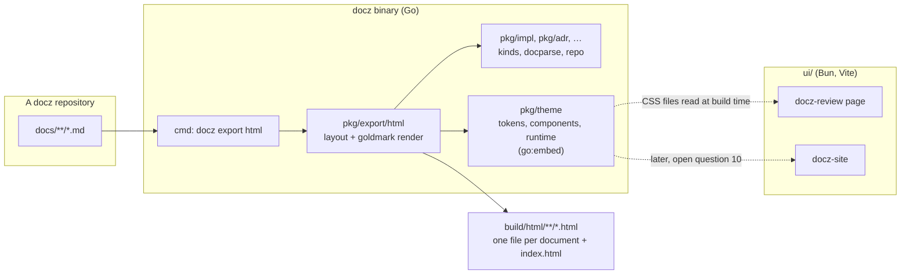
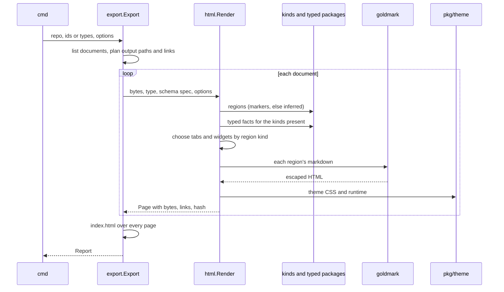
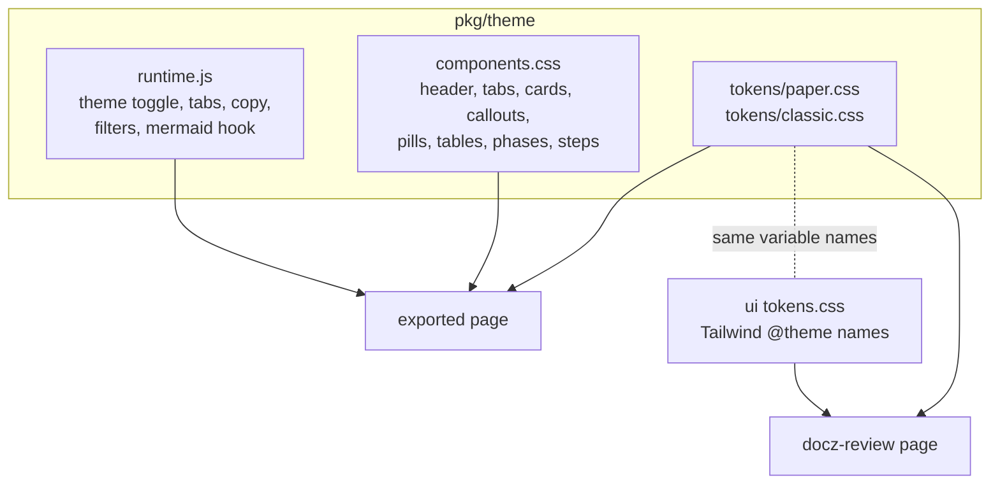

<!-- markdownlint-disable-file MD025 MD041 -->

# DESIGN-0025: docz-html: standalone HTML pages from docz documents, and one themeable design for docz's HTML

<!--toc:start-->
<!-- markdownlint-capture -->
<!-- markdownlint-disable MD013 -->
- [Overview](#overview)
- [Goals and Non-Goals](#goals-and-non-goals)
  - [Goals](#goals)
  - [Non-Goals](#non-goals)
- [Background](#background)
  - [The source skill](#the-source-skill)
  - [docz's HTML today](#doczs-html-today)
- [Detailed Design](#detailed-design)
  - [1. The pieces](#1-the-pieces)
  - [2. Rendering one document](#2-rendering-one-document)
  - [3. The theme](#3-the-theme)
  - [4. Layout by region kind](#4-layout-by-region-kind)
  - [5. The runtime](#5-the-runtime)
  - [6. Widgets from markdown](#6-widgets-from-markdown)
  - [7. Mermaid](#7-mermaid)
  - [8. Links and images](#8-links-and-images)
  - [9. The index](#9-the-index)
  - [10. The skill](#10-the-skill)
  - [11. The docz-review page](#11-the-docz-review-page)
- [API / Interface Changes](#api--interface-changes)
  - [CLI](#cli)
  - [Go packages](#go-packages)
  - [Layer rules](#layer-rules)
  - [ui/](#ui)
  - [Config](#config)
- [Data Model](#data-model)
- [Testing Strategy](#testing-strategy)
- [Migration / Rollout Plan](#migration--rollout-plan)
- [Open Questions](#open-questions)
  - [1. Where does the shared design live?](#1-where-does-the-shared-design-live)
  - [2. What are the themes called?](#2-what-are-the-themes-called)
  - [3. What decides a page's layout?](#3-what-decides-a-pages-layout)
  - [4. How does a standalone page draw mermaid diagrams?](#4-how-does-a-standalone-page-draw-mermaid-diagrams)
  - [5. Do IMPL task checkboxes on a page do anything?](#5-do-impl-task-checkboxes-on-a-page-do-anything)
  - [6. What happens to the source skill's hand-written widgets?](#6-what-happens-to-the-source-skills-hand-written-widgets)
  - [7. Where do pages go by default?](#7-where-do-pages-go-by-default)
  - [8. Is code highlighted in exported pages?](#8-is-code-highlighted-in-exported-pages)
  - [9. Where is the skill published?](#9-where-is-the-skill-published)
  - [10. Does docz-site move to the new design too?](#10-does-docz-site-move-to-the-new-design-too)
  - [11. Is classic kept on the review page?](#11-is-classic-kept-on-the-review-page)
  - [12. Does .docz.yaml configure the export?](#12-does-doczyaml-configure-the-export)
  - [13. Are the two new packages stable at their first release?](#13-are-the-two-new-packages-stable-at-their-first-release)
  - [14. Which widgets come first, and how is each written?](#14-which-widgets-come-first-and-how-is-each-written)
  - [15. What does the Confluence export do with a widget block?](#15-what-does-the-confluence-export-do-with-a-widget-block)
- [Decisions](#decisions)
- [References](#references)
<!-- markdownlint-restore -->
<!--toc:end-->

<!--docz:overview:start-->
## Overview

docz renders a document to HTML in three places today, and none of them
is a file a person can hand to someone else: docz-site and the docz-review
page need a server, and the Confluence export needs Confluence. A skill
called docz-html, written for another team's standards library, shows what
that file could be: one self-contained page per document, tabbed, in a
warm light and dark design, that opens from disk, an S3 bucket, or a Slack
upload. It does the work in about 1,000 lines of Python that re-parse
docz's markdown with regular expressions, while the person running it
already has docz, which parses the same documents properly.

This design moves the rendering into the docz binary as
`docz export html`, built on goldmark and the typed per-type packages, and
makes the docz-html look a **theme**: one set of design tokens and
components in a new `pkg/theme` package that the exported pages and the
docz-review page both use. The current dark look stays as the `classic`
theme, selectable, so nothing is lost. A small skill tells an agent when to
make a page and how to improve one, which is by editing the markdown and
exporting again, never the HTML.

The source skill's interactive widgets (flows, scenario steppers,
scorecards) stay, but they move from per-page JavaScript into the
markdown as fenced blocks, so the export draws them today and docz-site
can draw the same blocks later. The skill comes first, as the fast loop
for iterating the design; the Go renderer then encodes what that loop
settles.

<!--docz:overview:end-->

## Goals and Non-Goals

<!--docz:goals:start-->
### Goals

- `docz export html` writes one self-contained HTML file per document:
  inline CSS and JS, no CDN, no fonts to fetch, readable offline, printable.
- The page is generated **only** from the markdown and the docz version, so
  exporting twice gives the same bytes, and the markdown stays the one
  source of truth.
- Every built-in type gets a layout that uses what its typed package
  already knows: IMPL phases and tasks with progress, ADR consequences,
  open questions with the recommended option marked, an investigation's
  answer as a verdict, runbook steps with their commands. A custom type and
  an unmarked document still get a sensible page.
- One design for docz's HTML: the tokens and components live once, in
  `pkg/theme`, and the exported page and the docz-review page both read
  them. A theme is a set of token values, so the docz-html look (`paper`,
  light and dark) and today's look (`classic`, dark) are two themes, not
  two codebases.
- Interactive widgets (a stage flow, a scenario stepper, a scorecard)
  written in the markdown as fenced blocks, so every renderer that reads
  the markdown can draw them: the export first, docz-site later.
- No Python, nothing to install beyond docz, and nothing specific to one
  organisation.

<!--docz:goals:end-->

<!--docz:non-goals:start-->
### Non-Goals

- **Restyling HTML written in another design**, and adopting an existing
  library of hand-written pages. Those were the source skill's jobs for its
  own team's standards pages; they are not about docz documents.
- **Per-page scripts.** The source skill had an agent write each
  widget's JavaScript into the page. A page edited after generation stops
  being reproducible, so widgets come from the markdown instead
  (section 6 of the Detailed Design).
- **Writing back.** A page never changes the document; a tick on a page is
  not a tick in the markdown (open question 5).
- **Changing docz-api, or the Confluence export beyond widgets.**
  Confluence keeps its own storage-format rendering and Confluence's
  styling; the one change there is that a widget block shows its source in
  an expand (open question 15).
- **A static site generator.** `docz wiki` already builds MkDocs; this
  exports single pages and an index of them.

<!--docz:non-goals:end-->

<!--docz:background:start-->
## Background

### The source skill

The `docz-html/` directory on this branch is a Claude Code skill in five
parts. It is the reference for the output, not code to keep:

| Part | What it is | Fate in this design |
| --- | --- | --- |
| `assets/engine.css` (19 KB), `engine.js` (18 KB), `page.html` | The design: tokens, components, a `window.SSE` runtime for theme, tabs, and widgets | Ported into `pkg/theme`, de-branded, renamed to docz's token names; the flow, stepper, and scorecard kept as widgets driven from markdown |
| `templates/types.json` | For each type, which `##` heading goes in which tab | Replaced by a region-kind table (Detailed Design §4) |
| `scripts/build.py new` | A regex markdown converter and page assembler | Replaced by `pkg/export/html` |
| `scripts/restyle.py`, `batch.py`, `build.py adopt`, `references/class-map.json` | Convert another team's HTML into the design | Dropped (non-goal) |
| `scripts/lint.py`, `check.py` | Lint the HTML; click through it in Playwright if installed | Replaced by Go tests and one Playwright spec in CI |

What it gets right, and what this design keeps: one file per document;
tabs per section, with the last tab remembered per document; a warm
palette with true light and dark values and a toggle; cards, callouts,
pills, comparison tables, phase cards; colour only through tokens, so
both modes are always right; storage namespaced per document; print
showing every panel.

What it gets wrong for docz, and what this design fixes:

- **It parses docz with regular expressions.** It splits on `##` heading
  text, so a document whose headings differ from the template loses its
  layout; it drops the `<!--docz:…-->` region markers; inline markup is
  rewritten with patterns; it has no mermaid. docz already parses these
  documents into regions and typed fields.
- **It is written against docz v1.** It still has `plan`, removed in v2
  (ADR-0003), has no `runbook`, and keys investigations as `inv`, which v2
  treats as an alias.
- **It is one team's.** Every eyebrow reads "SSE Platform", the design
  names that team's standards pages, and the runtime carries its
  compliance-framework catalogue.
- **It is Python.** Anyone using it has docz installed; the Python is a
  second implementation to keep in step with the first, in a language
  nothing else in docz uses, with nothing in CI to run it.

### docz's HTML today

| Where | Renderer | Styling |
| --- | --- | --- |
| docz-site (`ui/`) | unified: remark, rehype, Shiki, mermaid, in React | Tailwind v4, `ui/src/theme/tokens.css`, dark only |
| docz-review page (`ui/review.html`) | The same pipeline in review mode | The same stylesheet and fonts; no CSS of its own |
| Confluence export (`pkg/export/confluence`) | goldmark with a storage-format node renderer | Confluence's |

The two `ui/` pages share one stylesheet: `tokens.css` declares every
colour as a Tailwind v4 `@theme` variable (`--color-bg-base`,
`--color-fg-primary`, `--color-accent`, status and type colours), and
every component is written in utilities that read those variables. That
is what makes themes cheap here: a theme is the same variable names with
different values, and no component changes. The site is dark only today:
no `data-theme`, no toggle, `color-scheme: dark`.

<!--docz:background:end-->

<!--docz:detailed-design:start-->
## Detailed Design

### 1. The pieces



- **`pkg/theme`** owns the design: the token files (one per theme, each
  with light and dark values), the component stylesheet, and a small
  runtime. Go embeds them; `ui/` imports the same CSS files at build time,
  as it reads `api/openapi.yaml` today.
- **`pkg/export/html`** turns one document into one page: it reads the
  regions, picks a layout, renders each region's markdown with goldmark,
  and assembles the page with the theme inlined. It is pure (bytes in,
  bytes out) with an `Export` operation over a `repo.Repo` around it, the
  shape `pkg/export/confluence` already has.
- **`cmd/export.go`** gains `html` beside `confluence`: flags, one call,
  printing, exit codes.
- **The skill** drives the command and teaches the agent to improve the
  markdown.

### 2. Rendering one document



1. **Read.** Reject CR line endings and a missing frontmatter block, as
   `confluence.Render` does. Resolve regions with `kinds.ResolveRegions`
   and the type's heading spec, which `repo.Template` already supplies, so
   an unmarked document gets inferred regions and the page says so in its
   header.
2. **Typed facts.** For the kinds a widget needs (section 4), parse the
   document with the package that owns those kinds: phases with
   `impl.Parse`, procedures with `runbook.Parse`, and so on. This switches
   on **region kind**, never on type name, which is ADR-0002 R7's rule and
   lets a custom type carrying a built-in's regions get that built-in's
   widgets. A parse error is not fatal: the page falls back to rendering
   the region's markdown, and the report carries the error.
3. **Render markdown.** goldmark with GFM and footnotes, as the Confluence
   export uses, and a node renderer for what docz needs: headings with
   `docparse.AnchorSlug` ids (so a ToC link and a `#slug` in the text match
   docz's own slugs), GitHub alerts as callouts, task lists as read-only
   checkboxes, tables wrapped for horizontal scroll, mermaid fences
   (section 7), links through a resolver (section 8). Raw HTML is escaped
   except the Confluence export's allow-list (`br`, `kbd`, `sub`, `sup`,
   `span`, `details`, `summary`); comments and region markers are dropped.
   The ToC region is dropped too: the tabs and an in-panel heading list
   replace it.
4. **Assemble.** The page skeleton is a Go `html/template`, so every
   interpolated value is escaped by construction. The theme's CSS and
   runtime are inlined between `<!-- docz:theme -->` markers.
5. **No check at render time.** `html/template` and goldmark's escaping
   make the output well-formed by construction; the tests parse every
   golden and fuzzed page as HTML (section "Testing Strategy"), so the
   production package needs no HTML parser.

A page carries a header (eyebrow, title, the summary as one paragraph,
pills for id, status, author, created, the theme toggle), a sticky tab
row, one panel per tab, and a footer naming the source path, its content
SHA-256, and the docz version that rendered it. Nothing time-dependent is
written, so the same input gives the same bytes.

### 3. The theme

A theme is a **token file**: the same custom-property names with values
for light and dark. Components and the runtime only ever read tokens.



**Names.** The token names are `ui/`'s, because 660 lines of
`tokens.css` and every component in `ui/` already use them; the source
skill's short names map onto them:

| docz-html | Shared token | Use |
| --- | --- | --- |
| `--bg` | `--color-bg-base` | page |
| `--bg2` | `--color-bg-raised` | cards, panels, tables |
| `--bg3` | `--color-bg-elevated` | inline code, meters, idle buttons |
| `--ink`, `--ink2`, `--ink3` | `--color-fg-primary`, `-secondary`, `-tertiary` | text, secondary text, labels |
| `--line` | `--color-border-default` | borders |
| `--acc` | `--color-accent` | eyebrow, selected state |
| `--acc2` | `--color-ok` (new) | pass, done, positive consequence |
| `--acc3` | `--color-link` (new) | links, informational |
| `--warn`, `--bad` | `--color-warn`, `--color-bad` (new) | partial, caution; fail, negative |
| `--mono`, `--sans` | `--font-mono`, `--font-sans` | type |

Status (`--color-st-*`), document type (`--color-t-*`), admonition
backgrounds (`--color-adm-*`), and the fallback hash palette already exist
in `tokens.css`; each theme gives them values too, so a status pill
means the same colour family in every theme.

**Two themes.**

| Theme | Modes | Look | Fonts | Code blocks |
| --- | --- | --- | --- | --- |
| `paper` (new default) | light and dark | the docz-html palette: warm off-white or charcoal, rust accent, 12 px card radius | system stacks | dark in both modes |
| `classic` | dark | today's docz-site look, values moved from `tokens.css` unchanged | system stacks in exported pages; the bundled Mona Sans, Source Serif, Monaspace in `ui/` | dark |

Keeping code blocks dark in both modes, as the source design does, means
Shiki's `tokyo-night` theme keeps working in `ui/` with no light variant.

**Selection.** `<html data-theme="paper|classic" data-mode="light|dark">`.
With no `data-mode`, `prefers-color-scheme` decides. The toggle sets
`data-mode` and stores it in `localStorage` as `docz:mode`; the exported
page stores the last tab as `docz:<id>:tab`. Every storage access is in a
`try`, since `file://` pages and private windows throw.

**In `ui/`.** `tokens.css` keeps its `@theme` block, so Tailwind still
generates `bg-bg-raised` and the rest, and imports `pkg/theme`'s token
files after it; their `:root[data-theme…]` rules override the variables,
and Tailwind's utilities follow because they read the variables. The
review page sets `data-theme` and gains the light/dark toggle. Mermaid
already reads its colours from the tokens at render time
(`mermaidThemeFromTokens`); it re-renders on a mode change.

**Contrast.** `ui/src/theme/contrast.test.ts` checks token pairs against
WCAG today; it runs over every theme and mode instead of one.

> **Amended 2026-10-31 (IMPL-0028 Phases 1 and 2).** The token files
> carry four more names than the table above: `--color-on-accent` (text on
> an accent fill), `--color-code-fg` (code stays dark in every mode, so it
> has its own foreground), and `--radius-card` / `--radius-control`, which
> are how `paper` gets its rounded cards and `classic` its square ones.
> The fonts are **not** tokens: `base.css` sets the system stacks for an
> exported page only, so `ui/` keeps its bundled fonts. `paper`'s dark
> values appear twice, under `data-mode="dark"` and under
> `prefers-color-scheme: dark` with no `data-mode`, and a test holds the
> two equal; `classic` is one block for every mode, and a test holds its
> colours equal to `ui/`'s `@theme` values. The runtime's one global is
> `docz` (`mode`, `setMode`, `onMode`, `palette`, `showTab`), and the
> mode change is also a `docz:mode` event.

> **Amended 2026-11-01 (IMPL-0030).** One theme system across the three
> surfaces, with the default set by whoever owns the surface:
>
> | Surface | Default from | Theme selector | Light/dark toggle |
> | --- | --- | --- | --- |
> | `docz export html` | the repository's `html.theme` in `.docz.yaml`; `--theme` overrides it for one run | none | kept |
> | docz-review | the repository's `html.theme`, through `docz inspect --format json` | none (the one IMPL-0028 Phase 6 added is removed) | kept |
> | docz-site | the deployment's `DOCZ_THEME` (the chart's `site.config.theme`) | in the topbar | kept |
>
> The repository decides for the two surfaces that show one repository,
> so a reader of those gets no selector; the light/dark mode stays the
> reader's preference. docz-site shows many repositories and never reads
> a repository's key. `pkg/theme.Names()` is the one list every check and
> every selector uses, so a theme added there needs no change on any
> surface to be usable. A choice kept in `localStorage` is per origin and
> never travels between surfaces (docz-site is one origin, each review
> session is `127.0.0.1` on a random port, an exported page is
> `file://`); that is accepted, not worked around.
>
> IMPL-0030's open questions, settled: the key lives in an `html:` block
> (1b); `pkg/doczcore/config` imports `pkg/theme` to check it (2a); an
> unknown name is a validation warning and falls back to `paper`, so
> docz-api never refuses an ingest over it (3a); a docz too old to report
> the theme leaves the review page on `paper` (4a); docz-site generates its
> theme list from `pkg/theme/tokens/` at build time (5a); the third theme
> is `charcoal`, repo-guardian DESIGN-0036's look, with IBM Plex Sans and
> JetBrains Mono named first in its stacks and nothing embedded (6c);
> docz-site does not adopt the themes' radii (7a); each phase is a
> `dont-release` PR and the last `minor` (8a); the TypeScript widget rules
> are held to `widgets.go` by a shared corpus (9a); and IMPL-0029 is
> cancelled in its favour (10a).

### 4. Layout by region kind

A table maps each
**region kind** to a tab and, where the kind has typed
facts, a widget. Tabs appear in the order their first region appears in
the document; a kind the table does not know becomes a tab of its own
named by its heading, so a customised template or a custom type loses
nothing. A document with no regions at all, marked or inferred, gets one
tab per H2, as the source skill did.

| Region kinds | Tab | Widget |
| --- | --- | --- |
| `summary`, `overview`, `objective`, `question`, `hypothesis`, `context` | Overview | The header summary from the first of these; the rest as text |
| `goals`, `non-goals`; `scope`, `in-scope`, `out-of-scope` | Overview | Two cards: goals and non-goals, or in scope and out of scope |
| `when`, `prerequisites`, `last-verified` (runbook) | Overview | Text, a checklist, and a card: date, PR, commit, verifiers |
| `problem`, `background` | Problem, Background | Text |
| `proposal`, `detailed-design` | Proposal, Design | Text |
| `decision` (ADR) | Decision | A callout above the rationale |
| `consequences` with `positive`, `negative`, `neutral` | Consequences | Three cards: ok, bad, neutral |
| `alternatives` | Alternatives | One card per alternative (`kinds.Alternatives`) |
| `risks` | Risks | The table, likelihood and impact cells tinted |
| `criteria` outside a phase (RFC) | Success | One card per criterion |
| `api-changes`, `data-model` | Interfaces, Data model | Text; each contract in a code block |
| `phase` with `tasks`, `criteria` (IMPL) | Phases | A card per phase: tasks with their state, a progress bar, deferred and skipped pills with their notes, success criteria in an ok callout, a filter (all, open, done) |
| `file-changes` | Changes | The table |
| `testing`, `rollout`, `dependencies` | Testing, Rollout, Dependencies | Text |
| `approach`, `environment` | Approach | The steps, then the environment table |
| `findings` | Findings | One card per observation (`kinds.Sections`) |
| `conclusion`, `recommendation` | Conclusion | The `**Answer:**` as a verdict box coloured by `investigation.Verdict`, then the recommendation |
| `procedure` with `steps`, `verification`, `rollback` (runbook) | Procedures | Numbered steps with nested children, each command in a block with a copy button, `**Expected:**` beneath, verification as a checklist, rollback in a caution callout |
| `scenario` with `steps` | Scenarios | One expandable per scenario: symptom, alert, likely cause, steps |
| `escalation` | Escalation | The table |
| `open-questions` | Open questions | One expandable per question; the recommended option marked; a resolved question shows its resolution and is closed by default |
| `decisions` | Decisions | The table |
| `references` | References | The list, links resolved |

The exact kind names come from the catalogue in
`pkg/doczcore/validate/kindrule.go` and the embedded templates; the
implementation pins the table to them with a test, so a new kind in a
template without a row here fails the build rather than vanishing into a
generic tab. Which tabs each built-in gets, from its template:

| Type | Tabs |
| --- | --- |
| RFC | Overview, Problem, Proposal, Alternatives, Risks, Success, References |
| ADR | Overview, Decision, Consequences, Alternatives, References |
| DESIGN | Overview, Background, Design, Interfaces, Data model, Testing, Rollout, Open questions, References |
| IMPL | Overview, Phases, Changes, Testing, Dependencies, References |
| Investigation | Overview, Approach, Findings, Conclusion, References |
| Runbook | Overview, Procedures, Scenarios, Escalation, References |

An Open questions or Decisions tab appears in any type whose document
carries that region, as many hand-edited IMPLs and investigations do.

An empty region (a template placeholder never filled in) renders as a
muted "not written yet" line, not as an empty tab, so a Draft document's
page shows what is missing.

> **Amended 2026-10-31 (IMPL-0028 Phase 2).** Eight pages assembled by
> hand from this table (one per built-in, an unmarked design, and one
> carrying every widget) settled what it left open. The full rules are
> the skill's `references/layout.md`, which Phase 4 encodes:
>
> - **The header summary is not repeated.** It is the first paragraph of
>   the first summary-like region; the panel shows the rest.
> - **Every heading's anchor lands on the page.** The panel title names
>   the tab and takes the first region's anchor when the texts match;
>   otherwise each region's heading is an `h3` with its anchor; a heading
>   that becomes a card label puts its anchor on the card, an open
>   question's on its `details`.
> - **Nothing outside a region is dropped.** An H2 section outside every
>   region becomes a tab of its own; a heading that only introduces the
>   regions under it (`## Goals and Non-Goals`) gives its anchor to the
>   tab's first element.
> - **A child with a row of its own gets that row's tab**
>   (`open-questions` inside `recommendation`).
> - **Per kind:** alternatives are cards per H3, else per bold-led
>   paragraph or item, `accent` only when chosen; a decision's callout
>   holds its first block, paragraph or list; risk cells tint by first
>   word, Critical as high; a runbook scenario is closed, its symptom,
>   alert, and cause a definition list.
> - **Open-question options come from the markdown**, with `recommended`
>   from `kinds.OpenQuestions`: its option text loses the letter and keeps
>   a stray `**` when the option is bold-wrapped (`- **a. …**`), which is a
>   docz fix for Phase 4.

### 5. The runtime

Plain JavaScript in `pkg/theme/runtime.js`: the mode toggle; tabs (click,
`#p-<tab>` and `data-tab` links, ←/→/Home/End, the overflow fade, last tab
restored); copy buttons on code; the IMPL task filter; opening the
expandable an in-page link points into; and the widgets of section 6,
each read from a JSON island the renderer writes beside its mount point,
never from code in the document. The source skill's framework catalogue
is not carried. The page works without JavaScript: every panel shows,
stacked, which is also how it prints, and each widget falls back to a
plain rendering of its data.

### 6. Widgets from markdown

A widget is a fenced block whose info string names it and whose body is
YAML. The renderer validates the YAML, writes the data as a
`<script type="application/json">` island, and the runtime draws it in
theme tokens, redrawing on a mode change. An invalid block renders as its
source with the error, the same rule mermaid follows, and the report
carries the line.

````markdown
```docz-flow
title: Request path
gates: [2]
stages:
  - name: Ingress
    does: Terminates TLS, routes by host
  - name: Auth
    does: Verifies the bearer token
    note: 30 s clock skew
  - name: Handler
    does: Reads through the store
```
````

| Widget | Draws | From the source skill |
| --- | --- | --- |
| `docz-flow` | A horizontal stage flow; clicking a stage shows its detail; gate stages outlined | `SSE.initFlow` |
| `docz-stepper` | "What happens when": named scenarios over one step list, the failing step and its notes highlighted | `SSE.initStepper` |
| `docz-scorecard` | Criteria with weights; the reader pastes JSON results and sees a score per criterion | `SSE.initScorecard` |

The first set and the exact YAML are open question 14. Because the
blocks live in the markdown:

- docz-site and the docz-review page can render them later from the same
  data, with React components reading the same YAML (step 5 of the
  rollout);
- any renderer that does not know a widget shows the fenced source, which
  is readable YAML, so GitHub, MkDocs, and the Confluence export degrade
  rather than break, and the Confluence export shows the source in an
  expand titled with the widget's name (open question 15);
- `docz validate` can check a widget's YAML later, as it checks regions.

> **Amended 2026-10-31 (IMPL-0028 Phase 2).** The three widgets' YAML is
> settled in the skill's `references/widgets.md`, which Phase 4 encodes as
> pinned schemas. Every schema is **closed** (an unknown key is an
> error). `docz-flow`: `stages` (2 to 8, each `name`, `does`, optional
> `note`), optional `title`, `gates` (**1-based** stage positions, as the
> example above reads), `label`, `legend`, `alert`. `docz-stepper`:
> `steps` (2 to 12, each `key`, `name`, `does`, optional `title`) and
> `scenarios` (each `name`, optional `fails_at` naming a step key,
> `fail_label`, `notes` keyed by step). `docz-scorecard`: `checks` (each
> `id`, `name`, `target`, optional `weight` defaulting to 1, `fixes`,
> `source`), optional `title`, `note`, and `example`; pasted results are
> `{results: [{id, score 0..1 or null, observed, evidence}]}`, and the
> total is points over the weights of the measured checks. On the page a
> widget is a `figure.widget` holding the JSON island, an empty
> `.widget-mount`, and a `.widget-fallback` with the same data as a list
> or table; the runtime builds its DOM with `textContent` only, marks the
> figure `drawn` to hide the fallback, and redraws on a mode change.

### 7. Mermaid

A page whose document has a mermaid fence needs mermaid to draw it, and
mermaid is large: `mermaid.min.js` 12.x is 5.5 MB, 1.6 MB gzipped. A page
with a diagram embeds it, and a page without one does not (open question
4). The docz binary carries the file gzipped, about +1.6 MB, vendored at
`ui/`'s mermaid version by a `just` recipe with a drift check.
`--mermaid source` leaves the source as a labelled code block and
`--mermaid cdn` loads a pinned URL with an integrity hash instead. In the
embed and CDN modes, a diagram whose source fails to parse shows the
source and the error instead of a blank box, as docz-site does.

### 8. Links and images

- `#slug` links resolve within the page, switching to the tab that holds
  the heading.
- A relative link to another docz document that this run exports becomes
  a relative link to its page, so a directory of pages links to itself.
- Any other relative link becomes a GitHub blob URL through the
  `blobResolver` `docz export confluence` already uses, and is listed in
  the report when it resolves nowhere.
- A relative image under the repository, 1 MB or smaller, is inlined as a
  `data:` URL so the page stays one file; a larger one becomes a blob URL.
- Every page carries a Content-Security-Policy `<meta>`:
  `default-src 'none'; style-src 'unsafe-inline'; script-src
  'unsafe-inline'; img-src data: https:`, plus the CDN's origin in CDN
  mode, so nothing a document says can load anything else.

### 9. The index

When a run writes more than one page it also writes `index.html`: the
same header and theme, one tab per type, each a table of id, title,
status, and date linking to the page, in the order `docz list` prints.

### 10. The skill

The skill comes **before** the Go renderer, because it is the quickest way
to iterate the design (open question 10). It has two stages.

**Stage 1, the design loop.** The skill carries `pkg/theme`'s files and a
reference to the components and widgets, and the agent assembles a page
from a document by hand: the header, the tabs, each region's markdown
turned into the components, the widgets from their fenced blocks. No
Python and no generator: the agent writes HTML against the theme, a
person looks at it, and the theme or a widget changes in minutes rather
than through a Go release. What the loop settles (the tokens, the
components, the widgets' YAML, the per-kind layout table) is what the Go
renderer then encodes.

**Stage 2, the command.** Once `docz export html` exists, the skill
switches to it and becomes instructions:

1. When to make a page: someone outside the repository needs to read the
   document, or asks for "an HTML version", "a walkthrough page", "docz
   html".
2. Run `docz export html <id>` and report the path; open it when asked to
   look.
3. To improve the page, improve the **markdown**: a one-paragraph summary
   that states scope and the ask (it becomes the header); alternatives as
   one subsection each; risks and decisions as tables; a `docz-flow`,
   `docz-stepper`, or mermaid block where a flow or a scenario carries more
   than prose. Then export again. Never edit the HTML: the next export
   replaces it.
4. `docz validate <id>` before exporting, since a finding usually means a
   region the page cannot lay out.

Where the skill is published is open question 9.

### 11. The docz-review page

The review page moves to `paper` by default, gains the light/dark toggle,
and keeps `classic` selectable (open question 11). Its two
review-specific rules in `tokens.css` (the `::highlight(docz-review)`
paint and the changed-region mark) already use tokens and need new
values per theme, nothing else. The work is the token files, the
`data-theme` wiring, the toggle, and the contrast tests; no review
component is rewritten. docz-site follows after this work (open question
10), with the widgets of section 6 as React components.

<!--docz:detailed-design:end-->

<!--docz:api-changes:start-->
## API / Interface Changes

### CLI

```text
docz export html [<id>|<path>|<type>...]
    --out DIR          where pages go (default build/html)
    --stdout           write the one page to stdout; refused for more than one
    --theme NAME       paper (default) or classic
    --mermaid MODE     embed (default), source, or cdn
    --format FMT       text (default) or json: the report
    --dry-run          report what would be written; write nothing
```

With no arguments it exports every enabled type, as `docz export
confluence` does, and writes the index under `build/html/`, mirroring the docs tree
(`build/html/design/0025-….html`), so generated files stay out of
`docs/`, where the wiki, `docz validate`, and docz-api's ingest would see
them. Exit codes follow `export
confluence`: 0 when every page was written, 1 when one failed, 2 for a
usage or config error (unknown or disabled type, unknown theme, no such
document). The text report is one line per page (`wrote`, `unchanged`, or
`failed`, with the path) and a total; the JSON report is the same data,
and joins the CLI contract in `api/cli/` as `export-html.schema.json`
with `schema_version` 1.

"Unchanged" means the bytes on disk already equal the render, so a
repeated export rewrites nothing and a CI job can tell a stale committed
page from a current one.

### Go packages

`pkg/theme`:

```go
// Names lists the themes in a stable order: "paper", "classic".
func Names() []string

// CSS returns the theme's tokens plus the shared components, ready to
// inline. An unknown name is ErrUnknownTheme.
func CSS(name string) (string, error)

// Runtime returns the page runtime.
func Runtime() string
```

`pkg/export/html`:

```go
type MermaidMode int // MermaidEmbed, MermaidSource, MermaidCDN

type RenderOptions struct {
    Theme   string            // "" means "paper"
    Mermaid MermaidMode
    Spec    kinds.HeadingSpec // the type's spec, for inference
    Source  string            // repo-relative path
    Resolve LinkResolver
    Site    string            // the eyebrow's first part; "" means none
    Version string            // the docz version in the footer
}

type Page struct {
    ID, Title, Type string
    Body            []byte
    Hash            string // "sha256:<hex>" of Body
    Links           []Link // unresolved links, with line numbers
    Inferred        bool   // regions were inferred from headings
    Problems        []error // typed-parse failures that fell back to text
}

func Render(src []byte, opts RenderOptions) (Page, error)

type ExportOptions struct {
    Types, IDs []string
    Out        string // a directory
    DryRun     bool
    Render     RenderOptions
}

func Export(ctx context.Context, rp *repo.Repo, opts ExportOptions) (Report, error)
```

`Export` reads through `repo`, writes nothing outside `Out`, checks the
context between documents, and narrates through hooks in the
`WithHooks`/`HooksFrom` shape `repo` and the Confluence export use, so the
package prints nothing.

### Layer rules

`pkg/export/html` may import the type packages (nothing forbids it; the
rule is that the **core** may not) and goldmark (already allowed under
`pkg/export/`). `pkg/theme` imports only the standard library. The core
imports neither; both join `TestLayerRules_*` coverage by prefix as they
stand. No new third-party module is needed.

### `ui/`

`ui/src/theme/tokens.css` imports `../../../pkg/theme/tokens/*.css`;
`vite.config.ts` adds `pkg/theme` to `server.fs.allow`; `Dockerfile.ui`
gains a `theme` named context beside `spec`, laid out so the same
relative path resolves inside the image. The `ui` CI path filter gains
`pkg/theme/**`.

### Config

None in the first release (open question 12): flags only.

> **Amended 2026-11-01 (IMPL-0030).** An `html:` block with one key,
> `theme`, sets the default theme for `docz export html` and docz-review
> (section 3's amendment). The other flags stay flags.

<!--docz:api-changes:end-->

<!--docz:data-model:start-->
## Data Model

Nothing is stored server-side. The exported page stores three things in
the reader's browser, all optional:

| Key | Value | Written when |
| --- | --- | --- |
| `docz:mode` | `light` or `dark` | the toggle is used (shared by every page and the review page) |
| `docz:<id>:tab` | the tab name | a tab is chosen |
| `docz:<id>:filter` | `all`, `open`, or `done` | the IMPL task filter is used |

The page's identity is the document id, so two exports of one document
share a remembered tab.

<!--docz:data-model:end-->

<!--docz:testing:start-->
## Testing Strategy

| Layer | What it proves | Where it runs |
| --- | --- | --- |
| Goldens: `Render` over every `.md` in the six type packages' corpora and the parity fixtures, regenerated with `-update` | The layout per type, inference over unmarked documents, deterministic bytes | `just test` |
| Unit: the region-kind table against the validate catalogue and the embedded templates | No template kind falls through to a generic tab unnoticed | `just test` |
| Unit: escaping, raw-HTML allow-list, link and image resolution, CSP present, no external URL outside CDN mode | A document cannot inject markup or load anything | `just test` |
| Fuzz: `Render` never panics, and its output parses as HTML | The renderer is total | `just test` (seed corpus) |
| Widgets: each widget's YAML schema over valid and invalid fixtures; an invalid block falls back to its source with the error | Widgets never break a page | `just test` |
| Theme: every token named in `components.css` and `runtime.js` is defined by every theme in both modes; no literal colour in either file | Both themes and modes stay complete | `just test` |
| Contrast: `contrast.test.ts` over every theme and mode | Text stays readable | `just ui test` |
| CLI: `docz export html` over parity fixtures, JSON report validated against `export-html.schema.json` | The command and its contract | `just test` |
| Browser: one Playwright spec opens an exported page per type, clicks every tab, toggles the mode, filters IMPL tasks, checks no console error | What only a browser shows, as the source skill's `check.py` did | the `ui-e2e` job |
| Review page: the existing review e2e under `paper` and `classic` | The theme move broke nothing | the `ui-e2e` job |

<!--docz:testing:end-->

<!--docz:rollout:start-->
## Migration / Rollout Plan

Each step is one PR; the first that adds a command is labelled `minor`.

1. **`pkg/theme`.** The token files (`paper` from the source design,
   de-branded and renamed; `classic` moved from `tokens.css` unchanged),
   `components.css`, `runtime.js` with the widgets, the Go accessors, and
   the token completeness tests. `ui/` imports the token files with
   `classic` selected, which is a no-op for both pages: the proof that the
   plumbing works before anything looks different. `dont-release`.
2. **The skill, stage 1.** The design loop of section 10: iterate the
   theme, the components, the widgets' YAML, and the layout table over
   this repository's own documents until they are settled. Changes land
   back in `pkg/theme` and in this document.
3. **`pkg/export/html` and `docz export html`.** Encode what step 2
   settled: generic rendering, the per-kind layouts, the widgets, goldens,
   the CLI contract schema, the Playwright spec. The skill moves to stage
   2. `minor`.
4. **The review page on `paper`**, with the toggle and the contrast tests
   over both themes. `minor`, since the default look changes.
5. **docz-site on `paper`**, `classic` selectable, and the widgets as
   React components reading the same fenced blocks. `minor`.

The `docz-html/` source directory is removed from the branch before the
first PR merges; nothing from it is committed except what step 1 ports.

<!--docz:rollout:end-->

<!--docz:open-questions:start-->
## Open Questions

### 1. Where does the shared design live?

- **a. `pkg/theme`, a public Go package that embeds the CSS and JS; `ui/`
  reads the same files by relative path, as it reads `api/openapi.yaml`.**
  *(recommendation)* One copy, owned beside the Go code that inlines it,
  under the public library's semver like everything in `pkg/`.
- b. A root `theme/` package beside `api/`, outside `pkg/`. Same mechanics;
  keeps the design out of the library's semver, but `pkg/export/html`
  would then import a package outside `pkg/`, which nothing else does.
- c. `ui/` owns the tokens and a `just` recipe copies them into Go before
  each build, with a drift check. Keeps `ui/` self-contained; two copies
  and a generated file.
- d. Other.

> **Resolved 2026-10-31: (a).**

### 2. What are the themes called?

- **a. `paper` for the new one and `classic` for today's.** *(recommendation)*
  Each name says what it looks like, and a third theme can join without a
  version number meaning anything.
- b. `v2` and `v1`.
- c. `docz` for the new one and `classic` for today's.
- d. Other.

> **Resolved 2026-10-31: (a).**

### 3. What decides a page's layout?

- **a. The region kinds present, through one kind-to-tab table; typed
  facts come from the package that owns each kind.** *(recommendation)* No
  type-name switch, a custom type carrying built-in regions gets their
  widgets (ADR-0002 R7), and a template change shows up as a table row.
- b. The document's type (or `schema:`), one layout per built-in and a
  generic one for the rest, with a type switch like `cmd/validate.go`'s.
  Simpler to read, and closer to the source skill's `types.json`.
- c. Other.

> **Resolved 2026-10-31: (a).**

### 4. How does a standalone page draw mermaid diagrams?

- **a. Embed mermaid, only in a page that has a diagram; the docz binary
  carries it gzipped (about +1.6 MB, from 15.6 MB), and the page grows by
  about 5.5 MB.** *(recommendation)* The page stays one file that works
  offline, and DESIGN documents are where most diagrams are. Costs a
  vendored file kept at `ui/`'s mermaid version by a `just` recipe and a
  drift check.
- b. Leave the source as a labelled code block by default; `--mermaid
  embed` or `cdn` when wanted. Small pages and binary; a design's
  diagrams are unreadable by default.
- c. Load mermaid from a pinned CDN URL with a subresource-integrity hash.
  Small pages, no vendored file; breaks the offline promise and needs the
  CSP to allow one origin.
- d. Other.

> **Resolved 2026-10-31: (a).**

### 5. Do IMPL task checkboxes on a page do anything?

- **a. No: they show the document's state, read-only, with a progress bar
  and the open/done filter.** *(recommendation)* A page that disagrees
  with the markdown is worse than one that cannot be ticked.
- b. They tick, saved in the reader's browser, layered over the
  document's state and marked "local", as the source skill did.
- c. Other.

> **Resolved 2026-10-31: (a).**

### 6. What happens to the source skill's hand-written widgets?

- **a. Dropped: no flow, stepper, scorecard, or per-page script.**
  *(recommendation)* A page is generated from markdown alone, so it is
  reproducible; mermaid covers most of what the flow did.
- b. Dropped now; later, fenced blocks (```` ```docz-flow ```` with YAML)
  that the renderer turns into the widgets, so they come from markdown.
- c. Kept as an escape hatch: a `<doc>.html.js` beside the document,
  inlined if present.
- d. Other.

> **Resolved 2026-10-31: (d).** Keep the widgets, and make them
> part of docz-site too. So they come from the markdown, as fenced blocks
> with YAML bodies, now rather than later (Detailed Design section 6);
> the first set and the syntax are question 14.

### 7. Where do pages go by default?

- **a. `build/html/`, mirroring the docs tree (`build/html/design/0025-….html`),
  plus `build/html/index.html`.** *(recommendation)* Generated files stay
  out of `docs/`, where the wiki, `docz validate`, and docz-api's ingest
  would otherwise see them.
- b. Beside each source, `docs/design/0025-….html`, as the source skill
  did. Easy to find; generated files in the docs tree.
- c. No default: `--out` or `--stdout` is required.
- d. Other.

> **Resolved 2026-10-31: (a).**

### 8. Is code highlighted in exported pages?

- **a. No, in the first release: code blocks are styled but not
  highlighted.** *(recommendation)* No new dependency; the source design
  does not highlight either.
- b. Highlight in Go with chroma: a new third-party module, an allow-list
  entry, and colours to keep matching Shiki's in `ui/`.
- c. Other.

> **Resolved 2026-10-31: (a).**

### 9. Where is the skill published?

- **a. `plugins/docz-html/` in this repository's marketplace, beside
  docz-review, versioned on its own.** *(recommendation)* It drives this
  repository's binary, so it ships and changes with it; a private
  marketplace copies it as it copies docz-review.
- b. A skill inside the docz plugin in claude-skills, as `docz:html`.
  Beside the other docz skills; not public.
- c. Both: published here, copied there.
- d. Other.

> **Resolved 2026-10-31: (a).**

### 10. Does docz-site move to the new design too?

- **a. Yes, after the review page: `paper` by default with `classic`
  selectable, as its own PR.** *(recommendation)* With themes as token
  sets it is the same work the review page needs, and the site and the
  review page should not look like two products.
- b. Not now: the site stays `classic` only; revisit later.
- c. Yes, and drop `classic` once the site moves.
- d. Other.

> **Resolved 2026-10-31: (a).** The site follows this work. The skill
> comes first, as the quick way to iterate the design (Detailed Design
> section 10, rollout step 2).

### 11. Is `classic` kept on the review page?

- **a. Yes, selectable, with `paper` the default.** *(recommendation)*
  Keeping it costs one token file already written in step 1.
- b. No: the review page is `paper` only.
- c. Other.

> **Resolved 2026-10-31: (a).**
>
> **Revised 2026-11-01 (IMPL-0030).** `classic` stays a theme, but the
> review page shows the repository's `html.theme` and has no selector.

### 12. Does `.docz.yaml` configure the export?

- **a. Not in the first release: flags only.** *(recommendation)* Add an
  `html:` block once a repository needs the same flags on every run.
- b. An `html:` block now: `theme`, `out`, `mermaid`, `site` (the eyebrow
  text).
- c. Other.

> **Resolved 2026-10-31: (a).**
>
> **Revised 2026-11-01 (IMPL-0030).** An `html:` block with `theme` only:
> the theme is the one setting both the export and the review page need
> to agree on for every run.

### 13. Are the two new packages stable at their first release?

- **a. Yes, under semver like the rest of `pkg/`, keeping their surfaces
  small (above).** *(recommendation)*
- b. Marked experimental in their package docs until a later minor, as the
  v2 packages were through the betas.
- c. Other.

> **Resolved 2026-10-31: (a).**

### 14. Which widgets come first, and how is each written?

- **a. `docz-flow`, `docz-stepper`, and `docz-scorecard`, each a fenced
  block with a YAML body whose schema is pinned by a test; the exact
  fields settled in the skill's design loop.** *(recommendation)* The
  three the source skill had, with the data out of JavaScript.
- b. `docz-flow` only at first; the stepper and scorecard when a document
  needs them.
- c. The three, with JSON bodies instead of YAML, matching what the page
  stores in its data island.
- d. Other.

> **Resolved 2026-10-31: (a).**

### 15. What does the Confluence export do with a widget block?

- **a. Show the YAML source in an expand titled with the widget's name,
  as it does a mermaid block's source.** *(recommendation)* Readable, no
  Confluence app needed.
- b. Render a static fallback: a flow as a numbered list of stages, a
  stepper as a table, a scorecard as its criteria.
- c. Other.

> **Resolved 2026-10-31: (a).**

<!--docz:open-questions:end-->

<!--docz:decisions:start-->
## Decisions

All fifteen resolved 2026-10-31, numbered as the questions above:

| # | Question | Decision |
| - | -------- | -------- |
| 1 | Where the design lives | (a) `pkg/theme`, embedded by Go and read by `ui/` by relative path |
| 2 | Theme names | (a) `paper` for the new design, `classic` for today's |
| 3 | What decides the layout | (a) The region kinds present, through one kind-to-tab table |
| 4 | Mermaid in a standalone page | (a) Embedded when the page has a diagram; the binary carries it gzipped |
| 5 | IMPL checkboxes on a page | (a) Read-only, with a progress bar |
| 6 | The source skill's widgets | (d) Kept, written in markdown as fenced blocks so docz-site can render them too |
| 7 | Where pages go | (a) `build/html/`, mirroring the docs tree, plus `index.html` |
| 8 | Code highlighting | (a) None in the first release; styled, not highlighted |
| 9 | Where the skill is published | (a) `plugins/docz-html/` in this repository's marketplace |
| 10 | docz-site | (a) Moves to `paper` after this work, with `classic` selectable; the skill comes first to iterate the design |
| 11 | `classic` on the review page | (a) Kept, selectable, `paper` the default |
| 12 | `.docz.yaml` configuration | (a) Flags only in the first release |
| 13 | Stability of the new packages | (a) Stable under semver from their first release |
| 14 | The first widgets | (a) `docz-flow`, `docz-stepper`, `docz-scorecard`, YAML bodies with pinned schemas |
| 15 | Widgets in the Confluence export | (a) The YAML source in an expand titled with the widget's name |

<!--docz:decisions:end-->

<!--docz:references:start-->
## References

- [DESIGN-0024](0024-docz-review-a-blocking-review-page-for-agent-written-documents.md):
  the docz-review page this design restyles
- [DESIGN-0020](0020-confluence-export-docz-documents-as-confluence-cloud-pages.md): the export this one sits
  beside
- [ADR-0002](../adr/0002-docz-is-an-api-package-whose-first-consumer-is-the-cli.md): R7, typed parsing by
  region kind
- [ADR-0003](../adr/0003-remove-plan-from-the-built-in-document-types.md): why the source skill's
  `plan` layout goes
- [INV-0030](../investigation/0030-docz-review-follow-ups-after-v230.md):
  the docz-review follow-ups this design does not change
- [Mermaid](https://mermaid.js.org/): the diagram library pages embed or
  load

<!--docz:references:end-->
