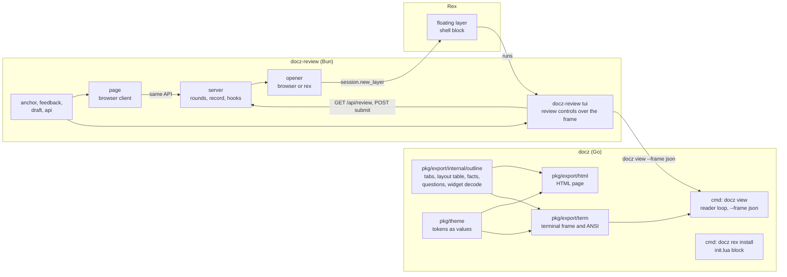
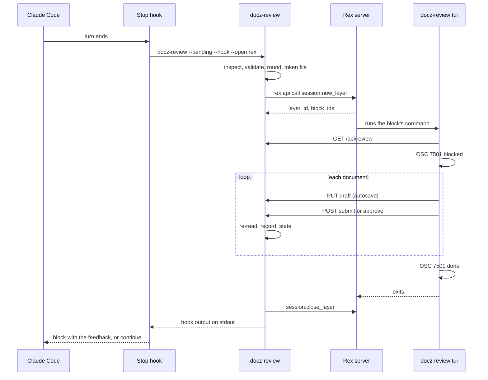

<!-- markdownlint-disable-file MD025 MD041 -->

# DESIGN-0027: docz view and docz-review-rex: a terminal renderer for docz documents and a Rex client for docz-review

<!--toc:start-->
<!-- markdownlint-capture -->
<!-- markdownlint-disable MD013 -->
- [Overview](#overview)
- [Goals and Non-Goals](#goals-and-non-goals)
  - [Goals](#goals)
  - [Non-Goals](#non-goals)
- [Background](#background)
- [Detailed Design](#detailed-design)
  - [1. The pieces](#1-the-pieces)
  - [2. The shared structure](#2-the-shared-structure)
  - [3. Rendering one document in the terminal](#3-rendering-one-document-in-the-terminal)
  - [4. Pictures](#4-pictures)
  - [5. docz view, the reader](#5-docz-view-the-reader)
  - [6. docz-review-rex, the client](#6-docz-review-rex-the-client)
  - [7. Anchors](#7-anchors)
  - [8. The Rex opener](#8-the-rex-opener)
  - [9. The plugin and the Rex install](#9-the-plugin-and-the-rex-install)
  - [10. What does not change](#10-what-does-not-change)
- [API / Interface Changes](#api--interface-changes)
- [Data Model](#data-model)
- [Testing Strategy](#testing-strategy)
- [Migration / Rollout Plan](#migration--rollout-plan)
- [Open Questions](#open-questions)
  - [1. Where does the shared structure live?](#1-where-does-the-shared-structure-live)
  - [2. What runs the reader's interactive loop?](#2-what-runs-the-readers-interactive-loop)
  - [3. What is the review client's command?](#3-what-is-the-review-clients-command)
  - [4. How is docz-review-rex packaged?](#4-how-is-docz-review-rex-packaged)
  - [5. How are mermaid diagrams drawn in the terminal?](#5-how-are-mermaid-diagrams-drawn-in-the-terminal)
  - [6. How fine is an annotation?](#6-how-fine-is-an-annotation)
  - [7. Which mode does the terminal render in?](#7-which-mode-does-the-terminal-render-in)
  - [8. How does the token reach the pane?](#8-how-does-the-token-reach-the-pane)
  - [9. Who owns the layer's lifecycle?](#9-who-owns-the-layers-lifecycle)
  - [10. Does docz rex install ship in the first release?](#10-does-docz-rex-install-ship-in-the-first-release)
  - [11. Is code highlighted?](#11-is-code-highlighted)
  - [12. How is the diff since the previous round computed?](#12-how-is-the-diff-since-the-previous-round-computed)
  - [13. Does the review ask through the palette?](#13-does-the-review-ask-through-the-palette)
  - [14. Is there a Claude Code pane client?](#14-is-there-a-claude-code-pane-client)
  - [15. Does the opener learn tmux and Herdr?](#15-does-the-opener-learn-tmux-and-herdr)
- [References](#references)
<!-- markdownlint-restore -->
<!--toc:end-->

<!--docz:overview:start-->
## Overview

docz draws a document two ways today: `docz export html` makes a page
in docz's theme (DESIGN-0025), and docz-review opens that kind of page
in a browser so a person can answer an agent's document before the
turn ends (DESIGN-0024). Neither reaches a terminal. This design adds
the third surface: **`docz view`**, a reader in the `docz` binary that
draws one docz document in the terminal with docz-html's structure
(tabs by region kind, cards, callouts, question cards, widgets) over a
terminal writer in `pkg/theme`'s colours, and **docz-review-rex**, a
second client of the docz-review server, a Bun command inside the
docz-review binary that draws the frame `docz view` emits and reuses
the page's review logic, which a person installs as an option and
which opens as a floating pane in Rex instead of a browser tab.
docz-review, its server, its page, its hooks, and its review record
are unchanged; the Rex client speaks the same API and writes the same
record. INV-0035 settled the languages: Go for the reader, Bun for
the client, and no Rust or Bazel.

<!--docz:overview:end-->

## Goals and Non-Goals

<!--docz:goals:start-->
### Goals

- **One renderer, every front end.** `docz view` draws a document
  from one Go package, and docz-review-rex draws the frame that
  package emits as JSON, so a review looks like the reader, the reader
  looks like the HTML page, and a third front end (question 14) would
  draw the same frame.
- **The HTML page's structure, not glamour's.** Tabs in the order
  DESIGN-0025 §4 fixes, the same components per region kind, the same
  typed facts (phases, procedures, findings, questions), and the same
  widgets. A docz marker is never shown and never lost.
- **docz's theme.** The three themes in `pkg/theme` map to 24-bit
  terminal colours, light and dark, so a Rex pane and an exported page
  agree.
- **A full docz-review client, over the page's own logic.** Every
  actionable item DESIGN-0024 §5 defines (question answers, comments,
  replace, delete, document comments, status, findings marked fix) and
  every non-actionable one (looks good, dismissed findings), submitted
  through the existing API into the existing record by the same
  `anchor.ts`, `feedback.ts`, `draft.ts`, and `api.ts` the page uses,
  so the agent's next instruction is the same whichever client the
  person used and no review rule exists twice.
- **A preview while the agent writes.** The reader follows the file
  and marks what changed, since every terminal viewer that exists is
  used beside an agent that is still writing.
- **Rex as the host, by choice.** docz-review learns one more opener,
  the Rex floating layer, selected by a flag or a variable; the
  browser stays the default. The pane lands over the agent's window,
  reports its status through Rex's program status protocol, and is
  closed when the review ends.
- **Installable as an option.** A `docz-review-rex` plugin in the
  `docz` marketplace, with the same hooks and skill as docz-review and
  the Rex opener fixed on.
- **Testable without a terminal.** The renderer is bytes in, a frame
  model and ANSI bytes out, with goldens over every corpus the HTML
  renderer already has; the client is tested against a fake server
  and against the real one.

<!--docz:goals:end-->

<!--docz:non-goals:start-->
### Non-Goals

- **Replacing docz-review's page.** The browser client stays the
  default and keeps every feature; docz-review-rex is an alternative,
  not a successor.
- **Editing.** Neither front end edits a document. The client records
  what should change; the agent changes it.
- **A Neovim plugin.** `docz view --plain` is what a `docz.nvim`
  would wrap, as mdp's plugin wraps its server, and INV-0034 names it;
  it is a later piece, outside this design.
- **A web view in Rex.** Rex's browser pane is built and demoed but
  not released (INV-0033 Observation 2). When it ships, docz-review's
  page can open there with no change to this design; this design is
  what works in a terminal today.
- **leaf and the Rex markdown viewers.** leaf, tkmp, mddog,
  rex-md-viewer, and rexworks md-viewer are prior art for Kitty
  placement, embedded mermaid, pane ownership, and a Rex installer,
  and nothing here depends on any of them.
- **A third toolchain.** No Rust binary and no Bazel (INV-0035): the
  Go half is `docz`, the Bun half is docz-review, and `just` already
  runs both.
- **A general markdown viewer.** `docz view` draws docz documents and
  the markdown a docz document may contain; a file with no frontmatter
  is refused as `docz export html` refuses it.
- **Character-level selection in the first release.** Annotations
  anchor whole blocks (question 6); a selection inside a block is a
  later addition.
- **docz-api and docz-site.** Nothing here touches the server or the
  site.

<!--docz:non-goals:end-->

<!--docz:background:start-->
## Background

**docz-review** (DESIGN-0024) is three pieces: a Bun server on
`127.0.0.1` with a random token in the URL it opens, a React page it
embeds, and a Claude Code plugin whose `Stop` hook runs
`docz-review --pending --hook` for up to 24 hours. The server runs
`docz inspect` and `docz validate` per round, serves `GET /api/review`
(each document's `inspect` output, findings, the previous round's
source, and the autosaved draft), takes `POST /api/review/{doc}/submit`,
`approve`, `dismiss`, `/done`, and `PUT .../draft`, re-reads the file
on every submission, writes `reviews/<doc>/round-<n>.json` in the
shape of `api/cli/review.schema.json`, and prints the hook output last.
Annotations are anchored by a quote of a block's text with context
(§7), never by a DOM path, so they survive the agent's edits. INV-0032
ported Plannotator's pieces into the page: ten quick labels, question
cards with "accept all recommendations", a rendered diff per round,
three columns, and five gates. Its step 4 found block-level annotation
acceptable for the kind of document docz holds.

**docz-html** (DESIGN-0025, `pkg/export/html`) renders one document to
one page: `outline.go` cuts the document into tabs by depth-0 region,
`layout.go` is the table of region kind to tab and component,
`facts.go` parses `impl`, `runbook`, `adr`, and `investigation`
lazily by region kind, `questions.go` draws question cards,
`widgets.go` validates the three YAML widgets, and `components.go`
dispatches each section to a writer. All of that is unexported;
`Render` and `Export` are the surface. `pkg/theme` holds the three
themes as CSS token files with one hex value per token per mode, plus
the page's components and runtime. The reader in docz-site embeds the
same renderer's fragment (DESIGN-0026).

**Rex** (INV-0033) has no web view in the preview. Its server API has
floating layers: `session.new_layer` takes a session, fractional
bounds, a block layout, an optional window, and focus, and returns the
layer and block ids; `set_layer_state` minimizes and restores; a
terminal block's only shipped flavor is the shell, with `command`,
`cwd`, `path_prepend`, and `size` options and no environment option.
`rex wait BLOCK` returns the child's exit status. The program status
protocol (OSC 7501) lets a program report `blocked` with a `kind` and
`msg`, which Rex shows in the session picker and the tab header. The
CLI calls the API with `rex api call`, and `init.lua` defines palette
actions and key bindings. Kitty graphics are supported in full on Mac
and Linux, with a per-block image budget. Ladybird's terminal mode is
merged but unreleased, and the browser pane is demoed but unreleased.

**INV-0034** looked at what a terminal viewer of docz documents would
take. The panes that look like browsers in Rex are pictures drawn with
Kitty graphics (a headless browser, or leaf's placement of rasterised
images), and a document drawn that way does not reflow, select, or
scroll as text. leaf (Rust, ratatui) draws markdown as it is written,
with Kitty pictures for images and mermaid through Pele, and installs
a Rex action by writing a marked block into `init.lua`; it shows docz
markers as nothing and docz regions as plain headings. glamour draws
ANSI from a stylesheet over goldmark and knows no regions. mdp wraps a
Go server in a Neovim plugin that downloads the release binary. The
investigation's hypothesis, a text renderer with pictures only for
figures, carrying docz-html's structure, is what this design builds.

**INV-0035** answered the language question after the first draft.
leaf had grown Margin, a plan review that is docz-review's loop for
any markdown, and four more Rex markdown viewers had appeared: tkmp
(text, with Pele run inside an embedded QuickJS for mermaid and Kitty
Unicode placeholders for pictures), rex-md-viewer (a page rasterised
in Go, panes owned by a labelled block), rexworks md-viewer
(selection and find over pictures, Rex's theme read live), and mddog
(a CoreText rasteriser and a Claude Code pane beside the chat). None
reads a docz marker. Two spikes showed mermaid without a browser in
both runtimes, Pele under `fastschema/qjs` with resvg as wasm in Go
and Pele natively in a compiled Bun binary, and every other piece of
leaf's reader already had a Go and a Bun answer. The conclusion is
the split this design now has: the reader in Go, the review client in
Bun reusing the page's logic, and neither Rust nor Bazel.

**Rex Custom UI** (2026-11-12) lets a custom action pause and ask
through the command palette, `rex.ui.input` for text and
`rex.ui.pick` for a list, on every connected Rex app, a phone
included, with the first answer winning. It needs control API
revision 17; on 2026-11-18 the server had it and the Preview Mac app
answered every prompt `unsupported`, so a client has to handle that
reason per call. It is a fourth surface for the parts of a review
that are a choice (question 13).

Four things were decided while the investigations were open, and this
design takes them as given: docz-review is not replaced; the Rex
client is docz-review-rex, a thing a person installs when they want
it; leaf is prior art, not a dependency; and the docz CLI and API stay
Go, with no third toolchain for the Rex client.

<!--docz:background:end-->

<!--docz:detailed-design:start-->
## Detailed Design

### 1. The pieces



Seven pieces: four in the `docz` binary (the structure, the
renderer, the theme values, and `docz view` with `docz rex install`),
two in docz-review (the client and the opener), and one plugin:

| Piece | Where | What it is |
| ----- | ----- | ---------- |
| The shared structure | `pkg/export/internal/outline` (question 1) | docz-html's outline, layout table, typed facts, question reading, and widget decoding, moved out of `pkg/export/html` so two renderers read one copy |
| The terminal renderer | `pkg/export/term` | `Render(src, Options) (Frame, error)`: a document to tabs of styled lines, blocks with their text and lines, and figures; `Frame.ANSI(width)` to bytes |
| Theme values | `pkg/theme` | `Tokens(name, mode)`: the token files read as values, so a terminal writer gets `#1f2937` where the page gets `var(--color-fg-prose)` |
| `docz view` | `cmd/view.go` | The reader: an interactive loop over the renderer that follows the file, `--plain` ANSI to stdout for a pager or a Neovim buffer, or `--frame json` for another front end |
| docz-review-rex, the client | `ui/review/tui/`, `docz-review tui` (question 3) | A Bun terminal client: the frame from `docz view --frame json` drawn with a block cursor, the page's annotation, question, draft, diff, and submit logic, and the docz-review API |
| The Rex opener | `ui/review/` | `--open rex` and `DOCZ_REVIEW_OPEN`: a floating layer over the agent's window running the client, the token in a file, the layer closed when the client exits |
| The plugin and the install | `plugins/docz-review-rex/`, `docz rex install` | docz-review's hooks and skill with the Rex opener fixed on; a marked block in `~/.config/rex/init.lua` with palette actions |

The server, the page, the record, the hook contract, and the arming
path are DESIGN-0024's, untouched. The client is a peer of the page,
which is what makes it an option rather than a fork.

### 2. The shared structure

`pkg/export/html` keeps its structure unexported on purpose
(DESIGN-0025 §2: what is governed is `Render` and its options, not the
outline). A second renderer needs the same outline, the same layout
table, the same facts, and the same widget validation, and a copy
would drift the way two index writers once drifted before `repo`
unified them. The files move, by name and without a behaviour change,
into a package both renderers import:

| Today in `pkg/export/html` | Moves to `pkg/export/internal/outline` | Stays |
| -------------------------- | -------------------------------------- | ----- |
| `outline.go` (`section`, `tab`, `outline`, `gapSections`, `attachIntros`) | yes, exported as `Section`, `Tab`, `Outline` | |
| `layout.go` (`component`, `row`, `layout`, `rowFor`) | yes, exported as `Component`, `Row`, `RowFor`, `Tabs` | |
| `facts.go` (`facts`, `phase`, `procedure`, `scenario`, lazily parsed) | yes, exported as `Facts` with the same `once` laziness | |
| `questions.go` (`questions`, `resolutionLine`) | the reading, yes; the HTML writing stays | `questions` writer |
| `widgets.go` (`widget`, `flow`, `stepper`, `scorecard`, `decodeWidget`) | the decode and field checks, yes | the `figure.widget` writer |
| `components.go`, `nodes.go`, `page.go`, `panels.go`, `markdown.go`, `links.go`, `render.go`, `export.go`, `index.go`, `resolve.go` | | all HTML: stays |

The package is Go-internal under `pkg/export/`, so `pkg/export/html`
and `pkg/export/term` import it and nobody outside the module can.
`TestLayerRules_PkgNeverImportsInternal` checks the module's `internal/`
(the server's) by prefix and is not tripped; a new layer test pins that
nothing outside `pkg/export/` imports the package. The HTML goldens,
`layout_test.go`'s pinning of every catalogue kind to a row, and
`TestPhaseProgressMatchesImpl` run unchanged after the move, which is
the proof it was a move. The widget corpus
(`pkg/export/html/testdata/widgets/`) stays where the UI's test reads
it; `widgets_corpus_test.go` runs over the moved decoder.

### 3. Rendering one document in the terminal

```mermaid
flowchart LR
  src["bytes"] --> fm["frontmatter<br/>blanked, lines kept"]
  fm --> regions["kinds.ResolveRegions<br/>markers or inferred"]
  regions --> outline["outline.Outline<br/>tabs of sections"]
  outline --> layout["outline.RowFor<br/>component per section"]
  layout --> facts["outline.Facts<br/>phases, steps, findings, questions"]
  facts --> gm["goldmark AST<br/>one parse"]
  gm --> writer["term writer<br/>styled lines per block"]
  writer --> frame["Frame<br/>tabs, blocks, figures"]
  frame --> ansi["ANSI at a width"]
```



`Render` is pure, as `html.Render` is: it never touches the
filesystem, keeps no state, fails for CR line endings and a document
with no frontmatter, blanks the frontmatter lines so every line number
is the document's, resolves regions through `Options.Spec` and reports
`Inferred`, and parses the markdown once. It writes a **frame model**
rather than bytes, because the two front ends need to know where
things are: which block is under the cursor, which line a block
starts on, which figure needs a picture.

| Model | Holds |
| ----- | ----- |
| `Frame` | `ID`, `Title`, `Type`, `Status`, `Tabs []Tab`, `Blocks []Block`, `Figures []Figure`, `Inferred`, `Problems` |
| `Tab` | `Key`, `Label`, `Sections []Section` in DESIGN-0025 §4's order |
| `Section` | `Kind`, `Ordinal` (the nth region of that kind), `Heading`, `Component`, `Lines []Line` |
| `Line` | `Spans []Span`, `Block int` (index into `Blocks`, or -1 for chrome) |
| `Span` | `Text`, `Style{FG, BG, Bold, Italic, Underline, Dim, Strike}` |
| `Block` | `Line` (the document line), `Kind` (paragraph, heading, item, row, code, table, quote), `Region`, `Ordinal`, `Heading`, `Text` (the block's plain text, §7's normalisation) |
| `Figure` | `Block`, `Kind` (image, mermaid, widget), `Source`, `Alt`, `Width`, `Height` |

`Frame.ANSI(width, mode)` lays the lines out at a width: soft wrap at
word boundaries measured in terminal cells (East Asian width and
combining marks counted, tabs expanded), hard wrap for a word longer
than the width, code blocks never wrapped (clipped with a marker),
tables shrunk by column weight then wrapped in cells. Wrapping happens
at output time, so a resize is a re-layout of the same frame and never
a re-parse. Each component has a terminal idiom:

| Component | On the page | In the terminal |
| --------- | ----------- | --------------- |
| text | prose | prose, headings bold in `fg-primary`, links underlined in `link` with the URL after in `fg-muted` |
| card (goals, scope, criteria, consequences, alternatives, last-verified) | bordered card, tinted | a box of light box-drawing characters, the title in the top border, the border in `ok`, `bad`, or `border-default` by the card's tint |
| callout (decision, verdict, alerts) | left-bar callout | a heavy left bar in the callout's colour, the label bold |
| checklist, task list | checkboxes | `[ ]`, `[x]`, and a struck line for a skipped task |
| phases | filter bar and phase cards | one card per phase with its progress as `3/7` and a bar of `█`/`░` cells, tasks as the checklist; the filter is a key in the reader |
| procedures, scenarios | numbered steps, expandables | numbered steps with nested numbering, commands in code blocks, `Expected:` in `fg-secondary`; a scenario opens on a key |
| findings | one card per finding | one card per finding, the code in `fg-muted` |
| questions | one expandable per question | one card per question: the number and text bold, each option on its line, the recommendation badged `(recommended)` in `ok`, the resolution quoted below it |
| risks | tinted table cells | the likelihood and impact cells coloured `ok`, `warn`, `bad` |
| table | `div.table-wrap` | box-drawing grid, header bold, right-aligned numbers |
| code | `pre` | the block on `code-bg` in `code-fg`, no highlighting (question 11) |
| widget | drawn by the runtime | drawn as text: a flow as a vertical list with arrows and branches indented, a stepper as numbered steps with the current one marked, a scorecard as a table with the result row tinted; the YAML is never shown |
| mermaid | the vendored mermaid | a picture when one can be drawn (§4), else the source on `code-bg` under a `diagram` label (question 5) |
| image | `img` | a picture when one can be drawn, else the alt text and the path |

**The theme.** `pkg/theme` gains `Tokens(name, mode string)
(map[string]string, error)`: the token file parsed for `--name: value`
lines in the block for that mode, names kept as the CSS has them
(`color-fg-prose`), values as hex. The parser is the package's own,
and `theme_test.go`'s "every theme has every token in every mode"
test runs over `Tokens` too, so the terminal cannot name a token the
page lacks. The writer maps the tokens it uses to 24-bit SGR
sequences (`38;2;r;g;b`) and nothing else: no 256-colour fallback,
since Rex, Kitty, Ghostty, WezTerm, iTerm2, and every terminal this
is for support truecolor, and a terminal that does not gets
`--color never`. `Mode` is `dark` or `light` (question 7), and
`Options.Theme` empty means the repository's `html.theme`, resolved by
cmd as `docz export html` resolves it.

**Line numbers survive.** Every block carries its document line, and
every heading its slug, so the reader can jump to a `#slug` link and
the client can anchor a block. A paragraph the HTML page folds into a
tab's intro is the same block here.

**The frame is also the seam.** `docz view --frame json` writes the
frame as JSON, with `json` tags on every field of the model above and
each span's style as token names (`fg-prose`), not resolved colours,
so a front end in another runtime draws it in its own colours or
asks `pkg/theme` for them. docz-review-rex draws from it (§6), and a
Claude Code pane could (question 14). The JSON is governed by a
schema in `api/cli/` like the rest of the CLI's output
(`frame.schema.json`, `schema_version` 1), so the Bun client reads a
contract and not a Go struct.

### 4. Pictures

A frame's figures are drawn with the Kitty graphics protocol when the
terminal answers the capability query (`\e_Gi=31,s=1,v=1,a=q,t=d,f=24;AAAA\e\\`
and a reply within a short deadline) and the figure has bytes to draw:
an image file under the repository root of at most 1 MB (the same
rule `pkg/export/html`'s resolver applies), or a mermaid diagram the
renderer turned into a PNG. Placement uses **Unicode placeholders**
(`U=1`): the image is uploaded once as `f=100` PNG data in 4096-byte
chunks with an id derived from the figure's index, and the figure's
rows are cells of U+10EEEE carrying the id in their colour and their
row and column in diacritics, so the picture lives in the text grid,
scrolls with its paragraph, and is clipped by the pane like text,
with no placement to move or delete on scroll. tkmp draws this way
in Rex, which is the proof Rex supports it. Direct placement (`a=T`
at the cursor, as leaf does it) is the fallback for a terminal that
answers the query but shows placeholder cells as glyphs, chosen by
`--kitty placeholders|direct`. The placement is sized in cells from
the image's pixel size and the terminal's pixel-per-cell ratio
(`TIOCGWINSZ`, which Rex reports since server preview.15). The reader
keeps the total under Rex's 10,000,000-byte per-block store by
uploading only the figures in view and freeing the rest, and refuses
a single frame of 10 MB or more. Without Kitty support, or under
`--plain`, a figure is its text form from §3's table: the alt text
and path for an image, the source for a diagram.

**Mermaid** needs a renderer, not a browser (INV-0035 Observation 4).
`pkg/export/term` carries two wasm modules, both run by wazero with
no cgo: QuickJS through `fastschema/qjs`, which loads Pele (Obsidian's
DOM-free mermaid renderer, every Mermaid 12.1 diagram type) with a
text-measuring callback and renders a fence to SVG, and docz's own
wrapper of resvg (MPL-2.0; the ready-made `resvg-go` is GPL-3.0 and
is not used), which rasterises the SVG to a PNG at the pane's pixel
size. Both are vendored under `pkg/export/term/assets/` by
`just vendor-mermaid-term` with their versions and hashes pinned by a
test, as `TestVendoredMermaid` pins `mermaid.min.js.gz`; a Rust
toolchain is needed only when the resvg wrapper is rebuilt, never at
build time. Loading costs about 330 ms for Pele and 230 ms for resvg
and is paid lazily on the first diagram, so a document with none
pays nothing; a render is a few milliseconds. `--mermaid source`
skips it and shows the fence under a `diagram` label, and a diagram
Pele cannot read is shown as source with the error in `Problems`
(question 5). The page's vendored `mermaid.min.js` is not reused: it
wants a DOM, and Pele is the renderer that does not.

### 5. `docz view`, the reader

```text
docz view <id|path> [--tab NAME] [--plain] [--frame json] [--width N]
                    [--theme NAME] [--mode dark|light|auto]
                    [--mermaid kitty|source] [--kitty placeholders|direct]
                    [--color auto|always|never] [--watch|--no-watch]
```

The argument resolves as `docz inspect`'s does (`resolveDocument`: an
id through `repo.Find`, else a path under an enabled type's
directory), the type's heading spec comes from `kinds.SpecFromTemplate`
over `repo.Template`, and the renderer gets the bytes
`ValidateDocument` read. With `--plain`, or when stdout is not a
terminal, the whole frame is written as ANSI at `--width` (default the
terminal's, else 80), every tab in order under its label, and the
command exits: this is the pager form (`docz view X | less -R`) and
the form a Neovim buffer would load. With `--frame json` the frame
itself is written as JSON (§3) and the command exits; this is the form
docz-review-rex reads.

Otherwise the reader takes the alternate screen and runs a loop. It
**watches the file** by default (`--no-watch` to stop): a change on
disk re-renders after a 15 ms debounce, keeps the tab and the scroll
position by block, and marks each changed block in the gutter until
the next key, since the common use is a pane beside an agent that is
still writing. The keys:

| Key | Does |
| --- | ---- |
| `1`..`9`, `Tab`, `Shift-Tab` | select a tab |
| `j`, `k`, arrows, `Space`, `PgUp`, `PgDn`, wheel | scroll |
| `g`, `G` | top, bottom |
| `/`, `n`, `N` | search in the current tab |
| `o` | open the link under the cursor (`$BROWSER`, else `open`/`xdg-open`); an in-document link jumps to its heading and tab |
| `f` | on the Phases tab, cycle the task filter: all, open, done, skipped |
| `Enter` | expand or collapse the question, scenario, or widget under the cursor |
| `m` | toggle light and dark |
| `w` | toggle watching; `R` re-renders now |
| `?` | the key list |
| `q`, `Esc` | quit |

The loop is in `cmd/`, not in the renderer, and it is where the only
new dependency goes (question 2): the renderer is stdlib and goldmark,
inside `layer_test.go`'s allow list; the loop needs raw mode, the
alternate screen, key and mouse decoding, and resize events, which a
TUI framework gives and `cmd/` may import freely. A resize re-lays the
frame at the new width and keeps the cursor's block in view.

### 6. docz-review-rex, the client

`docz-review tui <url> --token-file <path>` is a Bun command in the
docz-review binary (`ui/review/tui/`, question 3): a terminal front
end over the same review logic the page runs. It reads the token from
the file, calls `GET /api/review` with `Authorization: Bearer`, and
for each document runs `docz view <path> --frame json --theme <theme>`
with the `docz` the server resolved, so the picture a person reviews
is the reader's picture and the server's `inspect` and the frame come
from one binary. The frame's styled lines are drawn in the session's
`theme` through `pkg/theme`'s token values, read once from
`docz view --frame json`'s header, and the figures are drawn as §4
draws them, with the PNG bytes the frame carries for a figure already
rendered (a mermaid diagram) and `@resvg/resvg-wasm` never needed
here. The loop is a raw-mode loop over Bun's stdin with the Kitty
keyboard and SGR mouse decoders the page does not need (question 2
is the Go reader's; the Bun client's loop is its own few hundred
lines, OpenTUI being more than it needs).

The review logic is the page's, imported from `ui/src/review/`:
`sourceBlocks` and `resolveAnchor` from `anchor.ts` over the frame's
blocks (§7), the ten quick labels and the tips from `feedback.ts`, the
`Draft` and its autosave from `draft.ts`, and the typed API from
`api.ts`. The reader's keys stay; the review adds a block cursor and
the controls DESIGN-0024 §5 lists, with INV-0032's labels:

| Key | Does | Produces |
| --- | ---- | -------- |
| `J`, `K` | move the block cursor | |
| `c` | comment on the block | annotation `comment` |
| `r` | replace the block's text: the block opens in `$EDITOR` with its text, the saved text is the replacement | annotation `replace` |
| `d` | delete the block | annotation `delete` |
| `l` | pick a quick label for the block: Alt-1 to Alt-0 as on the page, or a menu | annotation `comment` with the label and its tip |
| `g` | looks good | annotation `looks-good` |
| `D` | a document comment | annotation `document` |
| `Q` | the questions panel: a card per open question, a letter answers, `o` writes an other, `n` adds a note, `A` accepts every recommendation, `x` clears | `questions[]` |
| `F` | the findings panel: `f` marks fix, `x` dismisses | `findings[]` |
| `s` | the status: a list of the type's statuses | `status` |
| `v` | the diff: changed blocks marked in the margin from the previous round's source, removed text struck in place, a list of changes per round in the rail; `v` again hides it | |
| `a` | the annotation rail: the draft's items in document order, `e` edits, `x` removes | |
| `S` | submit (enabled with any actionable item) | `POST .../submit` |
| `A` | approve (enabled only while the draft holds no actionable item; with items, a confirmation to discard) | `POST .../approve` |
| `X` | dismiss the document | `POST .../dismiss` |
| `W` | done: dismiss every document without an outcome | `POST /api/review/done` |
| `]`, `[` | next and previous document | |

The client keeps a draft per document and autosaves it with
`PUT /api/review/{doc}/draft` on every change, in the page's `Draft`
shape (`questions`, `annotations`, `status`, `findings`), so a pane
closed by mistake, or a client restarted by the opener, recovers
exactly where it was: the server returns the draft with the document,
and the client loads it before the first paint. A submission carries
the round id, the digest, and a fresh submission id; a `409 stale`
shows what changed (the server's new digest, the diff re-run against
the new bytes), keeps the draft, and lets the person review the new
bytes; a `400` is shown with the server's reason. The client writes
nothing itself. When every document has an outcome, or on `W`, it
exits 0; on `q` with a draft it confirms, autosaves, and exits 0; on
a lost server (the event stream closes and `GET /api/review` fails)
it says so and exits 1.

**Status reports.** On open the client writes OSC 7501
`state=blocked:kind=question:app=docz-review:msg=<base64 "review: DESIGN-0027, round 2">`
to its own pane, so Rex's session picker and tab header show the
pane is waiting on a person; on each submission `state=working`
briefly then `blocked` again for the next document; on exit
`state=done` with the outcome, then `clear`. Outside Rex the sequence
is harmless, as the protocol specifies.

### 7. Anchors

The page anchors a selection by the text of the block it is in, with
up to 32 code points of context on each side, the block's region kind
and ordinal, the nearest heading, and the line (DESIGN-0024 §7). The
server stores what the client sends, and the next round's page and
feedback resolve it by quote. Because the client is Bun, it builds an
anchor with the page's own `anchor.ts` and never re-implements the
rule; what it feeds that code is the frame's `Blocks`, not a DOM.

The first release anchors **whole blocks** (question 6). A block's
`exact` is its entire text, `prefix` and `suffix` are empty (the
context is within the block, and there is nothing beside the whole),
`region`, `ordinal`, `heading`, and `line` are the block's, and the
record's `selection` is the same text. That reduces the parity
question to one claim: **the plain text the Go renderer gives a block
equals what `sourceBlocks` computes for the same block in the page's
remark pipeline**. Both walk the inline nodes and concatenate text,
code spans as their content, links as their text, images as their
alt, soft breaks as spaces, entities decoded; the shapes where
goldmark and remark can differ (a hard break, an HTML inline, a
footnote reference, an autolink) are enumerated in a corpus and
pinned by the parity test in Testing Strategy. The `Block.Text` of §3
is that text, computed once in Go, used by the cursor's display, the
anchor, and the diff.

A block the page would not anchor (a table row's text is anchored, a
whole table is not; a code block is anchored as one block) follows
the page's `sourceBlocks` rules exactly, so the two clients see the
same list of blocks in the same order. The client never builds an
anchor with a `resolution`; the server-side and page-side resolver
sets it when the anchor is next matched.

### 8. The Rex opener



docz-review's `browserOpener` becomes one of two openers chosen by
`--open browser|rex|auto` or `DOCZ_REVIEW_OPEN` (the flag wins;
`browser` is the default; `auto` is `rex` when `REX_SESSION` and
`REX_BLOCK` are set and `rex` is on `PATH`, else `browser`). Every
call the opener makes is `rex -S "$REX_SERVER" --autostart=false
--timeout 10s …`, so it talks to the server the session is on and
never starts one. The Rex opener:

1. Writes the token to `<session dir>/token`, mode 0600, created
   exclusively, and removes it on exit. The token goes nowhere else:
   the block's `command` is argv, visible to anyone who can list the
   server's blocks, and the shell flavor has no environment option
   (question 8).
2. Finds the agent's window: `rex block inspect "$REX_BLOCK" --json`
   gives the window the hook's shell is in, so the layer opens over
   the pane the person is already looking at. Without `REX_BLOCK`,
   the layer opens in the session with no window, which Rex places
   over the focused one.
3. Calls `session.new_layer` with `session_id` from `REX_SESSION`,
   `bounds` `[0.1, 0.1, 0.8, 0.8]` (`--rex-bounds` to change it),
   `focus: true`, and a shell block whose `command` is
   `docz-review tui http://127.0.0.1:<port> --token-file <path>`
   (the running docz-review's own executable path, so the client is
   the server's version), `cwd` the repository root, `label`
   `docz-review:<16 random hex>`, and `path_prepend` the directory of
   the `docz` the server resolved, so the frame comes from the same
   docz the server ran `inspect` with.
4. Records `layer_id`, `block_id`, and the label in the session's
   state beside the lease, so `--resume` and a server that took over
   an expired lease can find the pane, raise it, or close it.
5. Waits on the block with `rex wait <block>`: an exit is the client's
   end. The server's own end (every document has an outcome, Done,
   the deadline, a signal) closes the layer with `session.close_layer`
   **only after** `rex block inspect` shows the block still carries
   the recorded label, as rex-md-viewer verifies before closing, so a
   shell that reused the block is never closed; a client that exited
   while documents are still open is treated as the page's disconnect
   (DESIGN-0024 question 2), a grace period after which the open
   documents are dismissed, and `--resume` reopens the layer.
6. Falls back to the browser opener, with one stderr line, when
   `session.new_layer` fails (Rex not reachable, Remote Control off,
   an older server with no layers).

Everything the opener needs from Rex is the CLI, which the hook's
shell inherits from the Rex session, so no Lua is needed for the
review to open; `init.lua` is for the person's own keys and for the
palette prompts (§9, question 13). tmux and Herdr as further hosts
are question 15: each is one more opener of the same shape, the
client unchanged. On a
Rex server on another machine, the hook runs where the agent runs,
which is where the server's shell is, so the token file, the client,
and docz-review share one filesystem.

### 9. The plugin and the Rex install

`plugins/docz-review-rex/` is docz-review's plugin with the opener
fixed on: the same `hooks.json` (the two `PostToolUse` arm hooks and
the `Stop` hook), `stop.sh` running
`docz-review --pending --hook --open rex`, the same `arm.sh`, a
`/docz-review-rex:review` skill that is docz-review's skill with
"browser" read as "pane", and its own `plugin.json` version. The
marketplace lists it fourth. Installing both plugins would fire two
`Stop` hooks and open two reviews, and both READMEs say to install
one; docz-review itself gains `--open` and `DOCZ_REVIEW_OPEN`, so a
docz-review user can flip to the pane without changing plugins, and
the separate plugin is the installable, discoverable option the user
asked for (question 4).

`docz rex install` writes a marked block into `~/.config/rex/init.lua`
(`-- >>> docz >>>` to `-- <<< docz <<<`, replaced on each run, removed
by `docz rex uninstall`), runs `rex config check`, and asks Rex to
reload, as leaf's installer does. The block defines:

| Action | Does |
| ------ | ---- |
| `docz_view` (`args = { doc = "string?" }`) | opens a floating layer running `docz view <doc>` in the focused block's `cwd`; with no argument, prompts through the palette |
| `docz_review_toggle` | minimizes the docz-review layer if one is recorded for the session, restores it otherwise (`set_layer_state`) |
| `docz_review_raise` | raises the layer |
| `docz_review_ask` (`args = { kind = "string", title = "string", items = "array?", other = "boolean?", multiple = "boolean?" }`) | asks through the palette with `rex.ui.pick` (or `rex.ui.input` when `items` is absent) and returns the answer as the action's result; docz-review-rex runs it with `rex do` for a verdict, a status, or an open question's lettered options when the person asked for prompts, and reads `unsupported`, `no_client`, and `busy` as "ask in the pane instead" (question 13) |

No key is bound by default; the README shows `rex.bind`. The block is
optional: the review works without it (question 10), and without
`docz_review_ask` nothing is ever asked through the palette, since a
prompt can only be asked from inside an action's `run`.

### 10. What does not change

The server's routes, the record and its schema, the hook output, the
arming path, the `Stop` hook's timeout and deadline, the lease and
state layout, the staleness rules, the page, and docz-site. The
client adds no field to the record; a record written through the pane
is indistinguishable from one written through the page, which is what
keeps the agent's instruction the same.

<!--docz:detailed-design:end-->

<!--docz:api-changes:start-->
## API / Interface Changes

**`docz` CLI.**

| Command | New | Notes |
| ------- | --- | ----- |
| `docz view <id\|path>` | yes | flags in §5, `--frame json` governed by `api/cli/frame.schema.json`; exit 2 for a type name, a path outside an enabled type's directory, or an unknown theme, mode, or kitty option; 1 for a document that does not exist |
| `docz rex install`, `docz rex uninstall` | yes | §9; exit 1 when `rex` is not on `PATH` or `rex config check` fails, with the block left unwritten |

**docz-review.**

| Surface | Change |
| ------- | ------ |
| `docz-review tui <url> --token-file <path>` | new subcommand, the terminal client of §6; exit 2 without a token file, 1 for a server that cannot be reached or a `docz` that cannot be run |
| `--open browser\|rex\|auto` | new flag; `DOCZ_REVIEW_OPEN` the variable; `--no-open` unchanged |
| `--rex-bounds x,y,w,h` | new, fractions; default `0.1,0.1,0.8,0.8` |
| `DOCZ_REVIEW_BROWSER`, `BROWSER` | unchanged, used by the browser opener only |
| the API, the record, the hook output | unchanged |

**Go.**

| Package | Change |
| ------- | ------ |
| `pkg/export/term` | new, public: `Render`, `Options`, `Frame` and its model with `json` tags, `Frame.ANSI`, `ErrLineEndings`, `ErrNoFrontmatter`, `ErrUnknownTheme`; two vendored wasm modules under `assets/` (QuickJS with Pele, docz's resvg wrapper) and `fastschema/qjs` plus wazero added to `thirdPartyAllowList` for this package alone |
| `api/cli` | `frame.schema.json`, `SchemaVersionFrame` = 1 |
| `pkg/export/internal/outline` | new, Go-internal: the moved structure; no semver surface |
| `pkg/export/html` | no exported change; the same goldens |
| `pkg/theme` | `Tokens(name, mode)` added; `ErrUnknownMode` |
| `cmd/` | `view.go`, `rex.go`; one new dependency for the reader's loop (question 2); no review code |

**Plugins.** `plugins/docz-review-rex/` at 0.1.0 and a fourth
marketplace entry; `plugins/docz-review/` bumps for the `--open` flag
in its README and skill.

**Config.** No `.docz.yaml` change. The theme is `html.theme`, as for
the page and the export.

<!--docz:api-changes:end-->

<!--docz:data-model:start-->
## Data Model

**The frame** (§3) is the renderer's output, in memory only:

```go
type Frame struct {
    ID, Title, Type, Status string
    Tabs     []Tab
    Blocks   []Block
    Figures  []Figure
    Inferred bool
    Problems []error
}

type Block struct {
    Index    int    // position in Frame.Blocks, and in the page's block list
    Line     int    // the document line the block starts on
    Kind     string // paragraph, heading, item, row, code, quote
    Region   string // the deepest region's kind, "" outside any
    Ordinal  int    // the nth region of that kind, 0-based
    Heading  string // the nearest heading above, "" before the first
    Text     string // the block's plain text (§7)
}
```

`docz view --frame json` writes the same struct through its `json`
tags, with `schema_version` first; the Bun client's type is generated
from `frame.schema.json` as the review page's is from
`review.schema.json`.

**The anchor** the client sends is the record's `anchor` object as
`api/cli/review.schema.json` defines it, built by the page's
`anchor.ts` from a frame block, less `resolution`:

| Field | Value for a whole-block anchor |
| ----- | ------------------------------ |
| `region` | `Block.Region` |
| `ordinal` | `Block.Ordinal` |
| `heading` | `Block.Heading` |
| `exact` | `Block.Text` |
| `prefix`, `suffix` | `""` |
| `line` | `Block.Line` |

**The session state** docz-review keeps gains one file and one
record, under the existing `$XDG_STATE_HOME/docz/review/<root>/<session>/`:

| Path | Holds |
| ---- | ----- |
| `token` | the round's token, 0600, present only while a Rex layer is open |
| `rex.json` | `{layer_id, block_id, label, session_id, window_id, opened_at}`, written after `new_layer`, removed after `close_layer`; `label` is what the close verifies |

**The draft** is the page's `Draft` as `PUT /api/review/{doc}/draft`
already takes it; the client sends the same JSON.

**Status reports** are OSC 7501 sequences, not state:

| Moment | Report |
| ------ | ------ |
| open, and after each submission with documents left | `state=blocked:kind=question:app=docz-review:msg=<b64>` |
| during a submission | `state=working:app=docz-review` |
| every document has an outcome | `state=done:app=docz-review:msg=<b64 outcome>` then `state=clear` |
| a lost server | `state=error:app=docz-review:msg=<b64>` |

**`init.lua`** carries the marked block of §9; `docz rex install`
reads the file, replaces the block between the markers or appends it,
and writes the file back with a `.bak` beside it on the first write.

<!--docz:data-model:end-->

<!--docz:testing:start-->
## Testing Strategy

- **The move is a move.** After §2, `pkg/export/html`'s goldens,
  `layout_test.go`, `TestPhaseProgressMatchesImpl`, the widget corpus
  test, and `FuzzRender` pass unchanged, and `git diff --stat` on
  `pkg/export/html/testdata` prints nothing.
- **Renderer goldens.** `pkg/export/term/testdata/golden/` holds one
  frame per `.md` in the six type packages' corpora, the parity
  fixtures, and `pkg/export/html/testdata/pages/`, as the HTML package
  does, in two forms: the frame as a text dump (tabs, sections, blocks
  with line and text, figures) and the ANSI at 80 columns with the
  escapes rendered as readable tags (`<fg:fg-prose>`), regenerated with
  `-update`. A third golden per theme and mode pins the colour mapping
  over one document.
- **Widths.** A table test renders the same documents at 40, 80, and
  160 columns and checks that every line fits, every block is present
  in each, and the block list is identical across widths (wrapping
  never changes structure).
- **Tokens.** `theme_test.go` runs its every-token-every-mode test
  over `Tokens`, and `pkg/export/term` pins that every token the writer
  names exists in every theme.
- **Fuzz.** `FuzzRender` holds the renderer to no panic, a frame whose
  blocks are in line order, and ANSI with no escape but SGR, cursor,
  and the graphics commands it emits on purpose.
- **The frame contract.** `docz view --frame json` over the parity
  fixtures validates against `frame.schema.json` in
  `cmd/cli_contract_test.go`, as every governed output does, and the
  Bun client's generated type is checked by `gen-cli-check`.
- **Anchor parity.** A Go test writes, for a corpus of documents that
  covers every inline shape §7 names, each frame as JSON into
  `ui/src/mocks/__generated__/term-frames/`, in the pattern of
  `TestUIFragmentFixtures`; a vitest test runs `sourceBlocks` over
  the same documents' markdown and asserts the frame's blocks equal
  the page's, line by line and text by text. The files are in CI's
  `go` path filter, so the `ui` job runs when the Go side changes. A
  difference is a bug in whichever side departs from CommonMark.
- **Mermaid.** `TestVendoredMermaidTerm` holds the two wasm modules
  to the versions and hashes `just vendor-mermaid-term` records, and a
  golden PNG per diagram type in `pkg/export/html/testdata`'s mermaid
  corpus pins the render; a fence Pele rejects renders as source with
  one `Problems` entry.
- **The client against a fake.** A `bun test` in `ui/review/tui/`
  over an in-memory review server (the page's MSW handlers, which
  already model load, draft, submit, a `409` on a changed digest, a
  `400` on an unknown option, approve refused with actionable items,
  and done) and a recorded frame; the loop is driven by a scripted
  key sequence on a fake stdin, and the requests it made are
  asserted.
- **The client against the real server.** A Bun test in `ui/review/`
  starts the server with `--no-open` over a fixture repository, runs
  `docz-review tui` with scripted keys under a pseudo-terminal, and
  checks the record written matches a record the page's test writes
  for the same actions (the same `annotations[].anchor`, the same
  `questions[]`), which is the proof the two clients are
  interchangeable. It needs `just build` locally, as the export
  browser test does, and runs in the `ui-e2e` job.
- **The opener.** Unit tests over a fake `rex` on `PATH` (a script
  that records its argv and prints a layer id) cover the chosen
  opener, the token file's mode and removal, `rex.json`, the window
  lookup, the fallback on a failed `new_layer`, and the close on
  every end path.
- **The drill.** A hand-run drill on Rex, recorded as
  `plugins/docz-review-rex/docs/rex-drill.md` in the shape of
  docz-review's `hook-drill.md`: the pane opens over the agent's
  window, the status shows in the picker, a submission blocks the
  turn with the feedback, a closed pane recovers its draft on
  `--resume`, two documents in one round, Escape during the hook, and
  the browser fallback with Remote Control off. Its observations
  amend this design's Decisions as DESIGN-0024's drill did.
- **Pictures.** A test over a recorded Kitty terminal response checks
  the query, the chunking, the ids, the placeholder cells' colour and
  diacritics, and the direct-placement fallback; a document with an
  image over 1 MB and one with a path outside the root draw their
  text form.
- **Palette prompts.** The `docz_review_ask` action is exercised by
  the drill only, on a Rex whose app carries prompts; a unit test over
  the fake `rex` covers each reason the client must read as "ask in
  the pane", `unsupported` first.
- **The plugin.** The `plugin` job's manifest check covers the new
  plugin; `bun test plugins/docz-review-rex/tests/` runs the hook
  tests docz-review has, with `--open rex` asserted in the stop hook's
  argv.

<!--docz:testing:end-->

<!--docz:rollout:start-->
## Migration / Rollout Plan

Nothing migrates: no record, state, config, or page changes shape. The
work lands in phases, each a `dont-release` PR, the last a `minor`.

| Phase | Lands | Proves |
| ----- | ----- | ------ |
| 0. Spike | a throwaway writer over three documents (an IMPL, an INV, a runbook) at 80 columns, measured against the HTML page by eye; the mermaid half is done (INV-0035 Observations 4 and 5) | that the frame model and the idioms in §3 hold, and the size of the writer (INV-0034 Observation 9's unmeasured) |
| 1. The move | `pkg/export/internal/outline`; html unchanged | the goldens; the layer test |
| 2. The renderer | `pkg/export/term`, `theme.Tokens`, `frame.schema.json`, goldens, fuzz | a frame for every corpus document; the frame contract |
| 3. The reader | `docz view`, `--plain`, `--frame json`, `--watch`, the loop, pictures, the vendored mermaid modules | the key table; the pager form; a diagram drawn |
| 4. The client | `docz-review tui` in `ui/review/tui/` over the page's logic: the frame drawn, controls, draft, submit, status reports | the fake-server test and the parity test |
| 5. The opener | `--open`, the token file, the layer, `rex.json`, the fallback | the opener tests and the real-server test |
| 6. The plugin | `plugins/docz-review-rex/`, `docz rex install`, READMEs, the skill | the drill |

The release is a `minor` (new commands, a new public package, a new
plugin). The `docz-review` plugin bumps for its README and skill; the
`docz-review-rex` plugin starts at 0.1.0; docz-review's binary gains
the flag in the same release, since the plugin's hook needs it.
claude-skills gets the copy of both plugins afterwards, as the plugin
rules say.

**Risks.**

- **The writer's size** is the unknown INV-0034 could not measure;
  phase 0 exists to measure it before phase 2 commits to the model.
- **Anchor parity** is a claim about two markdown parsers; the parity
  test is in CI, and a shape the corpus misses is found by the drill
  or a user and added to the corpus.
- **Rex's layer API is preview software.** The opener calls four
  methods (`new_layer`, `close_layer`, `set_layer_state`, and
  `block inspect`) and falls back to the browser when any is missing,
  so a Rex change degrades the feature rather than the review.
- **Two plugins installed** open two reviews; both READMEs say so, and
  a later `docz-review` could refuse when it sees the other's hook.
- **Two parsers.** The frame's blocks come from goldmark and the
  page's from remark; the parity test holds them equal over a corpus,
  and a document that splits them is found by the drill or a user and
  added to it.
- **Prompt skew.** A Rex server can carry prompts while every app on
  it does not (INV-0035 Observation 8); the client reads
  `unsupported` per call and nothing in a review depends on a prompt.
- **The vendored modules** are a Rust build at vendor time; the
  recipe and the pin test are what keep a resvg or Pele bump honest,
  as they do for mermaid.

<!--docz:rollout:end-->

<!--docz:open-questions:start-->
## Open Questions

### 1. Where does the shared structure live?

- **a. A Go-internal package under `pkg/export/`, `pkg/export/internal/outline`,
  that `html` and `term` import and nothing outside the module can.**
  *(recommendation)* No new semver surface, no copy, and DESIGN-0025's
  choice to keep the outline outside the contract holds. A layer test
  pins that only `pkg/export/*` imports it.
- b. A public `pkg/export/outline`, governed by semver, so a third
  renderer outside the module could use it.
- c. Leave the files in `pkg/export/html` and export the few types the
  terminal renderer needs from there, so `term` imports `html`.
- d. Other.

### 2. What runs the reader's interactive loop?

- **a. Bubble Tea v2 with its key, mouse, and resize handling, in
  `cmd/` only; the renderer stays stdlib plus goldmark and never
  imports it.** *(recommendation)* Raw mode, the alternate screen,
  Kitty keyboard, SGR mouse, and resize are solved there, and the
  package already decodes the key protocols Rex speaks. The renderer's
  styled lines are drawn as-is; Lip Gloss is not used.
- b. tcell: lower level, a cell grid the writer fills directly; more
  code in `cmd/` for the model and the views.
- c. Hand-rolled over `golang.org/x/term`: raw mode and a key decoder
  written here, no framework, several hundred lines to own.
- d. Other.

### 3. What is the review client's command?

- **a. `docz-review tui <url> --token-file <path>`: a Bun command in
  the docz-review binary that draws the frame `docz view --frame json`
  emits and runs the page's own review logic.** *(recommendation)*
  INV-0035: the anchors, labels, draft, diff, and API are reused as
  they are, so no review rule exists twice; the picture is still the
  Go renderer's, so there is one renderer; and the binary docz-review
  already ships grows by a few hundred kilobytes.
- b. The same Bun command with its own writer over remark, drawing
  the document from the markdown the server already holds, so the
  client never runs `docz`. Two renderers to keep agreeing, and the
  reader's idioms written twice.
- c. `docz view --review <url> --token-file <path>` in Go, as the
  first draft had it: the reader with the controls switched on, and
  the review logic rewritten in Go behind a parity test.
- d. A separate Go binary, `cmd/docz-review-rex`, released beside
  `docz` and `docz-review`; the plugin installs three things.
- e. Other.

### 4. How is docz-review-rex packaged?

- **a. A separate plugin, `plugins/docz-review-rex/`, with docz-review's
  hooks and skill and the Rex opener fixed on, and docz-review itself
  also gaining `--open` and `DOCZ_REVIEW_OPEN`.** *(recommendation)*
  An installable, discoverable option for someone who wants the pane,
  and a flag for someone who already has docz-review. The two plugins
  are mutually exclusive, and both READMEs say so.
- b. One plugin, docz-review, with `DOCZ_REVIEW_OPEN=rex` as the only
  way to choose the pane; no second plugin.
- c. One plugin whose stop hook defaults to `--open auto`, so a Rex
  session gets the pane and anything else the browser, with no
  install or variable.
- d. Other.

### 5. How are mermaid diagrams drawn in the terminal?

- **a. Pele inside QuickJS (`fastschema/qjs` under wazero) with
  docz's own MPL resvg wrapper as a second wasm module, both vendored
  in `pkg/export/term/assets/` and loaded lazily on the first
  diagram; `--mermaid source` to skip it, and a diagram Pele cannot
  read shown as source.** *(recommendation)* INV-0035 spiked it: no
  cgo, no runtime on the machine, 330 ms and 230 ms once per process,
  a render in milliseconds, about 8 MB in the binary, and the same
  picture Bun draws. `resvg-go` is GPL-3.0 and is not used.
- b. No renderer in docz: the source under a `diagram` label, and
  `--mermaid kitty` draws through an `mmdc` found on `PATH`. The first
  draft's answer, before the spike.
- c. Shell out to `bun` or `node` running Pele when one is on `PATH`,
  as leaf does; the fence as source otherwise.
- d. Other.

### 6. How fine is an annotation?

- **a. Whole blocks in the first release: the cursor is on a block, and
  comment, replace, delete, label, and looks-good apply to it; a
  selection inside a block comes later.** *(recommendation)* INV-0032
  step 4 found block-level acceptable; it makes the anchor a whole-text
  quote with no context, which is the parity question's smallest form;
  the client builds it with the page's `anchor.ts` over a frame block;
  and replace through `$EDITOR` on the block's text covers the common
  edit.
- b. A visual mode inside a block from the start: `v`, motion keys,
  then the action on the selected text, with prefix and suffix as the
  page computes them.
- c. Other.

### 7. Which mode does the terminal render in?

- **a. `--mode auto` by default: query the terminal's background with
  OSC 11, dark when the reply's luminance is low, light otherwise,
  dark with no reply within 100 ms; `m` toggles in the reader; `--mode`
  fixes it.** *(recommendation)* Rex, Kitty, Ghostty, and WezTerm
  answer OSC 11 (tkmp and rexworks md-viewer read Rex's colours the
  same way), and a wrong guess is one key away.
- b. Dark always, `--mode light` to change it.
- c. Read `COLORFGBG` and nothing else.
- d. Other.

### 8. How does the token reach the pane?

- **a. A 0600 file under the session's state directory, named by
  `--token-file` in the block's command, removed when the layer
  closes.** *(recommendation)* The block's argv is visible to anyone
  who can inspect the Rex server, the shell flavor has no environment
  option, and the state directory is already 0700.
- b. In the URL as the page gets it, in argv; the pane is on the
  person's own machine.
- c. A `sh -c` wrapper in the command that reads the file into an
  environment variable, so `docz view` reads `DOCZ_REVIEW_TOKEN` and
  no flag.
- d. Other.

### 9. Who owns the layer's lifecycle?

- **a. docz-review: it opens the layer, records it in `rex.json`, waits
  on the block, closes the layer on every end path, and reopens it on
  `--resume`.** *(recommendation)* docz-review already owns the wait
  and every end path, and the client stays a plain program that can
  run in any terminal.
- b. The client: it is told its layer id and closes it on exit;
  docz-review only opens.
- c. Neither: the layer stays until the person closes it, as a shell
  pane would.
- d. Other.

### 10. Does `docz rex install` ship in the first release?

- **a. Yes, small: the three actions in §9 in a marked block, no
  default bindings, `uninstall` to remove it.** *(recommendation)*
  It is a day's work on leaf's pattern and is what makes `docz view`
  a palette action.
- b. Later; the review needs no Lua, and `docz view` from a shell is
  enough to start.
- c. Other.

### 11. Is code highlighted?

- **a. No: code on the code background in the code colour, as the HTML
  page draws it.** *(recommendation)* The page has no highlighter and
  the two should agree; chroma would be a third third-party module
  under `pkg/`.
- b. chroma in the renderer, with `thirdPartyAllowList` widened to
  `pkg/export/term`, and the page left as it is.
- c. Other.

### 12. How is the diff since the previous round computed?

- **a. The page's own diff code from `ui/src/review/`, run in the
  client over the two sources, mapped to frame blocks by line; a
  block with any changed line is marked, removed lines are struck in
  place, and the rail lists the changes.** *(recommendation)* The
  client is Bun, so the diff the page draws is an import, and the two
  clients cannot disagree about what changed.
- b. No diff in the first release; the client shows the current
  round's document and the previous round's record.
- c. A line diff in Go, carried in the frame when `docz view` is
  given `--diff <previous>`, so a Claude Code pane gets it too.
- d. Other.

### 13. Does the review ask through the palette?

- **a. Yes, as an option beside the pane: `docz_review_ask` in the
  installed block (§9) asks a verdict, a status, or an open
  question's lettered options with `rex.ui.pick` (`allow_other` for
  "Other", `multiple` for findings), the client runs it with `rex do`
  when the person turned prompts on (`P` in the client, or
  `DOCZ_REVIEW_PROMPTS=1`), and any reason but an answer means the
  pane asks instead.** *(recommendation)* A prompt reaches every Rex
  app on the server, a phone included, and the first answer wins,
  which is the review from the couch INV-0033 wanted; it cannot show a
  document or anchor a comment, so it is a companion to the pane; and
  it is one action and one `rex do`, nothing in the server. It must
  be per call: on 2026-11-18 the server had prompts and the Preview
  Mac app did not (INV-0035 Observation 8).
- b. Not in the first release; revisit when Rex for Mac Preview
  carries prompts and the drill can run.
- c. Prompts as the whole client for a small document: no pane, the
  questions and the verdict through the palette, the document read
  elsewhere.
- d. Other.

### 14. Is there a Claude Code pane client?

- **a. Not in this design, but the frame is shaped for it: `docz view
  --frame json` is the seam, and a mod that draws it beside the chat
  through the mods API is a later design once a pane inside the same
  Claude Code process is shown to hold the turn as the Stop hook
  does.** *(recommendation)* mddog shows the pane is possible (INV-0035
  Observation 9), and it would reach the desktop app, VS Code, and
  mobile with no Rex; whether it can block the turn is untested.
- b. Design it here as the third client, in the same release.
- c. Never: the browser and Rex are enough.
- d. Other.

### 15. Does the opener learn tmux and Herdr?

- **a. Not in the first release; `--open` keeps `browser`, `rex`, and
  `auto`, and the client is a plain program any terminal can run, so
  a person in tmux runs `docz-review tui` by hand from the URL the
  server prints.** *(recommendation)* Each host is one more opener of
  the same shape (a pane beside the agent, a wait, a close), and leaf
  carries all three, but docz-review-rex is the Rex option by name and
  the drill covers one host.
- b. Add `tmux` now: `tmux split-window` with the same token file,
  closed by pane id, a day's work.
- c. Add `tmux` and `herdr` now.
- d. Other.

<!--docz:open-questions:end-->

<!--docz:references:start-->
## References

- [INV-0033: docz-review inside a Rex floating pane instead of a browser](../investigation/0033-docz-review-inside-a-rex-floating-pane-instead-of-a-browser.md)
- [INV-0034: a terminal viewer for docz documents, docz-html's page as a CLI](../investigation/0034-a-terminal-viewer-for-docz-documents-docz-htmls-page-as-a-cli.md)
- [INV-0035: Go or Bun, not Rust](../investigation/0035-go-or-bun-not-rust-building-leafs-reader-for-docz-view-and-docz.md): the languages, the mermaid spikes, the viewers, and Custom UI
- [DESIGN-0024: docz-review](../design/0024-docz-review-a-blocking-review-page-for-agent-written-documents.md)
- [DESIGN-0025: docz-html](../design/0025-docz-html-standalone-html-pages-from-docz-documents-and-one.md)
- [DESIGN-0026: docz-site's shell and the reader](../design/0026-docz-sites-shell-in-repo-guardians-look-and-the-readers.md)
- [INV-0032: port, not fork, from Plannotator](../investigation/0032-docz-reviews-page-after-plannotator-adopt-its-layout-or-fork-it.md)
- [IMPL-0028: docz-html, pkg/theme, the skill, docz export html](../impl/0028-docz-html-pkgtheme-the-skill-docz-export-html-and-the-review.md)
- [IMPL-0030: one theme system across docz-html, docz-review, and docz-site](../impl/0030-one-theme-system-across-docz-html-docz-review-and-docz-site.md)
- [The review record schema](../../api/cli/review.schema.json)
- [docz-review's hook drill](../../plugins/docz-review/docs/hook-drill.md)
- [Rex: custom actions](https://www.superlogical.com/rex/docs/customize/actions)
- [Rex: custom UI](https://www.superlogical.com/rex/docs/customize/custom-ui), `rex.ui.input` and `rex.ui.pick`
- [Rex: the program status protocol](https://www.superlogical.com/rex/docs/build/program-status)
- [Rex: the Lua API](https://www.superlogical.com/rex/docs/reference/lua)
- [The Kitty graphics protocol](https://sw.kovidgoyal.net/kitty/graphics-protocol/)
- [leaf, a markdown reader for Rex](https://github.com/DeepanshuMishraa/leaf)
- [tkmp](https://github.com/tfcace/tkmp), Pele in embedded QuickJS and Kitty Unicode placeholders
- [mddog](https://github.com/qu8n/mddog), a rasterised page and a Claude Code pane
- [rex-md-viewer](https://github.com/zztkm/rex-md-viewer), pane ownership by a labelled block
- [rexworks md-viewer](https://github.com/good-banana/rexworks/tree/main/md-viewer), selection over pictures
- [Pele](https://github.com/obsidianmd/pele), [fastschema/qjs](https://github.com/fastschema/qjs), [resvg](https://github.com/linebender/resvg)
- [mdp, a markdown preview server and its Neovim plugin](https://github.com/donaldgifford/mdp)
- [glamour](https://github.com/charmbracelet/glamour)
- [Bubble Tea](https://github.com/charmbracelet/bubbletea)
- [tcell](https://github.com/gdamore/tcell)
- [mdast-util-to-string](https://github.com/syntax-tree/mdast-util-to-string)

<!--docz:references:end-->
