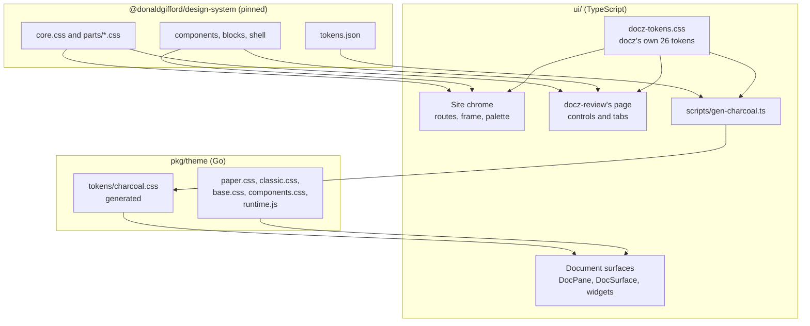
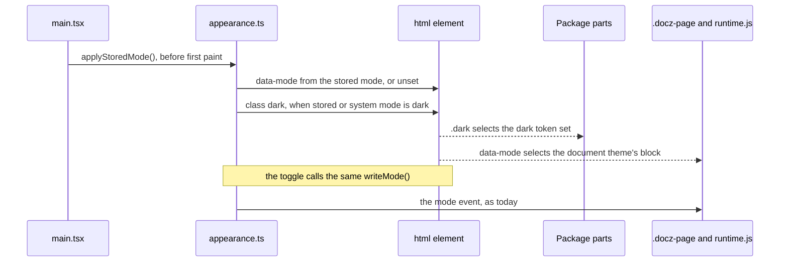
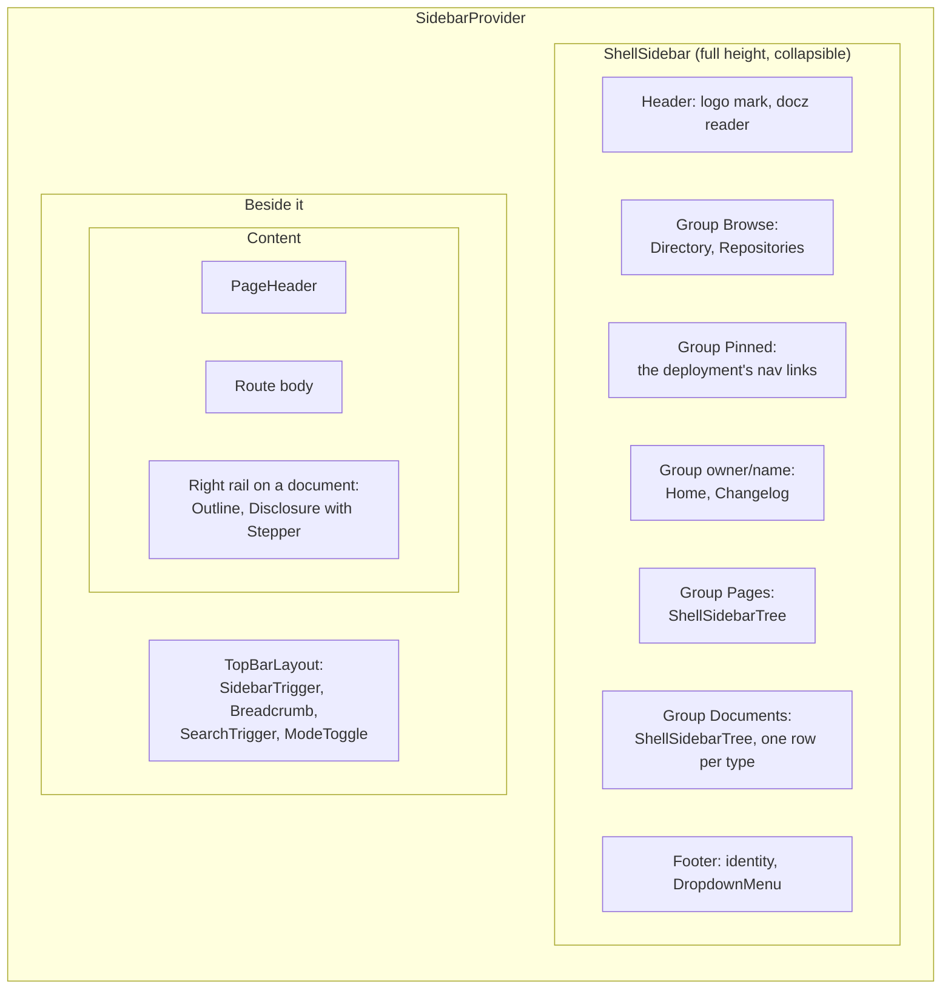
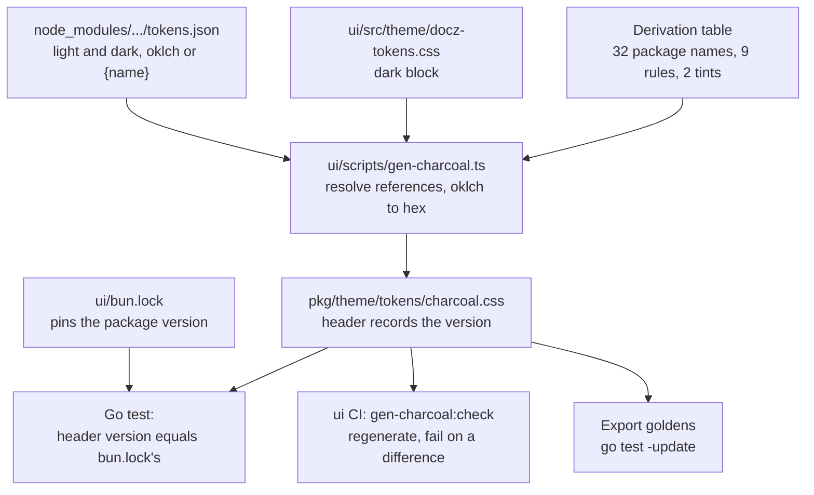

<!-- markdownlint-disable-file MD025 MD041 -->

# DESIGN-0028: docz-site and docz-review's page on the shared design-system package

<!--toc:start-->
<!-- markdownlint-capture -->
<!-- markdownlint-disable MD013 -->
- [Overview](#overview)
- [Goals and Non-Goals](#goals-and-non-goals)
  - [Goals](#goals)
  - [Non-Goals](#non-goals)
- [Background](#background)
- [Detailed Design](#detailed-design)
  - [1. What changes and what stays](#1-what-changes-and-what-stays)
  - [2. Installing the package](#2-installing-the-package)
  - [3. The stylesheet](#3-the-stylesheet)
  - [4. Two vocabularies, split by where the element is](#4-two-vocabularies-split-by-where-the-element-is)
  - [5. The mode switch](#5-the-mode-switch)
  - [6. The frame](#6-the-frame)
  - [7. The parts](#7-the-parts)
  - [8. Status and type colours](#8-status-and-type-colours)
  - [9. Site-rendered code](#9-site-rendered-code)
  - [10. docz-review's page](#10-docz-reviews-page)
  - [11. The Go side: charcoal from tokens.json](#11-the-go-side-charcoal-from-tokensjson)
  - [12. The bundle budget](#12-the-bundle-budget)
  - [13. The test environment](#13-the-test-environment)
- [API / Interface Changes](#api--interface-changes)
- [Data Model](#data-model)
- [Testing Strategy](#testing-strategy)
- [Migration / Rollout Plan](#migration--rollout-plan)
- [Open Questions](#open-questions)
  - [1. What is the new bundle budget, and when is it set?](#1-what-is-the-new-bundle-budget-and-when-is-it-set)
  - [2. What is docz's accent utility renamed to?](#2-what-is-doczs-accent-utility-renamed-to)
  - [3. Which parts of the chrome keep a type's colour on that type's routes?](#3-which-parts-of-the-chrome-keep-a-types-colour-on-that-types-routes)
  - [4. Does the generated charcoal carry a light mode?](#4-does-the-generated-charcoal-carry-a-light-mode)
  - [5. Which token do the workflows use to install?](#5-which-token-do-the-workflows-use-to-install)
  - [6. Which Shiki themes does site-rendered code use?](#6-which-shiki-themes-does-site-rendered-code-use)
  - [7. Where does the charcoal generator live?](#7-where-does-the-charcoal-generator-live)
  - [8. How does the work merge?](#8-how-does-the-work-merge)
  - [9. Does this design add the app switcher from the mockup?](#9-does-this-design-add-the-app-switcher-from-the-mockup)
  - [10. What happens to the hand-drawn sketches?](#10-what-happens-to-the-hand-drawn-sketches)
- [References](#references)
<!-- markdownlint-restore -->
<!--toc:end-->

<!--docz:overview:start-->
## Overview

docz-site and docz-review's page stop carrying a hand-made copy of
repo-guardian's look and take it from `@donaldgifford/design-system`
instead: its tokens, its primitives, and its frame (a full-height sidebar
with a top bar beside it). `pkg/theme`'s `charcoal` theme is generated
from the same package, so the one look has one source in TypeScript and
in Go.

INV-0036 chose this over moving docz into repo-guardian's UI, ran a spike
against docz's gates, and had every gap it found fixed upstream. This
document is the design that investigation asked for.

<!--docz:overview:end-->

## Goals and Non-Goals

<!--docz:goals:start-->
### Goals

- The site's chrome is drawn by the package's parts on the package's
  tokens, in the package's frame. `shell.css` and the duplicated dark
  token block are gone.
- docz-review's page adopts the package in the same piece of work, so the
  two entries of `ui/` share one set of controls.
- `pkg/theme`'s `charcoal.css` is generated from the package's
  `tokens.json`, and two checks hold it to the version `ui/bun.lock` pins.
- A document reads exactly as it does today. The document pane, the
  document themes, the markdown pipeline, and the widgets are not
  restyled.
- Every gate docz has today still holds: 4.5:1 contrast in both modes, the
  unit suite in jsdom, the axe sweeps, the image build, and a bundle
  budget (with a new number).
- docz builds none of the package's parts locally. A missing part is an
  issue on the package, as design-system#32 was.

<!--docz:goals:end-->

<!--docz:non-goals:start-->
### Non-Goals

- Moving docz into repo-guardian's UI (INV-0036's option B, ruled out).
- A second look, or any change to the package's design. Where docz and
  the package differ, docz adopts the package's choice.
- Changing `pkg/theme`'s public surface: its theme names, its token
  names, `data-mode`, the `docz:mode` storage key, and `runtime.js`'s
  contract all stay.
- Moving the widgets onto the package's `flow` and `stepper` blocks
  (INV-0036 question 6). The three surfaces stay on one corpus.
- Replacing react-router, orval, or vitest with what repo-guardian uses.
- Any change to docz-api, the CLI, or the Helm chart's values.

<!--docz:non-goals:end-->

<!--docz:background:start-->
## Background

DESIGN-0026 gave docz-site repo-guardian's look by copying its tokens into
`ui/src/theme/shell.css` and mapping them onto docz's own names. It listed
"importing a design-system package" as a non-goal because none existed.
One does now, repo-guardian moved onto it on 2026-11-18, and the
package's own RFC-0001 names docz as its second consumer.

INV-0036 settled the following, and this design does not reopen any of
it:

<!-- markdownlint-capture -->
<!-- markdownlint-disable MD013 -->

| Decided in INV-0036 | Answer |
| --- | --- |
| Adopt the package, or move into repo-guardian's UI | Adopt the package |
| The frame (question 1) | The package's sidebar and top bar |
| The mode switch (question 2) | The site sets `.dark` and `data-mode`; exports and `pkg/theme` do not change |
| How `pkg/theme` gets the tokens (question 3) | A recipe generates `charcoal.css`, after `just vendor-mermaid` |
| docz's extra colours (question 4) | Shared steps went upstream; types, alerts, and the rest stay in docz |
| docz-review's page (question 5) | Adopts in the same IMPL |
| The widgets (question 6) | Stay as they are |
| When (question 7) | Now, pinned exactly |
| Site-rendered code blocks (design-system#32 B1) | Follow the page's mode, on a light and dark Shiki pair |
| `Superseded` (design-system#32 A8) | Takes the package's `ignored` variant |
| docz's `accent` name (design-system#32 B3) | docz renames its token |

<!-- markdownlint-restore -->

What the spike measured, on package 0.6.0 (INV-0036 Observations 10 and
12):

- The contrast test passes 428 of 428 once it can follow `var()` into the
  package's tokens and convert oklch. The unit suite passes 1439 of 1439
  with a `matchMedia` stub. `tsc -b` and eslint pass.
- `Dockerfile.ui` builds with the registry token as a build secret, and
  the image holds no token.
- Eager JavaScript goes from 124.0 KB gzipped to 156.6 KB with the frame
  mounted, against a 130 KB budget. This is the one gate that does not
  hold.
- The stylesheet goes from 68.0 KB to 107.9 KB (16.6 KB to 23.6 KB
  gzipped) on `core.css` and the per-part sheets.
- 32 of the shell's 58 token names take their value from the package, and
  each converts to the hex the shell carries today. The other 26 are
  docz's own.

The package is 0.x. Its minors may break, and its 1.0 waits on docz
adopting it.

<!--docz:background:end-->

<!--docz:detailed-design:start-->
## Detailed Design

### 1. What changes and what stays



<!-- markdownlint-capture -->
<!-- markdownlint-disable MD013 -->

| Area | After this design |
| --- | --- |
| `ui/src/app`, `components`, `routes` | Rewritten onto the package's parts and frame |
| `ui/src/review` | Its controls move onto the package's parts; its review logic does not change |
| `ui/src/theme/shell.css` | Deleted |
| `ui/src/theme/tokens.css` | Shrinks to the imports, docz's fonts, the document-scoped utility names, and the prose and chip rules |
| `ui/src/theme/docz-tokens.css` | New: docz's own tokens, light and dark |
| `ui/src/lib/appearance.ts` | Also sets `.dark` |
| `ui/src/markdown` | A Shiki theme pair; nothing else |
| `ui/src/components/doc-pane.tsx`, `doc-surface.tsx` | Unchanged |
| `ui/server`, `ui/review` (the binary) | Unchanged |
| `pkg/theme/tokens/charcoal.css` | Generated; its values move by a step or two |
| `pkg/theme` otherwise | Unchanged |

<!-- markdownlint-restore -->

### 2. Installing the package

`ui/package.json` pins the package exactly (`"0.6.0"`, no caret), as it
pins the two shell fonts. A minor of a 0.x package may break, so every
bump is a reviewed pull request.

`ui/.npmrc` is committed and holds no secret:

```ini
@donaldgifford:registry=https://npm.pkg.github.com
//npm.pkg.github.com/:_authToken=${NPM_TOKEN}
```

GitHub Packages wants a token to read even a public package, so
`NPM_TOKEN` has to be in the environment of every install. The token
always comes from the environment and is never written to a file.

<!-- markdownlint-capture -->
<!-- markdownlint-disable MD013 -->

| Install path | Where the token comes from |
| --- | --- |
| `just ui install`, and `just ci` through `ui::install` | The developer's shell: `NPM_TOKEN=$(gh auth token)`, which needs `read:packages` |
| `ci.yml`: the `ui`, `ui-e2e`, and `plugin` jobs | The workflow token (question 5) |
| `release.yml` and `prerelease.yml`: the docz-review build | The workflow token |
| `Dockerfile.ui` | A BuildKit secret, `--mount=type=secret,id=NPM_TOKEN`, passed on every build |
| Renovate | A `hostRules` entry for `npm.pkg.github.com` with its own encrypted token |

<!-- markdownlint-restore -->

Three details from the spike and from repo-guardian:

- `Dockerfile.ui` copies `.npmrc` beside `package.json` and `bun.lock`
  before the install. The token is never an `ARG` or an `ENV`.
- A cached image build succeeds without the secret, which hides a missing
  one. `docker-bake.hcl` and the CI steps that build the image pass the
  secret on every build, and the `ui` job's install is the check that
  fails when the token stops working.
- An install without `NPM_TOKEN` fails with an authorization error from
  the registry. `just ui install` checks for the variable first and
  prints the `gh auth token` line, so the failure names its fix.

A consequence worth stating: after this, nobody can install `ui/`'s
dependencies without a GitHub token, including a contributor who only
wants to run the site locally. `ui/CONTRIBUTING.md` and `ui/README.md`
say so.

### 3. The stylesheet

`ui/src/theme/tokens.css` stays the one global stylesheet. Its head
becomes:

```css
@import "@donaldgifford/design-system/core.css" source(none);
@source "../";
@source "../../index.html";
@source "../../review.html";
@import "@donaldgifford/design-system/parts/shell/sidebar.css";
@import "@donaldgifford/design-system/parts/shell/top-bar.css";
/* one line per part the site or the review page imports */
@import "./docz-tokens.css";
```

- `core.css`, not `globals.css`. `globals.css` scans the whole package
  and ships five static font files; `core.css` brings Tailwind, the
  tokens, and the `@theme inline` map only.
- `source(none)` is required. Without it Tailwind 4.3 takes the whole
  directory of any file it sees under `node_modules`, and the stylesheet
  is no smaller than with `globals.css`.
- Each package part docz imports gets one `parts/` line, which names that
  part's file and everything it imports. docz writes no `@source` line
  that points into `node_modules`.
- A test reads every `@donaldgifford/design-system/...` import under
  `ui/src` and fails when a part has no matching `parts/` line. A missing
  line does not fail a build; it renders a component without its classes.
- The radius wipe (`--radius-*: initial`) goes. It removes `rounded-md`
  and `rounded-lg` from the build, and the package's components use both.
  docz's own bordered controls that remain keep `rounded-sm`.
- Fonts stay docz's variable `@fontsource-variable` imports in
  `main.tsx`: IBM Plex Sans, JetBrains Mono, and Source Serif 4. The
  package's `fonts.css` is not imported. `--font-sans` and `--font-mono`
  name the same two families the package expects.

### 4. Two vocabularies, split by where the element is

Today every utility in `ui/` is written against docz's token names
(`bg-bg-raised`, `text-fg-muted`): 498 uses in 33 files. The package uses
shadcn's names (`bg-card`, `text-muted-foreground`). After this design
each name set has one place:

<!-- markdownlint-capture -->
<!-- markdownlint-disable MD013 -->

| Where the element is | Names it uses | Why |
| --- | --- | --- |
| Chrome: the frame, routes, the palette, the review page's controls | The package's (`bg-card`, `text-muted-foreground`, `border-border`, `bg-primary`) | One vocabulary with repo-guardian and the package's own parts |
| Inside a `.docz-page`: `DocPane`, `DocSurface`, the markdown components, the widgets | `pkg/theme`'s (`bg-bg-raised`, `text-fg-prose`, `text-t-rfc`) | `page.css` sets these per document theme, and they are `pkg/theme`'s public names |
| Chrome that needs a docz colour: a type dot, an alert | docz's own tokens from `docz-tokens.css` | The package leaves an app's domain colours to the app |

<!-- markdownlint-restore -->

The mapping for chrome, which `shell.css` already records:

<!-- markdownlint-capture -->
<!-- markdownlint-disable MD013 -->

| docz name | Package name | Note |
| --- | --- | --- |
| `bg-base` | `background` | |
| `bg-raised` | `card` | |
| `bg-elevated` | `secondary` | |
| `bg-active` | `surface-pressed` | New in 0.5.0, docz's value |
| `border-default` | `border` | |
| `border-strong` | `border-strong` | New in 0.5.0, docz's value |
| `fg-primary` | `foreground` | |
| `fg-muted` | `muted-foreground` | |
| `accent` | `primary` | See below |
| `on-accent` | `primary-foreground` | |
| `ok`, `warn`, `bad` | `success`, `warning`, `destructive` | |
| `st-proposed` | `info` | |
| `hash-1` to `hash-8` | `category-1` to `category-8` | New in 0.5.0, docz's values |
| `bg-hover`, `border-hairline`, `fg-secondary`, `fg-tertiary` | none | Chrome moves to the nearest package step; the names live on inside documents |

<!-- markdownlint-restore -->

**`accent`.** The package's theme map is `@theme inline`, so `bg-accent`
compiles to `var(--accent)`, the package's hover surface, wherever it is
written. docz's `--color-accent` is the brand colour, used by 47
utilities and 17 `var()` reads. docz's utility name therefore changes
(question 2), in chrome and inside documents alike. The CSS variable
`--color-accent` in `pkg/theme` does not change: it is a public token
name, and exported pages set it. The new utility name is registered
against it:

```css
@theme inline {
  --color-brand: var(--color-accent);
}
```

**docz's own tokens.** `ui/src/theme/docz-tokens.css` is the one
hand-written source for the 26 names the package has no value for: two
surface and border steps, three text steps, `accent-dim`,
`st-superseded`, five alert backgrounds, thirteen type colours, and
`code-bg`. It has a light block at `:root` and a dark block under
`.dark`. The chrome reads the type and alert colours from it; the
generator in section 9 reads its dark block for `charcoal`. Each value
is already fitted to 4.5:1 on the package's surfaces.

**Holding the split.** A test walks `ui/src` and fails on a
document-scoped utility name in a file outside the document surfaces
(`src/markdown`, `doc-pane.tsx`, `doc-surface.tsx`, and the review
page's document view). Without it the two vocabularies drift back
together one class at a time.

### 5. The mode switch

`pkg/theme`, exported pages, and docz-review's document view read
`data-mode` on `<html>` and remember it under `docz:mode`. The package
reads a `.dark` class. The site sets both, from the one function that
already owns the mode:



- `writeMode()` gains one line: toggle `dark` on `<html>` from the stored
  mode, or from the system when nothing is stored.
- With nothing stored, `data-mode` stays unset so each document theme's
  `prefers-color-scheme` block applies, as today. The package has no such
  block, so `appearance.ts` also listens to the media query and updates
  the class when the system changes.
- The top bar's toggle is the package's `shell/mode-toggle`, driven by
  `useAppearance`. docz keeps ownership of storage and of the event; the
  package's part is the button.
- `shell.css`'s three copies of the dark set (the `@theme` default,
  `data-mode="dark"`, and the media query) are deleted with the file.

### 6. The frame

The top bar and per-repository rail are replaced by the package's frame.
One sidebar carries the app's navigation and, on a repository's routes,
that repository's.



- **The app's groups.** `Browse` holds Directory and Repositories.
  `Pinned` holds `enabledNavLinks()`, the deployment's nav links that sit
  in the top bar today, and is absent when there are none.
- **The repository's groups** appear on a repository's routes only. The
  rail's type sections become one `ShellSidebarTree` with a row per type
  and its count. A type's documents load when its row first opens, as
  they do today; the package calls `onOpenChange(true)` for a top-level
  row on the icon rail too, which covers it. The pages tree comes from
  one request and loads nothing on open.
- **Loading inside a tree** is an `InlineLoading` in a
  `ShellSidebarTreeNote`. A bare paragraph in the nested list is not
  valid markup.
- **Breadcrumbs** move from the top of the content into the top bar, as
  the package's `Breadcrumb`.
- **The account menu** moves from the top bar's avatar to the sidebar's
  footer, as a `DropdownMenu`. Sign-out keeps its order: navigate to
  `/login`, then clear the query client.
- **The right rail** stays a column of the content, on a document only:
  the package's `Outline` with `use-active-heading`, and the lifecycle as
  a `Disclosure` holding a vertical `Stepper`.
- **Narrow screens** get the package's sheet in place of the rail's
  hidden state, and the collapsed icon rail and its keyboard shortcut
  come with the frame.
- **`/login` and `/consent`** render outside the frame, as a `Card` on
  the page, since neither has a session to show navigation for.
- **Per-type colour.** A type's routes set `--type-accent` today, and the
  logo mark, the repository badge, the breadcrumb leaf, and the active
  rail item take it. The package draws the active sidebar row on its own
  `sidebar-accent` surface, so which parts keep the type's colour is
  question 3.

### 7. The parts

Every part of the shell, and what draws it at 0.6.0. None is built in
docz.

<!-- markdownlint-capture -->
<!-- markdownlint-disable MD013 -->

| In docz today | After |
| --- | --- |
| Top bar (`AppShell`) | `shell/sidebar`, `shell/top-bar` |
| Repository rail (`RepoNav`, `repo-nav-pages`) | Sidebar groups, `shell/sidebar-tree`, `hooks/use-tree-open` |
| Breadcrumbs (`RepoBreadcrumbs`) | `Breadcrumb`, in the top bar |
| Search button, mode toggle (`AppearanceControls`) | `shell/search-trigger`, `shell/mode-toggle` |
| Account disclosure (`SessionMenu`) | `DropdownMenu` on the sidebar's footer |
| Page hero | `PageHeader` |
| Repository picker and type chips (`directory-controls`) | `FilterBar`, `FilterChip` with `pressed`, `OptionRows` in a `Popover` |
| Search hit rows (`HitRow`, `snippet`) | `ListRow` with `eyebrow`, `detail`, and `render`; `blocks/marked`; `Time` `style="stacked"` |
| Status pill and dot (`badges.tsx`) | `Badge` and `Dot`, by the table in section 8 |
| Type colour on dots and chips | `tone` on `Badge` and `Dot` |
| "show more" | `LoadMore` |
| Metadata table, format buttons (`DocMetaTable`) | `DetailsGrid`, `SegmentedControl` |
| Lifecycle (`LifecycleRail`) | `blocks/disclosure` holding a vertical `Stepper`, `size="sm"` |
| "On this page" (`TocList`) | `blocks/outline`, `hooks/use-active-heading` |
| A type's document table | `DataTable` |
| Repository cards | `Card` |
| Command palette (544 lines) | `CommandDialog` with `CommandFilters`, `CommandFooter`, and `preview` |
| Not found, error, empty, loading (`query-states`) | `EmptyState`, `ErrorState`, `Skeleton`, `InlineLoading` |
| Sign-in and consent | `Card`, `Button` |
| The document pane and document themes | Unchanged, docz's |

<!-- markdownlint-restore -->

Rules that carry over from the code being replaced, because each was
learned the hard way:

- A sign-in provider button stays a real `<a href="/auth/login?...">`,
  rendered through `Button`'s `render` prop. The OAuth redirect has to
  reach the browser.
- A search hit in the palette is a `ListRow` with both `render` (a router
  link) and `onClick` (close the palette). 0.6.0 is the first version
  that runs `onClick` when the link is followed, which is one reason the
  floor is 0.6.0.
- Routes stay lazy (`lazy: () => import(...)`), and the palette's body
  stays out of the eager graph where the package's `CommandDialog`
  allows it.
- No component carries a literal colour. That rule is unchanged; the
  tokens it points at are the package's.

### 8. Status and type colours

A status maps to a `Badge` variant by the groups `lib/colors.ts` already
has. `statusColor()` is replaced by a `statusVariant()` over the same
groups, and the `st-*` tokens leave the chrome.

<!-- markdownlint-capture -->
<!-- markdownlint-disable MD013 -->

| Status group (`lib/colors.ts`) | Statuses | Variant |
| --- | --- | --- |
| draft | Draft | `warning` |
| proposed | Proposed, In Review, In Progress | `info` |
| accepted | Accepted, Active, Approved, Adopted, Completed, Implemented, Concluded | `success` |
| rejected | Rejected, Cancelled, Abandoned | `destructive` |
| superseded | Superseded | `ignored` |
| deprecated | Deprecated, Archived, Paused, Inconclusive | `outline` |
| anything else | | `outline` |

<!-- markdownlint-restore -->

`Superseded` is the one visible change: it is a violet today and takes
the package's `ignored` colour, as design-system#32 decided.

A type's colour is a `tone` handed to `Badge` and `Dot`:
`typeColor(type)` returns the same `var(--color-t-*)` it returns now, from
`docz-tokens.css`. A toned badge is tinted and never filled, which docz
never needed. A custom type with no colour of its own still hashes to one
of eight, now the package's `--category-1` to `--category-8`, which hold
docz's values.

Inside a document nothing changes: `page.css` resolves `--color-t-*`,
`--color-st-*`, and `--color-accent` against the document's theme.

### 9. Site-rendered code

Markdown the site renders itself (pages, a repository's home, the
changelog, and the fallback when a fragment fails) highlights with Shiki
on `tokyo-night` over a code background that stays dark in both modes.
The package's `--code-bg` follows the page, and docz adopts that.

- Shiki renders with a light and a dark theme at once
  (`themes: { light, dark }` with `defaultColor: false`), and CSS picks
  the set from `.dark`. Shiki's inline `style` stays the one place the
  XSS gate allows a `style` attribute.
- `liftThemeContrast` runs once per theme, against that mode's
  `--code-bg`, so both sets hold 4.5:1. `CODE_BG` becomes a pair, and
  its test pins both to the package's tokens.
- Which pair is question 6.
- Code inside a document fragment is `pkg/theme`'s and does not change.

### 10. docz-review's page

`review.html` is `ui/`'s second Vite entry and shares `tokens.css`, so it
takes the package's tokens when the site does. Its controls then move
onto the package's parts: `Button`, `Tabs`, `Dialog`, `Badge`,
`SegmentedControl`, and `InlineLoading`.

- The page has no sidebar. It keeps its own single-column frame with a
  header, on the package's primitives. `shell/sidebar` is not imported
  there, so its JavaScript is not in the review bundle.
- The document view stays in the document's theme inside `.docz-page`,
  and annotations, questions, findings, and the diff keep their logic.
  The diff view is docz's port from Plannotator (INV-0032) and stays;
  the package's `diff-view` block is not adopted here.
- The binary embeds the built page, so it works offline as before. The
  registry token is needed to build the binary and never to run it.
- `release.yml`'s SBOM step itemises the package like any other
  dependency.

### 11. The Go side: `charcoal` from `tokens.json`

`charcoal.css` is repo-guardian's look written by hand from its
DESIGN-0036. It becomes a generated file whose values are the shell's.



- **Source.** The package's `tokens.json`, not its stylesheet. A value is
  an oklch colour or a `{name}` reference to another token, so the
  generator resolves references and needs no CSS parser for the package.
- **oklch stops at the generator.** It writes sRGB hex. `pkg/theme`'s
  tests, `contrast.test.ts`, and the export's goldens keep reading hex,
  `components.css` still holds no literal colour, and `pkg/theme` stays
  standard library only.
- **What it writes.** The token block of `charcoal.css`: 32 names taken
  from the package's dark set; nine that follow from those by rule
  (`link` is the accent, `st-draft` is `warn`, `st-deprecated` is
  `fg-muted`, and so on); the two accent tints at 10% and 30%; and docz's
  own, read from `docz-tokens.css`'s dark block. The font block and the
  header comment's prose stay hand-written, in a template the generator
  fills.
- **The recipe** is `just gen-charcoal`, run after `just ui install`, the
  same shape as `just vendor-mermaid`.
- **Two checks, split by what each job has.** The generated header
  records the package version. A Go test in `pkg/theme` holds it to the
  version `ui/bun.lock` pins, as `TestVendoredMermaid` does for mermaid,
  so a lockfile bump without the recipe fails. The `ui` CI job has
  `node_modules`, so it regenerates and fails on any difference, as
  `gen-themes-check` does. The version is the Go job's half and the bytes
  are the frontend's.
- **CI's `go` path filter gains `ui/bun.lock`.** Without it, a pull
  request that only bumps the package never runs the Go test. The same
  gap exists for mermaid today, and this closes both.
- **What moves.** Only three of charcoal's 58 values equal the shell's
  today. Surfaces move by one or two steps in a channel (`#17191d` to
  `#17191c`), `bad` moves from `#f4645c` to `#f7756e`, and the type and
  hash colours become the shell's. Exported charcoal pages change by that
  much, and their goldens are regenerated with `go test ./... -update`.
  `pkg/theme` is governed by theme name and token name, not by byte, so
  this is not a breaking change.
- **A bump of the package** is therefore three things in one pull
  request: the lockfile, `just gen-charcoal`, and the goldens. A Renovate
  pull request fails both checks until a person runs the recipe on it,
  which is how a mermaid bump already works.

Whether the generated `charcoal` also carries a light mode is question
4, and where the generator's code lives is question 7.

### 12. The bundle budget

The eager JavaScript is 124.0 KB gzipped today against 130 KB. The spike
measured 137.3 KB with a button and a badge and 156.6 KB with the frame
mounted, in both cases with docz's own shell and palette still in the
bundle.

- The frame cannot be lazy: it is the first paint.
- docz's shell, palette, and badges leave as the package's arrive, so
  the final number is below the spike's sum. How far below is not known
  until the last phase.
- What the budget guards does not change: the markdown pipeline, a Shiki
  grammar, mermaid, or the widgets leaking into the eager graph, any of
  which is far larger than the headroom.

The number, and when it is set, is question 1. `bundle-budget.ts`'s
comment is rewritten with the new rationale either way.

### 13. The test environment

- `src/test/setup.ts` gains a `window.matchMedia` stub. The package's
  sidebar reads it and jsdom has none (134 failures without it). The
  `ResizeObserver` stub cmdk needs is already there.
- `contrast.test.ts` gains a resolver that follows `var()` into the
  package's `tokens.css` and converts oklch to hex. Without it the test
  silently loses every mapped token (179 failures as written). The
  conversion is one module, shared with the generator in section 11.
- `shell.test.ts`, which pins the `@theme` defaults to `shell.css`'s
  dark set, is deleted with the file it pins.
- `e2e/appearances.ts` keeps `SHELL_MODES`; its mode setup also has to
  produce the `.dark` class, which it gets for free by going through
  `docz:mode` in storage.

<!--docz:detailed-design:end-->

<!--docz:api-changes:start-->
## API / Interface Changes

No change to docz-api, the OpenAPI contract, the CLI, the CLI's JSON
contract, or the chart's values.

<!-- markdownlint-capture -->
<!-- markdownlint-disable MD013 -->

| Surface | Change |
| --- | --- |
| `pkg/theme` | No API change. `charcoal`'s values move slightly; theme and token names are unchanged |
| `just gen-charcoal` | New recipe, after `just ui install` |
| `just ui ci` | Gains `gen-charcoal:check` |
| `just ui install` | Needs `NPM_TOKEN`, and says so when it is missing |
| `Dockerfile.ui` | Needs the `NPM_TOKEN` build secret; `docker-bake.hcl` passes it |
| `ci.yml`, `release.yml`, `prerelease.yml` | Each install step gets the token; the `go` filter gains `ui/bun.lock` |
| `renovate.json5` | A `hostRules` entry for `npm.pkg.github.com` |
| docz-site's URLs | Unchanged |
| docz-site's look | The frame changes; `Superseded` and site-rendered code change colour |

<!-- markdownlint-restore -->

<!--docz:api-changes:end-->

<!--docz:data-model:start-->
## Data Model

Nothing is stored on a server. In the browser:

- `docz:mode` in `localStorage` is unchanged, and stays the one key the
  reader, exported pages, and docz-review share.
- The sidebar's open or collapsed state and the tree's open rows are new
  client state, kept by the package's `SidebarProvider` and
  `use-tree-open`. Where each is kept (a cookie or `localStorage`) and
  under what key was not checked against 0.6.0; the IMPL records both,
  and the site's cookie handling in `server/` is checked against it.

<!--docz:data-model:end-->

<!--docz:testing:start-->
## Testing Strategy

Gates that exist and must still pass, unchanged in what they assert:

- `contrast.test.ts`: every text and surface pair at 4.5:1, in both
  modes, now reading the package's tokens through the resolver.
- The unit suite (vitest in jsdom), `tsc -b` with the package's source
  under docz's strict settings, and eslint.
- The axe sweeps, in jsdom and in Playwright, over every shell mode.
- `doc-pane.xss.test.tsx` and the markdown XSS suite. Nothing here
  touches what they guard, and they are the proof of that.
- The e2e chunk assertions: mermaid, ELK, and the widgets never load on a
  page without them.
- `gen-themes-check`, `gen-api-check`, and `gen-cli-check`.
- The Go suite, with charcoal's page goldens regenerated once.

New tests:

- The Go test holding `charcoal.css`'s recorded version to `ui/bun.lock`.
- `gen-charcoal:check` in the `ui` job.
- Unit tests for the generator: reference resolution, a cycle, an unknown
  name, and oklch to hex against the values the spike already confirmed.
- The `parts/` line test from section 3.
- The vocabulary test from section 4.
- A test that `applyStoredMode()` and the toggle set `.dark` and
  `data-mode` together, including the system-follow case.
- A `statusVariant()` table test over every status in `STATUS_GROUPS`.

Rewritten rather than kept: each component test whose component is
replaced by a package part (`badges`, `command-palette`, `repo-nav`,
`session-menu`) is rewritten to assert docz's behaviour through the
package's part, not the package's own behaviour. The e2e specs change
their selectors where the frame moved things; `mvp.spec.ts` and
`pages.spec.ts` are the two that drive the navigation.

Checked by hand before the frame merges: the screens in
`ui/design/mockup.html` against the built site in both modes, and an
exported `charcoal` page before and after the generator.

<!--docz:testing:end-->

<!--docz:rollout:start-->
## Migration / Rollout Plan

The order is repo-guardian's: tokens first, components after, the frame
last. The values already agree, so every phase before the frame leaves
the site looking as it does today.

<!-- markdownlint-capture -->
<!-- markdownlint-disable MD013 -->

| Phase | What lands | Visible to a reader |
| --- | --- | --- |
| 1. Install and auth | The pin, `.npmrc`, the token on every install path, Renovate's host rule, the licence check | No |
| 2. Stylesheet and tokens | `core.css`, `docz-tokens.css`, the `accent` rename, the radius wipe removed, `.dark`, the contrast resolver, the `matchMedia` stub | No |
| 3. The Go side | The generator, generated `charcoal.css`, both checks, the path filter, goldens | Exported charcoal pages shift slightly |
| 4. Leaves | Badges, buttons, states, cards, the page header, load more | `Superseded`'s colour |
| 5. Controls and overlays | The palette, the account menu, the filter bar, the segmented control | Small |
| 6. Tables and rails | The type table, the outline, the lifecycle, the details grid | Small |
| 7. The frame | The sidebar and top bar, the tree, breadcrumbs; the Shiki pair | Yes |
| 8. docz-review's page | Its controls | Yes, in the review page |
| 9. Removal | `shell.css`, the old names, the final budget, `ui/CLAUDE.md`, the status flips | No |

<!-- markdownlint-restore -->

- Phase 3 depends on phase 1 only and can run beside the others.
- Whether these are separate pull requests is question 8.
- Rolling back any phase is a revert: nothing is stored, no API changes,
  and the image is built from the tree.
- The package's IMPL-0001 Phase 6 lists this work on its side. When the
  last phase merges, that phase's tasks are closed there, except "switch
  the mode toggle to `.dark` in the export", which INV-0036 question 2
  answered differently and which is reported back as such.
- `ui/CLAUDE.md` is rewritten for the areas that change (the shell, the
  tokens, the fonts note, the radius note), in the phase that changes
  each.

<!--docz:rollout:end-->

<!--docz:open-questions:start-->
## Open Questions

### 1. What is the new bundle budget, and when is it set?

- **a. Raise it to 165 KB in the phase that mounts the frame, then in
  the last phase set it to the measured eager total plus 6 KB.**
  *(recommendation)* 6 KB is the headroom the budget has today (130
  against 124). The spike's 156.6 KB still held docz's own shell, so
  165 KB is a ceiling for the middle phases and not the final number.
- b. Fix it at 160 KB now and do not revisit it.
- c. Keep one number for docz's own code and exclude the package's chunk
  from the measure with a manual chunk.
- d. Other.

> **Resolved 2026-11-23: (a).** 165 KB from the phase that mounts the
> frame; the last phase sets it to the measured eager total plus 6 KB.
> Amended the same day by IMPL-0033 question 4: 165 KB applies from the
> first package import (its Phase 4), since one button and one badge
> already measure 137.3 KB.

### 2. What is docz's `accent` utility renamed to?

- **a. `brand`: `bg-brand`, `text-brand`, with `brand-dim`, `brand-bg`,
  `brand-border`, and `on-brand`.** *(recommendation)* Short, and it is
  what the token means. `pkg/theme`'s `--color-accent` variable keeps
  its name; only the utility key changes.
- b. `doc-accent`, since after the split the name is only used inside a
  document.
- c. No docz name: chrome uses the package's `primary`, and document
  surfaces read `var(--color-accent)` through arbitrary values.
- d. Other.

> **Resolved 2026-11-23: (a).** `brand`.

### 3. Which parts of the chrome keep a type's colour on that type's routes?

- **a. The parts docz hands a colour to: the type's `Dot` and `Badge`
  through `tone`, the open type row's dot in the sidebar tree, and the
  document's own accent inside the pane. The logo mark, the breadcrumb
  leaf, and the active row's surface take the package's colours.**
  *(recommendation)* It uses only what the package offers, and the
  package's rule is that a design difference is the package's design.
- b. Override `--primary` and `--sidebar-primary` on the route's wrapper,
  so every package part on a type's routes takes the type's colour. This
  needs each type colour checked against `primary-foreground`.
- c. Drop the per-type colour from the chrome entirely and keep it inside
  the document only.
- d. Other.

> **Resolved 2026-11-23: (a).**

### 4. Does the generated `charcoal` carry a light mode?

- **a. No: it stays dark only, generated from the package's dark set.**
  *(recommendation)* An exported charcoal page looks as it does today for
  every reader, which is the package's own criterion for this work. A
  light mode can be added later without a new name.
- b. Yes: both modes, as `paper` has. A charcoal page then turns light
  for a reader whose system is light, which is a visible change to
  existing exports.
- c. `charcoal` stays dark only, and a new theme name carries both modes.
- d. Other.

> **Resolved 2026-11-23: (a).** Dark only.

### 5. Which token do the workflows use to install?

- **a. The workflow's own `GITHUB_TOKEN` with `packages: read`, as
  repo-guardian does, with the docz repository granted read access on
  the package.** *(recommendation)* Nothing to rotate. Not checked:
  whether a pull request from a fork can read the package with its
  read-only token. If it cannot, the UI jobs fail on fork pull requests.
- b. A personal access token in a repository secret, `NPM_TOKEN`, with
  `read:packages`. Works the same everywhere secrets reach, expires, and
  never reaches a fork.
- c. Other.

> **Resolved 2026-11-23: (a).** The workflow's `GITHUB_TOKEN`. The fork
> case is checked in the IMPL's first phase.

### 6. Which Shiki themes does site-rendered code use?

- **a. `github-light` and `github-dark`, each lifted for contrast on its
  mode's `--code-bg`.** *(recommendation)* Neutral greys that sit on the
  package's surfaces without a tint. Not checked: what the package's own
  `code-block` uses at 0.6.0; if it names a pair, matching it is better.
- b. Keep `tokyo-night` for dark and add `github-light` for light.
- c. Other.

> **Resolved 2026-11-23: (a).** `github-light` and `github-dark`, unless
> the package's `code-block` names a pair at the pinned version.

### 7. Where does the `charcoal` generator live?

- **a. A Bun script, `ui/scripts/gen-charcoal.ts`, beside
  `gen-themes.ts`.** *(recommendation)* It needs `ui/node_modules` to run
  at all, and it shares the oklch conversion with `contrast.test.ts`, so
  one module is tested once.
- b. A Go program run with `go run`, standard library only, with the
  conversion written a second time in Go.
- c. Other.

> **Resolved 2026-11-23: (a).**

### 8. How does the work merge?

- **a. One pull request per phase into `main`, each leaving the site
  shippable, labelled `dont-release` until the frame, which is a
  `minor`.** *(recommendation)* The values agree, so the middle phases
  are safe to ship, and each review is small.
- b. One pull request for all of it, as repo-guardian's #255 was.
- c. A long-lived branch that phases merge into, released once.
- d. Other.

> **Resolved 2026-11-23: (a).**

### 9. Does this design add the app switcher from the mockup?

- **a. No. The sidebar header is the logo and name, and a switcher is
  its own change.** *(recommendation)* It needs a new runtime setting and
  chart value for the list of apps, which this design otherwise avoids.
- b. Yes: a header menu listing other apps from a new `DOCZ_APP_LINKS`
  setting, links only.
- c. Other.

> **Resolved 2026-11-23: (a).** Not in this design. The app switcher is a
> fast follow after the last phase, as its own change.

### 10. What happens to the hand-drawn sketches?

- **a. Delete `ui/mockup.html` and `ui/design/` in the last phase. The
  package's Storybook is the reference from then on.**
  *(recommendation)* `mockup.html` describes a shell that no longer
  exists, and `ui/CLAUDE.md` calls it the visual source of truth.
- b. Delete `ui/mockup.html` and keep `ui/design/` as INV-0036's record.
- c. Keep both.
- d. Other.

> **Resolved 2026-11-23: (c).** Keep both for now.

<!--docz:open-questions:end-->

<!--docz:references:start-->
## References

- [INV-0036](../investigation/0036-docz-site-on-the-shared-design-system-or-docz-as-a-backend-of.md):
  the investigation this design follows, with the spike's numbers
- [DESIGN-0026](0026-docz-sites-shell-in-repo-guardians-look-and-the-readers.md):
  the shell this replaces, and the document pane this keeps
- [DESIGN-0025](0025-docz-html-standalone-html-pages-from-docz-documents-and-one.md):
  `pkg/theme` and the document themes
- [DESIGN-0024](0024-docz-review-a-blocking-review-page-for-agent-written-documents.md):
  docz-review and its page
- [`ui/design/mockup.html`](../../ui/design/mockup.html) and
  [`ui/design/candidates.html`](../../ui/design/candidates.html): the
  sketch of the frame and the parts asked of the package
- [donaldgifford/design-system](https://github.com/donaldgifford/design-system):
  RFC-0001, IMPL-0001 Phase 6, and
  [issue 32](https://github.com/donaldgifford/design-system/issues/32)
- [donaldgifford/repo-guardian](https://github.com/donaldgifford/repo-guardian):
  IMPL-0037 and
  [pull request 255](https://github.com/donaldgifford/repo-guardian/pull/255)

<!--docz:references:end-->
