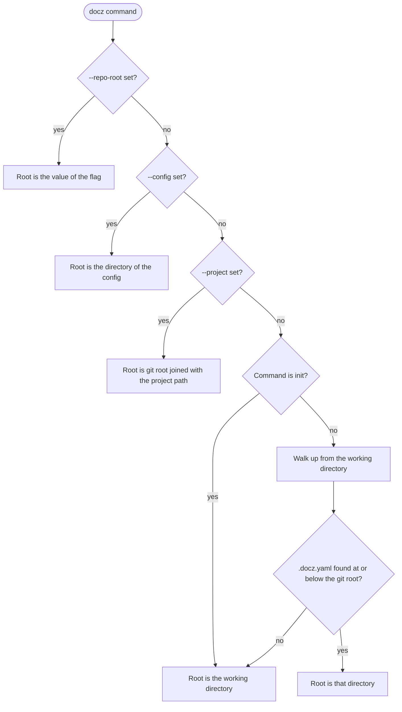
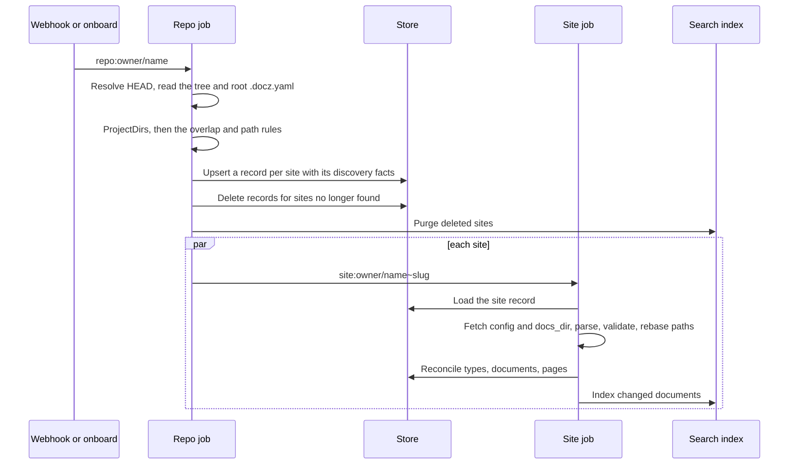
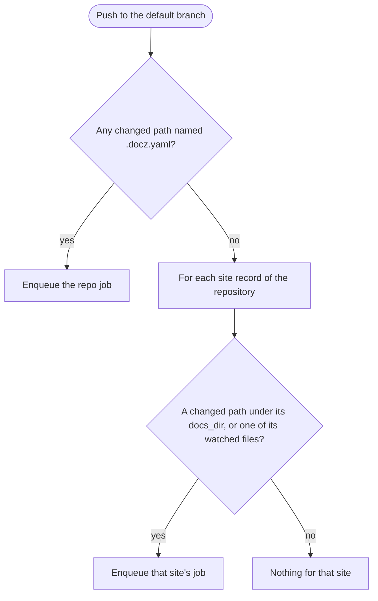
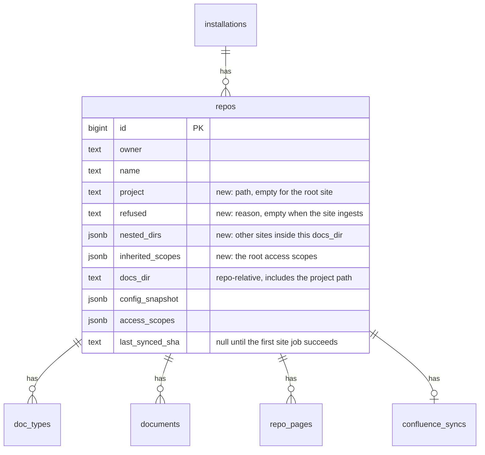

<!-- markdownlint-disable-file MD025 MD041 -->

# DESIGN-0029: Projects: nested .docz.yaml files in one repository

<!--toc:start-->
<!-- markdownlint-capture -->
<!-- markdownlint-disable MD013 -->
- [Overview](#overview)
- [Goals and Non-Goals](#goals-and-non-goals)
  - [Goals](#goals)
  - [Non-Goals](#non-goals)
- [Background](#background)
- [Detailed Design](#detailed-design)
  - [1. The projects: block](#1-the-projects-block)
  - [2. What a project is](#2-what-a-project-is)
  - [3. The CLI](#3-the-cli)
    - [Finding the root](#finding-the-root)
    - [New surface](#new-surface)
    - [Library](#library)
  - [4. Two jobs](#4-two-jobs)
  - [5. The repo job](#5-the-repo-job)
  - [6. The site job](#6-the-site-job)
  - [7. The address](#7-the-address)
  - [8. Webhooks and onboarding](#8-webhooks-and-onboarding)
  - [9. REST, search, and MCP](#9-rest-search-and-mcp)
  - [10. The frontend](#10-the-frontend)
  - [11. What does not change](#11-what-does-not-change)
- [API / Interface Changes](#api--interface-changes)
- [Data Model](#data-model)
- [Testing Strategy](#testing-strategy)
- [Migration / Rollout Plan](#migration--rollout-plan)
- [Open Questions](#open-questions)
  - [1. Is the walk up to the git root on by default?](#1-is-the-walk-up-to-the-git-root-on-by-default)
  - [2. What access does a project get when it writes no access: block?](#2-what-access-does-a-project-get-when-it-writes-no-access-block)
  - [3. How is a docs_dir that leaves its directory treated?](#3-how-is-a-docs_dir-that-leaves-its-directory-treated)
  - [4. What does --all-projects --format json print?](#4-what-does---all-projects---format-json-print)
  - [5. Does a search filtered to a repository include its projects?](#5-does-a-search-filtered-to-a-repository-include-its-projects)
  - [6. Can a project set a display name?](#6-can-a-project-set-a-display-name)
  - [7. Does the root's projects: list also gate the CLI?](#7-does-the-roots-projects-list-also-gate-the-cli)
  - [8. Where does the frontend's project switcher sit?](#8-where-does-the-frontends-project-switcher-sit)
  - [9. Is a site a row of repos, or its own table?](#9-is-a-site-a-row-of-repos-or-its-own-table)
  - [10. Does a push that changes only documents skip the repo job?](#10-does-a-push-that-changes-only-documents-skip-the-repo-job)
  - [11. Which sites does the repo job enqueue?](#11-which-sites-does-the-repo-job-enqueue)
  - [12. Is a site that has never ingested visible?](#12-is-a-site-that-has-never-ingested-visible)
- [References](#references)
<!-- markdownlint-restore -->
<!--toc:end-->

<!--docz:overview:start-->
## Overview

A repository can hold more than one docz tree. The root `.docz.yaml`
lists where the others are, and each one is a complete docz
configuration in its own directory. docz-api calls each tree a **site**,
the root included, and stores one record per site, addressed as
`owner/name` for the root and `owner/name~path~to~project` for a
project.

The server's one ingest job becomes two. A **repo job** finds a
repository's sites and keeps their records; a **site job** ingests one
site. The CLI finds the nearest config above the working directory, and
the site and the MCP server show a project the way they show a
repository.

This document stays `Draft` until the site's move to the design system
(DESIGN-0028, IMPL-0033) is complete, because the frontend work here is
drawn against the frame that move delivers.

<!--docz:overview:end-->

## Goals and Non-Goals

<!--docz:goals:start-->
### Goals

- A service in a monorepo keeps its documents beside its code, with its
  own types, statuses, numbering, and access.
- The CLI works from anywhere inside a project, and from the root can
  list, validate, and update every project.
- The root is not a special case on the server. It is the site with an
  empty path, ingested by the same job as any project.
- One site's failure, or one site's push, touches that site only.
- REST, search, the frontend, and MCP address a project without a new
  route level.
- A repository with no `projects:` block serves exactly what it serves
  today.

<!--docz:goals:end-->

<!--docz:non-goals:start-->
### Non-Goals

- Inheritance from the root config. A project config is complete
  (INV-0037 question 4), with one exception proposed in open question 2.
- Writing a project's documents into the root `docs/<project>/`
  (INV-0037 question 2).
- A repository with only nested configs. The root config stays required
  (INV-0037 question 5).
- A combined wiki nav, Confluence export, or HTML export across
  projects. Each runs per site from its own config (INV-0037
  question 7).
- Projects that declare projects. Only the root's list is read.
- Write access through docz-api. The server stays read-only.
- A workflow engine. Both jobs are tasks on the queue docz-api already
  runs.

<!--docz:non-goals:end-->

<!--docz:background:start-->
## Background

INV-0037 found that the CLI already treats any directory holding a
`.docz.yaml` as a root when run from that directory, and that nothing
connects such a directory to the repository around it:

- The CLI's root is `--repo-root`, else the directory of `--config`,
  else the working directory. It never walks up, so one level below a
  project the defaults apply silently.
- docz-api reads `.docz.yaml` at the tree's root only, and every table,
  route, search key, and MCP argument is keyed on `owner/name`.
- A push that touches only a project's files does not trigger an
  ingest.

All seven of the investigation's questions were resolved as (a). This
design builds that shape, and splits the server's ingest in two so that
a repository and the sites inside it are separate units of work.

| Term | Meaning |
| ---- | ------- |
| Root config | The `.docz.yaml` at the git repository's root |
| Project | A directory, matched by the root's `projects:` block, that holds its own `.docz.yaml` |
| Site | One docz tree as the server stores it: the root, or a project |
| Project path | A project's directory relative to the git root, `services/billing`; empty for the root site |
| Slug | The project path with `/` written as `~`, `services~billing` |
| Label | What the API calls a site: `owner/name`, or `owner/name~slug` for a project |
| Repo job | The queue task that finds a repository's sites |
| Site job | The queue task that ingests one site |

<!--docz:background:end-->

<!--docz:detailed-design:start-->
## Detailed Design

### 1. The `projects:` block

The root config gains one block. It is dormant when absent or empty.

```yaml
projects:
  paths:
    - services/*
    - libs/**
    - tools/docgen
  exclude:
    - services/legacy
```

- **`paths`** are directory patterns relative to the git root. `*`
  matches one path segment, `**` matches any number of segments
  including none, and anything else is literal. A directory is a project
  when a pattern matches it **and** it holds a `.docz.yaml`. A matched
  directory with no config is not an error, so `services/*` can be
  written before every service has documents.
- **`exclude`** are directory prefixes relative to the git root, under
  the same rule as `api.exclude`. An excluded directory and everything
  below it is never a project.
- The root itself is never a project, whatever the patterns say.
- Every entry passes the repo-relative directory rules in
  `pkg/doczcore/config/paths.go`, with `*` and `**` allowed as whole
  segments only. A bad entry is a hard error wrapping a new
  `ErrInvalidProjects`.
- A project path's segments must match `[A-Za-z0-9._-]+`. A matched
  directory that does not is skipped with a warning, because its slug
  could not be read back (section 7).
- A `projects:` block inside a project's own config is ignored, with a
  validation warning that names the root.

Discovery is one pure function in `pkg/doczcore/config`, so the CLI and
the server cannot disagree:

```go
// ProjectDirs returns the project paths among configPaths, the
// repo-relative paths of every .docz.yaml in the tree, sorted.
func (c *Config) ProjectDirs(configPaths []string) (dirs []string, skipped []SkippedProject)
```

The CLI builds `configPaths` by walking only the literal prefixes of the
patterns. The server's repo job filters a tree it fetched.

### 2. What a project is

A project's `.docz.yaml` is an ordinary config, parsed by
`config.ParseBytes` with nothing merged under it. Its `docs_dir` is
relative to the project's directory and defaults to `docs`, so
`services/billing/.docz.yaml` governs `services/billing/docs/`.

Two rules keep sites from colliding:

- A project's `docs_dir` must stay inside the project's directory. The
  CLI warns and the server refuses the site (open question 3).
- No two trees may overlap. If a site's resolved `docs_dir` is inside
  another site's, the inner one is refused and the outer one ingests
  without that directory.

The second rule also settles what the root publishes: the root's pages
and wiki nav skip any directory that is a project's `docs_dir`.

### 3. The CLI

#### Finding the root



- The walk stops at the git root, the first ancestor holding a `.git`
  entry (a directory, or a file in a worktree). It never leaves the
  repository, so `$HOME/.docz.yaml`, the global config, is never taken
  for a repository's.
- Outside a git repository there is no walk and the root is the working
  directory, as today.
- `docz init` never walks. Running it in `services/billing` creates a
  project there. When a root config exists and its `projects:` block
  does not match the new directory, `init` prints the line to add.
- `--project <path>` takes a project path from anywhere in the
  repository. It is an error with `--repo-root` or `--config`, and an
  error when the path is not a discovered project.
- Every branch yields an absolute root. `--repo-root` and the directory
  of `--config` are made absolute first, because a relative root is
  joined twice today and writes land under `<root>/<root>/`
  ([INV-0038](../investigation/0038-a-relative-repo-root-or-config-doubles-the-root-empty-reads-and.md)).
  That fix ships on its own and this design depends on it.

The walk is the one behaviour change for a repository with no
`projects:` block: a command run from a subdirectory now finds the
root's config where it used to apply the defaults.

#### New surface

| Command | What it does |
| ------- | ------------ |
| `docz projects` | Lists the root and each project: path, `docs_dir`, enabled types, document count. `--format json` is a new governed schema, `api/cli/projects.schema.json` |
| `docz list --all-projects` | Lists the root's documents and every project's, with a `PROJECT` column |
| `docz validate --all-projects` | Validates each tree in turn; the exit code is the worst one |
| `docz update --all-projects` | Runs `update` in each tree |

`--all-projects` is accepted at the root only. Every path a project
command prints stays relative to that project's directory, as now;
under `--all-projects` each is prefixed with the project path so it is
relative to the git root. The JSON shape under `--all-projects` is open
question 4.

#### Library

`pkg/doczcore/repo` gains, all additive:

- `FindRoot(start string) (root, gitRoot string, err error)`, the walk.
- `Projects(ctx, gitRoot string, cfg *config.Config) ([]Project, error)`
  with `Project{Path, Root, Cfg}`, each a root a caller can hand to
  `Repo{Root, Cfg}`. `Root` is `gitRoot` joined with `Path`, so it is
  absolute whenever `gitRoot` is, and `FindRoot` returns both absolute.

`config.Config` gains `Projects ProjectsConfig{Paths, Exclude}` with
yaml and json tags. `config` is frozen at its v1 shape; a new field with
a dormant zero value is additive under that rule.

### 4. Two jobs

docz-api has one ingest task per repository today, `ingest:owner/name`,
which fetches, parses, and reconciles in one run. That task splits into
two, both on the same queue with the same failure logging and the same
cleared-not-coalesced rule for a finished task.

| | Repo job | Site job |
| --- | --- | --- |
| Task id | `repo:owner/name` | `site:owner/name` or `site:owner/name~slug` |
| Unit | One GitHub repository | One site |
| Reads | The tree and the root `.docz.yaml` | The site's `.docz.yaml` and the files under its `docs_dir` |
| Writes | Which site records exist, and the facts that span sites | One site's types, documents, pages, index, changelog |
| Fails when | The root config is missing, unparseable, or its `projects:` block is invalid | That site's config is invalid, or a fetch fails |
| Then | Enqueues a site job for every site | Enqueues that site's Confluence export, as ingest does today |



A repository with no projects runs one repo job and one site job, for
the root.

### 5. The repo job

1. Resolve the default branch's HEAD and read the recursive tree.
2. Read the root `.docz.yaml`. A missing or unparseable file, or an
   invalid `projects:` block, fails the job and changes nothing. Any
   other fault in the root config is the root site job's to report, so
   a bad `api:` path in the root does not stop projects from ingesting.
3. Run `ProjectDirs` over the tree's `.docz.yaml` paths. The site set is
   the root plus every project.
4. Apply the rules that need more than one site in view, and record the
   result on each site's record as its **discovery facts**:
   - `refused`, with a reason, for a project whose path cannot form a
     slug or whose tree overlaps another's;
   - `nested_dirs`, the other sites' `docs_dir`s that sit inside this
     site's, which the site job leaves out;
   - `inherited_scopes`, the root's `access.scopes` (open question 2).
5. Upsert a record for every site and delete the records of this
   `owner/name` that are no longer in the set, purging each deleted
   site from the search index.
6. Enqueue a site job for every site that is not refused.

**Truncated trees.** GitHub truncates a recursive tree past about
100,000 entries, and `resolveHead` fails on that today. The repo job
falls back to reading the recursive tree of each pattern's literal
prefix (`services` for `services/*`), which is all discovery needs. A
pattern that begins with `**` in a repository whose tree truncates
fails the job with a message naming the pattern.

**What the repo job does not do.** It does not parse a project's config
beyond finding its `docs_dir`, read a document, or write a type, a
document, or a page.

### 6. The site job

1. Load the site's record. If it is gone, the site was removed after
   the job was enqueued, and the job ends successfully. A site job
   never creates a record, so it cannot bring a removed site back.
2. Resolve HEAD. Read the trees on the path to the site's directory,
   then the recursive tree of its `docs_dir`. The whole repository's
   tree is not read, so a site's cost does not grow with the monorepo
   around it. The exact GitHub calls are for the implementation plan to
   settle.
3. Read the site's `.docz.yaml` and parse it with `config.ParseBytes`.
4. **Rebase.** Prefix the project path onto `docs_dir`,
   `changelog.file`, `api.landing_page`, and each `api.additional_docs`
   entry. From there `buildDocuments`, `buildPages`, and the record's
   `docs_dir` work on repo-relative paths as they do now, and a
   document's `path` stays a path GitHub can open. The stored
   `config_snapshot` keeps the config as written.
5. Fetch the files under `docs_dir`, less `nested_dirs`, and the files
   the config names outside it.
6. Reconcile the site's types, documents, and pages in one transaction,
   with the content-hash gate, and index what changed.

A site job that fails leaves the site at its last good state and
retries on the queue's schedule. No other site is affected, and the
failure is logged with the site's label.

A site record with no successful ingest yet is not served: it is absent
from `GET /repos`, and its label is a 404.

**Narrower fetch.** `classifyTree` fetches every file in the repository
that matches the docz filename pattern and lets ingest drop the strays.
That goes away with the whole-repository tree: a site job only ever
sees its own `docs_dir`.

### 7. The address

A project's label is `owner/name~slug`. The slug is the project path
with `/` replaced by `~`.

| Path | Label |
| ---- | ----- |
| root | `acme/platform` |
| `services/billing` | `acme/platform~services~billing` |
| `libs/auth/v2` | `acme/platform~libs~auth~v2` |

- GitHub repository names are limited to letters, digits, `.`, `_`, and
  `-`, so a `~` in the `{name}` segment can only be a project. That is
  also why a project path's segments are held to the same set.
- `~` is an unreserved URL character. It needs no escaping in a REST
  path, a frontend route, or an MCP argument.
- One helper, `internal/repolabel`, parses `{name}` into the repository
  name and the project path and formats the reverse. `resolveRepo` in
  `httpapi`, `tools.repo` in `mcp`, and the queue's task ids all call
  it, and nothing else splits a label.
- The `{owner}/{name}` routes, the frontend's `:owner/:repo` routes, and
  the MCP `repo` argument keep their shape. A project is reachable at
  every existing endpoint: types, documents, the HTML fragment, pages,
  index, changelog, and Confluence status.

### 8. Webhooks and onboarding



- A changed `.docz.yaml` at any depth, added, modified, or removed, is
  the only thing that can change the site set or a site's discovery
  facts, so it is what runs the repo job. The repo job then enqueues
  every site, which covers the config change itself.
- A push that changes only documents enqueues the site jobs it touches
  and reads no repository-wide tree. Whether that is right is open
  question 10.
- Installing the App, adding a repository to an installation, and the
  `-onboard` flag enqueue the repo job.
- Removing a repository from the installation deletes all of its site
  records and purges each from the index.
- A burst of pushes coalesces per task id, as now: many pushes to one
  service are one site job.

### 9. REST, search, and MCP

- **`GET /repos`** lists every site the caller may read, root and
  projects. `RepoSummaryDTO` and `RepoDetailDTO` gain `project` (the
  path, empty for the root) and `parent` (`owner/name`, empty for the
  root). Both are additive in `api/openapi.yaml`.
- **Search.** Each site's documents are indexed under their own label,
  so `repo=acme/platform~services~billing` filters to one project with
  no change. The index gains a filterable `parent` attribute. Whether
  `repo=acme/platform` reaches the projects is open question 5.
- **MCP.** The `repo` argument accepts a project's label. `list_repos`
  entries gain `project` and `parent`, and the server instructions and
  tool descriptions say a repository may have projects.
- **Access.** `access.scopes` is read per site, so a project can be
  narrower or wider than its repository. What a project gets when it
  writes no `access:` block is open question 2.
- **Confluence export** runs per site from that site's `sync:` block.
  Its tables are keyed on the site's record and need no change.

### 10. The frontend

The frontend work is drawn against DESIGN-0028's frame and does not
start until IMPL-0033 is complete.

- **Routes** do not change. `:repo` carries `name` or `name~slug`.
- **Repositories page.** A repository with projects renders as one
  entry with its projects listed beneath it, grouped by `parent`. A
  project the reader can see whose root they cannot is listed on its
  own.
- **Inside a repository.** The sidebar's `owner/name` group gains a
  project switcher above Home and Changelog: the root first, then each
  project by path. It is absent for a repository with no projects.
  Choosing an entry goes to that site's home.
- **Breadcrumb.** `owner / name / services/billing / type / id`, with
  the project path as one crumb linking to the project's home.
- **Search results** show the project path beside the repository.

### 11. What does not change

- What a repository with no `projects:` block serves: one site with an
  empty project path and the same label.
- `config.ParseBytes`, the config every site is parsed with.
- The queue itself, its failure logging, and its self-heal; the
  authorization model; the OAuth and MCP transport.
- The chart. No new value is needed.

<!--docz:detailed-design:end-->

<!--docz:api-changes:start-->
## API / Interface Changes

| Surface | Change | Kind |
| ------- | ------ | ---- |
| `.docz.yaml` | `projects: {paths, exclude}` at the root | Additive |
| `pkg/doczcore/config` | `Config.Projects`, `ProjectsConfig`, `ProjectDirs`, `ErrInvalidProjects` | Additive |
| `pkg/doczcore/repo` | `FindRoot`, `Projects`, `Project` | Additive |
| CLI | `--project`, `--all-projects`, `docz projects` | Additive |
| CLI | The root is found by walking up to the git root | Behaviour change |
| `api/cli/` | `projects.schema.json`; see open question 4 | Additive |
| REST | `project` and `parent` on the two repository DTOs | Additive |
| REST | `{name}` accepts `name~slug` | Additive |
| Search | Filterable `parent` attribute | Additive |
| MCP | `repo` accepts a project label; `project`, `parent` in `list_repos` | Additive |
| Queue | `ingest:owner/name` replaced by `repo:` and `site:` tasks | Internal |

<!--docz:api-changes:end-->

<!--docz:data-model:start-->
## Data Model

A site record is a row of the existing `repos` table, with the project
path added. Every other table follows `repo_id` and is untouched.
Whether the table should instead split in two is open question 9.



```sql
ALTER TABLE repos ADD COLUMN project TEXT NOT NULL DEFAULT '';
ALTER TABLE repos ADD COLUMN refused TEXT NOT NULL DEFAULT '';
ALTER TABLE repos ADD COLUMN nested_dirs JSONB NOT NULL DEFAULT '[]';
ALTER TABLE repos ADD COLUMN inherited_scopes JSONB NOT NULL DEFAULT '[]';
ALTER TABLE repos DROP CONSTRAINT repos_owner_name_key;
ALTER TABLE repos ADD CONSTRAINT repos_owner_name_project_key
    UNIQUE (owner, name, project);
```

- The two jobs write disjoint columns. The repo job writes `project`,
  `installation_id`, `default_branch`, and the three discovery facts.
  The site job writes everything else. `UpsertRepo` splits into
  `UpsertSiteDiscovery` and `UpdateSiteContent`, and the second is an
  `UPDATE`, never an insert.
- A record the repo job has just created holds an empty `docs_dir` and
  `config_snapshot` and a null `last_synced_sha` until its site job
  runs. Every read query filters on a non-null `last_synced_sha`.
- `GetRepoByOwnerName` takes the project path. A new
  `ListReposByOwnerName` serves the webhook and removal.
- `DeleteRepoByOwnerName` returns every id it deleted. A new
  `DeleteRepoProject` removes one record.
- `ListRepos` orders by `owner, name, project`, which puts the root
  first.
- The search document's primary key stays `<repo_id>_<doc_id>`.

<!--docz:data-model:end-->

<!--docz:testing:start-->
## Testing Strategy

- **Config.** Table tests for the pattern matcher (`*`, `**`, literal,
  exclude, the root, bad segments) and for `ErrInvalidProjects`.
  `TestJSONTags_MirrorYAML` and `TestConfigJSON_MarshaledShape` cover
  the new field. A fuzz target holds `ProjectDirs` to never panic and to
  return only paths it was given.
- **Parity.** The v1.2.2 goldens run with the root given explicitly, so
  the walk does not reach them. A new test pins that a config with no
  `projects:` block marshals as it did.
- **CLI.** `cmd/` tests build a tree under `t.TempDir()` with a root and
  two projects and drive `FindRoot` by setting the working root on the
  `Runner`, not with `os.Chdir`. Cases: inside a project, below a
  project, `--project`, `init` below a root, no git root, a worktree's
  `.git` file. The contract test validates `docz projects --format
  json` against its schema.
- **Repo job.** A fixture tree with a root, two projects, an
  overlapping project, and a project whose path cannot form a slug: the
  records created, the discovery facts, the refused reasons, the record
  deleted after a project is removed, and the site jobs enqueued. A
  truncated tree takes the per-prefix path.
- **Site job.** One site ingested from a fixture: rebased paths,
  `nested_dirs` left out, a broken config leaving the last good state,
  and a job for a deleted record ending without a write.
- **The two together.** A repository with no projects produces the same
  rows and search documents the single ingest job produces today,
  compared against a recorded baseline.
- **Webhook.** The routing in section 8: a nested `.docz.yaml` added, a
  push to one site, a push to two, and a push to none.
- **Address.** Round-trip tests for `repolabel`, and handler tests that
  a project label resolves, an unreadable one is the same 404 as a
  missing one, and a record with no ingest yet is a 404. The OpenAPI
  contract test covers the new fields.
- **Integration.** The store migration up and down, and the onboard and
  search suites extended with a project.
- **Frontend.** Route tests for the switcher, the grouped repositories
  page, and the breadcrumb, written against the design system's frame.

<!--docz:testing:end-->

<!--docz:rollout:start-->
## Migration / Rollout Plan

The work splits into phases that each ship alone. The frontend waits on
IMPL-0033.

| Phase | Contents | Depends on |
| ----- | -------- | ---------- |
| 1 | `projects:` block, matcher, `FindRoot`, `Projects` in `pkg/` | Nothing |
| 2 | CLI: the walk, `--project`, `docz projects`, `--all-projects` | 1 |
| 3 | Server: the migration and the two jobs, for the root site only | Nothing |
| 4 | Server: discovery, project sites, `repolabel`, webhook routing, DTOs, search, MCP | 1 and 3 |
| 5 | Frontend: switcher, grouped page, breadcrumb, search results | 4 and IMPL-0033 Completed |

- Phase 3 is the job split with no new behaviour: every repository is
  one repo job and one root site job, and the test is that nothing
  served changes. It ships and runs on its own before any project
  exists, so the riskier half of the server work is proven first.
- Each phase is a minor release, with a beta first for phases 3 and 4.
- The migration is safe to apply ahead of the code: the new columns
  have defaults and the widened constraint admits every existing row.
- A task enqueued under the old `ingest:` id before the upgrade is
  handled as a repo job by the new worker, so nothing in flight is
  lost.
- Rolling back phase 4 needs the project records deleted before the old
  constraint can return. The down migration does both.
- Between phases 4 and 5 the frontend lists a project as a plain
  repository card with its label. That is usable, and it is why the
  address was chosen to need no route change.
- This repository gets no `projects:` block. A fixture repository under
  `docz-fixture-*` gets one for the integration suite and the homelab
  check.

<!--docz:rollout:end-->

<!--docz:open-questions:start-->
## Open Questions

### 1. Is the walk up to the git root on by default?

- **a. Yes, for every command but `init`.** *(recommendation)* It fixes
  the silent fall-back to defaults one level below a config, which is
  the worst part of today's behaviour, and the parity goldens pass an
  explicit root.
- b. Only when the root config has a `projects:` block, so a repository
  that has not opted in sees no change at all.
- c. Never by default; a `--find-root` flag or `DOCZ_FIND_ROOT=1` turns
  it on.

### 2. What access does a project get when it writes no `access:` block?

- **a. The root's `access.scopes`.** *(recommendation)* The repo job
  records them on the site as `inherited_scopes`, and the site job uses
  them when the project's raw config has no `access:` key. Otherwise
  adding a project to a restricted repository publishes it to every
  signed-in reader by default. This is the one place a project takes
  anything from the root.
- b. The built-in default, `public:read`, as any config gets. No
  exception to "a project config is complete".
- c. A project is always readable by exactly the root's scopes and its
  own `access:` block is ignored.
- d. A reader needs a scope from the project's list and one from the
  root's.

### 3. How is a `docs_dir` that leaves its directory treated?

- **a. A warning from the CLI, and a refusal on the server for a
  project.** *(recommendation)* `docs_dir` has never been validated, and
  a hard error in the CLI is a break the parity rules do not allow in a
  minor. The server has no such history for projects.
- b. A hard config error everywhere, released as a breaking change.
- c. Left as it is in the CLI, refused on the server.

### 4. What does `--all-projects --format json` print?

- **a. A new envelope per command, `{schema_version, projects: [{project,
  …the existing output}]}`, each with its own schema.**
  *(recommendation)* The existing single-tree outputs keep their
  schemas untouched, and `list`'s bare array stays bare.
- b. The existing shapes with a `project` field added to each entry.
- c. No JSON under `--all-projects` in the first version; text only.

### 5. Does a search filtered to a repository include its projects?

- **a. No. `repo=` is exact, and a new `parent=` filter (and MCP
  argument) selects a repository's projects.** *(recommendation)* An
  existing filter keeps returning what it returns now.
- b. Yes. `repo=owner/name` matches the root and every project.
- c. Exact only, and no `parent` filter in the first version.

### 6. Can a project set a display name?

- **a. No. A project is shown by its path.** *(recommendation)* The path
  is unique, is what the CLI takes, and needs no new config key.
- b. Yes, an optional `project: {name}` in the project's config, shown
  by the frontend and returned by the API beside the path.

### 7. Does the root's `projects:` list also gate the CLI?

- **a. Yes. `--project` and `--all-projects` act only on discovered
  projects; a nested config the root does not list still works when run
  from its own directory, with a note that the root does not list it.**
  *(recommendation)*
- b. The CLI treats any nested `.docz.yaml` as a project, and the list
  matters to the server only.
- c. A nested config the root does not list is an error.

### 8. Where does the frontend's project switcher sit?

- **a. In the sidebar's `owner/name` group, above Home.**
  *(recommendation)* It is the repository's own navigation and the frame
  already has the group.
- b. In the top bar, as a crumb with a menu.
- c. Both: the crumb opens the same menu.
- d. Decide after IMPL-0033 lands, in the phase 5 plan.

### 9. Is a site a row of `repos`, or its own table?

- **a. A row of `repos` with a `project` column.** *(recommendation)*
  One migration, no foreign key renamed, and every existing query keeps
  its shape. The cost is a table whose name means "site", and
  repository facts (`installation_id`, `default_branch`) repeated on
  each of a repository's rows.
- b. Two tables: `repos` holds the GitHub repository and `sites` holds
  everything docz ingests, with types, documents, pages, and the
  Confluence tables re-pointed at `site_id`. The model matches the
  design's words and stores each fact once, at the price of touching
  every query and the search key.
- c. (a) now, with (b) recorded as a follow-up once projects are in
  use.

### 10. Does a push that changes only documents skip the repo job?

- **a. Yes. The webhook enqueues the touched sites' jobs directly, and
  only a changed `.docz.yaml` runs the repo job.** *(recommendation)* A
  document push costs one small fetch for one site, which is the point
  of the split.
- b. No. Every push runs the repo job, which enqueues the sites the
  push touched. One entry point and discovery re-checked on every push,
  for one repository-wide tree read per push.
- c. (a), plus a repo job for every repository on a timer, to repair
  anything a missed webhook left behind.

### 11. Which sites does the repo job enqueue?

- **a. Every site that is not refused, every time.** *(recommendation)*
  The content-hash gate makes an unchanged site cheap, and a root
  config change can alter any site's discovery facts.
- b. Only sites that are new, whose `.docz.yaml` changed in the push, or
  whose discovery facts changed. Fewer jobs in a large monorepo, and a
  comparison the repo job has to get right.

### 12. Is a site that has never ingested visible?

- **a. No. It is absent from every listing and its label is a 404
  until its first site job succeeds.** *(recommendation)* A reader never
  lands on an empty site.
- b. Yes, listed with a `pending` or `failed` state, so an owner can
  see that a project was found and why it is not serving.
- c. Hidden from readers, and reported by a new operator endpoint.

<!--docz:open-questions:end-->

<!--docz:references:start-->
## References

- [INV-0037](../investigation/0037-nested-doczyaml-files-in-one-repository-monorepo-projects-in.md),
  the investigation this design follows
- [INV-0038](../investigation/0038-a-relative-repo-root-or-config-doubles-the-root-empty-reads-and.md),
  the relative-root fault and why every root here is absolute
- [DESIGN-0028](0028-docz-site-and-docz-reviews-page-on-the-shared-design-system.md)
  and
  [IMPL-0033](../impl/0033-docz-site-and-docz-reviews-page-onto-the-design-system-package.md),
  the frame the frontend work waits on
- [DESIGN-0011](0011-api-config-block-index-page-and-additionaldocs-for-docz-api-and.md),
  the `api:` block and the repo-relative path rules
- [DESIGN-0023](0023-a-read-only-mcp-server-in-docz-api-oauth-21-tokens-tools-and.md),
  access scopes and the MCP tools
- [`cmd/root.go`](../../cmd/root.go): `resolveRepoRoot`
- [`internal/queue/job.go`](../../internal/queue/job.go) and
  [`internal/queue/client.go`](../../internal/queue/client.go): the
  ingest task and its id
- [`internal/githubapp/client.go`](../../internal/githubapp/client.go):
  `Fetch`, `classifyTree`, `resolveHead`
- [`internal/ingest/service.go`](../../internal/ingest/service.go): `Run`
- [`internal/webhook/events.go`](../../internal/webhook/events.go):
  `handlePush`, `shouldIngest`
- [`internal/httpapi/handler.go`](../../internal/httpapi/handler.go):
  `resolveRepo`
- [`internal/mcp/tools.go`](../../internal/mcp/tools.go): `tools.repo`

<!--docz:references:end-->
