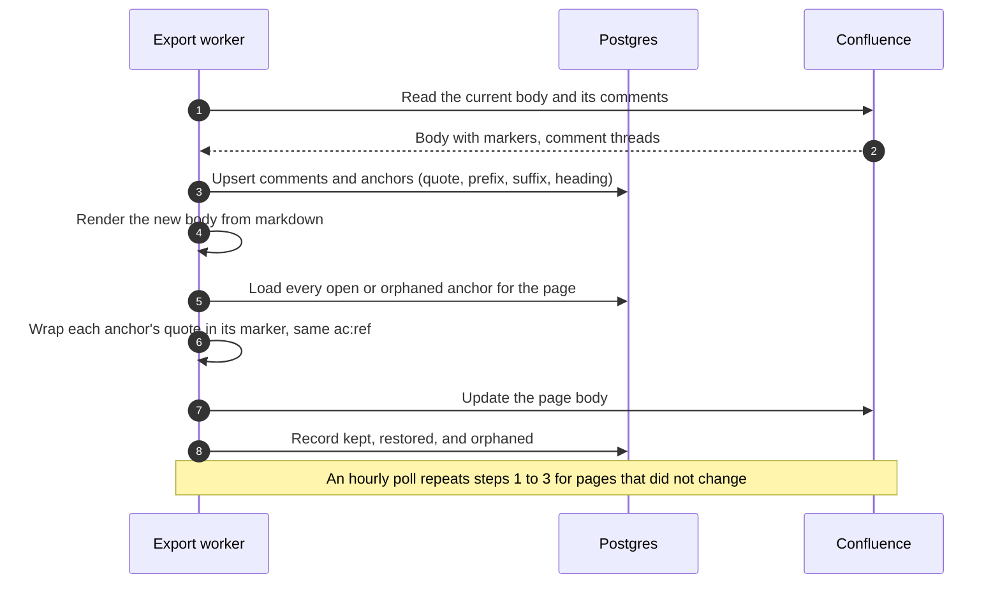
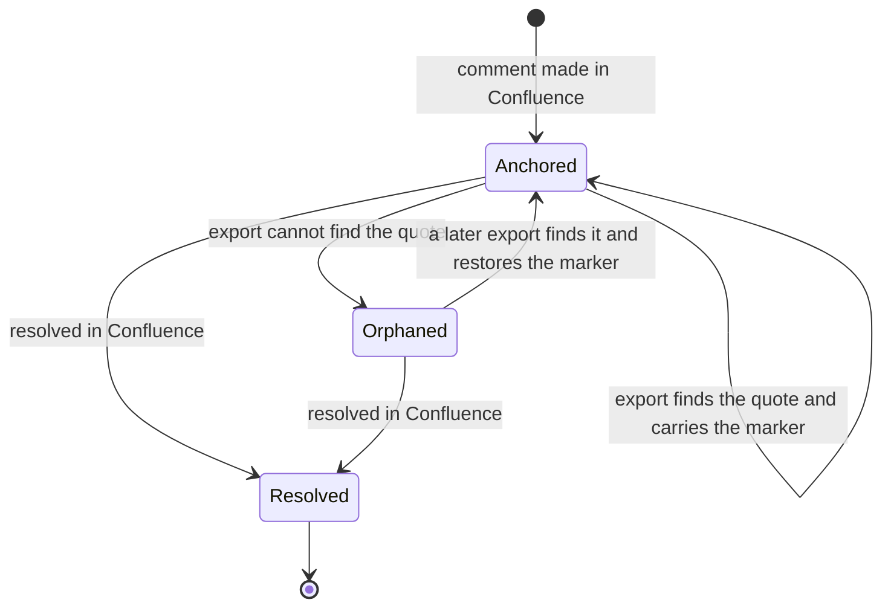

<!-- markdownlint-disable-file MD025 MD041 -->

# INV-0021: Confluence comments as a view layer kept across source changes

<!--toc:start-->
<!-- markdownlint-capture -->
<!-- markdownlint-disable MD013 -->
- [Question](#question)
- [Hypothesis](#hypothesis)
- [Context](#context)
- [Approach](#approach)
- [Environment](#environment)
- [Findings](#findings)
  - [Observation 1: the marker is the only link between a comment and the page](#observation-1-the-marker-is-the-only-link-between-a-comment-and-the-page)
  - [Observation 2: exact-once matching loses more than it has to](#observation-2-exact-once-matching-loses-more-than-it-has-to)
  - [Observation 3: the export already reads the page before it writes](#observation-3-the-export-already-reads-the-page-before-it-writes)
  - [Observation 4: the comment layer must stay out of git](#observation-4-the-comment-layer-must-stay-out-of-git)
  - [Observation 5: showing comments in docz-site crosses a permission boundary](#observation-5-showing-comments-in-docz-site-crosses-a-permission-boundary)
  - [Observation 6: an API update never detaches a comment, so the ref alone restores it](#observation-6-an-api-update-never-detaches-a-comment-so-the-ref-alone-restores-it)
- [Conclusion](#conclusion)
- [Recommendation](#recommendation)
  - [1. Where does the comment layer live?](#1-where-does-the-comment-layer-live)
  - [2. How is an anchor described?](#2-how-is-an-anchor-described)
  - [3. How is a lost anchor put back?](#3-how-is-a-lost-anchor-put-back)
  - [4. When are comments read?](#4-when-are-comments-read)
  - [5. Does docz-site show the comments?](#5-does-docz-site-show-the-comments)
  - [6. What happens to a comment whose text is gone for good?](#6-what-happens-to-a-comment-whose-text-is-gone-for-good)
- [References](#references)
<!-- markdownlint-restore -->
<!--toc:end-->

<!--docz:question:start-->
## Question

Can docz-api record the comments people leave on exported Confluence pages,
so that a comment whose anchored text survives a change to the source
document is put back on the new page, without anything about comments ever
reaching the markdown in git?

<!--docz:question:end-->

<!--docz:hypothesis:start-->
## Hypothesis

Yes. Comments are a layer over the rendered view, not part of the document:
the markdown in git stays the only source, and docz-api keeps the comment
layer beside it in Postgres. With each comment's anchor stored as the text it
was made on, plus some text either side of it, an export can find that text
in a new render more often than today's "the exact text appears once" rule
does, and can restore an anchor that an earlier export dropped. Once the
comments are in the database, docz-site can show them too.

<!--docz:hypothesis:end-->

<!--docz:context:start-->
## Context

**Triggered by:** the Phase B live run (IMPL-0024), where scenario 4 showed
a comment kept while its sentence was unchanged and lost once the sentence
changed.

The Confluence view exists so that people outside the repository can take
part in the docz flow, or at least read a set of the documents docz-api and
docz-site serve. Comments are how they take part: they are for human
discussion, they never change the source document, and they add to the view.

What happens today (#158, DESIGN-0021 §4, `pkg/export/confluence/comments.go`):

- Footer comments are attached to the page and survive any new body.
- Inline comments are anchored inside the body by an
  `ac:inline-comment-marker` element. On an update, `collectMarkers` reads
  the markers in the current body, and `carryMarkers` wraps the same text in
  the new render when it appears there exactly once. The rest are reported
  as lost (`PageResult.Comments.Lost`, `confluence_pages.comments_lost`).
- docz stores nothing about a comment. Once an update drops a marker, the
  marker is gone from the page, so no later export can put it back, even if
  the text returns.

This applies to every type the export writes. INV-0022 proposes leaving IMPL
documents out of the export, so in practice this covers RFCs, ADRs, designs,
investigations, runbooks, and pages.

<!--docz:context:end-->

<!--docz:approach:start-->
## Approach

1. Read the Confluence v2 comment API: list a page's inline and footer
   comments with their replies, and find which fields carry the marker ref,
   the original selection, the resolution status, the author, and the
   timestamps.
2. On the scratch site (`docz-fixture-basic`, RFC-0002), check what happens
   to an inline comment whose marker is dropped. Does its status become
   `dangling`, and does it attach again when a later version of the body
   carries a marker with the same `ac:ref`? Everything else depends on this.
3. Check whether a comment can be re-created through the API on someone's
   behalf, and what that costs: authorship, timestamps, and replies.
4. Measure what anchoring by quote and context gains over exact-once
   matching, by replaying the IMPL-0024 scenarios and the corpus documents'
   git history through both.
5. Sketch the schema and the read path (export time and polling), and what
   docz-site would show.

<!--docz:approach:end-->

<!--docz:environment:start-->
## Environment

| Component | Version / Value |
| --------- | --------------- |
| docz | `v2.0.0-beta.8` |
| Confluence | Cloud, REST v2, through the `api.atlassian.com/ex/confluence/<cloudId>` gateway |
| Scratch site | `dgifford06.atlassian.net`, spaces `DOCZ` and `DOCZ2` |
| Token scopes | Phase B's, plus `read:comment:confluence` (already granted for #158) |
| Fixtures | `donaldgifford/docz-fixture-*` (`test/live/confluence`) |

<!--docz:environment:end-->

<!--docz:findings:start-->
## Findings

### Observation 1: the marker is the only link between a comment and the page

An inline comment points at its anchor through the `ac:ref` of an
`ac:inline-comment-marker` in the body. `carryMarkers` keeps the ref, and
the live run showed the comment kept with the same ref. Nothing outside the
body records the anchor, so once a body without the marker is saved, docz
can't find the comment's text again. The comment still exists in
Confluence, but it is no longer attached to anything in the page.

### Observation 2: exact-once matching loses more than it has to

`carryMarkers` gives up when the marked text appears more than once in the
new render, and also when it was edited at all. A short selection such as
"the API" is usually ambiguous. A quote with a few words of context either
side (the W3C Web Annotation `TextQuoteSelector`: exact, prefix, suffix)
picks the right occurrence in most of those cases. Anchoring to the source
heading the text sits under narrows it further.

### Observation 3: the export already reads the page before it writes

On an `Updated` page, `Client.Body` reads the current body before the new
one is written, so collecting comments at that point costs one or two list
requests per changed page. Unchanged pages are not read today. So comments
made on a page that never changes would only be seen by polling.

With the comment layer, an export of a changed page would run like this:

### Observation 4: the comment layer must stay out of git

Nothing about comments may reach the repository: not the markdown, not a
sidecar file, and not a commit. The store in Postgres is the right place.
It already holds the export's state per page (`confluence_pages`), keyed by
repository and property key, so a comments table can hang off the same key.

### Observation 5: showing comments in docz-site crosses a permission boundary

Confluence decides who can read a comment through its space permissions,
and docz-site through its own login and the `authorize` seam (still
allow-all). Copying comments into docz-api means anyone who can read a
document in docz-site can also read the discussion on it, which may be a
wider audience than the space's.

### Observation 6: an API update never detaches a comment, so the ref alone restores it

Approach step 2, run on 2026-10-16 as `TestLiveInlineCommentReattach`
(`pkg/export/confluence/live_test.go`, under `just export-live`), against
a fresh page in `DOCZ`:

| Step | Body | v2 `resolutionStatus` | Marker in the rendered view |
| --- | --- | --- | --- |
| Comment made on "Postgres" | the original | `open` | yes |
| Update with the sentence reworded and **no marker** | `Reworded. The store is Postgres, as decided.` | `open`, polled for 60 s | no |
| Update with the marker written back under the **same `ac:ref`** | `Back. We chose Postgres for the store.` | `open` | yes |

The comment never became `dangling`. Confluence sets that state from its
own editor's save path, not from a storage-format body written through
the API: after the marker was dropped, the comment stayed `open`, the
page kept listing it, and the rendered view simply had no span carrying
its ref. When a later body carried the ref again, the view rendered the
highlight again. Nothing was done to the comment itself in between.

Two consequences for the shape:

- **Restoring an anchor is a body write and nothing else.** docz does not
  need the comment's thread, author, or status to put it back; it needs
  the `ac:ref` and enough of the quoted text to find the place. That is
  the pair `collectMarkers` already reads on every update.
- **Nothing needs to be stored about the comment, only about the
  anchor.** The anchors a page has ever carried are a few hundred bytes
  per comment (ref, quote, prefix, suffix) and belong beside the page,
  not in a table of their own, which also means the CLI and the server
  can do the same thing: the CLI has no Postgres.

One limit of the run: the v1 content API, which carries the older
`extensions.resolution` field, refused the scoped token (`401`, scope
mismatch), so the v2 status is the only one read. The rendered view is
the stronger evidence anyway, since it is what a reader's highlight is
drawn from.

<!--docz:findings:end-->

<!--docz:conclusion:start-->
## Conclusion

**Answer:** Yes, and with less machinery than the hypothesis assumed.
Decided 2026-10-16 on Observation 6. A comment whose anchor an export
dropped is restored by writing its marker back under the same `ac:ref`
in a later body, with no call on the comment itself (recommendation 3).
The only thing docz has to remember is the anchor, a ref and a quote
with context, which fits in the page's own `docz` property
(recommendation 1) rather than a comments table, and that keeps the CLI
and the server identical. Reading comments on a schedule, and showing
them in docz-site, are not needed for the anchors and are left for a
later design if the discussion is ever wanted outside Confluence.

Next: amend DESIGN-0021 §4 rather than write a new design. The change is
one package, `pkg/export/confluence`: `collectMarkers` keeps every anchor
in the property, `carryMarkers` matches by quote with context instead of
exact-once, and every remembered anchor is tried on every update. Approach
steps 1, 3, 4, and 5 close with the questions below.

<!--docz:conclusion:end-->

<!--docz:recommendation:start-->
## Recommendation

Amend DESIGN-0021 §4 with the answers below and ship the change as one PR.

A comment's anchor moves through these states, all of them docz's own
bookkeeping in the page property; Confluence's `resolutionStatus` is
never written by docz:

### 1. Where does the comment layer live?

- **(a) Postgres in docz-api.** A `confluence_comments` table keyed by
  repository, property key, and comment id holds the thread, its status,
  and its anchor. Git never sees it. *(recommendation)*
- (b) Only in Confluence, as today, with a better anchoring rule in
  `carryMarkers`. That needs no storage, but a dropped anchor stays dropped.
- (c) A page property on each page holding the anchors. It needs no new
  table, but properties have a size limit and the CLI would start writing
  state it can't clean up.
- (d) Other.

> **Resolved 2026-10-16: (c), not (a).** Observation 6 removed the reason
> for a table: docz needs the anchor, not the comment. Anchors go in the
> `docz` property beside `{id, source, hash, version}`, so the CLI and the
> server write the same thing, and a page with no docz property has no
> anchors to keep. The property is already docz's to clean up, since the
> export writes it on every save. Size is bounded by dropping the anchor
> of a comment the page no longer lists (question 6).

### 2. How is an anchor described?

- **(a) A quote with context: the exact text, about 32 characters either
  side, and the source heading it sat under.** It picks the right occurrence
  when the exact text repeats. *(recommendation)*
- (b) The exact text only, as today, but remembered across exports.
- (c) A source position, the markdown line and column. It's precise, but
  any edit above the comment moves it.
- (d) Other.

> **Resolved 2026-10-16: (a).** The quote, about 32 characters of context
> either side, and the heading. The same shape INV-0027 chose for review
> annotations, so one definition serves both.

### 3. How is a lost anchor put back?

- **(a) Write the stored marker, same `ac:ref`, into the next body where
  the anchor matches again.** The original comment, author, and replies come
  back intact. This depends on Approach step 2. *(recommendation)*
- (b) Re-create the comment through the API. It works even if (a) doesn't,
  but the docz bot becomes the author and the replies flatten.
- (c) Don't put it back, and report it in the API so someone can re-comment.
- (d) Other.

> **Resolved 2026-10-16: (a), confirmed live.** Observation 6: the same
> `ac:ref` in a later body renders the comment anchored again, and the
> comment was never marked dangling in between.

### 4. When are comments read?

- **(a) At export, for each page that is updated, plus a slow poll (hourly)
  of every exported page, so docz-site's copy stays current on pages that
  don't change.** *(recommendation)*
- (b) Only at export. It costs nothing extra, but the copy is stale on
  quiet pages.
- (c) Through Confluence webhooks. They need a Connect or Forge app, which
  is a lot of machinery for this.
- (d) Other.

> **Resolved 2026-10-16: (b).** Only at export, and only the markers: the
> body is read before every update already (Observation 3), so a comment
> made on a quiet page is captured by the first update that would have
> dropped it. No poll, because nothing but the anchor is kept.

### 5. Does docz-site show the comments?

- **(a) Yes, read-only, with a link to reply in Confluence, behind a server
  setting that is off by default (Observation 5).** *(recommendation)*
- (b) Yes, and docz-site can post replies to Confluence as the user. That
  needs per-user Atlassian OAuth.
- (c) No. The API stores comments only to restore anchors.
- (d) Other.

> **Resolved 2026-10-16: (c), for now.** Nothing stores the comments, so
> there is nothing to show, and Observation 5's permission question never
> arises. A later design can add a read of the threads if the discussion
> is wanted in docz-site.

### 6. What happens to a comment whose text is gone for good?

- **(a) Keep it in the table as `orphaned`, show it in the API and in
  docz-site under the document with its original quote, and try to restore
  it on later exports.** *(recommendation)*
- (b) Mark it resolved in Confluence after N exports.
- (c) Drop it from the table.
- (d) Other.

> **Resolved 2026-10-16: (a), in the property.** The anchor stays and is
> tried on every update, reported in `PageResult.Comments.Lost` and the
> CLI's `WARNING:` line as today. It is dropped only when the page's
> inline-comment list no longer carries its comment, which is one request
> per updated page and the bound on the property's size.

<!--docz:recommendation:end-->

<!--docz:references:start-->
## References

- Issue [#158](https://github.com/donaldgifford/docz/issues/158): updates
  that keep inline comments
- [DESIGN-0021](../design/0021-confluence-export-from-docz-api-per-repository-folders-in.md)
  §4: comments
- [IMPL-0024](../impl/0024-confluence-export-from-docz-api-folders-comments-and-the-server.md):
  the live run, scenario 4
- [INV-0020](0020-docz-api-confluence-export-running-confluenceexport-without-a.md)
  Observation 8 and Question 11
- [INV-0022](0022-leaving-impl-documents-out-of-the-confluence-export-by-default.md):
  which types are exported
- [`pkg/export/confluence/comments.go`](../../pkg/export/confluence/comments.go) and
  [the Confluence migration](../../internal/store/migrations/20261007000000_add_confluence.sql)
- [W3C Web Annotation Data Model](https://www.w3.org/TR/annotation-model/#text-quote-selector):
  `TextQuoteSelector`

<!--docz:references:end-->
