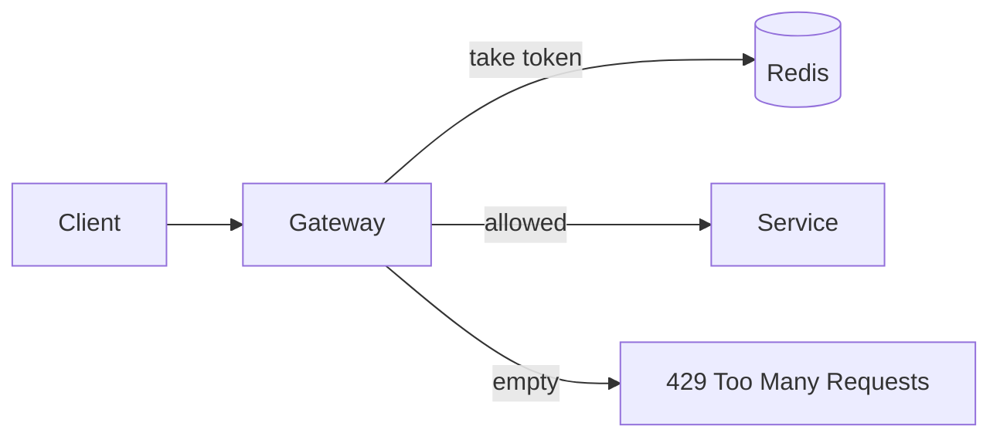

<!-- markdownlint-disable-file MD025 MD041 -->

# DESIGN-0001: Rate limiting for the public API

<!--toc:start-->
<!-- markdownlint-capture -->
<!-- markdownlint-disable MD013 -->
- [Overview](#overview)
- [Goals and Non-Goals](#goals-and-non-goals)
  - [Goals](#goals)
  - [Non-Goals](#non-goals)
- [Background](#background)
- [Detailed Design](#detailed-design)
- [API / Interface Changes](#api--interface-changes)
- [Data Model](#data-model)
- [Testing Strategy](#testing-strategy)
- [Migration / Rollout Plan](#migration--rollout-plan)
- [Open Questions](#open-questions)
  - [1. What does a client get when Redis is down?](#1-what-does-a-client-get-when-redis-is-down)
  - [2. Do internal keys get a limit?](#2-do-internal-keys-get-a-limit)
- [References](#references)
<!-- markdownlint-restore -->
<!--toc:end-->

<!--docz:overview:start-->
## Overview

The public API has no rate limit, and one partner's batch job took the
search endpoint down twice in October. This design adds a per-key limit
at the gateway, with headers that tell a client how much it has left.

<!--docz:overview:end-->

## Goals and Non-Goals

<!--docz:goals:start-->
### Goals

- Cap every API key at a configurable request rate.
- Tell a client its remaining budget on every response.
- Keep the added latency under 2 ms at p99.

<!--docz:goals:end-->

<!--docz:non-goals:start-->
### Non-Goals

- Billing or quota enforcement over a month.
- Limits on the internal service mesh.

<!--docz:non-goals:end-->

<!--docz:background:start-->
## Background

The gateway already authenticates each request by API key and keeps a
Redis connection for sessions, so the limiter can reuse both.

<!--docz:background:end-->

<!--docz:detailed-design:start-->
## Detailed Design

Each key gets a token bucket in Redis, refilled at the key's rate.
The gateway takes one token per request with a Lua script, so the read
and the decrement are one round trip.

The default rate is 50 requests a second with a burst of 100. A key's
rate can be raised in the admin console.

<!--docz:detailed-design:end-->

<!--docz:api-changes:start-->
## API / Interface Changes

Every response carries `RateLimit-Limit`, `RateLimit-Remaining`, and
`RateLimit-Reset`. A refused request is `429` with `Retry-After`.

<!--docz:api-changes:end-->

<!--docz:data-model:start-->
## Data Model

| Key | Type | TTL |
| --- | --- | --- |
| `rl:<api-key>` | hash: `tokens`, `updated` | 10 minutes idle |

<!--docz:data-model:end-->

<!--docz:testing:start-->
## Testing Strategy

Unit tests for the refill arithmetic, an integration test against a
real Redis, and a load test at three times the default rate.

<!--docz:testing:end-->

<!--docz:rollout:start-->
## Migration / Rollout Plan

Ship in report-only mode for a week, logging what would have been
refused, then enforce for new keys, then for every key.

<!--docz:rollout:end-->

<!--docz:open-questions:start-->
## Open Questions

### 1. What does a client get when Redis is down?

- a. Allow the request (fail open).
- b. Refuse with `503` (fail closed).

### 2. Do internal keys get a limit?

- a. No limit.
- b. A high limit, so a runaway job is still caught.

<!--docz:open-questions:end-->

<!--docz:references:start-->
## References

- [ADR-0001: Use a token bucket per API key](../adr/0001-use-a-token-bucket-per-api-key.md)
- [IMPL-0001: Rate limiter rollout](../impl/0001-rate-limiter-rollout.md)

<!--docz:references:end-->
